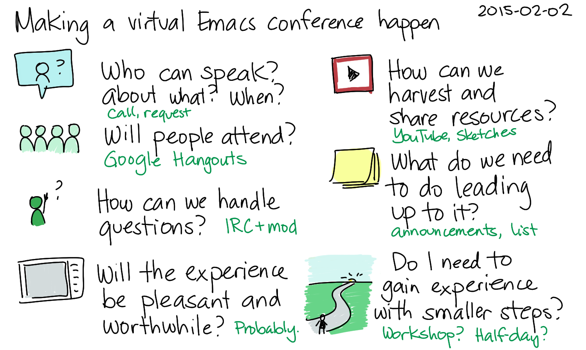
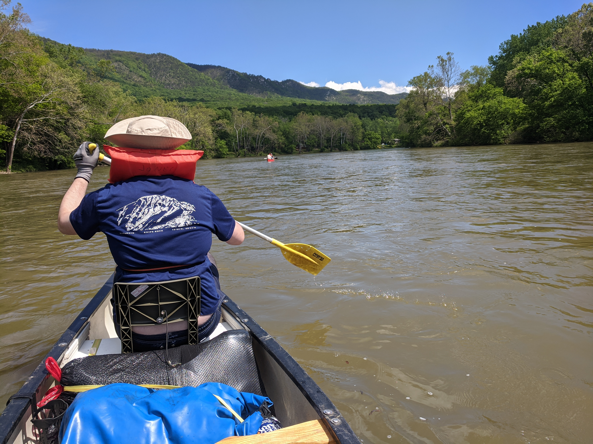
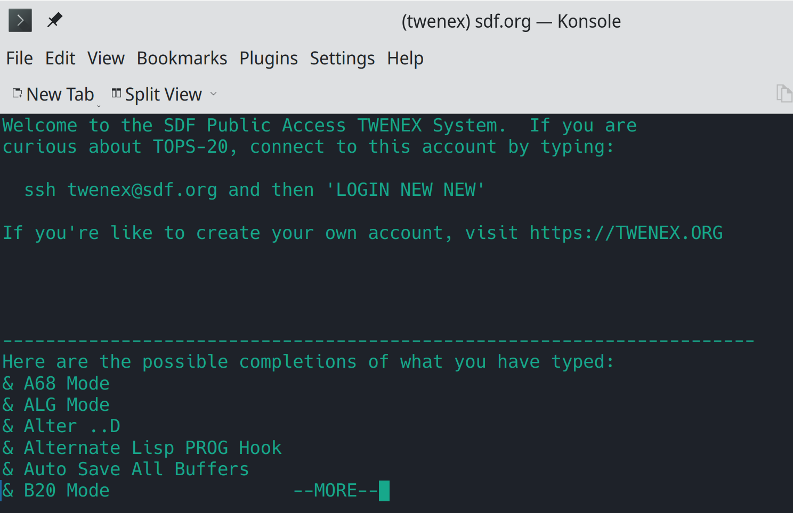
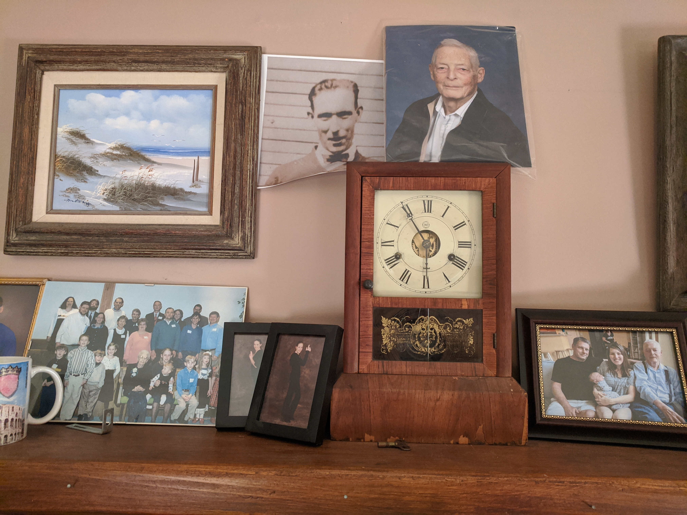
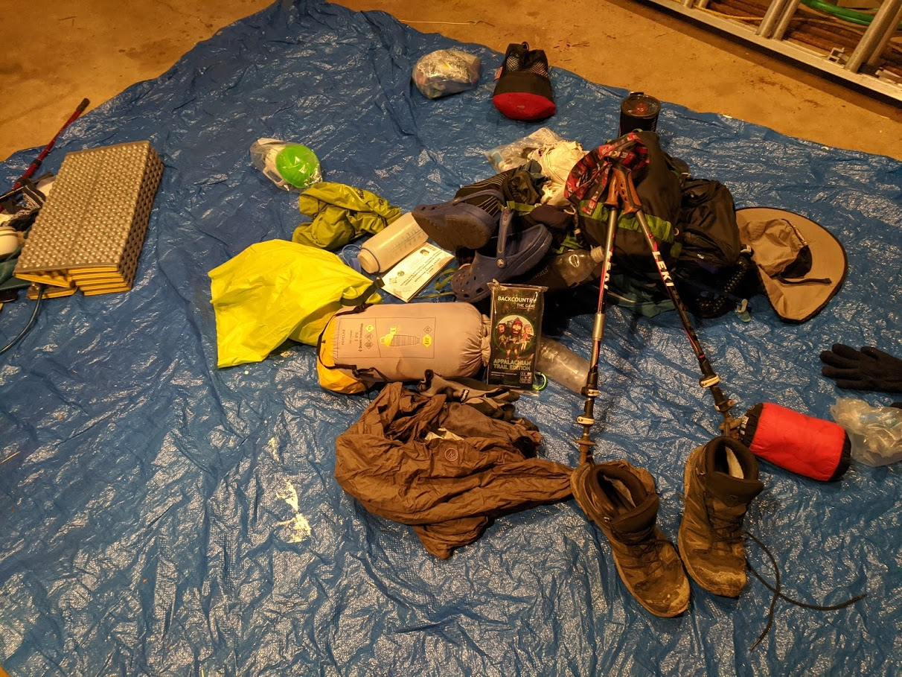
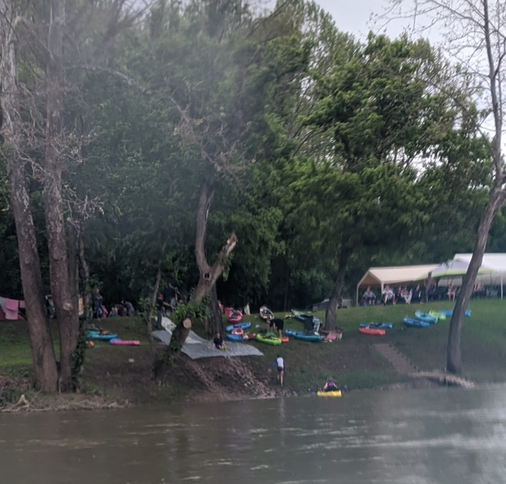
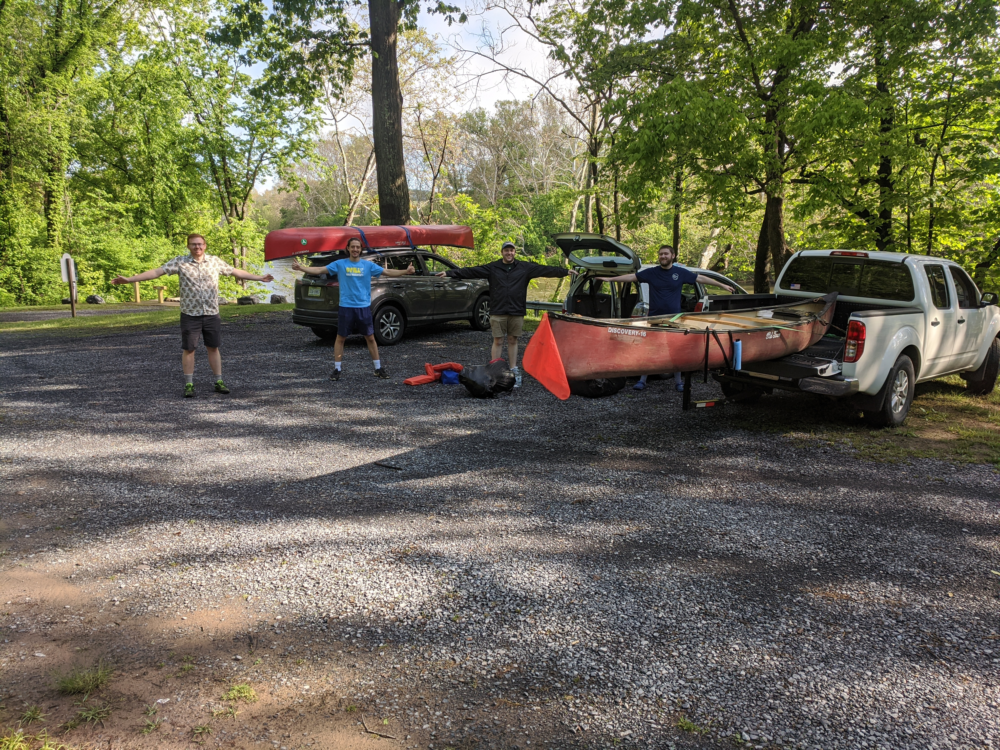
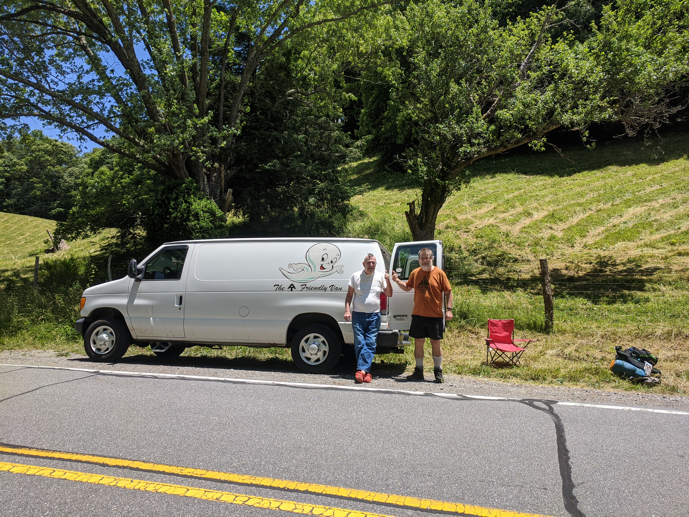
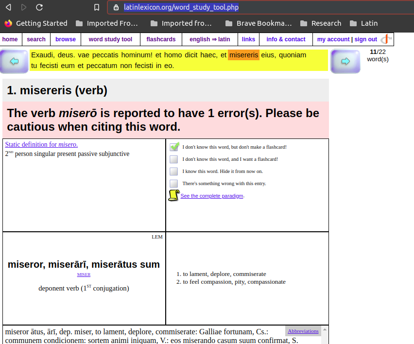

* Headings
#+title: Curious Musings
#+options: num:3 toc:nil \n:nil
#+OPTIONS: tex:t
#+todo: TODO(t) CANCELLED(c) |  WIP(w) PUBLISHED(p)
#+hugo_base_dir: .
#+hugo_auto_set_lastmod: %Y-%m-%d
#+MACRO instagram @@html:@@html:@@https:@@https:@@//www.instagram.com/p/$1

:PROPERTIES:
:EXPORT_HUGO_SECTION:
:END:
* Content
** Blog                                                               :@blog:
:PROPERTIES:
:EXPORT_HUGO_SECTION: Blog
:EXPORT_FILE_NAME:
:EXPORT_HUGO_PUBLISHDATE: <2024-08-05 MON 07:49:03>
:END:
*** Geek Stuff                                                         :geek:
**** PUBLISHED The TNI is dead, long live the TNI  :100DaysToOffload:history:
  :PROPERTIES:
  :EXPORT_FILE_NAME: 2024-04-02
  :EXPORT_HUGO_PUBLISHDATE: 2024-04-02:
  :END:

Today was the day I removed the TNI (Telephone Network Interface) from
my house.   The last vestiges of our land line. The last outpost of a
once vast network.

    #+caption: "This Phone Is Property of Ohio Bell" by George Jones is licensed under CC BY 2.0
    #+attr_html: :width 200px
    file:images/tni2.jpg

#+hugo: more

There used to be vast infrastructure (the Telephone Network) that got
phone calls from place to place. I remember sometime around 1969 (cub
scouts?  Elementary school?) touring the local AT&T building that
housed rows and rows of mechanical switches that routed phone calls in
our neighborhood.  For those with an eye for it, those buildings are
still everywhere to be seen.   Square.  Few windows.  Brick.   In
virtually every neighborhood.

There was the Microwave relay tower near my grandfathers farm. Part
of a nationwide network that supported the "Long lines", where AT&T
made it's money until Judge Green broke it up, costing the world Bell
Labs (creator of the Transistor and Unix) in the process.

I recently stayed at a friends house, vintage 1920s. It has a little
alcove in the wall just off the kitchen that was undoubtedly for "the
phone". Growing up we had "the kitchen phone", and one on my dad's
desk. When it rang sometimes you had to dash to the other room to answer.

Phones like the one pictured above could be thrown down the basement
stairs onto a concrete floor and survive. Not that I would know. Bell
ENGINEERED their hardware.

I'm glad we have moved beyond that technology, but it made the world
move for over a hundred years.

    #+caption: "The TNI about to be removed" by George Jones is licensed under CC BY 2.0
    #+attr_html: :width 200px
    file:images/tni.jpg

Read "[[https://www.amazon.com/Exploding-Phone-Phil-Lapsley/dp/0802122280][Exploding the Phone]]" for an insightful and amusing history of
the phone system, phone phreaks, the rise of hacker culture, and how
Steve Jobs and Woz got their start selling blue boxes in the Berkeley
dorms so students could "steal" long distance calls (my father's
roommate got around the high cost of long distance in the 50's by using
ham radio to "phone home").   The world has changed.

    #+caption: "[[https://www.amazon.com/Exploding-Phone-Phil-Lapsley/dp/0802122280][Exploding the Phone]]"" by Phil Lapsley
    #+attr_html: :width 200px
    file:images/explode.jpg

#59 of #100DaysToOffload take 3.1, https://100daystooffload.com/

**** WIP The unnumbered habits of a questionably effective person :orgmode:emacs:100DaysToOffload:life:
     :PROPERTIES:
     :EXPORT_FILE_NAME: 2022-12-25
     :EXPORT_HUGO_PUBLISHDATE: 2022-12-25
     :END:

   This is two part rant on planning with (and without) Emacs Org Mode,
   shoved together into one post in much the same way as Lennon-McCartney
   songs were shoved together from musical scraps they had laying around.
   My Frankenstein post will probably have less impact and reach than "A
   Day In The Life", Yeah, Yeah, Yeah.

   #+hugo: more

***** Rants on org mode, humanity and Bruce
****** Org mode and planning
   These are reflections getting things done (not GTD).   Or not getting
   things done.   Or yak-shaving with Emacs and org-mode while pretending
   to get things done and really just enjoying the experience either way.
   Maybe that's what org mode is all about anyhow.

   Org mode is the best list making tool I've ever found.  Org capture
   let's you capture thoughts, links, TODO items on the fly in the
   middle of whatever else you're doing and get back to them.  You never
   miss anything.

****** But we're human
   But there are a couple problems.   We're human, not AI-driven lisp
   code knocking off all the TODO items, and we're finite in terms of
   time, attention, focus, money, friends, skills, etc.

   The result is that org mode enables me to grow infinite lists of TODOs.
   The human brain is good at focusing on maybe 3 things at a time.
   The path to despair (long undone lists) is obvious.  Sometimes I just
   give up on org mode lists and do things.

****** Bruce
   Long, Long, ago in a tech company far, far away (CompuServe, Columbus,
   Ohio) there were "how do we migrate off of DEC10 to compete with AOL wars".
   I knew Bruce McNaughton. Bruce moved on from there to be VP of MSN at Microsoft
   for a while. Arguably a "Highly Successful Person" (who I'm pretty sure
   does not use org mode, but does have ligit geek creds).  I asked him
   once how he plans and memories (vague) are that he did not make lists
   (at the time Franklin Planners and then Franklin Planner software were
   all the rage).   That image stuck with me.   Just talk to people and
   do stuff.

****** Concluding Rant
       - It's about enjoying what you do
         + just the act of planning
         + maybe actually getting things done, maybe not
         + a sense of accomplishment (TODO -> DONE)
       - Software can be a tool, a focus, a shiny object or a distraction
       - Software can be tyrannical
         + Computers are good an infinite lists, humans aren't
       - I will die with a TODO list much larger than it is today.

***** My work planning regime with org mode
      That said, here's more-or-less how I plan my days at work.
      Home/personal stuff is similar, but a little less structured.

****** Morning Planning
   - What's in my head :: capture TODOs form the top of my journal (diaty.org)
   - Look at "inputs" :: look at calendar, email and slack in that order.
   - Look at existing porjects/plans :: Look at weekly plans, tasks, etc
   - Juggle all these and figure out what I'm going to try to do that day

****** During the day
   - Capture new stuff and move on :: Quickly capture new asks, TODOs
        (org-capture) and move.
   - Capture info :: capture info (links to HOWTOs, etc in the same file)
   - Keep a calendar open :: Keep a calendar window open so I don't
        miss thigns
   - Turn off all notificatons :: Turn off all email, slack,
        etc. notificatons and pop-iups so I can control my focus.
   - Check email, slack on my schedule :: Check in somewhat frequently
        with slack, email so people can get ahold of me in a somewhat
        timely fashon.   If it's urgent, call or text.  Voice calls seem
        to be a dying breed ("BR 549", "Pensylvania 6-5000")
   - Minimize yak shaving :: I tend to yak-shave a lot.  Like writing
        this post.  Watch it.

****** Organizing Time
   - Do "thinking work early" :: plan do do "thiking work" early in the day
   - Do "collaboration work mid-day" :: do 1:1s, collaboration mid-day
   - Do "meetings late-day" :: Push meetings, interrupts, etc late day

****** Where to store "TODOs"
   - one file :: I increasly just store TODOs, info , etc to one file
        (diary.org) which is a diary-like file organized under
        Year/Month/Day/ENTRY items.
   - project files :: I do have planning files for most projects with
        TODOs etc
   - agenda :: I do use org-agenda to get a roll-up agenda view, but
        more and more I'm just going with the inverse-stack, what's at
        the bottom of my diary.org and using mental prirotization.

***** Projects template

      And because this post is getting too long already, I'll make it
      longer.

      Here is the org project template that I've developed over the last
      decade or so.   I still use it, but I'm moving more and more to
      capturing everything in diary.org/the journal and maybe linking out
      to these project files.

      A couple notes. "OODA" refers to the "[[https://www.oodaloop.com/the-ooda-loop-explained-the-real-story-about-the-ultimate-model-for-decision-making-in-competitive-environments/][OODA Loop]]".  At times, its a
      useful paradigm for thinking about action, think Snoopy and the Red
      Barron: Snoopy _Observes_ the Red Barron, he _Orients_ himself, he
      _Decides_ to let the Red Barron live to fight another day, and the
      _Acts_ by disengaging the dogfight.

      "Cogita", "Fac", and "Dic" are Latin singular imperatives for
      "Think", "Act", "Speak".  Another paradigm for thinking about
      actions.  Figure out what you're doing, gather info, plan, then do
      stuff, then talk about it (blogs, reports, papers, meetings, sales...)

   #+begin_example org
# #+options: ':nil *:t -:t ::t <:t H:3 \n:nil ^:nil arch:headline
# #+options: author:t broken-links:nil c:nil creator:nil
# #+options: d:(not "LOGBOOK") date:t e:t email:nil f:t inline:t num:2
# #+options: p:nil pri:nil prop:nil stat:t tags:t tasks:t tex:t
# #+options: timestamp:t title:t toc:t todo:t |:t
# #+title: PROJECT
# #+date: <2022-12-25 Sun 07:50:58>
# #+author: George Jones
# #+email: ME @ SOMEWHERE
# #+language: en
# #+select_tags: export
# #+exclude_tags: noexport
# #+creator: Emacs 28.0.50 (Org mode 9.3.7)

# This is a project to...(overview/intro)...

# * PROJECT
# ** PROJECT - Info                                                         :cogita:Ooda:
#    - Observe :: Gather Raw Information.
#    - Think (Cogita) :: Thoughts, Brainstorming, etc.
# *** Info about the project
# *** Links
#      - project directory :: file://~/home/private/FOO
#        + change this
#        + create directory
#        + keep project files here.
# *** HOWTOs
#     - Links of HOWTO articles relevant to the project
# ** PROJECT - Background
#    - Add any background info here (old files, plans, projects..)
# ** PROJECT - Planning                                                     :cogita:oODa:
#    - Think :: Think about observations and info gathered
#    - Orient :: "Figure out which way is up"
#    - Decide :: Decide what your doing, which way to go.
# *** Goals
# *** Plans
# ** PROJECT - Action Items                                                    :fac:oodA:
#    - Act/DO (Fac) :: Actions to take on info and plans
# ** PROJECT - Meetings and Reports                                                 :dic:
#    - "After action reports"
#    - Tell people what happened.
#    - Have meetings, write reports, etc. (as needed)

# ** PROJECT - Backlog
   #+end_example

#40 of #100DaysToOffload take 2.1, https://100daystooffload.com/ of #100DaysToOffload take 2.1, https://100daystooffload.com/

**** WIP It's Manjaro !!!                            :linux:100DaysToOffload:
  :PROPERTIES:
  :EXPORT_FILE_NAME: 2022-10-19
  :EXPORT_HUGO_PUBLISHDATE: 2022-10-19:
  :END:

#+hugo: more

#+begin_example
2022-10-17:14:06:52: Installing and migrating to Manjaro
2022-10-17:14:29:04: pacman -Syu # update pacman
2022-10-17:14:30:06: sudo pacman -Syu # update pacman
2022-10-17:14:30:23: sudo pacman -S ed # install ed
2022-10-17:14:32:41: scp -v -r -p 192.168.0.10:~/stow . # copy stow files
2022-10-17:14:33:39: sudo pacman -S stow # instal stow
2022-10-17:14:47:04: # INFO - Arch runs zsh by default. Cool prompt stuff. Not quite bash
2022-10-17:14:59:24: sudo pacman -S emacs
2022-10-17:15:06:51: stow home.public.emacs.d/
2022-10-17:15:07:49: # and emacs just worked tail /home/gmj/var/log/install.org!
2022-10-17:15:14:31: # INFO enable sshd on arch https://linuxhint.com/arch_linux_ssh_server/
2022-10-17:15:26:12: TODO figure out the relationship between bash an zsh on arch. Looks like I'm really running zsh.
2022-10-17:15:26:31: TODO create a backup account
2022-10-17:17:29:28: DONE install all my stow files
2022-10-17:17:37:07: DONE install bind
2022-10-17:17:42:07: DONE installed mlocate
2022-10-18:05:51:17: DONE sudo pacman -S xclip
2022-10-19:06:21:54: TODO figure out how to start bash, not zsh
2022-10-19:06:22:18: IN-PROGRESS backing up ed to archive drive
2022-10-19:06:22:49: IN-PROGRESS copying /home/gmj/home/public /home/gmj/home/private /home/gmj/home/secret to mx
2022-10-19:06:23:21: DONE installed jupyter-notebook and pandas and matplotlib
2022-10-19:06:29:34: DONE sudo pacman -S hugo
2022-10-19:06:33:46: DONE sudo pacman -S community/speedtest-cli
#+end_example

#29 of #100DaysToOffload take 2.1, https://100daystooffload.com/

**** PUBLISHED IPv6 Day                           :100DaysToOffload:Internet:
:PROPERTIES:
:EXPORT_FILE_NAME: 2022-02-11
:EXPORT_HUGO_PUBLISHDATE: 2022-02-11:
:END:

Today was the day I made the choice to live for an entire work-day on
an IPv6-only network.  And it worked.  I've been watching this slow
train comin' for 30 years.  Now I'm holding my breath for [[https://en.wikipedia.org/wiki/Connectionless-mode_Network_Service][CNLP]] :-)

#+hugo: more

I consciously, actively spent an entire day (well, work day) on a
hotspot that was serving up only v6.  This has been 30 years coming.
I was on the big-ip mailing list as far back as 1992 that was
discussing how to get past the impending crisis in 32 big IPv4
addressing.  That was when the Web was just about to happen and I
think getting an allocation may have involved sending email to Jon
Postel.  [[https://en.wikipedia.org/wiki/Classless_Inter-Domain_Routing][CIDR]] was introduced in 1993.  NAT, BGP and DHCP came long,
and countless other engineering and social hacks kept things
functioning (and killed the [[https://en.wikipedia.org/wiki/End-to-end_principle][end-to-end principal]]).

I'm sure I've been using v6 in lots of places (my phone) without doing
any setup or making any choice to enable it, but today was the day I
"turn on" v6 explicitly and lived there for a day.  And it worked.

Ironically, one of the days tasks involved trying to identify and
enumerate usage of v6 in some networks where it appears to have very
little actual deployment.

#6 of #100DaysToOffload take 2, https://100daystooffload.com/

**** PUBLISHED Tech companies I once admired                      :life:tech:
     :PROPERTIES:
     :EXPORT_FILE_NAME: 2021-12-23-companies-I-once-admired
     :EXPORT_HUGO_PUBLISHDATE: 2021-12-23
     :END:

     #+begin_example
     The dream is over,
     what can I say?
     The dream is over,
     yesterday.

     John Lennon, 1970
     #+end_example

    #+caption: "Past their sell-by date." by George Jones is licensed under CC BY 2.0, includes work by [[https://www.vecteezy.com/free-vector/nature][Nature Vectors by Vecteezy]]
    #+attr_html: :width 400px
    

     #+begin_example
     Don't believe in Digital Equipment Corporation,
     Don't believe in Sun Microsystems,
     Don't believe in CompuServe,
     Don't believe in Perl,
     Don't believe in USENIX,
     Don't believe in SourceForge,
     Don't believe in GitHub,
     Don't believe in Facebook,
     Don't believe in Linked-in,
     Don't believe in Google,
     Don't believe in The SANS Institute,
     Don't believe in The Center for Internet Security,
     Don't believe in Google Plus,
     Don't believe in Twitter,
     Don't believe in Spotify,
     Don't believe in Wikipedia,
     ...
     I just believe in me,
     human beings and me.

     Me, 2021
     #+end_example

    This is a list of tech companies I once admired.

    #+hugo: more

***** A tale of two tech companies

      I'll start with two examples.   Writing at Christmas-time 2021,
      I'll categorize the two examples as "naughty and nice".

      The examples will provide "soft" examples of what attracts me to
      tech companies and what drives me away.  Following that, I'll
      break it down more systematically (when, why...)

****** Wikipedia - naughty

      The catalyst for thinking about all this was the revelation that
      Wikipedia, an organization that is built on the backs of
      volunteers can't stop fund-raising (and lying in the process)
      even when flush with cash:
      https://www.theregister.com/2016/12/19/jimmy_wales_breaks_promise_more_chugging/
      and is making plans to further monetize it's volunteers work.
      I'm looking for ways to stop using Wikipedia.  How does it get
      to this point?

****** Wordpress - nice
        Wordpress came off the "naughty" list as I was writing this
        post when I came across this toot
        https://fosstodon.org/@markosaric/107495024812888717 which
        referenced [[https://www.protocol.com/matt-mullenweg][a good article on Matt Mullenweg ]] the CEO of
        Automattic, the company that runs WordPress.com:

 #+begin_quote
 "The cycle plays out the same in tech", he said. Take the internet:
 built as an open platform, eventually colonized by a handful of
 dictatorial players...

 "...But it also contains the seeds of its own demise." Users
 inevitably begin to feel hemmed in and controlled by the closed
 platforms, and yearn for open pastures. Then they go build something
 better. Something open. "People's natural desire for freedom starts to
 get more and more of the best and brightest in the world working on
 open, distributed, decentralized systems."
 #+end_quote

***** How you know the end is near for a company
      - The geeks who started it leave or are edged out by MBAs.
      - The founders, [[https://curious.galthub.com/blog/visionaries/][who had the vision leave]].
      - Free services morph into something that's all about monitization.
      - Volunteers are exploited.

      - The arrival of the unwashed masses ... [[https://encyclopediadramatica.online/Eternal_September][eternal September]].
      - Things are dumbed down.
      - You (the "customer") become the commodity, one of "the target
        audience" that the marketing people try to "reach"
      - When there are hoards of people earning six and seven figure
        salaries that had nothing to do with creating or maintaining
        the value.
      - Slogans like "Learn git and github without any code!" appear on
        sites that are all about code.
      - When you use the phrase "The market leader..."

***** Why do things go bad?
      - Greed, hubris, selfishness (in other words, human nature)
      - The problem of the commons
      - MBAs, marketing people and projects managers run the show.
      - Lies.
      - Loss of trust and good-will.
      - Loss of mission. "It's just a job."
        + The founders with the vision are either gone, no longer or
          charge or fail to communicate and sell the vision (Bezos did
          an excellent job of this with the "[[https://www.aboutamazon.com/about-us/leadership-principles][Amazon Leadership
          Principals]]")

***** So what? Where to go from here?
****** A day in the life (musically inspired metaphors)
      - Go hide out in a New York city townhouse, withdraw from public
        life, bake bread and raise your son until some deranged fan
        kills you? (see Lennon).  Props to @emacsen for the creative
        re-use of the "Dream is over" motif that I stole
        https://emacsen.net/@emacsen/107405795056467815
      - Existential nihilism or hedonism ("Whatever gets you through the night, it's all right, it's all right.")
      - Live your life, enjoy your family ("I'm just sitting here watching the wheels go round and round")
****** My current responses
      - Self hosting ::  I'm self hosting on a raspberry pi.  [[https://curious.galthub.com/][Blog]].
        [[http://git.galthub.com/][Git]].  New domain name (galthub.com). Re-considering increased
        use of my 2001-era hand-edited HTML website:
        http://www.port111.com/george/.  I took a year off blogging and stopped
        pushing any code, HOWTOs, etc to git.
      - Moving back to paid services :: I started my work life at
        Compu$erve.  You paid for what you got.  Then the web happened.
        The advertising business model migrated from print and
        broadcast to where the eyeballs had moved.  And you stopped
        paying.  But you became the product.  Your privacy became a
        commodity or a joke.  I'm increasingly reverting to seeing paid
        services as an "honest" alternative. I'm using paid email
        (fastmail, protonmail), VPN (proton), shared hosting (hurricane
        electric), domain names (namecheap) and may move to others,
        say, high quality professional journalism.  It seems there
        really are no truly free (as in speech or beer) lunch or online
        services.
      - Paper :: For about 30 years I used the phrase "If it requires
        paper, it's the wrong interface".  I'm backtracking on that.
        There are no marketing people, project managers, MBAs,
        data aggregators, or advertisers involved in my journal, and the
        threat models and data loss and protection paradigms are well
        understood.
      - Reconsideration :: In light of recent discoveries, and my
        exploration of the principals of why I move to/away from online
        services in this post, I'm reconsidering Wordpress.  I may
        reconsider others.
      - Pobody's Nerfect :: We live in a messed up world.  The Latin
        Poet Ovid said "In medio tutissimus ibis" (roughly, "you will
        go most safely in the middle.").  While it may be possible to
        use only free software (and grow your own food), most people
        can't live there entirely.

****** If you've got the energy and the vision...

       The world is driven by individuals with vision.  All hail [[https://stallman.org/saint.html][Saint
       IGNUcius]]. There would likely be no free software movement
       without him.  Individuals change tech: Alan Turing, Ken
       Thompson, Donald Knuth, Steve Jobs, Bill Gates, Linus Torvalds,
       Jeff Bezos, etc.

       If you've got the energy, the vision and the talent, go change
       the world.  Or just go tinker around, scratch your own itch and
       share the results.  That's often how the world is changed.

**** PUBLISHED Emacs enlightenment                    :emacs:life:philosophy:
     :PROPERTIES:
     :EXPORT_FILE_NAME: 2021-12-16-emacs-enlightenment
     :EXPORT_HUGO_PUBLISHDATE: 2021-12-16
     :END:

     #+begin_quote
     "...It's also clear you have a achieved emacs enlightenment.   The state
     where you see the whole world through the mind-bogglingly useful
     lens of emacs and org mode and fail to see (non judgmentally) why
     anything should exist outside that world.   'Om, Om, Om, M-x find-universe' :-)"
     #+end_quote

     #+hugo: more

     From [[https://fosstodon.org/@eludom/107456060382723164][a reply to a friend about his latest emacs 'wow' moment.]]

     #+caption: The Enlightened GNU
     #+caption: [[http://emacs.nu/wallpaper/gnu_wallpaper_4_1920.png]["Levitating GNU with Emacs source code" by Macduff is licensed under GPL 2.0]]
     #+attr_html: :width 400px
     

**** PUBLISHED Learn git and galthub without any marketing :blogging:geek:emacs:git:social:marketing:
:PROPERTIES:
:EXPORT_FILE_NAME: no-marketing
:EXPORT_HUGO_PUBLISHDATE: 2021-12-04
:END:

OK, so a year or so later I'm back online with both a self-hosted [[http://git.galthub.com/][git]] and [[https://curious.galthub.com/][blog]]
presence.

I had been using both github for code and github.io for my blog, but
for various reasons I decided to stop putting content there.

- Walled gardens go away ::  Walled gardens go way whenever it stops
  suiting the bottom line of the company.  All the form posts from
  CompuServe (my first employer) are gone AOL Instant Messenger
  messages (another employer) are gone.  Myspace content is gone.
  Twitter, Facebook and Google have been caught regularly censoring
  and deleting material.  Apple, Amazon (another employer) and Google (G+ anyone?) will
  be gone someday, and the user content they host that no longer suits
  their business needs will be gone before that.  I've written at
  length aobut this here [[*40 years of walled gardens & open platforms: Part I][40 years of walled gardens & open platforms:
  Part I]] and here [[*40 years of walled gardens & open platforms: Part II][40 years of walled gardens & open platforms: Part II]]

  #+begin_quote
  Karl Voit nailed it :: https://karl-voit.at/2020/10/23/avoid-web-forums/
  #+end_quote

- "Learn git and github without any code!" :: Really? A site who's
  sole purpose is (was?) to allow programmers to share code puts a
  slogan on top of all it's pages /Learn git and github without any
  code/.  Umm.  No.  Just no.  It appears the marketing people at
  Microsoft totally own the tech-focused site they bought.  The CEO
  left.  They are apparently developing some non-standard tool (of
  course they are, it's Microsoft, "embrace and extend"") "the Github
  CLI" that they want you to use instead of, you know, standard git
  tools that they don't control.  And somehow an inherently
  distributed source code control system is now centralizing all the
  worlds code.  No.  Just no.

- My content, my way :: I just don't want wordpress or atlassian or
  microsoft to reformat my content, add advertising links, require
  people to login or to throw long legal click-throughs and cookie
  disclaimers in front of my public cogitations.

- Using tools I like :: Emacs org mode is going to take me to my
  grave.  I *like* using it.  Using it is a hobby.  It is therapeutic.
  There is a worldwide community built around emacs:
  https://emacsconf.org/2021/. I LIKE using Hugo. See [[*Publishing a blog on Github with Org and Hugo][Publishing a blog on
  Github with Org and Hugo]] (just ignore the
  github bits now).  No need to use the mouse.

- Learning/Geeking :: I /like/ learning how to do things, how
  modern-ish Internet stuff works.  In the process of getting this
  back up, I've registered a new domain name (learning new record
  types, SEO, etc. in the process), discovered http://mysocket.io,
  brushed up on my apache and ansible skills, reinstalled my dead
  raspberry pie, and learned a good bit about configuring gitea

More to come now that I can get it out in a way I feel good about.

**** PUBLISHED Selfhosting a Hugo blog with mysocket.io  :blogging:org:emacs:HOWTO:
:PROPERTIES:
:EXPORT_FILE_NAME: hugo-via-mysocket
:EXPORT_HUGO_PUBLISHDATE: 2021-11-12
:END:

...that time when you realize your blog is hosted on a web site who's
sole purpose is to support coding, and they plaster the motto

#+begin_quote
"Learn Git and Github without any code!"
#+end_quote

all over their site, and you realize that its been
taken over by marketing clones ... and it's time to do your
geekly exit stage left and self host on a raspberry pi or something...

This is a HOWTO of the things I did to migrate my HUGO blog off github
onto a self-hosted raspberry pi using mysocket.io.

The original setup is described here [[*Publishing a blog on Github with Org and Hugo][Publishing a blog on Github with Org and Hugo]]

#+hugo: more

***** Do normal development with local hugo server
In =${HUGO_BASE_DIR}

=gmj@ed blog [master] $ hugo server -v -D=

browse to http//localhost:1313 to see updates in realtime.

***** Update config.toml

      In =${HUGO_BASE_DIR}/config.toml= update the following:

#+begin_example
# baseurl = "https://eludom.github.io/"
baseurl = "https://curious.galthub.com/

#homepage = "eludom.github.io"
homepage = "curious.galthub.com"
#+end_example
***** run hugo to regenerate docs

      The =docs/= directory will be the root of your webserver
#+begin_example
gmj@ed blog [master] $ hugo
Building sites …

                   | EN
-------------------+------
  Pages            | 210
  Paginator pages  |   0
  Non-page files   |   0
  Static files     |  78
  Processed images |   0
  Aliases          |   0
  Sitemaps         |   1
  Cleaned          |   0

Total in 2718 ms
gmj@ed blog [master] $ find . -mtime -^C
gmj@ed blog [master] $ hugo server -v -D^C
gmj@ed blog [master] $ find . -mtime -5 | head
.
./.#curious.org
./curious.org
./docs/index.html
./docs/404.html
./docs/robots.txt
./docs/about/index.html
./docs/about/index.xml
./docs/sitemap.xml
./docs/tags/poetry/index.html
...
#+end_example
***** TODO Copy the files to where the web server is (if needed)

      Which server...
      #+begin_example
      rsync -Cavz docs gmj@hangout:~/blog
      #+end_example
***** TODO Run local webserver
Run a web server with the root pointed at the =docs/= directory
#+begin_example
$ cd ~/blog/docs/
$ python3 -m http.server 1313
#+end_example
***** TODO Set up tunnel
      Set up a tunnel

      =$ mysocketctl connect --port 1313 --name hugo test=
***** TODO Define CNAME
      ...
***** TODO Add the CNAME to the allowed domain names for the tunnel
      ...
***** DONE install apache on raspberry pi using asnible
***** TODO Make sure apache root is on USB thumb drive
***** TODO copy/rsync blog/docs to new apache root
      - cron?
      - Or use sshfs mounting from ed to hangout?
***** TODO redirect apache root to blog
***** TODO set up a new mysocket tunnel for blog/apache
***** TODO set up CNAME curious.galthub.com pointing at tunnel

******* Test it out
        curl http://curious.port111.com
******* Future
******** archive.org?
******** CDN ?
**** PUBLISHED Fixing GNU bash associative array insert speed :programming:gnu:linux:
     :PROPERTIES:
     :EXPORT_FILE_NAME: 20200418
     :EXPORT_HUGO_PUBLISHDATE: 2020-04-18:
     :END:

Bash uses linear search to insert values in to associative arrays.
This is all well and good for small numbers of keys.   I was adding
millions[fn:1].    I went poking around the bash source code today
(2020-04-18) to confirm my suspicion and gauge the difficulty of
adding an option to do something more sensible.

In less than a day after I reported it, there is a patch
https://lists.gnu.org/archive/html/bug-bash/2020-04/msg00114.html My
timing code and pre and post patch timings are here:
https://github.com/eludom/snippits/tree/master/bash/tests

#+hugo: more

Here the steps I took and where I might go if I get serious about
fixing the problem:

***** Get the source code

****** Find it
- find the homepage :: A quick bit of googling lead to the homepage http://savannah.gnu.org/projects/bash/
- use git :: For a minute it looked like GNU was still stuck in the bad old
     days of having to download a tarball and then apply a series
     of patches, but fortunately, it there is a git repo http://savannah.gnu.org/git/?group=bash
****** Download it
#+begin_src bash :eval no
git clone https://git.savannah.gnu.org/git/bash.git
#+end_src
****** Build it

Bash follows a time honored build convention
#+begin_src bash :results output :eval no
./configure
make
#+end_src

****** Analyze it
- I read the NEWS file for any indication that associative arrays
  has been worked on to speed up associative array
  insert/look-ups.  No indication that they had.
- I checked the git commit logs, which appear to be meaningful
  after Bash-4.4 patch 19.  Nothing.
- With judicious use of grep ("grep-find in Emacs") for
  "associative" and "hash_search" it turns out that associative
  array inserts (as all inserts) are done with use of the
  "hash_search" function in =hashlib.c=
- has_insert() begins as follows:
#+begin_src C
/* Create an entry for STRING, in TABLE.  If the entry already
   exists, then return it (unless the HASH_NOSRCH flag is set). */
BUCKET_CONTENTS *
hash_insert (string, table, flags)
     char *string;
     HASH_TABLE *table;
     int flags;
{
  BUCKET_CONTENTS *item;
  int bucket;
  unsigned int hv;

  if (table == 0)
    table = hash_create (0);

  item = (flags & HASH_NOSRCH) ? (BUCKET_CONTENTS *)NULL
                               : hash_search (string, table, 0);
#+end_src
- and there it is, the linear search walking the list in
  =hash_search()=
#+begin_src C
/* Return a pointer to the hashed item.  If the HASH_CREATE flag is passed,
   create a new hash table entry for STRING, otherwise return NULL. */
BUCKET_CONTENTS *
hash_search (string, table, flags)
     const char *string;
     HASH_TABLE *table;
     int flags;
{
  BUCKET_CONTENTS *list;
  int bucket;
  unsigned int hv;

  if (table == 0 || ((flags & HASH_CREATE) == 0 && HASH_ENTRIES (table) == 0))
    return (BUCKET_CONTENTS *)NULL;

  bucket = HASH_BUCKET (string, table, hv);

  for (list = table->bucket_array ? table->bucket_array[bucket] : 0; list; list = list->next)
    {
      /* This is the comparison function */
      if (hv == list->khash && STREQ (list->key, string))
        {
          list->times_found++;
          return (list);
        }
    }
#+end_src

***** Next steps
****** DONE Reach out to the maintainers
see if they would even entertain the idea of a patch
****** CANCELED Look for appropriate in-memory hash insert/lookup functions
- btrees ?
****** CANCELED Code it
****** CANCELED test it
****** CANCELED submit patch
See https://lists.gnu.org/archive/html/bug-bash/2020-04/msg00114.html

***** Footnotes
[fn:17] The Amiga was my first computer. I was the first person to port
an Emacs editor to the Amiga, porting a version of what became
"MicroEmacs" and mg to it and receiving a phone call from one of the
core Amaga engineers at Commodore asking if they could use it
after I posted to comp.sources.amiga

[fn:7] ADS stands for "Attention Distraction Syndrome"

[fn:1] yes, there are many better tools for this job, but not in the constrained environment where this had to run.

**** PUBLISHED HOWTO: Using Pi-hole DNS to block ads.  The struggle continues... :DNS:privacy:networking:HOWTO:
     :PROPERTIES:
     :EXPORT_FILE_NAME: 2020-05-01
     :EXPORT_HUGO_PUBLISHDATE: 2020-05-01
     :END:

/This article is a work in progress.  Updated: 2020-05-02.  This is
turning into a bit of a catch-up on the state of DNS for me./

Day 03 and 04 of #100DaysToOffload.

***** Intro
# Thanks to Paul Vixie for the pointer to

The war against ads continues. https://pi-hole.net/ looks like a
reasonable, good, new?, open source entry in the war against ads. Get
'yer source/install for linux at https://github.com/pi-hole/pi-hole

Per Paul Vixie
#+begin_quote
not even non-technical users need a "public DNS" to shield themselves
from a lot of known-evil internet sites. check out @The_Pi_Hole or
have your 12yo child or cousin install it.
#+end_quote

..but I always make things harder.

#+caption: pi-hole console after a few hours on my system
#+name: pic:pi-hole.png

#+hugo: more

***** What
- It's a local DNS server to block adds.

***** Why
- Blocking ads is a moral good.
- I've not done home network hacking for a while.
- I'm moving into a bit of a more "don't track me" frame of mind.

***** When
- Now, because I'm home more during corona-virus.

***** How
- Set up local server.
- First on a Linux laptop that (usually) does not go off the net.
- Then maybe on an old pogoplug or laptop.

***** Install It

Here's what I did to instlal

- [ ] basic install :: On a Linux server, the *basic* install is
     simple:

     #+begin_example
                 sudo bash basic-install.sh
     #+end_example

- [ ] Static IP :: But you will want a Linux box with a static IP
     address. This may involve, e.g., convincing your wireless
     router to hand out a the same static IP to a static IP

- [ ] Tell other systems to use this IP for DNS :: Again,
     probably configuring your wireless router to specify your local
     IP as the DNS server for DNS assignments via DHCP assignments.
     You could also do this by configuring the individual devices to
     use it.

- [ ] Remember your admin password :: Make note of the admin password during install

- [ ] hit the local admin web server :: Its a very nice.  It will
     be at a something like  http://192.168.86.230/admin/index.php.

***** Test It

- [ ] Look something up by hand :: Use dig(1) or host(1).  Note
     the =SERVER= in the response below that shows where the answer
     came from.  If it's your IPS's DNS or Google, try again
     (something's not configured right).  In my case 127.1 is right.

#+begin_example
$ dig www.uu.net

; <<>> DiG 9.11.3-1ubuntu1.11-Ubuntu <<>> www.uu.net
;; global options: +cmd
;; Got answer:
;; ->>HEADER<<- opcode: QUERY, status: NOERROR, id: 54721
;; flags: qr rd ra; QUERY: 1, ANSWER: 4, AUTHORITY: 0, ADDITIONAL: 1

;; OPT PSEUDOSECTION:
; EDNS: version: 0, flags:; udp: 512
;; QUESTION SECTION:
;www.uu.net.			IN	A

;; ANSWER SECTION:
www.uu.net.		299	IN	CNAME	global.mci.com.
global.mci.com.		959	IN	CNAME	wac.C449.edgecastcdn.net.
wac.C449.edgecastcdn.net. 3599	IN	CNAME	gp1.wac.v2cdn.net.
gp1.wac.v2cdn.net.	3599	IN	A	152.195.32.39

;; Query time: 59 msec
;; SERVER: 127.0.0.1#53(127.0.0.1)
;; WHEN: Fri May 01 19:16:11 EDT 2020
;; MSG SIZE  rcvd: 146
#+end_example

- [ ] Check the query logs via the UI to make sure your target domain
  showed.   Be aware of caching.  It may only show up the first
  time you query.

- [ ] Go trolling for ads :: Find your favorite 90s-era web site,
     go hit it, and watch the counters

  - http://computershopper.com
  - http://www.yahoo.com
  - http://www.compuserve.com
  - http://www.aol.com
  - http://sears.com (get it while it lasts)

- If the counters go crazy and you don't see the expected
  plethora of ads, you win.  If not dig deeper.

- If you are all-ready using ad-dblockers :: If you are already
     using ad-blockers or browsers such as Brave that block ads, you
     may have to test with something else (Firefox, Chrome, etc.)

- Browser and other apps are getting cagey about using not using
  the system DNS, using DOH, and otherwise not acting like you
  expect them too.  Editing =/etc/resolv.conf= is not the whole
  game anymore.

***** Tools you may want to use/learn/install
- dig :: for making/testing queries by hand
- [[https://www.wireshark.org/][Wireshark]] :: Use Wireshark to see what's going on on the wire,
     who you're talking to, etc.
***** The things you learn
- pi-hole can apparently function as a DHCP server itself.

- You can choose your upstream DNS servers from a list with
  options for IPv4, IPv6, DNSSEC/no DNSSEC, filtered/unfiltered.
- Quad9 is one of the choices.  It looks to be really useful for
  adding malware blocking to your domain.  See
  https://www.quad9.net/faq/ for a useful bit of education.

- The logs are at =/var/log/pihole.log=

- Possibly use [[http://www.ranum.com/security/computer_security/papers/ai/][Marcus Ranums's principal of "Artificial Ignorance"]]
  to grep out the known and see what's left:

  #+begin_example
          $  cat pihole.log.1  | egrep -v microsoft.com\|google\|amazon\|in-addr\|linkedin\|dropbox\|facebook\|messenger\|ubuntu\|github\|brave\|basicattention\|yahoo\|disqus\|twitter\|akamai\ | sed 's/.*: //'  | sort | uniq -c | sort -rn | head
          334 reply min-api.cryptocompare.com is <CNAME>
          334 reply ccc-api.cloudapp.net is 40.115.22.134
          334 query[A] min-api.cryptocompare.com from 127.0.0.1
          238 forwarded min-api.cryptocompare.com to 8.8.4.4
          143 cached min-api.cryptocompare.com is <CNAME>
          101 query[A] no-thanks.invalid.lan from 127.0.0.1
          101 query[A] no-thanks.invalid from 127.0.0.1
          101 forwarded min-api.cryptocompare.com to 8.8.8.8
          100 reply hfq2h9152m63.statuspage.io is <CNAME>
          100 query[A] rpt.cedexis.com from 127.0.0.1
  #+end_example

  #+begin_example
          $ cat pihole.log.1  | egrep -v microsoft.com\|google\|amazon\|in-addr\|linkedin\|dropbox\|facebook\|messenger\|ubuntu\|github\|brave\|basicattention\|yahoo\|disqus\|twitter\|akamai\|compuserve\|aol | sed 's/.*: //'  | sort | uniq -c | sort -rn | tail -20
          1 cached imap.gmail.com is 2607:f8b0:400d:c0f::6d
          1 cached imap.gmail.com is 2607:f8b0:400d:c07::6d
          1 cached imap.gmail.com is 2607:f8b0:400d:c00::6d
          1 cached imap.gmail.com is 2607:f8b0:4004:c08::6d
          1 cached imap.gmail.com is 2607:f8b0:4004:c08::6c
          1 cached imap.gmail.com is 172.253.63.109
          1 cached imap.gmail.com is 172.253.63.108
          1 cached hosts-file.net is 3.234.198.254
          1 cached encrypted-tbn0.gstatic.com is 172.217.13.78
          1 cached dig is NXDOMAIN
          1 cached content-signature-2.cdn.mozilla.net is <CNAME>
          1 cached beacons-handoff.gcp.gvt2.com is 172.217.15.99
          1 cached beacons.gvt2.com is 172.217.13.227
          1 cached beacons.gcp.gvt2.com is <CNAME>
          1 cached beacons4.gvt2.com is 216.239.32.116
          1 cached beacons2.gvt2.com is 216.239.38.117
          1 cached beacons2.gvt2.com is 216.239.36.117
          1 cached beacons2.gvt2.com is 216.239.34.117
          1 cached beacons2.gvt2.com is 216.239.32.117
          1 cached article.smartasset.com is <CNAME>
  #+end_example

  What is this stuff?

***** Tune it
I'm not sure all the devices in the house are using the P-hole
proxy.  If they are, then they are showing up as the single
device _gateway.   I need to understand this and figure out if I
can get other devices pulling wireless addresses via DHCP from
the WAP to use the Pi-hole DNS directly.   Stay tuned.

***** POST INCOMPLETE FROM HERE

***** Migrate

***** Burn in

***** Inflict it on others

# **** Show and Tell

#      http://192.168.86.230/admin/index.php

**** PUBLISHED "My Computer ?"   :computers:windows:apple:cloud:ubuntu:linux:
     :PROPERTIES:
     :EXPORT_FILE_NAME: my-computer
     :EXPORT_HUGO_PUBLISHDATE: 2020-05-12
     :END:

The windows desktop has (had? I don't pay attention) icons labeled
"My Computer".  I always thought that was odd, or at least very
often out of context as many (most?) instances of Windows ran on
machines at people's jobs.  They didn't own the computer.  It was
not "My Computer".

Similarly, Apple has a long history of asserting they know what's
best for other people and their computers.  The last time I had to
go to "The Apple Store" all I wanted was a power cable.  I wanted
the part, I wanted to pay, I wanted to get out.  But,
characteristically, the "experts" there (what does that say about
their view of their customers) wanted to engage me, to "have a
conversation", talk to me about warranties and if I qualified, they
wanted to wast my time (more valuable than my money) on their
agenda.  Apple software is the same way.   Not "My Computer".

Then there is the cloud.  "There is no cloud, there's just other
people's computers."  I've worked at AWS.  I worked at CompuServe
about 5 years into the information service days.  Before that, it
was a time-sharing company.  "There is no isolated Project,
Programmer Number environment with custom BASIC and FORTRAN
Compilers, InfoPlex (email), and FILGE (FILe Generator and Editor)
connected via X.25 PADs (VPNs back in the day), there's just
CompuServe's DecSystem-10s."

And then there is this glorious 3 or 4 year old laptop that I'm
about to blow up, wiping the disk and reinstalling Ubuntu
(switching to Kubntu, because, why not?).  No change control.  No
production concerns (well, maybe a few, I'm putting out this blog
post early in case it does not come back quickly).  I have a long
running game of naming my systems.  This one's currently called ed
(for the editor), octo (8 processors), mel (for "real
programmers").  I think when I reinstall this time, I'll call it
"MyComputer".

**** PUBLISHED Publishing a blog on Github with Org and Hugo :blogging:org:emacs:HOWTO:
     :PROPERTIES:
     :EXPORT_FILE_NAME: hugo-org-github
     :EXPORT_HUGO_PUBLISHDATE: 2020-08-16
     :END:

If you ever thought to yourself, "Gee, Emacs Org mode is a great
outlining and authoring tool, and I wish there were a powerful
and simple way use it to publish static websites on github or in
S3 buckets, I wish my blog could look as slick ast
https://eludom.github.io/" your're in luck, All but the
/simple/ part.  Here are some of the references I used.

Post 19 of #100DaysToOffload https://100daystooffload.com/
#+hugo: more

***** Potential ox-hugo sites to copy
****** The Art Of Not Asking Why
I started by looking for sample web sites to copy by perusing
the sites on this list
https://ox-hugo.scripter.co/doc/examples/

I found the following

- Site :: https://joshrollinswrites.com/
- Source :: https://github.com/jarss/TAONAW/tree/master

Josh has been great in answering the odd question.  His blog is
interesting too !!!  He accepts paypal...

***** General Info on Hugo, Ox-Hugo and github pages
Then I did some reading (this is where the /not simple/ part
comes in) on the following sites

- hugo getting started :: https://gohugo.io/getting-started/quick-start/
- hosting a blog on github pages :: https://gohugo.io/hosting-and-deployment/hosting-on-github/
- github pages :: https://pages.github.com/
- HOWTO with Hugo and github pages :: https://medium.com/swlh/hosting-a-hugo-blog-on-github-pages-with-travis-ci-e74a1d686f10
- Org mode hugo exporter :: https://ox-hugo.scripter.co/
  - I'll probably go here, but it seems like a bit much to start...
  - Maybe learn the un-automated way first?
- About Hugo :: https://people.umass.edu/weikaichen/post/emacs-ox-hugo/
- About blogging with Hugo :: https://www.shanesveller.com/blog/2018/02/13/blogging-with-org-mode-and-ox-hugo/

***** The results

You're looking at the results: https://eludom.github.io/, this
and other posts.  It took a couple deep dives to understand it,
but I think I more-or-less have it, and it is a very seamless
integration wtih Org-Mode, which for some of us closes the deal
even if there is pain involved

***** Bonus: Twitter cards

And for bonus points I did reading on how to add twitter card
support to ox-hugo bog posts, e.g., so you can write your post
and have twitter or other sites (such as [[https://mastodon.social/about][Mastadon]]) that
understand the format pull the title, intro and possibly an
image to post in the web sit.

****** Twitter Cards: HOWTO, the short story

Short version: if you drop =twitter_cards.html= in
=layouts/partials/= of your blog, you then just write your
blog, publish it, and past the URL into the https://cards-dev.twitter.com/validator
to make sure it's going to work when posted

****** Twitter Cards: More than you ever wanted to know, the long story.

- Twitter Cards :: https://sproutsocial.com/insights/twitter-cards/
- Twitter cards in ox-hugo :: https://ox-hugo.scripter.co/doc/org-toc/
- Twitter cards in Hugo :: https://gohugo.io/templates/internal/
- Twitter cards partials for Hugo :: https://gohugohq.com/partials/twitter-cards-partials-for-hugo/
- Ttitter card, ox-hugo discussion :: https://discourse.gohugo.io/t/solved-help-with-twitter-card-image/14067
- about hugo partials :: https://gohugo.io/templates/partials/

***** How to publish: files, settings, process
And, finally the gory details of actually publishing.

These are raw/WIP notes, but mostly right.  They actually
publish this blog.

****** Important Files and Directories
- /home/gmj/public/github/ox-hugo-blogs/blog/curious.org :: The one file to rule them all
     o This is the blog.  All articles live in this one file as
     separate org trees.   This is the "source".
- HUGO_BASE_DIR=/home/gmj/public/github/ox-hugo-blogs/blog :: The root of my blog
     o This is the root/source for the blog.  It gets pushed to
     git@github.com:eludom/blog.git (fetch)
- =${HUGO_BASE_DIR}/content/= :: Where local content (markdown) goes,
     e.g. =content/posts/steve.md=
- =${HUGO_BASE_DIR}/docs/= :: Where the content to publish (html) goes,

****** Settings and Organization
******* Set EXPORT_HUGO_SECTION
In the .org file that is the blog, set EXPORT_HUGO_SECTION
to be "Blog" (or in whichever section you want posts to land,
default is "posts")

This is inherited lower level headers in org so

#+begin_example
,** Blog
   :PROPERTIES:
   :EXPORT_HUGO_SECTION: Blog
   :EXPORT_FILE_NAME:
   :EXPORT_HUGO_PUBLISHDATE:
   :END:
#+end_example

covers things in

#+begin_example
,* Content
,** Blog
,*** Work Stuff
,*** PUBLISHED Choosy Programmers Choose GIF :Wilhite:CompuServe:GIF:History:Computers:Emacs:Programming:
#+end_example

****** Processes
******* Drafting
******** TODO start hugo in root directory
=hugo server -D=
******** TODO Edit curious.org

Add an entry like this

#+begin_example
,*** WIP Walled Gardens
    :PROPERTIES:
    :EXPORT_HUGO_SECTION: Blog
    :EXPORT_FILE_NAME: walled-gardens
    :EXPORT_HUGO_PUBLISHDATE: 2020-08-11
    :END:

    This is a brain dump on something like 40 years experience with
    "social media" of various forms.
#+end_example

- EXPORT_HUGO_SECTION :: probably not needed if inherited from
     higher level headline
- EXPORT_FILE_NAME :: The file name for this post.   Could be date.
- EXPORT_HUGO_PUBLISHDATE :: Set to the date this post should be
     "live".  Can be used to schedule "future" posts.

- IMPORTANT :: Posts with a status of TODO are drafts.  WIP or
     PUBLISHED are "live"

- EVEN MORE IMPORTANT :: /A valid Hugo post subtree is an Org
     subtree that has the EXPORT_FILE_NAME property set./  ox-hugo
     only exports valid subtrees to markdown.  You can draft to your
     hearts content in subtrees that do not have EXPORT_FILE_NAME set
     (and maybe export the subtree to text or html to view)

******** TODO Save
With point in the newly created or updated subtree, save the file.
******** TODO view at http://localhost:1313/
view the drafts http://localhost:1313/
View the result in your browser
******* Publishing
******** run hugo
In the HUGO_BASE_DIR run =hugo=.  The results will be written to
"doc/".
******** push to github
- I host on github.io.
#+begin_example
      cd doc
      git add -A
      git commit -m"name of new post"
      git push
#+end_example
******* make sure post is live, looks right
- Go to site: https://eludom.github.io/
- It often takes a minute or so after push for things to show up
  on the web site.  You might have to refresh
******* Add and push the source
#+begin_example
        cd ..
        git status .
        git add [new files]
        git commit -m"name of new post"
#+end_example

- be sure not to add docs/, as that is pushed a a subtree.
- possibly move the docs/ tree so that is not subsidiary to the root

***** Conclusion
"I mean, why not just use blogger.com or Wordpress"?  Been
there done that.

Companies come and go.  I ought to know.  I started my career
working at CompuServe.  The forums where apparently finally
deleted on 2017.  History was lost.

There are issues of control.  There are the issues of using
tools I like, not the GUI or "download my app" du jour with
tracking, ads, monetization, bloat and more.

**** PUBLISHED HOWTO: =/bin/ed= by example      :unix:100DaysToOffload:HOWTO:
     :PROPERTIES:
     :EXPORT_FILE_NAME: bin-ed
     :EXPORT_HUGO_PUBLISHDATE: 2020-08-28
     :END:

Below I *show* an editing session that uses basic =/bin/ed= commands.

#+begin_quote
~/bin/ed~ is the standard Unix Editor
#+end_quote

~ed~ was written round 1969.  It's still here.  ~grep~ comes from
=/bin/ed=: =g/re/p= works as an ed command to search *g*lobally for a
*re*gular expression and *p*rint the matching lines.  ed commands
will be familiar to users of ~sed~, as sed is the "stream editor"
with a very similar set of commands.  ed commands will be familiar to
~vi~ users.  If you type ":" in vi, you get, basically, an ed prompt.
You can type ed commands (see below) and they work.  "vi" is the
"visual interface" to ed (or one of it's successors).  Though I am a
die hard ~emacs~ user, often when I just want to do a quick edit or take
some note I just fire up =/bin/ed= and go....

***** A sample ~/bin/ed~ session...

#+hugo: more

#+begin_example

  gmj@ed tmp [master] $ ed -p: ed-HOWTO-blog.org  # use ":" for the prompt, just like vi
  ed-HOWTO-blog.org: No such file or directory
  :# append some lines
  :a
  ,* Write a blog post about /bin/ed
    /bin/ed is "The standard Unix editor" ... since 1969
    It was written by Richard Stallman

  ,* Show some basic ed commands
    - "a" :: append
    - "p" :: print
    - "s" :: substitute
    - "w" :: write
    - "q" :: quit
    - "." :: end input
  :
  :# Whoops, Stallman did not write ed
  :# go back to line 1
  :1
  ,* Write a blog post about /bin/ed
  :# make sure we are at line 1
  :.=
  1
  :# find the mistake
  :/Stallman/
    It was written by Richard Stallman
  :.=
  3
  :# its on line three
  :# fix it
  :s/Richard Stallman/Ken Thompson/
  :# let's see the fix
  :p
    It was written by Ken Thompson
  :# let's see the start of the file to here
  :1,.p
  ,* Write a blog post about /bin/ed
    /bin/ed is "The standard Unix editor" ... since 1969
    It was written by Ken Thompson
  :# OK, looks good, but one more change
  :p
    It was written by Ken Thompson
  :s/Ken Thompson/Ken Thompson or maybe Dennis Ritchie/p
    It was written by Ken Thompson or maybe Dennis Ritchie
  :# let's see the whole file now, it's short
  :1,$p
  ,* Write a blog post about /bin/ed
    /bin/ed is "The standard Unix editor" ... since 1969
    It was written by Ken Thompson or maybe Dennis Ritchie

  ,* Show some basic ed commands
    - "a" :: append
    - "p" :: print
    - "s" :: substitute
    - "w" :: write
    - "q" :: quit
    - "." :: end input
  :# now lets grep (g/re/p) for lines that contain "ed"
  :g/ed/p
  ,* Write a blog post about /bin/ed
    /bin/ed is "The standard Unix editor" ... since 1969
  ,* Show some basic ed commands
  :# ok, this looks good.  write and quit
  :w
  288
  :q
  gmj@ed tmp [master] $
#+end_example

Post 25 #100DaysToOffload https://100daystooffload.com/

**** PUBLISHED HOWTO: See *SOME* lines from a file :unix:100DaysToOffload:HOWTO:
     :PROPERTIES:
     :EXPORT_FILE_NAME: some
     :EXPORT_HUGO_PUBLISHDATE: 2020-09-01
     :END:

Sometimes you want to see the head of a file.   Sometimes you want to
see the tail. Sometimes you just want to see *some* lines from a file.

The bash function below gives you *some* lines:

#+begin_example
gmj@ed bash [master] $ cat <<END > lines.txt
> 1
> 2
> 3
> 4
> 5
> 6
> 7
> 8
> 9
> 10
> 11
> 12
> 13
> 14
> 15
> END
gmj@ed bash [master] $ source some.t
sh
gmj@ed bash [master] $
gmj@ed bash [master] $ some -2 lines.txt
14
15
gmj@ed bash [master] $ some -2 lines.txt
9
10
gmj@ed bash [master] $ some -2 lines.txt
6
7
gmj@ed bash [master] $ cat some.sh
#+end_example

#+hugo: more

#+begin_src bash
function some {
    # Functon to print "some" lines of a file, like head or tail but, random start
    #
    # Usage: some [[-#] FILE]

    set -u; # be safe out there

    HOW_MANY=10 # Number of lines to print.  Default.
    FILE="/dev/stdin" # default

    if [ "$#" -eq 0 ]; then
        :
    elif [ "$#" -eq 1 ]; then
        if [[ "$1" =~ -[0-9] ]]; then
            HOW_MANY=`echo "$1" | sed 's/^-//'`
        else
            FILE="$1"
        fi

    elif [ "$#" -eq 2 ]; then
        if [[ "$1" =~ -[0-9] ]]; then
            HOW_MANY=`echo "$1" | sed 's/^-//'`
        else
            echo "some: Usage: some [-# [FILE]]"
            return
        fi

        FILE="$2"
    fi

    # Count the lines to bound display
    LINES=`wc -l $FILE | sed -e 's/ .*//'`

    # pick a random starting line at least HOW_MANY back from the end
    FIRST=$((1 + RANDOM % (LINES - HOW_MANY + 1 )))
    LAST=$((FIRST + HOW_MANY - 1))

    # Let's see some lines !
    awk "NR >= $FIRST && NR <= $LAST" $FILE
}
#+end_src

Post 26 #100DaysToOffload https://100daystooffload.com/

**** PUBLISHED Source Code Distribution From Printouts to Github :unix:history:100DaysToOffload:
     :PROPERTIES:
     :EXPORT_FILE_NAME: sourcecode
     :EXPORT_HUGO_PUBLISHDATE: 2020-10-10
     :END:

     Source code distribution has changed over the years.  Today we
     all love (hate?) git, github and friends, but, believe it or not
     there were ways to distribute source code even before the
     Internet.  In fact, this was the world in which the GNU Public
     License was created. Below are a few of the ways I've
     gotten/transferred source code through the years, in something
     like chronological order

     #+caption: Code on the Europython 2009 bag" by Thomas Guest is licensed with CC BY 2.0. To view a copy of this license, visit https://creativecommons.org/licenses/by/2.0/
     #+name: pic:camera
     file:images/code.jpg

     Post 31 of #100DaysToOffload https://100daystooffload.com/

     #+hugo: more

     - Print Outs ::  Paper.  Yes, paper.  My first memories of source
       code (late 70s) include source listing of BASIC programs
       printed on ASR-33 Teletypes.  I also have memories of a large
       stack of "green bar" printouts at home (again, c.a. 78 or 79)
       that I think where the printouts of Emacs (TECO emacs, the
       original, before GNU) that my brother probably brought home
       from Carnegie-Mellon where he went as an undergrad.

     - Paper Tape :: The ASR-33s had paper tape punches on the side.
       You could punch your programs onto tape and read them back in.
       It was 8-bit ASCII.   At one point, I think my brother could
       read the ASCII by looking at the tape.

     - Cards :: Early in college (80, 81) I actually punched cards for
       a class or two.  You could duplicate cards.   No cheating on
       that programming assignment now !

     - BYTE Magazine :: Gamers of yore bought BYTE Magazine (and
       others), in part to get the source code listings that they
       could then type in.

     - ACM, Knuth :: And of course there were textbooks such as Kunths
       (to this day unfinished) "The Art of Computer Programming" and
       ACM publications.  Steve Wilhite used an algorithm published in
       ACM as part of GIF...of course anything printed was in the
       public domain, right? ... well, no.  We were all still learning
       about and in some cases defining the legal status of software
       then, right along with GNU/FSF.

     - USENET News  :: In the late 80s, MIT project Athena periodically posted
       the source code to X-Windows to the USENET news group
       comp.sources.x.  If you were on a USENET site that "took a
       feed" of that newsgroup (usually over modems not faster than
       9600baud), to get the latest source to X, you watched the news
       group (using readnews, rn or some other "newsreader" program),
       saved off the individual pieces from each post, reassembled and
       then extracted the code.  The (large) distro was compressed and
       broken up into many pieces, and re-assembling them often
       involved the use of uudecode, shar, patch, tar, and programs to
       decompress (pretty sure gzip was not a thing yet).  Of course,
       you had to grab them before your news site expired the articles
       (spool space was limited, and space was shared with
       rec.humor.funny and other essential news groups).  Heaven help
       you if you missed one piece.  No bit-torrent for you to find
       the missing pieces.  You got one shot from one source in a
       limited time window.

     - UUCP :: UUCP being "unix to unix copy", you could literally
       issue a copy command of source known to live on a remote system
       something like

       #+begin_example
       uucp cbosgd!/archive/hdb-uucp.tar.gz hdb-uucp.tar.gz
       #+end_example

       with multi-hop paths being possible...if you knew the topology
       (pathalias !) and the filenames.

     - mag tape :: Then there was the time I was in Boston (visiting
       Encore computer?).   I took a blank 9-track tape, arranged to
       stop by MIT, was given a personal tour of the labs, show the
       locked room where the all-important KDC (forerunner of
       Microsoft's domain controllers) was kept, and got a copy of the
       latest Athena source (X, Kerberos, Hesiod, etc.) dumped to
       tape. This was getting software, the easy way.

     - DECUS tapes ::  Tapes were a thing for quite a while.  early on
       users of DEC computers created and distributed "decus tapes",
       which were user-contributed collections of software.  If the
       VAX/VMS bulletin board system I created in FORTRAN-77 around
       1983 exists anywhere in the world, it's probably in the archive
       of DECUS tapes.  This is one example of collections of
       user-generated software that grew into the software archives we
       came to know later.  I think the IBM SHARE user group had
       similar collections.  The programs (games, etc) distributed
       with BSD Unix formed another set.  [[https://en.wikipedia.org/wiki/DistroWatch][DistroWatch]] is one web site
       in this vein today.

     - Floppies :: With the advent of the PC (early, mid 80s) floppies
       became a thing.  I purchased a copy of the Mark Williams C
       compiler for DOS just to get the public-domain source to
       MicroEmacs which I then ported to the Amiga.  Of course, with
       floppies came boot sector viruses and the security wars were
       on.  Later issues of BYTE sometimes shipped with floppies of
       source so you didn't have to type it in.

     - Email :: Yes, you could always use tar, shar(1), uuencode(1)
       and friends to email source code.   Email has been a workhorse
       for something like 40 years, not just for communication but as
       the file transfer method of last (first?) resort.

     - CompuServe (and other) Forums :: I ran ("SYSOPed" the
       CompuServe Unix Forum for a few years.  I think we/I may have
       invented the file suffix ".tgz" to stand for "gzip tar" archive
       (because the forums could not deal with multiple suffixes, as
       in .tar.gz).  We had source code available for download.  The
       Forums were just CompuServe's version of the local dial-up BBS
       and many other similar message/download systems.

     - FTP :: As Internet connectivity started becoming common (at
       least in universities, government and some larger
       corporations), a number of "well known" FTP sites where created
       (often at well connected UUCP sites) that collected and offered
       source downloads. UUNET and WUSTL (Washington Univerity at
       St. Louis) being some of the larger ones (there is still a
       version of FTP server software, wu-ftp available for Linux)

     - Source Code Control Systems :: As Internet connectivity became
       a thing, source code control systems such as cvs, svn,
       mercurial and friends started being used on local networks and
       it became possible to use them over the Internet.  They also
       solved a lot of the collaboration, version control and release
       management issues that are important for projects of any size.

     - SourceForge :: Sourceforge gets honorable mention as a
       precursor to github and friends.  In the early 2000s it hosted
       many open source projects.  I initially hosted NCAT there which
       became the Center for Internet Security's Router Audit Tool.

     - "My name is Legion, for we are many" ::  Git is a good thing.
       Really.  Today we have github, gitlab, dropbox and thousands of
       other options for getting and sharing source code, some of
       which even work reasonably well.

     The world has changed. It really is a better place. No more
     trolling the USENET News feed spool.  No more trips to MIT, tape
     in hand.  No more hoping ftp.uu.net has the latest version.
     Go forth and hack.

**** PUBLISHED All we are saying, is give init.el a chance :100DaysToOffload:emacs:
     :PROPERTIES:
     :EXPORT_FILE_NAME: init-el-for-world-peace
     :EXPORT_HUGO_PUBLISHDATE: 2020-11-11
     :END:

On this Armistice Day, 2020, commemorating the end of "The war to end
all wars" 119 years ago, I reflect that if the whole world were busy
fiddling with their emacs configs there would be no more war.  Well...
so the treaty of Versailles and the League of Nations did not work out
as planned...so maybe we look for community in the small instead.

There is community that has grown out of research labs in Boston (a
city notable for its contribution to the birth of other well known
communities).  Some of the well known members of the community that I
am acquainted with include a Chinese programmer living in Palo Alto, a
philosophy major in France, an Astronomy professor in the
Netherlands, a programmer in New Zealand, a Fin living in the United
states and a Filipina mother of a 4 year old living in Canada and of
course it's founder, still in Boston.

All we are saying, is give =init.el= a chance.

Post 36 of #100DaysToOffload https://100daystooffload.com/

**** PUBLISHED Of Typewriters, Scribe, LaTeX, Org mode, Hugo and Paper :history:blogging:emacs:100DaysToOffload:
     :PROPERTIES:
     :EXPORT_FILE_NAME: typewriters
     :EXPORT_HUGO_PUBLISHDATE: 2020-12-06
     :END:

***** What is this and why was it written?
      This is my personal history of putting
      words-on-page-or-screen-or-blog-entry covering the period from
      the late 1970s to present (2020-12-05).

      It was written (partially) at the request of [[https://helpdeskheadesk.net/about/][JTR]] from
      whom I borrowed a Hugo blog theme.  Thanks JTR.

      I was writing a post where I wanted to include the $\TeX$ symbol
      in the post, which is perfectly possible in emacs org mode where
      $\TeX$ and $\LaTeX$ are first class citizens, but it wasn't
      working.

      The blog exports to markdown via the [[https://ox-hugo.scripter.co/][ox-hugo]] Org exporter back
      end (lost yet?)  which [[https://gohugo.io/][Hugo]] then translates to HTML which can
      then be previewed locally with Hugo's own web server and then
      pushed to the live site, in my case, this site using git push.

      I pinged JTR who, it turns out had little experience with
      $\LaTeX$ and so was not able to help.  Along the way, he asked
      me

      #+begin_quote
      Is there more you can tell me about use case for it? In other words,
      can I get you to vent some more about this, it's interesting.
      #+end_quote

      #+hugo: more

      So here is some venting. I can always vent. And, in case you were wondering, the
      solution is to put

      #+begin_src html
      
      #+end_src

      at the bottom of =layout/partials/head.html= before ~</head>~ in
      the modified [[https://themes.gohugo.io/hyde-hyde/][Hugo hyde theme]] I borrowed from JTR.

***** Some History
      #+begin_quote
      Marley was dead, to begin with...
      #+end_quote

      No. No. No.

      #+begin_quote
      It was a dark and stormy night...
      #+end_quote

      Wrong.

      OK, how about this:

***** Dad - Typewriters
      #+begin_quote
      In high school I wrote out my paper assignments by hand and then my
      Dad typed them for me, at least until I took typing and got up to
      30wpm.  White-out can be your friend :-)
      #+end_quote

      Better.

      #+begin_quote
      As high school progressed I and my friends started using the
      HP-2000E in the computer lab on [[https://en.wikipedia.org/wiki/Teletype_Model_33][ASR 33 Teletypes]] (=/dev/tty=
      anyone?) that printed your input and the computers responses on
      a role of paper.  We may have printed a few stories or other
      prose, but mostly it was BASIC listings.

      Towards the end of high school, I remember eyeing the school
      secretary's IBM Selectric typewriter because we knew it could be
      converted to a printer...(Apple II's were all the rage then
      ...)
      #+end_quote

***** Brian Reid - Scribe
       So, [[https://en.wikipedia.org/wiki/Scribe_(markup_language)][Scribe]].  So in the late 70's at Carnegie-Mellon, Brian Reid
       stepped into the long tradition of Computer Science geeks scratching
       their own itch, developing one of the first mark-up languages
       that allowed the author to describe a document structurally
       (chapters, paragraph, et cetera.), and to target different output
       devices (text, laser printer, etc.), and to externalize styles,
       presaging the later CSS style sheets.

       Reid killed several birds with one stone.  Scribe was the
       subject of his PhD Thesis, it formatted his PhD thesis (and
       many others for a few years), and was sold to Unilogic sparking
       the first software copyright problems between CMU and students,
       wining Reid the ACM Grace Hopper Award, and, of course,
       criticism from Richard Stallman[fn:11] for not making it available for
       free...some people :-)

       I wound up using Scribe on the Ohio State DECsystem-20 and then
       being the SCRIBE administrator for the department of Mechanical
       Engineering for a year or two.  As I had access to
       then-world-class formatting and typesetting facilities, Dad was
       no longer typing my papers :-)

***** Donald Knuth - [[https://en.wikipedia.org/wiki/TeX][TeX]]

      Meanwhile, on the other side of the country (on a dark and
      stormy night?), [[https://en.wikipedia.org/wiki/Donald_Knuth][Donald Knuth]] was (and still is) engaged in
      writing his foundational series of Computer Science textbooks,
      /The Art of Computer Programming/ [fn:10].  But he was not happy with
      the appearance of the typesetting from his publisher, so, being
      Donald Knuth, he set out to write his own
      formatting and type-setting program c.a. 1978.  The result was
      $\TeX$. Along with [[https://en.wikipedia.org/wiki/TeX][TeX]]  he developed Metafont, a language for
      describing fonts from which we get the Computer Modern fonts.

      The current $\TeX$ release is 3.14159265.   Each subsequent
      release adds a digit of $\pi$.   Metafont is at  2.7182818 and
      approaching /e/ with each release.

      I installed the Pascal based TeX82 on the DEC10's at
      CompuServe sometime around 1986.

***** Donald Knuth - Literate Programming

     Not content with having won the Turning award in 1974 (4 years
     prior), with creating a typesetting system that is used to this
     day for a large fraction of academic publishing, alongside
     $\TeX$ he came up with the concept of [[https://en.wikipedia.org/wiki/Literate_programming][Literate Programming]], the
     basic idea of which is you are writing a program both for humans
     and machines.  The language was called WEB[fn:9].   The basic
     process is to run "weave" to generate output for humans (say, a
     volume of the /The Art of Computer Programming/) and to run
     "tangle" to generate output (code) for machines.

     We see elements of this today in Jupyter and Zeppelin notebooks,
     and for those of the Emacs-Org-mode faith, as the mix of [[https://orgmode.org/][Org
     Mode]] and [[https://orgmode.org/worg/org-contrib/babel/intro.html][Org Babel]].  See the paper by Domnick, Shculte etc on
     reproducible research: https://www.jstatsoft.org/article/view/v046i03

     Org directly supports a form "tangle" today.

***** Guy Steele - the 1 degree of separation

      Guy Steele who later went on to have a lot to do with Java (and
      standardizing C) seems to have been the 1-degree-of-separation
      point for Emacs, TeX, and possibly SCRIBE.  As recently
      as https://emacsconf.org/2020/, Stallman credits Steele with
      helping invent Emacs.  Per Wikipedia, Steele spent the summer of
      78 at Stanford and later implemented a back-end for TeX at MIT.
      By 1980 or so (per my wife who knew him there) he was at CMU and
      Tartan Labs as Reid was finishing off SCRIBE and his thesis.
      The Stanford-Berkeley-MIT-CMU crowed was (is?) a small world.
      James Gosling (Java, [[https://en.wikipedia.org/wiki/Gosling_Emacs][GosMacs]] 1981) was also kicking around CMU
      before moving off to Sun.

***** Leslie Lamport - Latex

      So, $\TeX$ was cool and all, but it was very low level, and in
      some ways difficult to work with.  People had seen SCRIBE.  So
      at some point in the mid-80s, as SCRIBE was on its way to
      proprietary-software-oblivion, [[https://en.wikipedia.org/wiki/Leslie_Lamport][Leslie Lamport]] created $\LaTeX$.

      $\LaTeX$ is, from my point of view, a set of SCRIBE-like macros
      on top of $\TeX$.  Very useful.

      And because creators gonna create....along the way Lamport and
      Oren Patashink created [[https://en.wikipedia.org/wiki/BibTeX][BibTeX]] which is to this day one of the
      most common ways to keep a list of bibliographic references that
      can be cited in your papers.

      If you're curious what all this looks like, I keep my resume in
      .tex format[fn:13]. You can see it here
      http://www.port111.com/george/resume/ along with the .bib file
      for citations and .tex input.

***** Bill Gates and the nameless corporate droids[fn:12] - WYSIAYG Editors

      What You See Is All You Get (WYSIAYG) also known as What You See
      Is What You Get (WISIWYG) editors let you move pixels around on
      the screen and print exactly what you see.  With no training at
      all in printing, typesetting, aesthetics, or design you can make
      wildly inconsistent and incoherent decisions about the visual
      appearance of your document, in fact, you (and your boss and
      your marketing department) can focus on that from the start to
      the exclusion of stringing together coherent thoughts.

      I'm pretty sure SCRIBE and $\LaTeX$ form the basis of my
      antipathy to the WYSIWIG editors that started to come along
      (mass market).  When writing documents you should think first
      about what you are saying, the structure of your document, your
      arguments and your story line before you worry (if all) about
      making a font just the right size and color so you can make your
      power point.  Formatting should be the afterthought, and no
      more than choosing the right style sheet.  Brian Reed got that
      right.

***** Sir "Almost not appearing in this blog post" - RUNOFF and nroff
      A couple honorable mentions that I did in fact use a good bit
      along the way are [[https://en.wikipedia.org/wiki/TYPSET_and_RUNOFF][DEC RUNOFF]] (DEC 10s, VMS) and [[https://en.wikipedia.org/wiki/Nroff][nroff]] (unix).

      nroff comes in handy when you want to write man(1) pages.

***** Tim Berners-Lee - The Web
      There was a time before the web.  There were things written and
      published before the web.  But since the early 90s it's been the
      800-pound gorilla in the living room.

      There were other hyptertext systems before it.  Apple's
      HyperCard.  The GNU/Emacs info system.  There was, in fact, a
      whole academic conference on hypertext systems at which early
      versions of HTML/HTTP were scorned.

      But NCSA Mosaic happened, Netscape happened ([[https://en.wikipedia.org/wiki/Marc_Andreessen][Marc Andreessen]]).
      The NCSA, Netscape and Apache servers happened.  For various
      reasons, the World Wide Web took off in ways that gopher never
      did and [[https://gemini.circumlunar.space/][Gemini]] probably never will.  Stodgy XML editors were
      rebranded as exciting new HTML editors.

      I attended the 2nd International Conference on Mosaic and the
      Web, met Berners-Lee, and implemented a never-released web
      browser that worked through CompuServe's WinCIM which would have
      allowed dial-up users without an IP stack such as SLIP or PPP
      (most users at that time) to access the web.  But marketing
      people.  They were not sure this web thing was going to catch
      on....

***** Carsten Dominick - Org Mode - "Your Life in Plain Text"
      Your blog post is text.  Your email it text.  Your slack (IRC)
      messages are text.  Your documents are text.  Your calendar and
      agenda are text.  Your shopping lists are text.  You TODO lists
      are text.  Musical scores are texts.  Poems are text.  ASCII art
      is text.  Source code is text.  Data is text (json).  The web is
      text (once you strip out all the graphics, videos, java and
      javascript...) At different levels YOU are text.  Your DNA
      sequence is a text.  The story of your life is a text.

      There was a period in the late 90s and early 2000s where Emacs
      (the text editor) kind of went into a lull.  Then two things
      happened: package managers (ELPA, MELPA, basically "apps" for
      emacs) and org mode.

      Org mode is a game changer.  It's going to take me to my grave
      or senility where I forget the meta-alt-control-shift-escape
      sequences needed to make the magic happen, whichever comes first.
      People are learning an arcane 44-year old editor just to use org
      mode (and the growing list of packages being built in/with round
      it).

      Org started as a simple text outline tool.  It enabled Abraham
      Lincoln to write a short, pithy, and memorable speech:

#+begin_src org
,* Hook
  Four score and seven years ago our fathers
  - brought forth on this continent, a new nation,
    o conceived in Liberty,
    o and dedicated to the proposition
      + that all men are created equal.
,** Body
   Now we are engaged in a great civil war, testing whether that
   nation, or any nation so conceived and so dedicated, can long
   endure...
,*** Conclusion
    ...that government of the people, by the people, for the people,
    shall not perish from the earth.
#+end_src

     OK, maybe not.

     Carsten Dominick, the creator of Org, is an academic
     (Astronomy professor), he built in support for $\LaTeX$ from the
     beginning.  To use $\LaTeX$ in Org, you simply write latex
     and math equations exactly as you would for "normal" $\LaTeX$.
     If the back-end exporter (e.g. the $\LaTeX$ exporter or the HTML
     exporter) support $\LaTeX$, you just get your nicely formatted
     output for free

\begin{multline*}
p(x) = x^8+x^7+x^6+x^5
\end{multline*}

     Org documents can be easily exported to text (of course),
     $\LaTeX$, HTML, .ODF (Microsoft Word compatible) and scores of
     others.  Same input.  2 or 3 keystrokes.  Different output.

     Org naively supports TODO lists, outlines, agendas, planning (GTD
     and similar systems), note taking/knowledge capture, contact
     management, calendaring, spreadsheet-like calculations, literate
     programming and the list goes on.

     Same basic interface.  Same commands.  Not a mouse-over, click or
     graphical interface in sight (unless you want it) Just text, all
     the way down.

     And since it's just text, it can be handled with source code
     management tools (git) and of course your favorite text editor.

     There are mobile clients ([[https://github.com/orgzly/orgzly-android][see Orgzly]]) so you can simply push org
     text files to your phone with Dropbox or Syncthing and use them
     for TODO lists, quick note taking and journal entries, shopping
     lists, contact management, schedules, etc.

     Oh, and ASCII art is a thing...

#+CAPTION: Text Colored Glasses
#+BEGIN_EXAMPLE
                                         /  \ "I'll see you on __
                 /\                     /   /  the text side  /  \
                /  \                   /       of the moon"  /   /
 -------R------/    \                _/_____       _______  /
 -------G-----/    --\-----W------- /       \ / \ /       \/
 -------B----/        \            |   Org   |   |  Mode   |
            /          \            \_______/     \_______/
           -------------

#+END_EXAMPLE

***** Johnny Cash - "I've seen 'em come and go, and I've seen 'em die.."

      - CompuServe
      - Prodigy
      - BIX
      - GEnie
      - AIM
      - AOL
      - MySpace
      - Google+
      - [[https://killedbygoogle.com/][Killed By Google]]

        My father spent 25 years working for the Ohio Historical
        Society running the microfilm department.  A lot of that time
        was spent preserving the last remaining copies of 19th and
        20th newspapers that somebody found in Aunt Millie's attic at
        her estate sale.  Save for that, the daily history of Findlay,
        Cadiz, Yellow Springs, Lima and Barberton would have been
        completely lost.  He was preserving important texts.  He was
        preserving, in some cases, the only record of people's lives.
        People's lives matter.

        I began my professional career at CompuServe.  CompuServe had
        vibrant forums where there was lots of interaction, growth and
        history made.  All with text exchanges.   A couple years ago,
        most of that history was flushed because "there was no
        business case for preserving it."

        Companies come and go.  They should not be trusted to preserve
        important texts or to decide which texts are important.  Today
        Facebook and Twitter are censoring content.  How long will
        they be in business? When will they dump text you care about?

        Karl Voit has spelled this out very well in a blog post: [[https://karl-voit.at/2020/10/23/avoid-web-forums/][Don't
        Contribute Anything Relevant in Web Forums Like Reddit]]

        I am systematically moving my texts off "Big Internet".
        Facebook went (mostly in 2016, completely in 2020).  I've
        stopped posting to Twitter.  Dropbox is gone.  Github (which
        hosts this blog) is next.  Google in progress.  I helped
        create this world, but it's time for a course correction.
        Centralization and mediation of human interaction by
        organizations with nothing but a advertising-driven profit
        motive[fn:14] is a problem.  We need to move to systems that
        put people first.

        Having recently joined the Mastadon community Fosstodon that
        focuses on Free and Open Source Software, I believe we are
        living in an incredible time where the tools we need for a
        federated, decentralized, ad-free, people-centric world are
        being created...all without even jumping on the
        crypto-currency bandwagon :-).  There are extant/emerging
        solutions for authoring, messaging, social networking,
        distributed source code control and many more.  Herein lies
        another long post, but to me this "feels" very like the early
        days of GNU and Linux.

***** Steve Francia - Hugo
      One last entry in the things-I-have-used-to-write lineup.  The
      Hugo static web site generator is bringing you this blog.

      The production of this blog combines many of the technologies
      and processes already discussed:

      - org mode :: The actual source for this blog is a "normal"
        emacs org mode buffer which is exported via the ox-hugo
        backend

      - $\LaTeX$ :: The ox-hugo exporter deals seamlessly
        with almost all org features, including $\LaTeX$[fn:15],
        footnotes, /emphasis/, etc.

      - Web :: Once the markdown is produced, Hugo does what it does.
        It uses style sheets, templates, themes etc to render the blog
        as HTML served up via a local web server for texting and to be
        pushed to the "live" web serer for production.

      - Focus on the content :: And all of this is in the "don't worry
        what it looks like, just focus on the content" mode.  With 4
        keystrokes I exported a copy of this post to =.ODT= format so
        my son could review it in word.  A different 4 keystokes
        exports to text or HTML.  I let the back-ends "do the right
        thing" to make it "look good" in the target format.

      - git :: Once the results are satisfactory, they are "pushed to
        production" via =git push=.  Problems?  Need to back out?
        It's git.   Multiple authors?  It's git.

      I described this process in way too much detail already
      elsewhere in my blog post on [[https://eludom.github.io/blog/hugo-org-github/][publishing a blog on Github with
      Org and Hugo]].

***** George Jones - OK, but did George actually write anything worth reading?

      You've read this far on a long blog post :-)

      I may have written some things, well, a lot of things.  You can
      decide if they are worth reading.

      - [[https://tools.ietf.org/html/rfc3871][https://tools.ietf.org/html/rfc3871]] :: RFC3871 was a
        starry-eyed attempt at getting large network equipment vendors
        to, you know, stop using telnet (with plain-text passwords in
        the clear) for management of inconsequential computers like
        the routers that make up the Internet backbone.  It used yet
        another cool text formatting tool, [[https://xml2rfc.tools.ietf.org/][xml2rfc]].  In my opinion we
        lost the war, e.g. getting security features in important
        devices ... and well ... IOT devices are here now, many using
        the same least-cost TCP/IP stacks that are full of the same
        problems, see
        https://en.wikipedia.org/wiki/Ripple20
        and not
        up-gradable.  It looks like the [[https://tools.ietf.org/wg/opsec/charters][IETF OPSEC Working Group]] that
        that document spawned is still going, pumping out documents,
        and, I'm sure, in the words of Marshall Rose, there have been
        "[[http://www.faqs.org/rfcs/rfc3160.html][Many fine lunches and dinners]]"

      - Links to a few pubs, talks, papers, etc :: Because 20 year old
        index.html files never die http://www.port111.com/george/#pubs

***** Back to paper

      I used to have a saying:

      #+begin_quote
      If it requires paper, it's the wrong interface.
      #+end_quote

      I'm backtracking on that.  I journal, on paper, most mornings.
      I'm finding that there is a level of creativity, spontaneity and
      a kind of catharsis that happens when putting things on paper.
      I make non-linear connections that would never be made at a
      keyboard.

      I'm not sure what that's saying.  Stay open?  Be willing to
      re-consider things you've discarded?   There will be no follows.
      No likes.  No re-shares.  No chance of going viral.  But its
      where I find my thoughts.  Things have come full circle.

***** Final thoughts
      I hope this has been at least an in interesting read.  I hope it
      has provided at least some idea of where we are and how we got
      here in terms of technology for putting thoughts on "paper".

***** And now, a word from our sponsor...

    \begin{array}{*{20}c} {x = \frac{{ - b \pm \sqrt {b^2 - 4ac} }}{{2a}}} & {{\rm{when}}} & {ax^2 + bx + c = 0} \\ \end{array}

***** Footnotes

[fn:9] And, yes, Tim Berners-Lee was in academic circles then and
      could not have helped knowing about Knuth's WEB ... score naming
      the Word Wide Web as a side effect of a side effect for Knuth?

[fn:10] Knuth's /The Art Of Computer Programming/ is available on
github.  I'm not going to provide a link because when I went there and
tried to view the site it crashed my browser and nearly froze my
computer.  My guess is Knuth just did something that was perfectly
sensible from a theoretical view (maybe creating a 50 gig PDF), but
which mere software chokes on.  Computer Science classic texts as DOS
attacks?  Another unintended side effect.  I wonder if [[https://attack.mitre.org/][MITRE ATT&CK]]
has mapped that threat yet?

[fn:11] This was several years before the start of the GNU project.

[fn:12] "Bill Gates and the Nameless Corporate Droids" sounds like a
fine name for a band, right up there with "The Dead Kennedys"

[fn:13] Actually, it's in in an .org format with custom elisp code
      that implements cpp style ifdef logic for producing different
      output for the short resume, the long resume, linkedin, etc. off
      the same source, that creates latex on export which is then run
      through tex and friends to produce a pdf, but shhh.  Pay no
      attention to that man behind the curtain.

[fn:14] Oppressive governments and various other not-so-friendly
motivations fall here as well.

[fn:15] once the =layout/partials/head.html= was fixed

Posts 39, 40 and 41 of #100DaysToOffload
https://100daystooffload.com/.  This one was a production. It counts
for 3.

**** PUBLISHED .bashrc as literate programming :howto:emacs:100DaysToOffload:
     :PROPERTIES:
     :EXPORT_FILE_NAME: bashrc
     :EXPORT_HUGO_PUBLISHDATE: 2020-12-05
     :END:

***** Knuth gets annoyed at his publishers, $\TeX$ is born.
Back in the late 70s Donald Knuth who was (and still is) publishing a
seminal series of Computer Science text books got annoyed at the
typesetting, layouts and font choices he was being presented by
publishers.   So he did what any self-respecting hacker who happened
to be Donald Knuth would do: he created his own typesetting system
called $\TeX$ which (along with $\LaTeX$ which borrowed heavily from SCRIBE)
is something of a standard to this day in academic publishing.

Because, you know, why is it unreasonable to expect publishers to
render simple equations, right?

\begin{multline*}
\vec{E}_{\mathrm{tot}}=
  q\cdot k_{b}\cdot \dfrac{r}{r^3}
  \left\lgroup
    \frac{\hat{r}-\left(\dfrac{d}{2\cdot r}\right)\hat{d}}
         {\biggl(1+\left(\dfrac{d}{2\cdot r}\right)^2-
                   \left(\dfrac{d}{r}\right)\hat{r}\cdot\hat{d}\cdot\cos(\theta)
          \biggr)^{3/2}}
  \right.
  \\
  \left.
    {}-
    \frac{\hat{r}+\left(\dfrac{d}{2\cdot r}\right)\hat{d}}
         {\biggl(1+\left(\dfrac{d}{2\cdot r}\right)^2+
                   \left(\dfrac{d}{r}\right)\cdot\hat{r}\cdot\hat{d}\cdot\cos(\theta)
          \biggr)^{3/2}}
  \right\rgroup
\end{multline*}

#+begin_center
https://tex.stackexchange.com/questions/371644/how-to-write-this-long-equation
#+end_center

But wait, there's more.

#+hugo: more

***** Literate Programming
In addition to writing his own typesetting system, he came up with the
concept of /Literate Programming/ at the same time.   The basic idea
is that you write for humans to read (e.g. text books) with a
side-effect of outputting code (for machines to execute).   It is the
ultimate in software documentation.   The code and the description are
an integrated whole with different processes, "tangle", to produce code
and "weave"[fn:8], to produce output for humans

I've been influenced by the concept of /Literate Programming/ ever
since I installed the original TeX (and LaTex) on CompuServe's DEC10s.

***** The children of tangle and weave - Org, Babel, Jupyter and Zepplin

Fast forward a few decades.  Carsten Dominick creates org mode for
Emacs to organize, well, everything which, of course, has a back end
to output .tex files.   Eric Schulte then has the bright ideas of
creating org-babel, which allows small (or not so small) blocks of
code to be imbedded in org files and executed with their output
becoming part of the document.   Literate programming, here were are,
again....oh, and it's a tool for doing reproducible scientific
research as well where the data, code, descriptions of experiments and
results/conclusions are all one document:

https://www.jstatsoft.org/article/view/v046i03

Jupyter and Zeppelin notebooks provide similar functionality today for
Python, Spark, Scala and the data science community, but Knuth was
there 40 years ago.

***** George gets annoyed at a complicated .bashrc, .bashrc.org is born

Which brings me to my own humble annoyances which are not likely to
change the course of science or academic publishing...

As a nearly lifelong emacs user I am mildly annoyed any time I have to do
something that can't be done in emacs in general, and have been
particularly annoyed at the growing complexity of my =.bashrc= file
which could not be organize and documented in org mode....until now.

***** EmacsConf 2020 talk: README Driven Design
      A talk at EmacsConf 2020 reminded me that Org mode can be used
      directly for literate programming.

      Test Driven Design (TDD) had been a concept for a while: write
      your tests first, once your code passes, you're done.  Find a
      bug, write a new test, code until it passes.

      "README Driven Design" continues in the same vein.  Often
      programmers will wait to the end to write their documentation,
      install notes, user guide etc.  What this talk advocates is to
      use literate programming and to /start/ the README.org, which,
      given Org babel, could be the whole application, including TDD
      scripts.  See. Emacs does subsume all, did you notice how TDD
      just got swallowed up without missing a step?  See the blog post
      summarizing the talk at
      [[http://adamard.com/literate_programming.html][http://adamard.com/literate_programming.html]]

*****  1 - My .bashrc as literate programming

      What follows are three different versions of my (457 line)
      =.bashrc= file.

      The first is the version for-human-consumption, complete with
      comments, descriptions, useful font highlighting and actual text
      blocked out. In Knuth's terms, this is the "weave" output.

      The second is the .bashrc that actually gets executed by bash.
      This is the "tangle" output.

      The last is the org mode source from which both preceding
      versions used as input.

****** 1.1 - My .bashrc - weave output for humans

       Here is the human-readable .bashrc file with comments, etc.

******* About this .bashrc file
******** Intro
         This is George Jones' .bashrc file as an literate programming file in
         emacs org mode using babel blocks.

******** To generate the actual .bashrc
         This .bashrc.org file must be processed to generate the actual
         .bashrc It can be processed interactively to generate .bashrc via
         org-babel-tangle-file or from the command line as

         #+begin_example
  emacs --batch --eval "(require 'org)" --eval '(org-babel-tangle-file ".bashrc.org")'
         #+end_example

         Permanent changes must be made to the .org version, as the actual
         .bashrc will be overwritten when the .org version is "compiled"

******** Debugging

        In most bash files I do

        #+begin_example
  set -e
  set -u
        #+end_example

        but there are problems setting it in .bashrc.   An error then causes
        you to exit the shell entirely (not what you want), and there are
        several constructs that cause warnings due to undefined variables
        (these can/probably should be fixd)

        Set

        #+begin_example
  export DEBUG=1
        #+end_example

        to enable debugging output from the debug helper function.

******* The actual executable .bashrc
******** Helper functions
         I define a few syslog-ish helper functions to print warnings,
         errors, etc.

         #+begin_src shell :tangle .bashrc :noweb no-export
  #PROG=`basename "$0" | tr -d '\n'`  # normal setting
  PROG="bashrc" # setting for bashrc due to errors

  function info()  { echo ${PROG}\: info: "$@" 1>&2; }
  function warn()  { echo ${PROG}\: warning: "$@" 1>&2; }
  function error() { echo ${PROG}\: error: "$@" 1>&2; }
  function debug() { [[ -v DEBUG ]] && echo ${PROG}\: debug: "$@" 1>&2 || true ; }
  function die()   { echo ${PROG}\: fatal: "$@" 1>&2 && exit 1; }
         #+end_src

******** Set a reasonable default prompt

         Here I set a reasonable default prompt that includes timestamp,
         username, host and current directory:

       #+begin_src shell :tangle .bashrc :noweb no-export
export PS1="\# [\t] \u@\h \W/ $ "
       #+end_src

******** Misc aliases

         Define various aliases that I use

         #+begin_src shell :tangle .bashrc :noweb no-export
  alias rm='	rm -i'
  alias ag='	alias | grep -i'
  alias eg='	printenv | grep -i'
  alias hg='	history | grep -i'
  alias ht='	history | tail'
  alias fpg='	find . -print | egrep -i'
  alias egi='	egrep -i'
  alias psg='	/bin/ps -auxww | grep'
  alias p8='	ping -c 3 8.8.8.8' # make sure routing works
  alias pp='	ping -c 3 port111.com' # make sure dns and routing work
  alias locate='locate -r'
         #+end_src

******** cd commands that use/print the directory stack

         These aliases support pushd/popd/dirs like functionality while
         listing one directory per line

         I like to keep a "stack" of directories so I can work on one thing
         then "pop" back to where I was.   =pushd= an =popd= support this,
         and =dirs= lists the directories, but I prefer to have them listed
         one per line.

         #+begin_src shell :tangle .bashrc :noweb no-export
  function dirl() {
      # "DIR"ectory "L"ist directory stack, one per line
      # Usage: dirl

      for d in `dirs`; do echo $d; done
  }

  function dirc() {
      # "DIR"ectory "C"onnect - connect to directory and list stack
      # Usage: dirc [DIR

      pushd ${1:-"$HOME"} > /dev/null
      dirl
  }

  function dirp () {
      # "DIR"ectory "P"op - pop N entries off the directory stack
      # Usage: dirp [N]
      #
      # OLD:
      #   alias  dirp='popd > /dev/null && dirl'
      for i in `seq ${1:-"1"}`; do
          debug "dirl: popd. i is $i"
          popd > /dev/null;
      done
      dirl
  }

  alias cd=pushd
         #+end_src

******** Misc functions

         #+begin_src shell :tangle .bashrc :noweb no-export

  function gf() {
  # grep-find: grep for patterins in files via find
  #
  # Usage: gf patterns [files [days]]
  #
  # Examples:
  #   gf findMeAnywhere
  #   gf findMeInTextFiles '*.txt'
  #   gf findMeInTextFiles .txt
  #   gf BEGIN\|END .org 30

  local files=""
  local days="365"

  set -o noglob

  # First arg is pattern(s) for egrep
  if [ -z ${1+x} ]; then
    echo 'gf needs string(s) to search for ' 1>&2
    info "Usage: gf patterns [files [days]]"
    return 1
  fi

  # Second arg (if present) is files for find.  No globbing, so "*.txt" OK
  if [ ! -z ${2+x} ]; then
    if [[ "$2" =~ ^\. ]]; then
      # Special case: treat ".foo" as "*.foo"
      # Avoids needing to quote on command line
      files="-name *$2"
    else
      files="-name ${2}"
    fi
  fi

  # $3 (if present) is find -mtime arg, default 365
  if [ ! -z ${3+x} ]; then
    days="${3}"
  fi

  # set -x
  find . -type f -mtime -${days} $files -exec egrep --color -H -i "${1}" \{\} \;
  # set +x

  set +o noglob
  }
       #+end_src

******** Bash history functions and settings
         #+begin_src shell :tangle .bashrc :noweb no-export

  # Preserve history across sesssions
  #
  # http://unix.stackexchange.com/questions/1288/preserve-bash-history-in-multiple-terminal-windows
  #
  export HISTCONTROL=ignoredups:erasedups  # no duplicate entries
  export HISTSIZE=100000                   # big big history
  export HISTFILESIZE=100000               # big big history
  shopt -s histappend                      # append to history, don't overwrite it

  # Save and reload the history after each command finishes
  export PROMPT_COMMAND="history -a; history -c; history -r;"

  function hgt() {
      # hgt == "history grep (for arg) tail"
      #echo "Histroy Grep tail"

      if [ -z ${1+x} ]; then
          echo 'hgt needs an argument' 1>&2
          return 1
      fi

      history | grep -i "$1" | tail
      return 0
  }
         #+end_src

******** Set the hostnane, timezone and local
         Set HOSTNAME if ~/etc/hostname exists

         #+begin_src shell :tangle .bashrc :noweb no-export
   if [ -e ${HOME}/etc/hostname ]; then
       export HOSTNAME=`cat ${HOME}/etc/hostname`
   elif [ -e /etc/hostname ]; then
       export HOSTNAME=`cat /etc/hostname`
   else
       export HOSTNAME="unknown"
   fi

   # Set timezone if ~/bin/tz.sh exists

   # NEW, if neeeed?
   #
   # https://linuxize.com/post/how-to-set-or-change-timezone-in-linux/
   #
   # OLD:
   #
   # if [ -e ~/bin/tz.sh ]; then
   #     echo Setting timezone.
   #     source ~/bin/tz.sh # should be in ~/rc.local
   # fi

   # STILL NEEDED?
   #
   # Set local for numeric output
   LOCAL=`locale -a | grep -i en_us | head -1`
   if [[ "$LOCAL" != "" ]]; then export LC_NUMERIC="$LOCAL"; fi
         #+end_src

******** Set up ssh agent
         Add keys by hand if needed via

         #+begin_example
   ssh-add ~/.ssh/id_*
         #+end_example

         #+begin_src shell :tangle .bashrc :noweb no-export
   if [ -e ~/bin/sshagent ]; then
       source ~/bin/sshagent
   fi
         #+end_src

******** Copy stdin to clipboard

         #+begin_src shell :tangle .bashrc :noweb no-export
   if [[ "$OSTYPE" == "linux-gnu"* ]]; then
     alias 2clip='xclip -selection c'
     alias 3clip='printf %s "$(cat /dev/stdin)" | xclip -selection c'  # no final \n
   elif [[ "$OSTYPE" == "darwin"* ]]; then
     alias 2clip='pbcopy'
   fi
         #+end_src

******** Path functions
        These path* functions add and remove elements to PATH.
        They insure that entries are unique.
        They allow you to place a path first or last in the order (e.g.
        so that =~/bin= comes before =/usr/local/bin=)

        #+begin_src shell :tangle .bashrc :noweb no-export
  pathrm() {
      # remove an item from the path
      if [ -d "$1" ]; then
          removeThis="`echo $1 | sed -e 's#/#\\\/#'g`"
          newPath=`echo $PATH | awk -v RS=: -v ORS=: "/$removeThis/ {next} {print}" | sed 's/[ :]*$//g'`
          export PATH=$newPath
      fi
  }

  pathlast() {
      # add path to the end if not there
      if [ -d "$1" ] && [[ ":$PATH:" != *":$1:"* ]]; then
          export PATH="${PATH:+"$PATH:"}$1"
      fi
  }

  pathfirst() {
      # add path to the front if not there
      if [ -d "$1" ] && [[ ":$PATH:" != *":$1:"* ]]; then
          export PATH="$1:${PATH}"
      fi
  }

  path() {
    # show path
    echo $PATH
  }

  # show path, one entry per line
  alias pathcat="echo $PATH | sed 's/:/\n/g'"

  # Be sure we have a few specific paths if they exist

  pathlast $HOME/bin
  pathlast /usr/local/bin
  pathlast /opt/bin
        #+end_src

******** source ~/rc.local/*.sh to do non-general bash setup
         Execute any .sh files in ~/rc.local/*.sh

         This allows me to split out setup for aliases and commands that
         only get used on certian systems or in certian contexts (git, go,
         mail, blog..)

         #+begin_src shell :tangle .bashrc :noweb no-export

   if [ -d ${HOME}/rc.local ]; then
       for rcfile in $(find ${HOME}/rc.local -name \*.sh); do
           debug running localrc ${rcfile}
           source ${rcfile}
       done
   fi
         #+end_src

******** Invoking emacs
         #+begin_src shell :tangle .bashrc :noweb no-export
   alias emacs='setsid emacs'

   # from http://stuff-things.net/2014/12/16/working-with-emacsclient/

   if [ -z "$SSH_CONNECTION" ]; then
       export EMACSCLIENT=emacsclient
       alias ec="$EMACSCLIENT -c -n"
       export EDITOR="$EMACSCLIENT -c"
       export ALTERNATE_EDITOR=""
   else
       export EDITOR=$(type -P emacs || type -P ed)
   fi
   export VISUAL=$EDITOR
         #+end_src

******** ls aliases
         #+begin_src shell :tangle .bashrc :noweb no-export

   # coloring for ls functions

   if [[ "$OSTYPE" == "linux-gnu" ]]; then
       color="--color";
   else
       color=""
   fi

   BIN_LS=/bin/ls
   alias ls='	ls '$color' -a'

   # Long List Reverse Tail
   function llrt() { ls -lrt $color ${*:-}; }

   # Long List Time
   function llt() { ls -lt $color ${*:-}; }

   # Long List Time, More
   function lltm() { ls -lt $color ${*:-} | more; }

   # Long List Time, Less
   function lltl() { ls -alt $color ${*:-} | more; }

   # Long List Time, Head
   function llth() { ls -lt $color ${*:-} | head; }

   # Long List Time, Tail
   function lltt() { ls -alt $color ${*:-} | tail; }

   # List Sort Size
   function lss() { ls -a1s $color ${*:-} | sort -n; }

   # List Sort Size Reverse
   function lssr() { ls -a1s $color ${*:-} | sort -nr; }

         #+end_src

******** Aliases for viewing the newest file in a directoy
         #+begin_src shell :tangle .bashrc :noweb no-export

   function nf ()
   {
       # list the newest file in the current directory
       NF=`find ${1:-.} -maxdepth 1 -type f -print0 | xargs -0 ls -1t  |  head -1;`;
       echo ${NF:-/dev/null} | sed "s/ /\\\ /g"
   }

   # new file tail file
   function nftf { NF=`nf ${1:-.}`; debug NF $NF;  echo "$NF" | xargs tail -f  ; }

   # new file tail
   function nft { NF=`nf ${1:-.}`; debug NF $NF;  echo "$NF" | xargs tail  ; }

   # new file head
   function nfh { NF=`nf ${1:-.}`; debug NF $NF;  echo "$NF" | xargs head  ; }

   # new file less
   function nfl { NF=`nf ${1:-.}`; debug NF $NF;  echo "$NF" | xargs less  ; }

   # new file cat
   function nfc { NF=`nf ${1:-.}`; debug NF $NF;  echo "$NF" | xargs cat  ; }

   # new file ls
   function nfls { NF=`nf ${1:-.}`; debug NF $NF;  echo "$NF" | xargs ls -A1t  ; }

   # new file ls -l
   function nflsl { NF=`nf ${1:-.}`; debug NF $NF;  echo "$NF" | xargs
   ls -Atl  ; }
         #+end_src

******** viewing files
         Notes on setting up file/mime type associations can be found at

         https://unix.stackexchange.com/questions/77136/xdg-open-default-applications-behavior

         So, to make emacs (what else?) the default for MIME type
         =text/plain= ...

         #+begin_example
   locate -r 'emacs.*\.desktop'
   xdg-mime default emacs.desktop text/plain
         #+end_example

         #+begin_src shell :tangle .bashrc :noweb no-export
   if [[  ! -z "`which xdg-open`" ]]; then alias open='xdg-open '; fi
         #+end_src

******** All done
         #+begin_src shell :tangle .bashrc :noweb no-export
   touch $HOME/.bashrc-ran
   debug ".bashrc done"
         #+end_src

****** 1.2 - My .bashrc - tangle output for computers

       Here is the actual .bashrc file for bash(1) to consume

#+begin_src bash :eval no
#PROG=`basename "$0" | tr -d '\n'`  # normal setting
PROG="bashrc" # setting for bashrc due to errors

function info()  { echo ${PROG}\: info: "$@" 1>&2; }
function warn()  { echo ${PROG}\: warning: "$@" 1>&2; }
function error() { echo ${PROG}\: error: "$@" 1>&2; }
function debug() { [[ -v DEBUG ]] && echo ${PROG}\: debug: "$@" 1>&2 || true ; }
function die()   { echo ${PROG}\: fatal: "$@" 1>&2 && exit 1; }

export PS1="\# [\t] \u@\h \W/ $ "

alias rm='	rm -i'
alias ag='	alias | grep -i'
alias eg='	printenv | grep -i'
alias hg='	history | grep -i'
alias ht='	history | tail'
alias fpg='	find . -print | egrep -i'
alias egi='	egrep -i'
alias psg='	/bin/ps -auxww | grep'
alias p8='	ping -c 3 8.8.8.8' # make sure routing works
alias pp='	ping -c 3 port111.com' # make sure dns and routing work
alias locate='locate -r'

function dirl() {
    # "DIR"ectory "L"ist directory stack, one per line
    # Usage: dirl

    for d in `dirs`; do echo $d; done
}

function dirc() {
    # "DIR"ectory "C"onnect - connect to directory and list stack
    # Usage: dirc [DIR

    pushd ${1:-"$HOME"} > /dev/null
    dirl
}

function dirp () {
    # "DIR"ectory "P"op - pop N entries off the directory stack
    # Usage: dirp [N]
    #
    # OLD:
    #   alias  dirp='popd > /dev/null && dirl'
    for i in `seq ${1:-"1"}`; do
        debug "dirl: popd. i is $i"
        popd > /dev/null;
    done
    dirl
}

alias cd=pushd

function gf() {
# grep-find: grep for patterins in files via find
#
# Usage: gf patterns [files [days]]
#
# Examples:
#   gf findMeAnywhere
#   gf findMeInTextFiles '*.txt'
#   gf findMeInTextFiles .txt
#   gf BEGIN\|END .org 30

local files=""
local days="365"

set -o noglob

# First arg is pattern(s) for egrep
if [ -z ${1+x} ]; then
  echo 'gf needs string(s) to search for ' 1>&2
  info "Usage: gf patterns [files [days]]"
  return 1
fi

# Second arg (if present) is files for find.  No globbing, so "*.txt" OK
if [ ! -z ${2+x} ]; then
  if [[ "$2" =~ ^\. ]]; then
    # Special case: treat ".foo" as "*.foo"
    # Avoids needing to quote on command line
    files="-name *$2"
  else
    files="-name ${2}"
  fi
fi

# $3 (if present) is find -mtime arg, default 365
if [ ! -z ${3+x} ]; then
  days="${3}"
fi

# set -x
find . -type f -mtime -${days} $files -exec egrep --color -H -i "${1}" \{\} \;
# set +x

set +o noglob
}

# Preserve history across sesssions
#
# http://unix.stackexchange.com/questions/1288/preserve-bash-history-in-multiple-terminal-windows
#
export HISTCONTROL=ignoredups:erasedups  # no duplicate entries
export HISTSIZE=100000                   # big big history
export HISTFILESIZE=100000               # big big history
shopt -s histappend                      # append to history, don't overwrite it

# Save and reload the history after each command finishes
export PROMPT_COMMAND="history -a; history -c; history -r;"

function hgt() {
    # hgt == "history grep (for arg) tail"
    #echo "Histroy Grep tail"

    if [ -z ${1+x} ]; then
        echo 'hgt needs an argument' 1>&2
        return 1
    fi

    history | grep -i "$1" | tail
    return 0
}

if [ -e ${HOME}/etc/hostname ]; then
    export HOSTNAME=`cat ${HOME}/etc/hostname`
elif [ -e /etc/hostname ]; then
    export HOSTNAME=`cat /etc/hostname`
else
    export HOSTNAME="unknown"
fi

# Set timezone if ~/bin/tz.sh exists

# NEW, if neeeed?
#
# https://linuxize.com/post/how-to-set-or-change-timezone-in-linux/
#
# OLD:
#
# if [ -e ~/bin/tz.sh ]; then
#     echo Setting timezone.
#     source ~/bin/tz.sh # should be in ~/rc.local
# fi

# STILL NEEDED?
#
# Set local for numeric output
LOCAL=`locale -a | grep -i en_us | head -1`
if [[ "$LOCAL" != "" ]]; then export LC_NUMERIC="$LOCAL"; fi

if [ -e ~/bin/sshagent ]; then
    source ~/bin/sshagent
fi

if [[ "$OSTYPE" == "linux-gnu"* ]]; then
  alias 2clip='xclip -selection c'
  alias 3clip='printf %s "$(cat /dev/stdin)" | xclip -selection c'  # no final \n
elif [[ "$OSTYPE" == "darwin"* ]]; then
  alias 2clip='pbcopy'
fi

pathrm() {
    # remove an item from the path
    if [ -d "$1" ]; then
        removeThis="`echo $1 | sed -e 's#/#\\\/#'g`"
        newPath=`echo $PATH | awk -v RS=: -v ORS=: "/$removeThis/ {next} {print}" | sed 's/[ :]*$//g'`
        export PATH=$newPath
    fi
}

pathlast() {
    # add path to the end if not there
    if [ -d "$1" ] && [[ ":$PATH:" != *":$1:"* ]]; then
        export PATH="${PATH:+"$PATH:"}$1"
    fi
}

pathfirst() {
    # add path to the front if not there
    if [ -d "$1" ] && [[ ":$PATH:" != *":$1:"* ]]; then
        export PATH="$1:${PATH}"
    fi
}

path() {
  # show path
  echo $PATH
}

# show path, one entry per line
alias pathcat="echo $PATH | sed 's/:/\n/g'"

# Be sure we have a few specific paths if they exist

pathlast $HOME/bin
pathlast /usr/local/bin
pathlast /opt/bin

if [ -d ${HOME}/rc.local ]; then
    for rcfile in $(find ${HOME}/rc.local -name \*.sh); do
        debug running localrc ${rcfile}
        source ${rcfile}
    done
fi

alias emacs='setsid emacs'

# from http://stuff-things.net/2014/12/16/working-with-emacsclient/

if [ -z "$SSH_CONNECTION" ]; then
    export EMACSCLIENT=emacsclient
    alias ec="$EMACSCLIENT -c -n"
    export EDITOR="$EMACSCLIENT -c"
    export ALTERNATE_EDITOR=""
else
    export EDITOR=$(type -P emacs || type -P ed)
fi
export VISUAL=$EDITOR

# coloring for ls functions

if [[ "$OSTYPE" == "linux-gnu" ]]; then
    color="--color";
else
    color=""
fi

BIN_LS=/bin/ls
alias ls='	ls '$color' -a'

# Long List Reverse Tail
function llrt() { ls -lrt $color ${*:-}; }

# Long List Time
function llt() { ls -lt $color ${*:-}; }

# Long List Time, More
function lltm() { ls -lt $color ${*:-} | more; }

# Long List Time, Less
function lltl() { ls -alt $color ${*:-} | more; }

# Long List Time, Head
function llth() { ls -lt $color ${*:-} | head; }

# Long List Time, Tail
function lltt() { ls -alt $color ${*:-} | tail; }

# List Sort Size
function lss() { ls -a1s $color ${*:-} | sort -n; }

# List Sort Size Reverse
function lssr() { ls -a1s $color ${*:-} | sort -nr; }

function nf ()
{
    # list the newest file in the current directory
    NF=`find ${1:-.} -maxdepth 1 -type f -print0 | xargs -0 ls -1t  |  head -1;`;
    echo ${NF:-/dev/null} | sed "s/ /\\\ /g"
}

# new file tail file
function nftf { NF=`nf ${1:-.}`; debug NF $NF;  echo "$NF" | xargs tail -f  ; }

# new file tail
function nft { NF=`nf ${1:-.}`; debug NF $NF;  echo "$NF" | xargs tail  ; }

# new file head
function nfh { NF=`nf ${1:-.}`; debug NF $NF;  echo "$NF" | xargs head  ; }

# new file less
function nfl { NF=`nf ${1:-.}`; debug NF $NF;  echo "$NF" | xargs less  ; }

# new file cat
function nfc { NF=`nf ${1:-.}`; debug NF $NF;  echo "$NF" | xargs cat  ; }

# new file ls
function nfls { NF=`nf ${1:-.}`; debug NF $NF;  echo "$NF" | xargs ls -A1t  ; }

# new file ls -l
function nflsl { NF=`nf ${1:-.}`; debug NF $NF;  echo "$NF" | xargs
ls -Atl  ; }

if [[  ! -z "`which xdg-open`" ]]; then alias open='xdg-open '; fi

touch $HOME/.bashrc-ran
debug ".bashrc done"
#+end_src

****** 1.3 - My .bashrc - The org mode source file

Here is the .bash.org input file

#+begin_src org
,#+title: .bashrc
,#+date: <2020-12-06 03:13:07 Sunday>
,#+author: George M Jones
,#+email: gmj@pobox.com
,#+options: ':nil *:t -:t ::t <:t H:3 \n:nil ^:nil arch:headline
,#+options: author:t broken-links:nil c:nil creator:nil
,#+options: d:(not "LOGBOOK") date:t e:t email:nil f:t inline:t num:2
,#+options: p:nil pri:nil prop:nil stat:t tags:t tasks:t tex:t
,#+options: timestamp:t title:t toc:t todo:t |:t
,#+language: en
,#+select_tags: export
,#+exclude_tags: noexport
,#+creator: Emacs 28.0.50 (Org mode 9.4)

,* About this .bashrc file
,** Intro
   This is George Jones' .bashrc file as an literate programming file in
   emacs org mode using babel blocks.

,** To generate the actual .bashrc
   This .bashrc.org file must be processed to generate the actual
   .bashrc It can be processed interactively to generate .bashrc via
   org-babel-tangle-file or from the command line as

   ,#+begin_example
  emacs --batch --eval "(require 'org)" --eval '(org-babel-tangle-file ".bashrc.org")'
   ,#+end_example

   Permanent changes must be made to the .org version, as the actual
   .bashrc will be overwritten when the .org version is "compiled"

,** Debugging

  In most bash files I do

  ,#+begin_example
  set -e
  set -u
  ,#+end_example

  but there are problems setting it in .bashrc.   An error then causes
  you to exit the shell entirely (not what you want), and there are
  several constructs that cause warnings due to undefined variables
  (these can/probably should be fixd)

  Set

  ,#+begin_example
  export DEBUG=1
  ,#+end_example

  to enable debugging output from the debug helper function.

,* The actual executable .bashrc
,** Helper functions
   I define a few syslog-ish helper functions to print warnings,
   errors, etc.

   ,#+begin_src shell :tangle .bashrc :noweb no-export
  #PROG=`basename "$0" | tr -d '\n'`  # normal setting
  PROG="bashrc" # setting for bashrc due to errors

  function info()  { echo ${PROG}\: info: "$@" 1>&2; }
  function warn()  { echo ${PROG}\: warning: "$@" 1>&2; }
  function error() { echo ${PROG}\: error: "$@" 1>&2; }
  function debug() { [[ -v DEBUG ]] && echo ${PROG}\: debug: "$@" 1>&2 || true ; }
  function die()   { echo ${PROG}\: fatal: "$@" 1>&2 && exit 1; }
   ,#+end_src

,** Set a reasonable default prompt

   Here I set a reasonable default prompt that includes timestamp,
   username, host and current directory:

 ,#+begin_src shell :tangle .bashrc :noweb no-export
export PS1="\# [\t] \u@\h \W/ $ "
 ,#+end_src

,** Misc aliases

   Define various aliases that I use

   ,#+begin_src shell :tangle .bashrc :noweb no-export
  alias rm='	rm -i'
  alias ag='	alias | grep -i'
  alias eg='	printenv | grep -i'
  alias hg='	history | grep -i'
  alias ht='	history | tail'
  alias fpg='	find . -print | egrep -i'
  alias egi='	egrep -i'
  alias psg='	/bin/ps -auxww | grep'
  alias p8='	ping -c 3 8.8.8.8' # make sure routing works
  alias pp='	ping -c 3 port111.com' # make sure dns and routing work
  alias locate='locate -r'
   ,#+end_src

,** cd commands that use/print the directory stack

   These aliases support pushd/popd/dirs like functionality while
   listing one directory per line

   I like to keep a "stack" of directories so I can work on one thing
   then "pop" back to where I was.   =pushd= an =popd= support this,
   and =dirs= lists the directories, but I prefer to have them listed
   one per line.

   ,#+begin_src shell :tangle .bashrc :noweb no-export
  function dirl() {
      # "DIR"ectory "L"ist directory stack, one per line
      # Usage: dirl

      for d in `dirs`; do echo $d; done
  }

  function dirc() {
      # "DIR"ectory "C"onnect - connect to directory and list stack
      # Usage: dirc [DIR

      pushd ${1:-"$HOME"} > /dev/null
      dirl
  }

  function dirp () {
      # "DIR"ectory "P"op - pop N entries off the directory stack
      # Usage: dirp [N]
      #
      # OLD:
      #   alias  dirp='popd > /dev/null && dirl'
      for i in `seq ${1:-"1"}`; do
          debug "dirl: popd. i is $i"
          popd > /dev/null;
      done
      dirl
  }

  alias cd=pushd
   ,#+end_src

,** Misc functions

   ,#+begin_src shell :tangle .bashrc :noweb no-export

  function gf() {
  # grep-find: grep for patterins in files via find
  #
  # Usage: gf patterns [files [days]]
  #
  # Examples:
  #   gf findMeAnywhere
  #   gf findMeInTextFiles '*.txt'
  #   gf findMeInTextFiles .txt
  #   gf BEGIN\|END .org 30

  local files=""
  local days="365"

  set -o noglob

  # First arg is pattern(s) for egrep
  if [ -z ${1+x} ]; then
    echo 'gf needs string(s) to search for ' 1>&2
    info "Usage: gf patterns [files [days]]"
    return 1
  fi

  # Second arg (if present) is files for find.  No globbing, so "*.txt" OK
  if [ ! -z ${2+x} ]; then
    if [[ "$2" =~ ^\. ]]; then
      # Special case: treat ".foo" as "*.foo"
      # Avoids needing to quote on command line
      files="-name *$2"
    else
      files="-name ${2}"
    fi
  fi

  # $3 (if present) is find -mtime arg, default 365
  if [ ! -z ${3+x} ]; then
    days="${3}"
  fi

  # set -x
  find . -type f -mtime -${days} $files -exec egrep --color -H -i "${1}" \{\} \;
  # set +x

  set +o noglob
  }
 ,#+end_src

,** Bash history functions and settings
   ,#+begin_src shell :tangle .bashrc :noweb no-export

  # Preserve history across sesssions
  #
  # http://unix.stackexchange.com/questions/1288/preserve-bash-history-in-multiple-terminal-windows
  #
  export HISTCONTROL=ignoredups:erasedups  # no duplicate entries
  export HISTSIZE=100000                   # big big history
  export HISTFILESIZE=100000               # big big history
  shopt -s histappend                      # append to history, don't overwrite it

  # Save and reload the history after each command finishes
  export PROMPT_COMMAND="history -a; history -c; history -r;"

  function hgt() {
      # hgt == "history grep (for arg) tail"
      #echo "Histroy Grep tail"

      if [ -z ${1+x} ]; then
          echo 'hgt needs an argument' 1>&2
          return 1
      fi

      history | grep -i "$1" | tail
      return 0
  }
   ,#+end_src

,** Set the hostnane, timezone and local
   Set HOSTNAME if ~/etc/hostname exists

   ,#+begin_src shell :tangle .bashrc :noweb no-export
   if [ -e ${HOME}/etc/hostname ]; then
       export HOSTNAME=`cat ${HOME}/etc/hostname`
   elif [ -e /etc/hostname ]; then
       export HOSTNAME=`cat /etc/hostname`
   else
       export HOSTNAME="unknown"
   fi

   # Set timezone if ~/bin/tz.sh exists

   # NEW, if neeeed?
   #
   # https://linuxize.com/post/how-to-set-or-change-timezone-in-linux/
   #
   # OLD:
   #
   # if [ -e ~/bin/tz.sh ]; then
   #     echo Setting timezone.
   #     source ~/bin/tz.sh # should be in ~/rc.local
   # fi

   # STILL NEEDED?
   #
   # Set local for numeric output
   LOCAL=`locale -a | grep -i en_us | head -1`
   if [[ "$LOCAL" != "" ]]; then export LC_NUMERIC="$LOCAL"; fi
   ,#+end_src

,** Set up ssh agent
   Add keys by hand if needed via

   ,#+begin_example
   ssh-add ~/.ssh/id_*
   ,#+end_example

   ,#+begin_src shell :tangle .bashrc :noweb no-export
   if [ -e ~/bin/sshagent ]; then
       source ~/bin/sshagent
   fi
   ,#+end_src

,** Copy stdin to clipboard

   ,#+begin_src shell :tangle .bashrc :noweb no-export
   if [[ "$OSTYPE" == "linux-gnu"* ]]; then
     alias 2clip='xclip -selection c'
     alias 3clip='printf %s "$(cat /dev/stdin)" | xclip -selection c'  # no final \n
   elif [[ "$OSTYPE" == "darwin"* ]]; then
     alias 2clip='pbcopy'
   fi
   ,#+end_src

,** Path functions
  These path* functions add and remove elements to PATH.
  They insure that entries are unique.
  They allow you to place a path first or last in the order (e.g.
  so that =~/bin= comes before =/usr/local/bin=)

  ,#+begin_src shell :tangle .bashrc :noweb no-export
  pathrm() {
      # remove an item from the path
      if [ -d "$1" ]; then
          removeThis="`echo $1 | sed -e 's#/#\\\/#'g`"
          newPath=`echo $PATH | awk -v RS=: -v ORS=: "/$removeThis/ {next} {print}" | sed 's/[ :]*$//g'`
          export PATH=$newPath
      fi
  }

  pathlast() {
      # add path to the end if not there
      if [ -d "$1" ] && [[ ":$PATH:" != *":$1:"* ]]; then
          export PATH="${PATH:+"$PATH:"}$1"
      fi
  }

  pathfirst() {
      # add path to the front if not there
      if [ -d "$1" ] && [[ ":$PATH:" != *":$1:"* ]]; then
          export PATH="$1:${PATH}"
      fi
  }

  path() {
    # show path
    echo $PATH
  }

  # show path, one entry per line
  alias pathcat="echo $PATH | sed 's/:/\n/g'"

  # Be sure we have a few specific paths if they exist

  pathlast $HOME/bin
  pathlast /usr/local/bin
  pathlast /opt/bin
  ,#+end_src

,** source ~/rc.local/*.sh to do non-general bash setup
   Execute any .sh files in ~/rc.local/*.sh

   This allows me to split out setup for aliases and commands that
   only get used on certian systems or in certian contexts (git, go,
   mail, blog..)

   ,#+begin_src shell :tangle .bashrc :noweb no-export

   if [ -d ${HOME}/rc.local ]; then
       for rcfile in $(find ${HOME}/rc.local -name \*.sh); do
           debug running localrc ${rcfile}
           source ${rcfile}
       done
   fi
   ,#+end_src

,** Invoking emacs
   ,#+begin_src shell :tangle .bashrc :noweb no-export
   alias emacs='setsid emacs'

   # from http://stuff-things.net/2014/12/16/working-with-emacsclient/

   if [ -z "$SSH_CONNECTION" ]; then
       export EMACSCLIENT=emacsclient
       alias ec="$EMACSCLIENT -c -n"
       export EDITOR="$EMACSCLIENT -c"
       export ALTERNATE_EDITOR=""
   else
       export EDITOR=$(type -P emacs || type -P ed)
   fi
   export VISUAL=$EDITOR
   ,#+end_src

,** ls aliases
   ,#+begin_src shell :tangle .bashrc :noweb no-export

   # coloring for ls functions

   if [[ "$OSTYPE" == "linux-gnu" ]]; then
       color="--color";
   else
       color=""
   fi

   BIN_LS=/bin/ls
   alias ls='	ls '$color' -a'

   # Long List Reverse Tail
   function llrt() { ls -lrt $color ${*:-}; }

   # Long List Time
   function llt() { ls -lt $color ${*:-}; }

   # Long List Time, More
   function lltm() { ls -lt $color ${*:-} | more; }

   # Long List Time, Less
   function lltl() { ls -alt $color ${*:-} | more; }

   # Long List Time, Head
   function llth() { ls -lt $color ${*:-} | head; }

   # Long List Time, Tail
   function lltt() { ls -alt $color ${*:-} | tail; }

   # List Sort Size
   function lss() { ls -a1s $color ${*:-} | sort -n; }

   # List Sort Size Reverse
   function lssr() { ls -a1s $color ${*:-} | sort -nr; }

   ,#+end_src

,** Aliases for viewing the newest file in a directoy
   ,#+begin_src shell :tangle .bashrc :noweb no-export

   function nf ()
   {
       # list the newest file in the current directory
       NF=`find ${1:-.} -maxdepth 1 -type f -print0 | xargs -0 ls -1t  |  head -1;`;
       echo ${NF:-/dev/null} | sed "s/ /\\\ /g"
   }

   # new file tail file
   function nftf { NF=`nf ${1:-.}`; debug NF $NF;  echo "$NF" | xargs tail -f  ; }

   # new file tail
   function nft { NF=`nf ${1:-.}`; debug NF $NF;  echo "$NF" | xargs tail  ; }

   # new file head
   function nfh { NF=`nf ${1:-.}`; debug NF $NF;  echo "$NF" | xargs head  ; }

   # new file less
   function nfl { NF=`nf ${1:-.}`; debug NF $NF;  echo "$NF" | xargs less  ; }

   # new file cat
   function nfc { NF=`nf ${1:-.}`; debug NF $NF;  echo "$NF" | xargs cat  ; }

   # new file ls
   function nfls { NF=`nf ${1:-.}`; debug NF $NF;  echo "$NF" | xargs ls -A1t  ; }

   # new file ls -l
   function nflsl { NF=`nf ${1:-.}`; debug NF $NF;  echo "$NF" | xargs
   ls -Atl  ; }
   ,#+end_src

,** viewing files
   Notes on setting up file/mime type associations can be found at

   https://unix.stackexchange.com/questions/77136/xdg-open-default-applications-behavior

   So, to make emacs (what else?) the default for MIME type
   =text/plain= ...

   ,#+begin_example
   locate -r 'emacs.*\.desktop'
   xdg-mime default emacs.desktop text/plain
   ,#+end_example

   ,#+begin_src shell :tangle .bashrc :noweb no-export
   if [[  ! -z "`which xdg-open`" ]]; then alias open='xdg-open '; fi
   ,#+end_src

,** All done
   ,#+begin_src shell :tangle .bashrc :noweb no-export
   touch $HOME/.bashrc-ran
   debug ".bashrc done"
   ,#+end_src
#+end_src

Congratulations for reading this far.   Go forth and write literate programs.

Posts 38 of #100DaysToOffload https://100daystooffload.com/.

***** Footnotes
[fn:8]This was about 10 years before the world wide web ... maybe
Berners-Lee got some inspiration on the name from Knuth? Or Sir Walter
Scott: "‘Oh what a tangled web we weave/When first we practice to deceive"

**** PUBLISHED To self host or not to self host, that is the question? :100DaysToOffload:blogging:life:
:PROPERTIES:
:EXPORT_FILE_NAME: 2022-03-22
:EXPORT_HUGO_PUBLISHDATE: 2022-03-22:
:END:

Shelving the self hosting for a while.   Just gonna push the static
blog up to my 20 year old Hurricane Electric shell account.
[[https://www.namecheap.com/support/knowledgebase/article.aspx/384/2237/what-is-url-redirect-and-how-does-it-work/][URL redirection]] is a marvelous thing.  This is not your fathers CNAME record.

#+hugo: more

After my raspberry pi died (when I unplugged it from the new UPS that
was supposed to keep it up),  and I manifestly failed for 2 weeks to
allocate the time to rebuild it,
I decided to let other people run the system and network. While it's
fun/retro to go back to doing all my own systems admin, networking and
security work on top of a day job that has me on a vertical learning
curve with systems, networking, security, databases, programming etc
at the end of the day, literally at the end of the day, I just don't
have it in me to sit in front of a computer and do more computer
stuff.

So I will let the nice people at Hurricane Electric with whom I've had
an a shell account for ~20 years run the system, the web server and
the network (they are really good at that).   Every time I send mail
to support@he.net I get what seems like a genuinely interested geek
replying.

Division of labor.  What a concept.

I've got other things in life that need attention and time now (and
some world events that are sucking up attention)

#17 of #100DaysToOffload take 2, https://100daystooffload.com/

**** PUBLISHED EmacsConf 2022 - Day 1                :100DaysToOffload:emacs:
  :PROPERTIES:
  :EXPORT_FILE_NAME: 2022-12-03
  :EXPORT_HUGO_PUBLISHDATE: 2022-12-03:
  :END:

So, day 1 of [[https://emacsconf.org/2022/][EmacsConf 2022]] is in the books.  Another eclectic mash up
of everything from the "[[https://github.com/ag91/emacs-buddy][Emacs Buddy Initiative]]" to a geeky dive on
how to [[https://emacsconf.org/2022/talks/jupyter/][Edit live Jupyter notebook cells with Emacs]] (no, really, I like
editing everything in browser text boxes ... not!) to
a serious proposal for a new economic model for software:
[[https://emacsconf.org/2022/talks/maint/][Maintaining the Maintainers: Attribution as an Economic Model for Open Source]]

#+hugo: more

Thanks to the organizers (Sacha Chua and friends) the conference
came off almost without a glitch, run entirely on open source software
(Big Blue Button, IRC, etc.).  Notepads, live Q&A, pre-recorded talks,
most of them already up, captioned with transcripts, for free.

Things I'm probably going to look into as a result of this are the
[[https://emacsconf.org/2022/talks/treesitter/][Tree-sitter beyond syntax highlighting]] for syntax-aware editing of
python, bash, etc., the logistics of [[https://emacsconf.org/2022/talks/meetups/][Attending and organizing Emacs
meetups]] (who knew there were people using Org mode tables to analyze
real-estate deals, tracking and visualizing health data, or
envisioning GNUS as the core of a system to replace Microsoft, Apple
and Google ?), and hooking Emacs to edit text boxes (think code in Jupyter
Notebooks, huge SQL blocks in BigQuery web console, JIRA and
Confluence forms, etc.)

Looking forward to day 2.

#37 of #100DaysToOffload take 2.1, https://100daystooffload.com/

**** WIP Thanks Sacha !                              :100DaysToOffload:emacs:
  :PROPERTIES:
  :EXPORT_FILE_NAME: 2023-12-09
  :EXPORT_HUGO_PUBLISHDATE: 2023-12-09:
  :END:
#+BEGIN_EXPORT html

<pre>
Ode to emacsconf 2023

All the world’s a text,
And all the men and women merely editors;
They have their reads and their writes,
And Emacs in its time plays many parts...
</pre>
With apologies to William Shakespeare and actual odes.

#+END_EXPORT

#+caption: "2015-02-02 Making a virtual Emacs conference happen -- index card #emacs #organizing-people #conference #planning #questions" by sachac is licensed under CC BY 2.0. To view a copy of this license, visit https://creativecommons.org/licenses/by/2.0/?ref=openverse.
#+attr_html: :width 600px

#+hugo: more

Emacs is a tangent to life.

We use Emacs around the edges of life.
It's adjacent to everything we do: our work, our finances, our art,
and, oh yea, our code too.

Our life is text.  Emacs is a text editor.  Emacs itself is text.  We
edit Emacs with Emacs.  "All the world's a text...."

Emacs gives us a (false?) sense of control. It's shiny object. Using
it turns parts of our lives into encounters mediated by a shiny object.
Or maybe it just leads us down rabbit-holes when we should be paying
the bills.

Emacs is a community. A worldwide diapora of isolated geeks. It is
a form of existential self expression.  It can be cathartic.

We share all this once a year at https://emacsconf.org/ emacsconf,
thanks to [[https://sachachua.com/blog/][Sacha Chua]] and friends.

Thanks, Sacha.

"Now wait, how was I planing to tweak that capture template? ...."

#51 of #100DaysToOffload take 3.1, https://100daystooffload.com/

**** TODO Palo Alto Firewalls
- Eating dogfood
- Purchase
- Console setup
- Factory reset
- Network mapping
- Configs
  + CLI
  + XML
  + GUI
- License
- Network set up easily, but ... objects, etc
  + enter https://github.com/PaloAltoNetworks/iron-skillet

*** Cybersecurity                 :cybersecurity:secuity:privacy:perspective:
**** PUBLISHED We've got to do better than this            :100DaysToOffload:
  :PROPERTIES:
  :EXPORT_FILE_NAME: 2024-01-25
  :EXPORT_HUGO_PUBLISHDATE: 2024-01-25:
  :END:

We've got to do better than this ... https://haveibeenpwned.com/

Not sure what the answer(s) is(are).  Decentralization?  Required 2FA?
Returning to the offline world?

#+hugo: more

Several of my accounts were in the list multiple times.  And then, our
friends at the credit bureau lost it all 6 years ago,
https://en.wikipedia.org/wiki/2017_Equifax_data_breach, and a large US
federal agency that does backgournd clearance investigations a few
years before that and Snowden a few years before that (and at the
moment Congress does seems uninterested in FISA reform).

Life goes on? We all seem to be conditioned to thinking that this is
normal and OK.

#56 of #100DaysToOffload take 3.1, https://100daystooffload.com/

**** PUBLISHED Privacy Technology              :privacy:security:perspective:
     :PROPERTIES:
     :EXPORT_FILE_NAME: 2021-12-18-privacy
     :EXPORT_HUGO_PUBLISHDATE: 2021-12-18
     :END:

     These are a few perspectives on privacy prompted by initial
     thoughts on the [[https://www.usenix.org/conference/pepr22/call-for-participation][Usenix PEPR '22 Call for Participation]]. I may or
     may not flesh this out as a submission.  If I do, it might take a
     totally different form, this being a first reaction.

    #+caption: "Privacy Technology for the 21st Centry" by George Jones is licensed under CC BY 2.0
    #+attr_html: :width 400px
    

     #+hugo: more

     First, here are some work experiences that inform my perspective.
     Professional life began for me at CompuServe in 1985.  In many
     ways CompuServe invented the online world.  Long stories there,
     told elsewhere.  The long strange trip has taken me through work
     with Usenet, UUNET, the IETF, SANS & The Center for Internet
     Security, the IETF, MITRE, CMU=/=CERT, AOL, Amazon=/=AWS, and
     currently Palo Alto Networks.  Security and privacy have been a
     large part of my life for 25 years.

     My personal response to questions of privacy has been to go
     backwards.  I journal. On paper.  Google has no idea.  I quit
     Facebook in 2016 when it got political.  I actually deleted the
     account (along with Spotify) a couple years ago after I sent a
     Facebook messenger note to my son saying that in childhood I
     loved Julie Andrews music and Spotify, without my input, started
     playing Julie Andrews.  I've stopped posting content on most
     large commercial platforms over concerns about monetization,
     aggregation and corporate self-interest driving what they do with
     it.  I currently self-host my blog and git repo on a raspberry
     pi.  I share publicly what I want to share.  The rest is not
     online.  It's in my head or on paper.

     To be sure I use some of the current tools available to /try/ to
     preserve some online privacy: Signal, Proton Mail, Tor, VPNs,
     etc. and while I laud academic, commercial and governmental
     efforts to improve privacy, I think we need to begin by admitting
     that the problems are not technical.  They are social.  They are
     human.
**** PUBLISHED Thoughts on the OODA loop and falling out of a canoe :outdoors:SOC:OODA:
     :PROPERTIES:
     :EXPORT_FILE_NAME: ooda-loop-and-getting-wet
     :EXPORT_HUGO_PUBLISHDATE: 2020-05-26
     :END:

# Tim, Jono, Leigh

In my never ending quest for synthesis, this post combines thoughts on
[[https://en.wikipedia.org/wiki/OODA_loop][the OODA loop]] and falling out of a canoe twice this weekend in rapids
on the Shenandoah river.  There is a connection.  Maybe.

If you want to see the full trip report, pictures, etc. go here [[https://eludom.github.io/blog/get-wet/][Things
that fall in the river get wet]].  If you're interested in how this relates to
the OODA loop or, better, if you have experience/thoughts on applying
the OODA loop to operational cybersecurity settings, read on (and
comment !)

#+caption: On the river during calm between crisis events
#+attr_html: :width 400px
#+attr_latex: :width 400px
#+attr_odt: :scale 0.5

#+hugo: more

***** The OODA Loop

[[https://en.wikipedia.org/wiki/OODA_loop][The OODA loop]] is a concept cybersecurity has borrowed from the US Air Force.
"OODA" stands for "Observe, Orient, Decide, Act".
The OODA loop began as a very fighter-pilot-centric view of a problem
space.  I always think of Snoopy and the Red Barron.  Snoopy
*observes* the Red Barron at a distance, *orients* his Sopwith-Camel
towards the Red Barron, *decides* to fire, and then *acts* by firing-away.
Then repeat the OODA loop.  *Observe*: what was the effect of your
action (the Red Barron went down in flames, or you missed and now he's on your
tail)...

***** The OODA Loop and falling out of a canoe
The OODA loop parallels my decision making process in the rapids this
weekend.  In one of our two crisis events I *observed* the other
canoe flip in the rapids ahead.  I *oriented* my canoe towards shore.
I *decided* to grab a tree root to buy time to sit and contemplate
options.  I *acted* by grabbing the tree root.  We flipped due to the
strong current.
REPEAT.
I *observed* that we were in the water 10 or 20 yards (9 to 18 meters)
from the start
of the rapids.  I *oriented* myself towards shore.  I *decided* to
swim to shore at all costs (loosing the canoe and all our gear) rather
than float the rapids in life jackets.  I *acted* by swimming to shore.
REPEAT.
I *observed* that we were safe on shore without our boat, gear or
friends.  I *oriented* myself downstream.  I *decided* to walk in
search of boat, gear and friends.  I *acted* by walking...

***** Where does the OODA loop work well?

The OODA loop seems to be a good model for rapidly changing situations
where the personal stakes to the actor are high, the actor is
receiving relevant information in a timely fashion and has the ability
to decide on appropriate action and execute in a very short
timescale.  There were elements of this in Bill Cheswick's classic [[https://www.cheswick.com/ches/papers/berferd.pdf][An
Evening with Berferd]] and Cliff Stoll's [[https://en.wikipedia.org/wiki/The_Cuckoo%27s_Egg][The Cuckoo's Egg]], but I am
wondering how many of these conditions apply, to, say the modern SOC?

***** Does the OODA loop work in SOCs?

How do the characteristics of crisis situations such has that
described above or a fighter pilot in dogfight map to the modern SOC?
Does a SOC have a rapidly changing situation?  Probably.  Are there
personal stakes for the actor (analyst)?  It depends.  Is it just
"work my shift and go home after the hand-off"?  Are the actors
(analysts) receiving relevant information in a timely fashion?  Or are
they waiting for a weeks-long (months-long?) approval process for the
ingest of needed data, the provisioning of enough storage and compute
power to run the queries they need?  Are they empowered to take action
in a short timescale?  Or are there three levels of management
approval needed and reports to be written before any action can taken?
Can they take machines offline, implement blocks, etc?  Even if it
impacts production?  Can they observe, orient, decide and act, or is
it time to put your feet up, hope for the best and float through the
rapids?

Your thoughts?  Experiences?

Days 17 of #100DaysToOffload https://100daystooffload.com/

**** PUBLISHED Bear attacks, no-win situations and cybersecurity      :bears:
     :PROPERTIES:
     :EXPORT_FILE_NAME: cybersecurity-and-bears
     :EXPORT_HUGO_PUBLISHDATE: 2020-03-19:
     :END:

I spend a good amount of time hiking in Shenandoah National Park and
surrounding areas. I've seen quite a few #bears and I've followed one
down the trail. I've been growled at by a mother bear when I
unknowingly came between her and her cubs. This is going somewhere
related to #cybersecurity. I promise.

You can't outrun a bear. Climbing a tree won't help. If a bear
actually decides to attack you, the odds are not in your favor, but
fortunately they almost never attack. The old joke goes "I don't have
to outrun the bear, I just have to outrun you" because, presumably the
bear will catch your slower partner, stop, and not bother you when you
both decide to run for it in violation of bear encounter best
practices.

This hints at any number of cybersecurity principals:

- Know your threat model.
- Know and follow best practices.
- Don't let fear (or adrenaline) dictate your response.
- Know and practice situationally appropriate responses (Grizzlies:
  if attacked play dead. Black Bear: if attacked fight for your
  life)
- Be prepared (bear spray, first aid kit)
- Practice deterrence (make noise, travel in groups)
- Prevention costs less than recovery. By far.
- And, of course, make sure the other guy is an easier target. Run faster if you run. Apply patches, have good backups (Hello, ransomware !), have layers of defense, decoys, monitoring, DLP, practice threat hunting, etc.
   For a decade or so, I've been reflecting on the fact that
  defensive cybersecurity is a loosing igame. The red team
  (attackers) always win. I don't like no-win situations.

There's a lesson here:

- Don't feed the bears :: They become habituated to humans, loose
     their inhibition, become a nuisance and sometimes have to be
     relocated or killed. Nobody wins.

OK, not that lesson. Lessons like:

- Follow best practices :: Following best practices CAN help avoid
     problems. Not following best practices WILL invite problems.
- Have an incident response plan :: If you see a bad thing
     happening, if it is coming straight for you, what do you do?
- Line up the right resources :: Do you know how to triage
     wounds? Do you have a cell phone? Are you in range of cell
     towers? If not, do you have a SPOT to call for help? Where is
     the nearest hospital? Are you prepared to shelter in place if
     need be?
- It's not just you :: Feeding the bears or failing to store food
     properly might result in perfectly good backcountry shelters
     being torn down. And here we are, 20 or so years after it
     became clear that that allowing spoofed packets out of your
     network enables #DDoS #attacks and we *still* do not have
     widespread adoption of reverse path forwarding
     checks. *Please* stop spoofed packets at your border !

So it maybe true that few people win in the face of an actual attack,
but, it turns out, there are still good reasons to play the game.

***** For Further Reading

- Numbers of bear attacks :: In North America, only 2-5 people are killed annually by bears: https://www.thealaskalife.com/outdoors/bear-attacks-statistic/ vs (Worldwide) 10 killed by sharks, 50,000 by snakes and 725,000 by mosquitos. https://www.statista.com/chart/2203/the-worlds-deadliest-animals/
- U.S. Forrest Service :: "Be bear aware" https://www.fs.usda.gov/visit/know-before-you-go/bears
- Internet safety 101 :: "Internet safety 101: 15 tips to keep your kids and family safe online" https://us.norton.com/internetsecurity-kids-safety-stop-stressing-10-internet-safety-rules-to-help-keep-your-family-safe-online.html. Sure they want to sell you antivirus software, but this is generally good advice.
- Ultimate Guide to Cybersecurity :: "Your Ultimate Guide to Cybersecurity: At Home, at Work, and on the Go." https://www.ibtimes.com/your-ultimate-guide-cybersecurity-home-work-go-2818655. A little more in depth.
- CIS Critical Controls :: "The Center for Internet Security (CIS) Critical Security Controls" - https://www.cisecurity.org/controls/cis-controls-implementation-groups/ More in depth. For enterprises.

**** PUBLISHED "​Reproducible security analytics?"                 :org:emacs:
     :PROPERTIES:
     :EXPORT_FILE_NAME: reproducable-security-analytics
     :EXPORT_HUGO_PUBLISHDATE: 2020-02-25:
     :END:

I'm looking for repositories of "reproducible security analytics".

As an addict of [[https://www.gnu.org/software/emacs/][Emacs]] [[https://orgmode.org/][Org mode]], one of the papers that got me started
thinking along these lines was [[https://www.jstatsoft.org/article/view/v046i03/v46i03.pdf][A Multi-Language Computing Environment
for Literate Programming and Reproducible Research]]. I realize for most
of the rest of the world this vision is now realized more in things
like Jupyter and Zeppelin notebooks. Your loss :-)

One thing that looks promising is [[https://car.mitre.org/][mitre's cyber analytics
repository]]. Another is [[https://github.com/hunters-forge/mordor][Hunters Forge/Mordor]] I'd be interested in
pointers to more.

**** PUBLISHED What is that thing on the Internet, and is it bad? :100DaysToOffload:
     :PROPERTIES:
     :EXPORT_FILE_NAME: things-on-the-internet
     :EXPORT_HUGO_PUBLISHDATE: 2020-09-19
     :END:

#+begin_ABSTRACT
When talking about Internet assets we often confuse "What is it?", "Is
it bad?" and "What should I do about it?".  This write-up intends to
show why it is important to keep those questions and answers to them
separate.
#+end_ABSTRACT

#+caption: [[https://images.squarespace-cdn.com/content/v1/547e053ae4b04768d95052b5/1449545907243-AHKE1H7G260OO4WJ9L3C/ke17ZwdGBToddI8pDm48kA4OTh10Ye8gZQM8UPYYQJFZw-zPPgdn4jUwVcJE1ZvWQUxwkmyExglNqGp0IvTJZUJFbgE-7XRK3dMEBRBhUpxpL5WijoIxxArGLpk2nP4rt_mQiHA3qkdw2IvdSifHurtFUlA4zHqOnDqw0hNJllc/image-asset.jpeg?format=750w][The Shape of the Elephant]]
#+name: pic:elephant
file:images/elephant.jpeg

Post 27 of #100DaysToOffload https://100daystooffload.com/

#+hugo: more

***** Questions to ask

When identifying Internet-based assets, there are a series of basic
questions[fn:6] that need to answered:

- What is it?
- How do I know?
- How certain am I?
- Is it "bad"?
  - depends on who you are
  - depends on time
- What can I do about it?

***** An Example: Web servers serving pages with flash
One example can be used to illustrate the point: web servers
serving content with Adobe Flash
(https://en.wikipedia.org/wiki/Adobe_Flash).

Flash is an older web technology that has known security
vulnerabilities, is deprecated (Adobe to stop supporting it on
12/31/2020) and has been replace by HTML5.

Let's classify it using the questions above, assuming we have
scanned a web site and pulled back the HTML body of the main page
via an HTTP GET request:

- What is it? :: A web server serving pages with flash.

- How do I know? :: We see files with =.swf= extensions embedded in
     javascript returned as part of the web page, e.g.
#+begin_example
    var swfpath="/e/data/images/pixviewer.swf
#+end_example

- How certain am I? :: Your signatures may vary.  There are other
     strings you can look for such as:

#+begin_example
application/x-shockwave-flash
#+end_example

#+begin_example
http://www.macromedia.com/go/getflashplayer
#+end_example

You might start with a google search for

#+begin_example
intext:http://www.macromedia.com/go/getflashplayer
#+end_example

It's just a question of how much time you want to put into
developing the signature.  For some things (HTML) there is a lot
of ambiguity. For others (TCP, HTTP, SNMP, SSH...) the protocol
will not work if the transactions are not well defined.
Identification of less well defined protocols is ad hoc based on
heuristics.  Identification of well defined protocols is more
certain. See below.

- Is it "bad"? It depends. :: Once we've answered the "what is it"
     question, you can begin to address the "is it bad" question and
     possibly it's corollary "how bad is it?" (not addressed here).
     Lets return to our flash example.  It turns out Chinese web sites
     are a large current (2020-09-17) source of flash on the web.  A
     security products vendor also uses a lot of flash on their login
     page.

  - *'Is it bad?' depends on who you are*

    1. Chinese government? Maybe you WANT people to download
       vulnerable software to enhance your ability to monitor
       citizens activity.
    2. Chinese human rights activist? You probably don't want known
       vulnerable software on your computer.
    3. Security vendor?  Forcing your security minded customers to
       download and run known vulnerable software as part of logging
       into your security web site is, at best, bad form.

  - *'Is it bad?' "Is it bad" "depends on time*
    When did vulnerabilities in the product become widely known (e.g. a CVE
    published)?  When was "proof of concept" exploit code available?
    When are/were patches/upgrades available? ...

  - *'Is it bad?' depends on where you are*
    Are you at work on a laptop supplied by your employer who has a policy against
    accessing web sites that use flash?  Are you at home or in a lab
    doing web vulnerability research on a "throwaway" machine...

- What can I do about it? :: Lastly, and probably most importantly,
     the question is "What can I do about it?".  Are there steps I
     can/should take to fix things that are "bad"?  Patch? Upgrade?
     Choose a different security vendor...?

***** Keep each issue separate, think about them independently

It is important to keep the answers to these questions separate.
For instance saying "write some software to find bad things on web
servers" presupposes a common definition of "bad", which, as we've
seen above can be highly contextual.

It would be far better to keep them separate.   For instance, define
a taxonomy (see below) to say "what is this"?   Then separately
devise ways to answer the "is it bad" question for separate
environments (countries, organizations, individuals ...)

***** Taxonomies, Ontologies and ASCII Art, Oh My !!!

The outline above lists the basic questions.  It is possible that
there will be a need for a deeper dive/more complete classification.
For instance, revisiting *what is it?* for the web server with
flash, we might come up with this taxonomy:

#+begin_example
  + open port                      WELL DEFINED, CERTAIN IDENTIFICATION
    + tcp
      + tls                                        ^
        + web server                               |
           + microsoft                             |
             + iis                                 |
               + 7.3                               |
                 + services                        |
                   + flash                         v
                 + frameworks
                    + dotnet       LESS DEFINED, LESS CERTAIN IDENTIFICATION
#+end_example

Taxonomies help in classifying, understanding and communicating
about things, for instance taxonomies (and Latin names) have been
used in Biology for hundreds of years.  More recently, the
cybersecurity world started standardizing vulnerability naming as
CVE.

***** Conclusion

When thinking about Internet assets, writing software to detect and
classify/fingerprint assets and deciding what to call "bad", keep
the preceding questions in mind and try to keep the questions
separate.

***** Disclaimer
The opinions expressed here are mine, and not those of my employer.
In fact, they may not even be mine.  I may have changed my mind.  I
may have grown beyond a particular opinion.  I may be trolling you.
I may be engaging in Socratic dialog to tear down your beliefs.  I
may be tearing down my own beliefs. γνῶθι σεαυτόν!

***** Footnotes

[fn:6] Note that these are not randomly chosen questions.  They map
fairly directly to some of the basic questions of epistemology, morals
and ethics.

*** Privacy                                                         :privacy:
**** PUBLISHED Deep Freeze
  :PROPERTIES:
  :EXPORT_FILE_NAME: 2024-08-01
  :EXPORT_HUGO_PUBLISHDATE: 2024-08-01:
  :END:

I got motivated yesterday to do some credit-report hygiene.
I wrote [[http://git.galthub.com:3000/gmj/home.public.howto/src/master/home/public/HOWTO/freezing-credit-reports.org][a HOWTO describing process of freezing all 3 major reports]], see
(http://git.galthub.com:3000/gmj/home.public.howto/src/master/home/public/HOWTO/freezing-credit-reports.org)

I also added some commentary what motivates the credit unions (and it's not
your security and privacy) and the sad state of things 9 years after
one of them lost 200 million records (likely including yours).

**** PUBLISHED Privacy: what is it and why do we care? ... :100DaysToOffload:
     :PROPERTIES:
     :EXPORT_FILE_NAME: privacy-intro
     :EXPORT_HUGO_PUBLISHDATE: 2020-09-24
     :END:

In this world where Big Internet firms track you to sell you stuff
(and to sell YOU), big Government tracks you because, well, they can,
and where I found myself on a motion activated camera when backpacking
alone in the "backcountry" in an attempt to "get away from it all",
I've spend some time thinking about privacy.

Life is short.  I could spend a lot of time registering domain names,
managing certificates, running my own mail server, de-googling,
convincing my friends and family to use nifty new security and privacy
apps, and generally fighting the privacy fight as an individual
against entire well-funded industries and governments.  Or I could
just live my life secure in the knowledge that Google and Amazon know
what I'm thinking of purchasing even before I do.

This is the first in what will probably be a series of blog posts
exploring the following (current outline):

#+begin_example
 ,**** TODO Privacy: Motion activated cameras strapped to trees in the woods?
 ,**** TODO Privacy: An attainable end state? A lost cause?
 ,**** TODO Privacy: A path to making a living via bureaucracy?
 ,**** TODO Privacy: Something to rant about ... with words.
 ,**** TODO Privacy: Rage against the machine ... with code?
 ,**** TODO Privacy: Hiding out on the digital frontier?
 ,**** TODO Privacy: A process, an ideal, one part of life?
#+end_example

Stay tuned.

Post 28 of #100DaysToOffload https://100daystooffload.com/

**** PUBLISHED Privacy: Motion activated cameras in the woods? :100DaysToOffload:hiking:
     :PROPERTIES:
     :EXPORT_FILE_NAME: privacy-cameras
     :EXPORT_HUGO_PUBLISHDATE: 2020-09-26
     :END:

I recently went backpacking on the Appalachian Trail in Massachusetts.
One of the reasons I go out is to "get away", to go "off the grid", to
enjoy nature and get away from adds, trackers, social media, etc.

But a funny thing happened at my last campsite.  There was a camera
strapped to a tree taking my picture every time I put my food in or
out of the "bear box".  The sign on the camera, in addition to asking
us not disturb the camera (duct tape, anyone ?) assured us that they
were only using the images to track bear activity at the campsite and
the images would be destroyed after being used for their intended
purpose.  Right.  They would not be fed to facial recognition
software, and the results would not be passed to law enforcement.
Right.

#+caption: [[https://live.staticflickr.com/8163/7670889680_2ef260ab0f_b.jpg]["Caméra de vidéo-surveillance" by zigazou76 is licensed under CC BY 2.0]]
#+name: pic:camera
file:images/camera.jpg

#+hugo: more

In addition to that, many hikers now use the "[[https://atlasguides.com/?cn-reloaded=1][Guthook]]" app to track
their progress, find distance to water, etc.  It has social media-like
features that let you leave messages to help other hikers like "there
is a good stealth campsite at this stream...".  And such comments
suggesting helpful, but sometimes over the official line actions,
which are absolutely not being monitored by park officials (looking at
you Smokies, Baxter) and others concerned with keeping everyone
strictly in line with the mountains of rules made by people sitting at
desks who have NOT just hiked 8 to 12 hours a day for days on end and
have no appreciation of or sympathy for realities in the field.

Mind you, I'm all for [[https://en.wikipedia.org/wiki/Leave_No_Trace][Leave No Trace]], minimizing impact, ensuring that
others have the same opportunities I crave to enjoy nature, not
killing cute little animals out of sheer cruelty, etc, but...

#+caption: foo [[https://www.songfacts.com/lyrics/five-man-electrical-band/signs][Signs]]
#+begin_src
"Signs, signs, everywhere there's signs,
blocking out the scenery, blowing my mind,
saying 'Do this, don't do that'
Can't you read the signs?"

Signs, The Five Man Electrical Band
https://www.songfacts.com/lyrics/five-man-electrical-band/signs
#+end_src

The point is that our information-obsessed, always-connected,
bureaucratic society will not even leave you alone, even in the woods.
Thoreau, Muir, Audubon: meet the panopticon.

Post 29 of #100DaysToOffload https://100daystooffload.com/

**** PUBLISHED Privacy: The view from 1987 and Antiquity - or why I'm deleting Google,Facebook and Twitter :100DaysToOffload:
     :PROPERTIES:
     :EXPORT_FILE_NAME: privacy-1987
     :EXPORT_HUGO_PUBLISHDATE: 2020-10-04
     :END:

***** "A History of Private Life"
#+begin_quote
There is, I think, an urgent need to protect the essence of
individuality from headlong technological progress.  For unless we are
careful, individual men and women may soon be reduced to little more
than numbers in immense and terrifying data bank.

Georges Duby, Forward to /A History of Private Life/, 1987

#+end_quote

I'm in the process of deleting Facebook, Twitter and Google from my
life. I think Duby et al. were on to something a little ahead of their
time.

#+caption: [[https://www.thriftbooks.com/w/a-history-of-private-life-from-pagan-rome-to-byzantium_arthur-goldhammer_philippe-aris/288055/item/2915263/?mkwid=%7cdc&pcrid=448915190769&pkw=&pmt=&slid=&plc=&pgrid=104754618896&ptaid=pla-926048762119#idiq=2915263&edition=2266565][A History of Private Life]]
#+name: pic:privateLife
file:images/private_life.jpg

Post 30 of #100DaysToOffload https://100daystooffload.com/

#+hugo: more

***** What's bothering me

      It takes a lot of work to change your email provider of 15
      years.  You loose contacts when you ditch Facebook (that guy
      I've not seen since 3rd grade..).  Twitter is, well, a thing.
      Just ask the President ('nuf said ?)  So why go the trouble?
      What is it about privacy that gets me and so many people spun up
      to the point that we will spend time fighting what is almost
      certainly a loosing battle against Big Brother, Big Internet and
      Big Advertising?

      There are many reasons, but I think they all center around what
      it means to be human:

      - We want to be left alone sometimes
      - We want space to be ourselves
      - We want our thoughts to be our thoughts (and we want to have
        them before the machine learning algorithms that are tracking
        us have them)
      - We want the freedom to think, act, feel, love and hate ("[[https://en.wikipedia.org/wiki/Catullus_85][Odi
        et amo]] ...") as we see fit, at least inside our own heads
      - We want to be able to work out life for ourselves
      - We want space to think, to grow, to make mistakes and correct
        them, or even to be free to persist in our chosen errors and
        delusions. "To err is human..."

      Something about using the current set of "free" Big Internet
      offerings where, "If you're not paying for it you ARE the
      product" violates the space we so desperately need.

***** Back to the big thinkers

      Enough of my ramblings.  Back to the deep thinkers who put
      together the encyclopedic /A History of Private Life/ in 1987
      without (gasp) Google or anything better than a IBM-PC running
      DOS...

#+begin_quote
...at all times and in all places a clear commonsensical distinction
has been made the public --- that which is open to the community and
subject to the authority of its magistrates --- and the private.  In
other words, a clearly defined realm is set aside for that part of
existence for which /every language has a word equivalent to
"private"/, a zone of immunity to which we may fall back or retreat, a
place where we may set aside arms and armor needed in the public
place, relax, take our ease, and lie about unshielded...this is the
place where the family thrives, the realm of domesticity; it is also
the realm of secrecy.   The private realm contains our most precious
possessions, which belong only to ourselves, which concern nobody
else, and which may not be divulged...

Georges Duby, Forward to /A History of Private Life/, 1987
#+end_quote

Is he right?  Do /you/ have the space you need to "protect the essence
of individuality from headlong technological progress"?

*** History                                                         :history:
**** PUBLISHED Closing the gates of Janus                           :history:
     :PROPERTIES:
     :EXPORT_FILE_NAME: 2024-08-14
     :EXPORT_HUGO_PUBLISHDATE: 2024-08-14:
     :END:

   In ancient Rome, there was a temple to the god Janus (he of the month "JANUary" fame).
   There was a tradition that the gates of the temple of Janus were to be
   closed in times of peace, and open in times of war.   They were
   usually open.

   I asked the Brave web browswer's AI-assisted "Leo" search engine and
   ChatGPT to put that in in cotext, both in the history of Rome and in
   the past 150 years of world history.

   #+begin_quote
   If ancient roman rules applied world-wide, when would the gates of janus be closed?
   #+end_quote

   ...
   #+hugo: more

***** Brave on the gates of Janus
   If ancient roman rules applied world-wide, when would the gates of
   janus be closed?

   #+begin_quote
   Based on the ancient Roman tradition, the Gates of Janus would be closed during times of peace and prosperity. From the search results, we can identify the following instances when the Gates were closed:

   During Numa’s reign: As mentioned in multiple sources, the Gates of Janus were closed during Numa’s peaceful reign, indicating a period of stability and harmony.
   After the First Punic War: The Gates were closed after the war, symbolizing the peace and prosperity achieved by Rome.
   Under Augustus: Augustus, the first Roman Emperor, ordered the doors to be closed, marking a period of peace and stability under his rule.
   Under Nero: Nero also closed the Gates of Janus, likely to commemorate a period of peace and prosperity during his reign.
   Under Vespasian: Vespasian, another Roman Emperor, closed the Gates, indicating a time of peace and stability.
   Notable Absences

   There is no record of the Gates being closed during the reigns of Tullus Hostilius, Manlius Torquatus, or during the Christian era, as mentioned in Orosius’ account of the gates being closed for 12 years during Christ’s childhood.

   Conclusion

   If ancient Roman rules applied worldwide, the Gates of Janus would be closed during periods of peace and prosperity, as indicated by the historical records. The specific instances of closure mentioned above would serve as benchmarks for this tradition.
   #+end_quote

***** ChatGPT on the gates of Janus
   if ancient roman rules applied world-wide, when would the gates of janus be closed

   ChatGPT said:

   #+begin_quote
   In ancient Rome, the Gates of Janus were closed during times of peace and opened during times of war. The gates were part of the Temple of Janus, and closing them symbolized that Rome was not engaged in any military conflict. Given that the Roman Empire was often involved in various military campaigns, the gates were rarely closed.

   If the same rules applied worldwide today, the Gates of Janus would be closed only during periods when no country in the world was engaged in any form of military conflict, whether a war, civil war, or significant military operation. Considering the current global landscape, with multiple ongoing conflicts, it would be rare for the Gates of Janus to be closed, as complete global peace is elusive.
   #+end_quote

   You said:
   When might this have happened in the last 150 years?

   ChatGPT said:
   ChatGPT
   #+begin_quote
   In the last 150 years, global peace—where no country was involved in any military conflict—has been extremely rare. However, there are a few moments in history when the world was relatively peaceful, and the Gates of Janus might have been closed if ancient Roman rules applied:

   Late 19th Century (1871-1914): After the Franco-Prussian War ended in 1871, Europe entered a period of relative peace known as the "Belle Époque." While there were colonial conflicts and smaller wars outside of Europe, the major powers were largely at peace until the outbreak of World War I in 1914. This period could be one of the closest to global peace, especially in Europe.

   Post-World War I (1918-1939): After World War I ended in 1918, there was a brief period of peace, particularly in Europe, though it was marred by the Russian Civil War (1917-1923) and other regional conflicts. The period between the wars (the Interwar period) saw no large-scale global conflicts until the lead-up to World War II.

   Brief moments post-World War II: After World War II ended in 1945, there were moments of relative peace before the Cold War escalated into proxy wars. For instance, the immediate post-war years saw a temporary lull in global conflict, though tensions quickly rose with the onset of the Cold War.

   Early 1990s: After the end of the Cold War and the dissolution of the Soviet Union in 1991, there was a brief period of relative global peace. The early 1990s saw fewer large-scale conflicts, although this period was soon followed by regional wars and interventions.

   While these periods might have seen the Gates of Janus symbolically closed, it's important to note that complete global peace, without any conflict at all, is extremely rare and may not have been fully achieved even during these times.
   #+end_quote

**** PUBLISHED Black Lives Matter ... the 1852 version.    :100DaysToOffload:
     :PROPERTIES:
     :EXPORT_FILE_NAME: 2022-10-07
     :EXPORT_HUGO_PUBLISHDATE: 2022-10-07:
     :END:

  So, I'm listening to [[https://en.wikipedia.org/wiki/Uncle_Tom's_Cabin][Uncle Tom's Cabin]] on Audible.

  How long until it gets canceled for use of the "N" word?  Looks like
  Paypal might try to charge me $2500 for reading something they don't
  approve of
  https://marginalrevolution.com/marginalrevolution/2022/10/the-2500-fine-read-it-and-weep.html.
  I've canceled Paypal.

  But that said, read it (while you can?).  If you can get past
  contemporary hangups about the "wrong" words being used you will
  find one of the most powerful statements in all of human history
  that "Black Lives Matter".  Stowe visited Lincoln in the White House
  in 1862, and there is a possible apocryphal quote by Lincoln that goes
  "So this is the little lady who started this great war."

  My family hid runaway slaves (14 miles north of the Ohio river) and
  fought in the Union army. One of them was a student at Lane Seminary
  in Cincinnati (just across the Ohio ) where Stow's father, Lyman
  Beecher taught ... where a series of student debates over Aboliton
  attended by Stow caused riots. The student body withdrew
  en masse to Oberlin college.  This book provides context and a
  backdrop for what drove them to disobey the law (the Fugitive Slave
  Act) and take up arms.

  That's history.   While I'm proud of what they did, I claim no
  virtue for their actions.  The question for me now, as it was for
  them then, is how do I treat my fellow human beings today.

  I have my relative's hand-written notes (1830s) from "Dr. Beecher's
  Lectures on Theology" in my closet.  Maybe that's up next on the
  reading list to better understand what drove them...

  #28 of #100DaysToOffload take 2.1, https://100daystooffload.com/
**** PUBLISHED The lesson of history                       :100DaysToOffload:
     :PROPERTIES:
     :EXPORT_FILE_NAME: 2022-03-03
     :EXPORT_HUGO_PUBLISHDATE: 2022-03-03:
     :END:

 I think the lesson of history is that we don't learn from the lessons
 of history.

 #+hugo: more

 #16 of #100DaysToOffload take 2, https://100daystooffload.com/

**** PUBLISHED George Washington Slept Here                :100DaysToOffload:
     :PROPERTIES:
     :EXPORT_FILE_NAME: 2022-02-27
     :EXPORT_HUGO_PUBLISHDATE: 2022-02-27:
     :END:

 Hiking yesterday in the Shenandoah Valley I discovered that I was on
 part of "Morgans Road", which is a road George Washington had built into the
 hills to allow his army to retreat from the British in case things got
 really bad.  "George Washington /Planned/ To Sleep Here If Things Got
 Really Bad".  That was enough at the time of the bicentennial (1976)
 to put up /another/ George Washington marker.

 This includes a longish list of Washington sites I've run across,
 including a couple with family connections.

 #+caption: [[http://curious.galthub.com/ox-hugo/ForumRomanarumNocte.jpg]["George Washington Planned To Sleep Here" by George Jones]] is licenced under [[http://creativecommons.org/licenses/by-sa/4.0/][CC SA 4.0]]
 #+attr_html: :width 400px
 file:images/Morgans2.jpg

 #+hugo: more

 I've lived in northern Virgina for almost 20 years.  250 years later,
 there is still a mythos, and in some cases still oral tradition about
 George Washington everywhere you go from his home at Mount Vernon to
 Bunker Hill in Boston.   Some of the most visible reminders (aside from
 Washington, DC and the Washington Monument) are all the "George
 Washington [did X] Here" signs.

 The myth may be larger than life.  The story about young George
 Washington saying "I can not tell a lie" when he cut down is father's
 cherry tree is probably a fabrication.  But there was a core of truth,
 a real man behind the legends that inspired those who knew him and the
 generations that followed.

 Living in northern Virginia, you can hardly step outside without
 running into some "George Washington [did X] Here" memorial.  Here is
 a top-of-the-head list of things I've run into in the past few years:

 - Neavil's Ordinary :: [[https://auburnva.fandom.com/wiki/Neavil%E2%80%99s_Ordinary][Neavil's Ordinary]] (inn) is a few miles from my
   house.   George Washington (and George Fairfax of Fairfax County
   fame) spent a night there on they way to survey land in the
   Shenandoah Valley.

 - Washington, VA :: Washington himself surveyed and laid out the town
   of [[https://washingtonva.gov/history2/][Washington "The First of them All" Virginia]], the county seat of
   Rappahannock County.

 - A farm in New Jersey :: Backpacking on the Appalachian Trail in New
   Jersey I spent a night camped behind the barn of a family that has
   owned the land since the revolution.    They have an oral tradition
   that Washington came through and spent a night in the old farm house.

 - Winchester, VA :: There is a [[https://winchesterhistory.org/george-washingtons-office/]["Washington's Headquarters" site in
   Winchester, VA.]]

 - Longfellow House, Cambridge, MA :: Then there is the house in
   Cambridge, MA (across the green from Harvard) that served as
   [[https://www.nps.gov/long/index.htm][Washington's headquarters]] during the siege of Boston and later as
   the [[https://www.nps.gov/long/index.htm][home of the poet Henry Wadsworth Longfellow]].  This one starts to
   get personal, as I am a cousin of some sort to Longfellow. We both
   go back to John Alden on the Mayflower. See Longfellow's "The
   Courtship of Miles Standish".

 - [[https://en.wikipedia.org/wiki/Fort_Capon][Fort Enochs/Fort Capon]] :: This one is very personal.  Turns out
   Washington commissioned my Great,Great,Great,Great,Great grandfather
   [[https://talesofafamily.blog/henry-enoch-1710-1784/][Lt. Colonel Henry Enochs]] to build a fort on his land during the
   French and Indian war.  Of course, Washington did the land survey.

   In the 20 years we's spent living in Virginia driving back to Ohio
   regularly, we developed a route that goes through Bloomery, West
   Virginia which winds up cutting right past the sight of the fort
   (now unmarked on a bluff in a field).  It is next to an old
   one-lane bridge.  We did this before we knew of the fort or the
   family connection.  I guess my ancestral lands were calling me home.
   In reality, much of my family kept moving west to Ohio, where
   Washington owned land.  They were among [[https://www.simonandschuster.com/books/The-Pioneers/David-McCullough/9781501168703][the first settlers of
   Marietta, Ohio]], the first town in the Northwest Territory and the
   seat of ... Washingotn county.

 - Bacon Fort :: Two weeks ago, on the way home from another hike I
   came across a marker for "[[https://readtheplaque.com/plaque/bacon-fort][Bacon Fort]]", another "Ordinary" and former
   frontier fort at which Washington stopped.

 - Mount Vernon :: And then there is Washington's home of Mt. Vernon
   where he and wife Martha are buried.  It is a private foundation and
   admission is free to people named "George" on his birthday.
   There is a harpsichord in the house that at least one 12 year old
   keyboard prodigy was allowed to play a few years back.  This Mount
   Vernon is not to be confused with the town of Mount Vernon, Ohio
   which my high school played in football.

 - Culpepper, VA :: A young Washington live in Culpeppr, VA a little
   south of where I live and joined the Masonic lodge there.   Nice men
   from the Masons can be found at his grave from time to time honoring
   their brother and (a few years back) handing out coins to children
   with Washington's image.

 - The National Road/Braddock's Road :: Then there was the time
   Washington and Braddock went to what is now Pittsburgh to try to
   dislodge the french at [[https://en.wikipedia.org/wiki/Fort_Duquesne][Fort Duquesne]].  Braddock wound up dead,
   [[https://www.nps.gov/places/braddock-s-grave.htm][buried under the road]] and Washington wound up hastily building [[https://www.nps.gov/fone/index.htm][Fort
   Necessity]] and signing surrender documents in French that he did not
   understand.  And the French and Indian wars were off and running...

 - Other Washington sites :: Over the years I've been to other sites associated
   with Washington: Valley Forge, [[https://www.mountvernon.org/library/digitalhistory/digital-encyclopedia/article/crossing-of-the-delaware/][The crossing of the Delaware]],
   Independence Hall (Philadelphia ) New York, Yorktown.

 The man got around Colonial America (see [[http://daybyday.gwpapers.org/][The George Washington Day By
 Day project]])

 To be fair there is, of course, another side to the "Settlement" story
 some of which is told by John Ruth in his book [[https://www.amazon.com/This-Very-Ground-Crooked-Affair/dp/1680270192][This Very Ground, This
 Crooked Affair]]. After seven generations, Ruth's family can no longer
 afford to live on land they got directly from William Penn near
 Philadelphia.  Penn, was "granted" all of Pennsylvania by the King of
 England despite the fact that there were already many people living
 there who had been there thousands of years...

 But that said, man or myth, Washington was an inspiring character.
 He had flaws (don't we all?).

 I can not tell a lie.  I think the take-home for me is to figure out
 what praiseworthy qualities Washington (or his myth) embodied and to
 at least /try/ to add those qualities to my own life.

 #13 of #100DaysToOffload take 2, https://100daystooffload.com/
*** Current Events                                  :news:philosophy:history:
**** PUBLISHED Insurance companies are using AI.  People will die. :100DaysToOffload:
  :PROPERTIES:
  :EXPORT_FILE_NAME: 2024-03-19
  :EXPORT_HUGO_PUBLISHDATE: 2024-03-19:
  :END:

So, life.  Death.  Taxes.  Insurance companies and AI.

This is one very real, present way AI is going to kill people.
Not by HAL-9000 or Borg malevolence, but with a heavy dose of
group-think by insurance companies.

#+hugo: more

Life has brought me rather suddenly to the place that I'm interacting
heavily with insurance companies about a medical issue for a loved
one.

The customer web site has a chat bot, and of course the
"cut-every-direct-costs-ignore-the-consequences" insurance company
pushes you hard to use it.   I did.   The output was semi-coherent,
non-resposnive and tended to just spit out canned responses that you
would find on the customer service web site (because, to be sure,
that's what was trained on).

I can read the web site.   When I call in, it's because I've already
done that and can't get my question answered.   I need a person who
understands things, can explain what I'm missing, and help me resolve
non-standard problems.    But generally the people you get only know how to
run a call script and maybe transfer you to other people who know how
to run different call scripts.

I got one of those who I think was a real human being, but, going
foward with text to speach/speech to text all tied to AI on the back end,
I'm pretty sure it's going to get to the point that you can ONLY
interact with AI.  Yay, Turning test.

So the person seemed to help me, seemed concerned, and promised to
follow up on the issue I raised.   We even got into an email exchange.
3 weeks later, no follow-up.   No resolution.

I emailed back. The emails were all answered quickly, suspiciously
quickly. It seemed to have no reference to the email exchange 3 weeks
earlier, even though I had replied to the earlier message. It seemed
unable to link ideas, reason or apply any common sense. I started getting
the same snippits-from-web-site-docs replies. It told me that they
both had and had not received something the doctor had sent them. Yup.
AI again.

It also helpfully recommended that I set up a 3 way call with their
billing people and the doctor involved to resolve the billing issue.
So, the doctor is asked to sit on hold for the benefit of the
insurance company, not spending time helping patients with medical
issues and, not billing valuable hours while waiting on hold with the
insurance company.   Who's running this show?   For who's benefit?

It would be interesting to see the results of some blind tests, A/B
testing, etc. where customers got access to competent people to help
them vs. only AI. I think we could measure the results in terms of
mortality. That sort of testing would raise ethical issues (the value
of a human life in terms of $).

Aside from raising my blood pressure (stroke anyone?), it's going to
delay needed care, give wrong/inconsistent answers (hallucinations
etc), and cause caregivers, patients and medical professionals alike
to waste time and figure out how to work around it.

But I'm pretty sure what's going on is mid-to-upper level people inside
insurance companies are just on the AI-hype bandwagon, driving it all
the way down in their organizations, further dehumanizing customer
service people before they lay them all off, and congratulating
themselves on how forward looking they are and what good service they
are providing.

People are going to die.

#58 of #100DaysToOffload take 3.1, https://100daystooffload.com/

**** PUBLISHED Be kind to your call center friends    :100DaysToOffload:life:
  :PROPERTIES:
  :EXPORT_FILE_NAME: 2024-03-02
  :EXPORT_HUGO_PUBLISHDATE: 2024-03-02:
  :END:

I'm going to subvert the system and try to connect with humans I talk
to in call centers as humans ... at least until they are all replaced
by AI.

#+caption: [[https://www.mentalfloss.com/article/72844/13-fascinating-facts-about-brazil]["No good deed unpunished, from Brazil"]] courtesy of MENTAL FLOSS may be copyrighted.
#+attr_html: :width 200px

#+hugo: more

My life has taken a turn where it looks like I will be talking to lots of
customer service people on the phone: medical stuff, tax stuff,
insurance stuff.  Oh joy.

It's no fun for me, but even less fun for them. They are likely working
an 8-5 job (at best), dealing with angry frustrated people for low
pay, having their calls recorded by "the man", fed to AI for analysis,
graded on how quickly they get people off the phone, with often no
knowledge of the big picture, and no empowerment (or encouragement)
to actually understand and solve problems that are not on their call
script....generally a bad place to be.

I'm going to try to subvert the system with each call.   My goal
(beyond getting insurance bills corrected, etc) will be to connect
with the human on the line.  To get their name, to read their mood,
to connect on some human topic, likely small.

Some will likely be annoyed or threatened by anything that takes them
off script or out of their role or adds 3 seconds to their measured
time on phone per call, but I think it's important to acknowledge the
humans in the system when we do manage to get past the AI chatbots.

I/they may be rewarded with Winston Smith (1984)/Sam Lowry (Brazil)
torture in the end (or just having the system refuse to fucntion in
mindless fashion), but I think the small act of humane rebellion will
be it's own reward.

#57 of #100DaysToOffload take 2.1, https://100daystooffload.com/

**** PUBLISHED Mark Twain quote on cryptocurrency (via ChatGPT) :100DaysToOffload:geek:latin:
  :PROPERTIES:
  :EXPORT_FILE_NAME: 2022-12-10
   :EXPORT_HUGO_PUBLISHDATE: 2022-12-10:
  :END:

#+begin_example
make up a mak twain quote about crypocurrency
#+end_example

#+begin_quote
Here is a possible quote that Mark Twain might have said about cryptocurrency:

“The only thing more elusive than the value of cryptocurrency is the person who invented it. They must be a master of misdirection, for they have managed to convince the world that a string of numbers and letters has worth.”
#+end_quote

A poem about Pete Rose?  A LATIN poem about Pete Rose? A bash script
to search files and contents? Advice on investing beat the market and
inflation? How to pack for a week long backpacking trip?

#+hugo: more

We used to say of computer programs "Garbage in, garbage out" ... but
ChatGPT seems to be getting a little better than that, probably not
close to passing the Turing test, but at the very least amusing.  I
think grading of high school assignments just became a lot harder...

#+begin_example
write a poem about pete rose
#+end_example

#+begin_verse
Pete Rose was a baseball great,
A player without compare,
With a bat in his hand and a smile on his face,
He could hit a ball anywhere.

His hits record will never be beat,
And his passion for the game was clear,
But his fall from grace was a tragic defeat,
And his legacy forever tarnished, I fear.

But still, I can't help but admire
The way he played the game,
With speed and skill and all his heart,
He left it all on the field and never gave up the fight.

So here's to you, Pete Rose,
A baseball legend in your own right,
Though your mistakes may never be forgotten,
Your place in history is secure, at least tonight.
#+end_verse

But wait, there's more.

#+begin_example
write a latin poem about pete rose
#+end_example

#+begin_verse
Pete Rose, ludus magnus,
Non comparari potest,
Bat cum manu et risus facie,
Posset pila ubique ferire.

Record eius numquam vincetur,
Et amor eius pro ludo patet,
Sed casus eius tristis est,
Et memoria eius semper maculata timeo.

Sed tamen admirari non possum
Modo ludebat,
Velocitate et peritia et tota corde,
Semper certabat et numquam desistebat.

Ergo tibi, Pete Rose,
Legenda ludi tua propria,
Licet errores tui numquam obliviscantur,
Locum tuum in historia tutum est, saltem hac nocte.
#+end_verse

#+begin_example
write me a bash script that searches for files by partial name that contain a certain regex
#+end_example

Here is a Bash script that searches for files with a partial name that match a specified regular expression and prints their names to the terminal:

Copy code
#+begin_src bash
#!/bin/bash

# Prompt the user for the search term and regular expression
read -p "Enter the partial file name to search for: " search_term
read -p "Enter the regular expression to match: " regex

# Search for files with the specified name and matching regular expression
results=$(find . -name "*$search_term*" -exec grep -l "$regex" {} +)

# Print the names of each file that was found
while read -r file; do
  echo "$file"
done <<< "$results"
#+end_src
This script uses the find command to search for files with the specified partial name and grep to match the regular expression. The -l option for grep is used to print only the names of the files that match, rather than their contents. The read command is used to prompt the user for input and to iterate over the search results.

To use this script, save it to a file (e.g. search.sh), make it executable with chmod +x search.sh, and run it with ./search.sh. You can specify the partial file name and regular expression to search for when prompted.

#+begin_example
how do I invest to beat the market and inflation
#+end_example

#+begin_quote
To invest in order to beat the market and inflation, you can follow these steps:

Identify your financial goals and the time frame in which you want to achieve them. This will help you determine the right investment strategy for your situation.

Create a diversified portfolio that includes a mix of stocks, bonds, and other investments. This will help reduce the risk of your investments and increase the chances of achieving your financial goals.

Research different investments and compare their potential returns, risks, and fees. Look for investments that have a track record of outperforming the market and have the potential to protect against inflation.

Consider consulting with a financial advisor who can provide expert advice on investing and help you create a personalized investment plan.

Regularly monitor your investments and make adjustments as needed. This may include rebalancing your portfolio to maintain the right mix of investments, selling underperforming investments, and buying new investments that align with your financial goals.

By following these steps and being disciplined in your approach to investing, you can increase the chances of beating the market and protecting against inflation. However, it is important to keep in mind that there are no guarantees in investing, and the value of your investments can go up or down. It is always a good idea to carefully consider the risks and consult with a financial advisor before making any investment decisions.
#+end_quote

#+begin_example
what backpacking gear should I get rid of when hiking for a week or more
#+end_example

#+begin_quote
When backpacking for a week or more, it is important to carefully consider the gear you take with you. To save weight and space, you may want to consider getting rid of the following items:

Extra clothing: Take only the essentials, such as a few layers for different weather conditions and a waterproof jacket. Avoid taking duplicate items or clothing that you are unlikely to wear.

Heavy or bulky items: Look for lightweight and compact alternatives to your gear, such as a backpacking stove, sleeping pad, and tent.

Non-essential items: Consider leaving behind items that are not necessary for your trip, such as a camp chair, extra gadgets, or luxury items.

Expired or unnecessary items: Get rid of any food, medication, or first-aid supplies that are expired or that you are unlikely to use.

Overall, the key is to pack only the essentials and to prioritize lightweight and compact gear. By doing so, you can save weight and space and make your backpacking trip more enjoyable.
#+end_quote

#+begin_example
make up a mak twain quote about crypocurrency
#+end_example

Here is a possible quote that Mark Twain might have said about cryptocurrency:

#+begin_quote
"The only thing more elusive than the value of cryptocurrency is the person who invented it. They must be a master of misdirection, for they have managed to convince the world that a string of numbers and letters has worth."
#+end_quote

#39 of #100DaysToOffload take 2.1, https://100daystooffload.com/

**** PUBLISHED Peace be with you                           :100DaysToOffload:
:PROPERTIES:
:EXPORT_FILE_NAME: 2022-03-05
:EXPORT_HUGO_PUBLISHDATE: 2022-03-05:
:END:

I've been listening to the [[https://www.gutenberg.org/ebooks/author/998][Meditations of Marcus Aurelius]], the stoic
Roman emperor.  The stoic philosopher Epictetus, who was an older
contemporary of Marcus Aurelius said

#+begin_src
Never say about anything, I have lost it,
but only I have given it back.
#+end_src

It might lower my blood pressure if I could get my mind around that.

#+hugo: more

It's all to easy to get upset when people wrong you, or when dictators
invade a neighboring country, killing thousands of people and destroy
the country for seemingly unknowable and unjustified reasons.

In the meditations, the point is often made that the only thing you
really have is this moment in time and your ability to control your
reactions.  You do not "have" or control the past, the future, events,
people, money, etc.   It's a sophisticated version of what parents
often tell their children "Don't worry about what your brother is
doing, pay attention to what you're doing".

Martin Luther (not King Jr.) put a Christian spin on the idea:

#+begin_example
I have held many things in my hands,
and I have lost them all;
but whatever I have placed in God's hands,
that I still possess.
#+end_example

The world is not fair. It is not just.  And I control almost none of
it, aside from my own assessment of what is "fair", what is "just",
and how I react to it.  I've caused myself a lot of trouble over the
years by they way I asses things and how I've reacted.

I wish you peace.

#18 of #100DaysToOffload take 2, https://100daystooffload.com/
**** PUBLISHED When goods don’t cross borders, soldiers will
:PROPERTIES:
:EXPORT_FILE_NAME: 2022-02-28
:EXPORT_HUGO_PUBLISHDATE: 2022-02-28:
:END:

[[https://fee.org/resources/if-goods-dont-cross-borders/][When goods don’t cross borders, soldiers will]].

That is all.

#+hugo: more
#14 of #100DaysToOffload take 2, https://100daystooffload.com/
**** PUBLISHED Who 'ya gonna trust?  CNN, Podcasts, ChatGPT... :100DaysToOffload:life:geek:AI:
  :PROPERTIES:
  :EXPORT_FILE_NAME: 2023-05-14
  :EXPORT_HUGO_PUBLISHDATE: 2023-05-14:
  :END:

On my [[https://fosstodon.org/@saluki/110354524960932474"][Mastadon feed]] this week, the question was asked
#+begin_quote
"Why have #podcasts become so popular in the last few years? What's changed?"
#+end_quote

I think there are a lot of answers...

#+caption: [[https://FOO.COM/BAR/BAZ.JPG][ChatGPT rendering of "Make an image of Dorothy Gale of Kanasas riding a bucking bronco with the wicked witch flying on her broom in the background and a tornado behind that" by ChatGPT and George Jones is licensed under ????]]
#+attr_html: :width 200px

#+hugo: more

My answers include

 #+begin_quote
 No need for the overhead or editorial control of older media forms.
 Lower production and distribution costs.  A wide range of presenters
 and topics.
 #+end_quote

I think there's going to be another HUGE
reason to tune unto long-form talking-heads/analysis style podcasts:
You can be pretty sure (at last for a while) that the people talking
are people, not, e.g. ChatGPT spitting out articles.   If you want to
hear what PEOPLE are saying and thinking, for the time being podcasts
are it. When we get to the point that AI generation of TV anchors and White
House press secretaries is common place, we will have arrived at an
existential crisis of trust in all mass-market delivered content.

At that point, your best bet will be to have live, in-person,
one-on-one interactions with real people.   And, come to think of it,
in any event, talking to people more might not be such a bad idea.

#49 of #100DaysToOffload take 2.1, https://100daystooffload.com/
*** Work                                                    :work:retirement:
**** PUBLISHED Changing the world, one side project at a time :100DaysToOffload:compuserve:history:
  :PROPERTIES:
  :EXPORT_FILE_NAME: 2023-12-22
  :EXPORT_HUGO_PUBLISHDATE: 2023-12-22:
  :END:

It is somehow fitting that the day I retire, the state of Ohio chose
to unveil an historical marker outside the former headquarters of my
first employer, CompuServe. I guess I'm history :-)

#+caption: [[https://FOO.COM/BAR/BAZ.JPG]["CompuServe Historical Marker"]]
#+attr_html: :width 400px
file:images/cs_history_marker.gif

    I started in June of 1985, and, looking back, what was going
    on there was world changing: the first commercial email, the first
    online banking, the first online shopping, the first electronic news
    wire feed, the first song released exclusively online (Arrowsmith 1994),
    online chat (CB), OS and compiler development, VPNs (X.25 !), data
    over cable in '82 ...

    In the course of my career, it turns out that many of the things that
    mattered wound up coming out of individual side projects, not grand
    corporate visions.

#+hugo: more

***** Side projects

****** The Eternal September, sorry.
    One of my earliest lasting contributions resulted from a side
    project that I put my good friend  [[https://www.linkedin.com/in/karlkleinpaste/][karl kleinpaste]], up to:
    creating the first Compuserve =<->= Internet mail gateway
    as a skunk-works project while we were both working at Ohio State Computer
    Science. Karl followed up with a USENET =<->= CompuServe gateway,
    which was soon copied by AOL leading to the [[https://en.wiktionary.org/wiki/Eternal_September][eternal september]]
    Sorry.

    Eternal September seems to be about to repeat it self with
    facebook's "threads" [[https://techcrunch.com/2023/12/14/mastodon-founder-touts-threads-federation-saying-it-makes-his-x-rival-a-far-more-attractive-option/][implementing a gateway to Mastadon]].

****** The Web Browser that never was
    Then there was this web browser I wrote at CompuServe that would have
    let the masses access the WWW before most people had even dial-up Internet.
    But the corporate powers-that-be we're not sure this web thing was
    going to catch on, so it was never released. Vision !!!

    It depended on a graphics library and the WinCIM interface
    developed by
[[http://curious.galthub.com/blog/2022-03-24/][Steve Wilhite]]
    (of GIF fame)

****** The editor that created Linux

In early CompuServe days, Wilhite  and I did
    a little collaborative coding to to improve
[[https://en.wikipedia.org/wiki/MicroEMACS][MicroEmacs]],
    I posted the source code to the Usenet group comp.sources.amiga and it took on a life
    of it's own thanks to Daniel Laurence, first being called
    MicroGNUEmacs until RMS himself objected to the use of "GNU" in the
    name.
[[https://github.com/torvalds/uemacs][Linus Torvalds (he of Linux fame) maintains a verison of MicroEmacs.]]
And
[[https://sachachua.com/blog/2013/03/emacs-chat-carsten-dominik/][Carsten Dominik]],
creator of
[[https://orgmode.org/][Org Mode ("Your life in plain text")]]
was an early user and was influenced by it.

Org Mode is central to most parts of my life today.  What goes around,
comes around.

****** SANS, IETF, Flocon, the White House

Along the way I wrote [[http://port111.com/george/talks/Jones-2002-SANS.pdf][The Router Audit Tool (RAT)]].
Offshoots of this work
fed indirectly (via XCCDF) into the creation of STIX and TAXII.
[[https://www.linkedin.com/in/john-n-stewart/][John Stewart]],
the venture capitalist and former CISO and VP of Cisco and
[[https://www.linkedin.com/in/neal-ziring-779890a9/][Neil Ziring]],
    tech director at NSA, contributed code to the project while I was
    leading it.  Alan Paller of SANS convinced me to release it through
    the [[https://www.cisecurity.org/][Center for Internet Security]] as one of their benchmark tools.
    RAT started as a side project at UUNET.

    Also at UUNET I started what became RFC3871:
    https://www.rfc-editor.org/rfc/rfc3871.  The IETF OpSec working group
    continues to this day as an offshoot ("Many fine lunches"?).  This was
    a side project that spanned UUNET and MITRE.

    While at CERT (CERT/CC at Carnegie-Mellon, the original CERT, not
    US-CERT) I had the opportunity to chair https://www.flocon.org/ twice.
    This was something of a side project for the organization, but one
    that got resources (my time).

    Also at CERT I had the opportunity to provide netflow analysis
    training to the White House SOC.

****** Side projects at Palo Alto
     At Expanse/Palo Alto I spent a lot of time staring  at Internet scan
     data, trying to figure out what vulnerable devices were presenting
     themselves to us (and hackers). An irony here being that 15 years earlier we thought
     scanning was always bad, and there were PhD theses around how to detect
     it.
[[https://www.linkedin.com/in/mpcollins/][Mike Collins]]
     [[https://gitlab.com/mcollins_at_isi/acknowledged_scanners][is still cataloging scan traffic]]
     (give it up Mike, Internet traffic IS scan traffic :-))

     After Palo Alto acquired Expanse, I spent a fair bit of time understanding the
     vast array security-related data available for analysis in other parts
     of the company. In my judgment, Palo Alto may have the best overall
     collection of data for analyzing and addressing security threats, second,
     possibly, only to AWS. They actively work to use these data sources
     to protect customers, see
[[https://www.paloaltonetworks.com/blog/2014/10/web-security-tips-pan-db-works/][PanDB]],
     for instance. I presented on my findings
     at an annual internal meeting of researchers.  A side project.

     As part of that effort I met
[[https://www.linkedin.com/in/janos-szurdi-b40b3598/][Janos Szurdi]]
     and collaborated with him
     and other AMAZING researchers in that division, mostly on informal
     projects such as an internal "Hackathon", my role mostly being to
     advise on the use of Expanse datasets.  The result can be seen in
[[https://janos.szurdi.com/blog/stockpiled-detector/][Janos' blog post about detecting stockpiled domains]]

     At this year's internal research meeting
[[https://www.linkedin.com/in/tim-hofmockel-a31437100/][Tim Hofmockel]]
     and I explored further
     applications of combining data sources to support security analysis to solve
     our customers challenges.
    Such meetings are side projects for everyone, but the in-person interactions
    that happen there are what gets the creative and collaborative juices
    flowing and are often the source of further outside-the-box projects.
    I think that's why I like them, and why companies fund them.

     There is a possible patent coming out of some side efforts (this would
     be the first of my career).

***** The Amazon Leadership Principals
    There is one set of corporate mumbo-jumbo I actually believe in:
    the [[https://www.aboutamazon.com/about-us/leadership-principles][Amazon Leadership Principals]].  They stick with you.  They form a
    way of thinking about the world and getting things done: Dive Deep,
    Learn and Be Curious, Bias for Action, Earn Trust, Disagree and
    Commit, Deliver Results.  It's said that some Amazonians have to try
    hard to turn them off with family.

    I think one of the reason those struck such a cord with me is that
    I saw them modeled 10 years before Amazon was founded at an early,
    impressionable period in my carrer. You could not have found a better
    description of Steve Wilhite (but one would have to add laconic, curmudgeonly,
    self-assured, stubborn and a few other adjectives)

    I'm holding my Amazon stock despite Andy Jassey now being in charge
    and the FTC going on an anti-trust fishing expedition.  The company is
    solid. And the leadership principals and customer obsession are a
    large part of it.

***** People matter.

    Yes, you have to have corporate vision statements to keep investors
    happy and make HR VPs think they are relevant, but so often what matters
    are the side projects, the accidents, and things that fly under the
    radar.

    I have it from Wilhite (30+ years ago) that the first DEC10 was delivered
    to CompuServe by mistake. It was then the computing arm of Goden United
    Life Insurnace Compay. They had ordered a smaller machine from Digital
    Equiptment Corporation. When the DEC10 arrived, they kept it, eventually
    started selling extra cycles as time-sharing (Cloud Computing, 1975),
    built a packet switched network, c.a. 1972 (take that ARPANet), started
    the first online service, c.a. 1979, and much of the world as we know
    it today was born.

    Shortly thereafter, Dan Piskur had to invent "Cybersecurity" /ab initio/.

    Wilhite left Ohio State during the 1970 riots to go do fun work on a
    big computer at a startup down the road.  He never finished his
    degree. Too much to do.  Things worked out.  I think I can say the
    same.

    People matter. Individuals matter.  Side projects matter (again,
    see [[http://curious.galthub.com/blog/steve/][Wilhite and GIF]].).

    So make your strategic plans, track things in your kan-ban boards, have
    project managers run your agile sprints, but remember

#+begin_quote
    "Life is what happens to you while you're busy making other plans"

    --- John Lennon, 1980 in "Beautiful Boy"

#+end_quote

#52 of #100DaysToOffload take 3.1, https://100daystooffload.com/

**** PUBLISHED What matters in work?                       :100DaysToOffload:
  :PROPERTIES:
  :EXPORT_FILE_NAME: 2023-12-06
  :EXPORT_HUGO_PUBLISHDATE: 2023-12-02:
  :END:

The chart below is a mental framework I've used to evaluate my work
situation over the span
of may career.  The goal is to move as far up the pyramid as you can.
Being at the top (interesting )is really a first or zeroth world
problem.  Insert discussion of human flourishing/εὐδαιμονία here.
If you're failing at a lower level, the upper layers really don't matter.

#+caption: [[http://git.galthub.com:3000/gmj/home.public.art/src/master/home/public/art/maslow2023.png][Maslow's Heirarchy of Jobs ]]© 2023 George M. Jones, is is made available under the terms of the [[https://creativecommons.org/licenses/by/4.0/][CC BY 4.0]]
#+attr_html: :width 600px
file:/home/gmj/home/public/art/maslow2023.png

#50 of #100DaysToOffload take 3.1, https://100daystooffload.com/

**** PUBLISHED Successful?                                 :100DaysToOffload:
  :PROPERTIES:
  :EXPORT_FILE_NAME: 2022-12-26
  :EXPORT_HUGO_PUBLISHDATE: 2022-12-26
  :END:

In http://curious.galthub.com/blog/2022-12-25/ I said

#+begin_quote
Bruce moved on from there to be VP of MSN at Microsoft for a while.
Arguably a "Highly Successful Person"
#+end_quote

Which, of course, begs (assumes, cedes) the question:

#+begin_quote
What is success?
#+end_quote

Bruce embraced the management track.  I've fairly consistently and
actively dodged it, ironically after Bruce promoted me to my first
supervisory role ... managing the development of a web-page creation
tool for CompuServe's "MySpace"-like web page publishing system
... from there I took a hard career turn into the security world
focusing on Internet security, routers, linux/unix, etc.  For me,
that's been a resounding success.  Just no direct reports, budgets
or Microsoft Windows, which were anti-goals for me.  I've focused on
front-line, hands-on doing.

#41 of #100DaysToOffload take 2.1, https://100daystooffload.com/

**** PUBLISHED Can I get the job done by doing nothing? :100DaysToOffload:GTD:
  :PROPERTIES:
  :EXPORT_FILE_NAME: 2022-04-22
  :EXPORT_HUGO_PUBLISHDATE: 2022-04-22:
  :END:

Over the years you pick up useful ideas from people. One of the most
useful "project management" ideas I've ever encountered is

#+begin_quote
/Can I get the job done by doing nothing?/
#+end_quote

Use the code you already have.  Use existing slide decks.  Time is
scarce.  Don't waste it creating something new when something you
already have will do the job.  Don't spend hours getting a slide deck
to %100 perfection when what you really need to do is talk over some
ideas and the existing material is sufficient to spark conversation.

Thanks to Russell Leighton (then) at AWS  for the mind-boggling obvious idea.

#26 of #100DaysToOffload take 2, https://100daystooffload.com/

**** PUBLISHED Career counseling should not take itself too seriously. :100DaysToOffload:life:
  :PROPERTIES:
  :EXPORT_FILE_NAME: 2022-02-03-O2
  :EXPORT_HUGO_PUBLISHDATE: 2022-02-03:
  :END:

These are some musings I sent to a friend who is a career counselor at
a local community college.

Short version:  I'm pretty sure I could not have planned my current
career in "IT" and "Cybersecurity" when neither of those terms even
existed until well into my career.

#+hugo: more

In my journal this morning I wound up writing about 8 pages on "how
did I get here" towards the end of what has arguably been as mostly
successful career in IT cybersecurity.   Except that neither the words
"IT" nor "cybersecurity" existed until well into my career.    One of
my conclusions is that it would have been impossible to plan my
career.  It might be possible to plan careers in fields where
technology does not change, where personal connectoms don't matter,
and where being in the right place at that right time dont matter.
In my case, those (and, well, providence and an aversion to lying,
management and marketing) were the drivers.

Pretty sure career counseling as a field needs to not take itself too seriously.

We had a long exchange where she made some cogent points in defense of
her profession.   Sometimes I stake out a possibly-extreme position as
a way of starting conversations.   I may expand on that conversation
in future posts.

#2 of #100DaysToOffload take 2, https://100daystooffload.com/.

**** PUBLISHED Finding needles in the marketingstack        :truth:marketing:
     :PROPERTIES:
     :EXPORT_FILE_NAME: 2021-12-15-truth-in-internet
     :EXPORT_HUGO_PUBLISHDATE: 2021-12-15
     :END:
     At work I do a lot of research around finding and understanding
     the capabilities of things connected to the Internet.
     I find that often checking Wikipedia and/or searching for the
     product excluding the vendor website gets to the real information
     fastest,
     e.g. https://duckduckgo.com/?q=vmware+tanzu+-vmware.com+-www.vmware.com
**** PUBLISHED "​I'm passionate about..."​                :Latin:humanity:work:
     :PROPERTIES:
     :EXPORT_FILE_NAME: Im-passionate about
     :EXPORT_HUGO_PUBLISHDATE: 2020-03-09:
     :END:
"I'm passionate about..." I've always hated that phrase. Because I
thought it was fake. I thought it was trendy. I've reflexively reacted
against trendy things for decades. Pet Rocks, Disco, TED talks,
cryptocurrency... But I am coming to see what the phrase is getting
at. And I think I like it.

In a work world where human beings are called "resources", where
intelligent, creative, inquisitive, motivated people are subjected to
management practices derived from 19th century steel mills and
automotive assembly line production, the phrase "I'm passionate
about..." is (can be) an attempt to re-assert humanity.

I've just finished reading [[https://www.amazon.com/Long-Live-Latin-Pleasures-Language/dp/0374284520#ace-8881249860][Long Live Latin: The Pleasures of a Useless
Language]] . For no good reason. Again and again, it raises the question
of what it means to be human: to be joyful, spontaneous, creative,
inquisitive, fulfilled, to discover, to appreciate beauty, music, art,
language, and poetry (yes, I have a liberal arts degree)

I guess if I had to say what I'm passionate about, it's about being
human and treating other people as humans. To put a professional spin
on it "I am passionate about collaborating with technical people to
find creative solutions to important problems."

Go learn a useless language. Climb a mountain and enjoy the
view. Spend time playing games with your family. Be human. Be
passionate. Carpe diem.

**** PUBLISHED Choosy Programmers Choose GIF :Wilhite:CompuServe:GIF:History:Computers:Emacs:Programming:
     :PROPERTIES:
     :EXPORT_FILE_NAME: steve
     :EXPORT_HUGO_PUBLISHDATE: 2020-04-30
     :END:
[[https://en.wikipedia.org/wiki/Steve_Wilhite][Steve Wilhite]] is the most prolific programmer I've ever known.  He's
mostly remembered for creating [[https://en.wikipedia.org/wiki/gif][GIF]] but he spent 30 years writing piles
of amazing software which helped set the stage for the Web.

#+caption: CompuServe XF4 Fortran Manual
#+name: pic:XF4MAN
file:images/cs/XF4MAN.gif

Day 02 of #100DaysToOffload.

#+hugo: more

Steve worked at CompuServe (and successors) from 1970 to 2001.  I
was fortunate enough to start my career working with/for him.  My
view of his programming output comes largely from 1985-1995.  I'm
sure there was much more that I missed.

***** Things Steve Wrote
Steve ran the languages and tools group when I arrived.  /He had just/
/given up on writing at DEC10 ADA compiler/[fn:2] (Steve is still writing
ADA software), was just beginning to embrace PCs as "real computers"
worthy of his attention, had written a FORTRAN compiler, a BASIC
compiler and associated run-time systems, and a run-time library for
BLISS called BTOOLS.  These were partially in support of
CompuServe's pre-information-service time-sharing services supported
by a homegrown packet-switched networking.  "Cloud computing" in the
1970s :-)

I worked on BTOOLS, SKIMAN (Single Key Index Access Manager), a
B-Tree library Steve had created.  There was a full-fledged database
system written in there somewhere I think.  There were ports and
hacks to various tools such as FINE (Fine Is Not Emacs), a C
compiler, DEC Runoff, laser printer support, source code control
systems, etc.

On top of that, Steve created the HMI (Host Micro Interface)
protocol that rode on top of [[https://en.wikipedia.org/wiki/b_protocol][CompuServe "B-Protocol"]] to allow API
driven interactions with the information service (the alternative
being text/command line interfaces).  This was all in an environment
where 9600baud modems were considered "fast".  Compression,
incremental display, etc. were paramount.

He later used that as the substrate for [[https://en.wikipedia.org/wiki/compuserve_information_manager][WinCim]], the graphical interface
to the information service that he created which kept the company
going for a while in the face of the likes of AOL.  Somewhere in
there, there was a graphics library and enough pieces that I was
able to write a web browser that worked inside WinCim, that would
have allowed CompuServe users without an Internet connection (most
everyone then) to browse the web.  Marketing did not want to release
my web browser.  *Sigh*.

Later on (after my time) Steve as pulled into major projects to support
the back end processing for H&R Blocks's TaxCut program when online
tax-filing was a new thing.  /He was also pulled into the WOW project/
/which was supposed to be the AOL killer when it became apparent that/
/CompuServe needed an AOL killer./[fn:3]  One of those projects succeeded.
Single-handed technical virtuosity could not fix the one that
didn't.

And there was this little side project called GIF.

***** Things that got out

****** GIF
Be careful what you do and say.  It's often the incidentals that you
are remembered for.  The kind (or unkind) words.  The side projects.

In the world of the mid 80s there were IBM PCs, Apple Macs
(classic), Amigas, Atari-STs, CoCos, and yes, Apple-IIs and
Commodor-68s.  The information service was moving beyond a
text-based, menu-driven system (I like curses and termcap as much as
the next guy, but hey..).  People wanted to share pictures, display
online-shopping catalogs, weather maps, etc.  There were no/few good
portable graphics formats.  So Steve wrote one.  GIF.  Then the web happened.
The web wanted portable images too.  GIF worked.  So the early web
adopted it.  There was the kerfuffle over the LZW compression
algorithm it used resulting in the creation of the PNG format, but,
hey, who in 1987 would ever think that an algorithm published in ACM
might not be free.  OK, [[https://en.wikipedia.org/wiki/richard_stallman][Stallman]], but who else :-).  And now there
are Giffy's in slack that I turn off because I hate dancing bears.
Thank-you Steve.

***** MicroEmacs/mg display hacks

And then there are the [[https://www.emacswiki.org/emacs/MicroEmacs][MiroEmacs]] display hacks.  When the Amiga came
out Steve convinced me to buy one (it was that or the AtariST, he
had and was hacking on both).  But there was no Emacs.  Somehow
(Steve?) I became aware that the source to MicroEmacs was included
on with the disks to Mark Williams C compiler for the PC.  So I bought
the C compiler, ported the source to the Amiga (all it needed was
character I/O drivers to work in the native ANSI/VT-100 terminal)
and gave the source to Steve, who, I think, hacked/improved the
screen update logic.  I then posted the source to the USENET group
comp.sources.amiga. It took off from there (thanks to Daniel
Lawerence).  It's rumored that Linus Torvalds uses a version of the
code to this day.

***** CompuServe: Groundbreaking events, great teams and amazing individuals.

At the recent (2019-10-19) CompuServe 50th Anniversary reunion I
was reminded of the revolutionary things that happened there: the
first commercial email, the first online banking, the first
online shopping, the first electronic news wire feed, the first
song released exclusively online (Arrowsmith 1994), online chat
(CB), OS and compiler development, VPNs (X.25 !), data over cable
in 82....and Dan Piskur inventing what we know today as much of
standard online security, incident response and "cyber"/law
enforcement collaboration, all before the Internet.

Of course it all took the efforts of many people and groups:  the
network software team (packet switching c.a. 1972, take that
DARPA), the "monitor group" (TOPS-10 OS development),
MicroComputer Software (terminal emulators forever !), large
systems software (billing et. al.), and of course the genius of
the founders (John Goltz) and the vision of Jeff Wilkins (CEO
1970-1985).

There's a lot to be said for being in the right place at the
right time, and for having a team, but many things do not happen
without the essential contributions of amazing individuals.

Thanks Steve.

#+caption: It all started...
#+name: pic:shirt
file:images/cs/compuserveshirt.gif

***** Footnotes

[fn:2] Steve corrected me.  There were never actually plans to write
an Ada compiler.  But I was unaware of the XBASIC compiler.   So 3
compilers in all.

[fn:3] Steve informs me he was NOT pulled into the WOW project.  Maybe
the outcome would have been better if he had...

[fn:1] yes, there are many better tools for this job, but not in the constrained environment where this had to run.

**** PUBLISHED Adding uncertainty in uncertain times :life:work:startups:GTD:
     :PROPERTIES:
     :EXPORT_FILE_NAME: 2020-06-30
     :EXPORT_HUGO_PUBLISHDATE: 2020-06-30
     :END:
So, when life turns uncertain you have two choices.   Cling to
things that seem to add stability and certainty, i.e. try to "stay
safe", or embrace the uncertainty, live now, carpe diem, and do
things would seem to be fulfilling now.

I'm choosing the latter.  At 58, in the middle of a pandemic and
social unrest, I'm moving to a startup. The following are notes
from a friend who has been playing the silicon valley startup game
for a few decades.   These are notes-to-self and anybody else who
cares from that conversation:

- Map out the architecture of the org/org structure (official)
  vs. what is actually working
- Whats the (people) API: theory, practice?
- Find "they guy who built it, knows everything"
- What is the aspirational architecture vs. what's really built?
- Find "the guy" who has it all in his head, maybe stuff that has
  not made it to paper.   Whiteboard it, write it up.
- Most places don't do that
- Look at reality vs. getting stuck in "my teams perspective"
- Use systems thinking to figure it all out
- Find the "old salts" who know where the bodies are buried, not
  "official channels"
- "First 90 Days", book
- "An elegant puzzle", book
- #1 lesson for all startups: "IT'S ALL ABOUT HOW MUCH CASH YOU
  HAVE IN THE BANK"
- If company is healthy, CFO knows burn rate, want's whole company
  to be thinking about it
- Health check: how aware are people of cash position?
- Build vs. buy
- Bailing wire and duct tape?
- WATCH BURN RATE, WATCH REVENUE
- Valuable people: people who understand tech and that you have to
  be a functioning business,  i.e. you need more $ revenue than
  you are spending
- People should be excited about growth
- Watch out for scaling company before projected/actual growth in revenue
- Biz/finance folks should be excited about you being interested
  in finances.  Defensiveness is a warning sign.   You WANT people
  who care about $.  People share what they are interested in
- Working remote, COVID
  - open door policy?
  - Ask admin assistant "Can I get 1/2 hour on X's calendar"?
  - Have/ask leading questions
  - Dig into current, next challenges
  - Demonstrate that you are thoughtful and someone who wants to
    make things work
- Most important: GET THINGS DONE
- reward/appreciated if you are seen as someone who wants to make
  things work, shape product
- not "staying in my lane"
- culture to pass things on, figure out where the holes are, fill them
- Each team should have onboarding guide
- Whoever was last onboarded updates it
- if not, as ?Mentor? to get it
- You should have a mentor
- there should be a doc that includes "what IT didn't tell you
- "When I build systems, I try to build something with good
  [benefits?] but light filling" (e.g. don't over-engineer)
- Two bad extremes:
  - Try to build something that works now, don't "boil the ocean"
  - Pure agile people...constant refinement, incrementalism.
- e.g. you know you need a memory managers.  Start with an
  interface.
- People.  There are always "a few of 'those' people", hard to
  work with, disrupt everything.   Stay away.

**** PUBLISHED Disclaimer                 :philosophy:humor:100DaysToOffload:
     :PROPERTIES:
     :EXPORT_FILE_NAME: disclaimer
     :EXPORT_HUGO_PUBLISHDATE: 2020-08-19
     :END:
The opinions expressed in this =[FOO]= are mine, and not those of my
employer.  In fact, they may not even be mine.  I may have changed my
mind.   I may have grown beyond a particular opinion.  I may be
trolling you.  I may be engaging in Socratic dialog to tear down your
beliefs.  I may be tearing down my own beliefs. γνῶθι σεαυτόν!

# Post 21 of #100DaysToOffload https://100daystooffload.com/

*** Life                                                               :life:
**** WIP Digging through layers of obfuscation  :100DaysToOffload:retirement:
  :PROPERTIES:
  :EXPORT_FILE_NAME: 2024-01-20
  :EXPORT_HUGO_PUBLISHDATE: 2024-01-20:
  :END:

This is a story about the similarity between finding good information
to identify vulnerable devices on the Internet and finding the info
one needs to sign up for US health care.

Hint: in one of these domains it's possible to find facts. In the other
there is a shifting maze of marketing, laws, partisan media coverage,
and bureaucracies who's goal is to profit from making it impossible to
find facts and make decisions on your own.

#+hugo: more

In my last job at Palo Alto Networks/Cortex Expanse
(https://www.paloaltonetworks.com/cortex/cortex-xpanse), one of the
things I did was dig through data that we generated by scanning the
entire Internet regularly to identify devices and applications
on the Internet so that we could inform our customers what potential
attackers saw to allow them to fix it.

One thing I learned pretty quickly was that you had to get past
marketing and sales info to find useful information.   A first step
was usually to search and exclude the companie's web site (ususally
mostly marketing material) from the results.   Someitmes I went
looking for technical manuals and installation guides, the "rubber
meets the road" reality for making things work "Open up these firewall
ports....".  Acquisuitions (company name changes) and product
name changes (a favorite pass-time of marketing departments) where another source of confusion.   I generally found that
the older the info was (tech startup's first engineer-written product
description) was often the best source of infomation ... the longer
the marketing people had their hands on it, the fuzzier and more
confusing things got.   Once you see "The market leader in..." it's
time to move on.   The acutal information content will approach zero.

I tell you that story to tell you this one.

Having just retired, I'm looking at health care, both ACA (ObamaCare)
and Medicare for myself and may family.  It turns out the same
marketing obfuscation applies here, and I've not yet figured out how
to filter out the mis-information.

But wait, there's more. In this space we're dealing with a political
football (healtcare) where the laws and regulaitons change every year,
where there is highly partisan coverage of the topic, and where mistakenly
giving out your phone number can result in 30 robocalls a day for a
week.

I'm not sure I will be able to find digestable spin-free sources of
truth in the health care space. There are too many vested interests
with a stake in keeping things confusing allowing them to posture to
appear to be "the solution". It's not about healthcare. It's about
votes, maintaining bureaucracies, keeping things complicated so you
need to pay people to help you and in general siphoning off as much
money as possible at every step.

I pay a physician friend directly, out-of-pocket, no insurance for
basic primary care.  I get what I pay for, no more, no less, with none
of the obfuscation or competing interests, no office manager or staff
to deal with, no claims to file, no stupid one-size-fits-all policies
that are actually a hazard to my health.  And I get good
informatoion, unfiltered.

#55 of #100DaysToOffload take 3.1, https://100daystooffload.com/

**** WIP "I ain't no Senators son, no !"        :100DaysToOffload:retirement:
  :PROPERTIES:
  :EXPORT_FILE_NAME: 2024-01-08
  :EXPORT_HUGO_PUBLISHDATE: 2024-01-08:
  :END:

Warning. First-world baby-boomer problem described here:

#+begin_example
So, I'm stitting here on the group-W bench, I'm just sitting here...
#+end_example

OK.  Really.  Not trying to get out of the Viet Nam draft, just having
another surreal interaction with the US Federal government 50 years later
along the lines of:

#+begin_example
Some folks are born silver spoon in hand
Ah, they really help themselves
But when the tax man comes to the door
Lord, the house look a rummage sale, oh yeah

John Fogerty/Credence Clearwater Revival
https://www.azlyrics.com/lyrics/catpower/fortunateson.html
#+end_example

#+hugo: more

I retired last month.  As a result of a lot of luck and about 38 years
hard work, I have more money now than at any other point in my life,
and thanks to the Obamacare (ACA) rules and the way my finances are
structured I have strong incentives to arrange things so that I have
very little "income" this year.   In fact, I'm flirting with having so
little income that I would qualify for Medicaid and be at or near the
federal poverty level.

So, yeah, I'm trying to make the house (1040) look like a "rummage
sale" all for benefit of the taxman.  And
it's all legal and right there on the the government web sites, just a
twisted bunch of incentives.

It's just surreal.

#+begin_example
There's one for you, nineteen for me,
should five percent appear to small,
be thankful I don't take
it all, 'case I'm the taxman

George Harrison, the nascient neo-con
#+end_example

#53 of #100DaysToOffload take 3.1, https://100daystooffload.com/

**** WIP Congress, Big Pharma and Kickbacks, Oh My !!!
  :PROPERTIES:
  :EXPORT_FILE_NAME: 2023-12-30
  :EXPORT_HUGO_PUBLISHDATE: 2023-12-30:
  :END:

GoodRX may save my son $3,500 or more on his prescription meds.  This
is a large fraction of the income he's earning on his first job.

Congress exempted "Big Phrama" from kickback rules in the 90s, the
result seems to be that prices signals are allowed to work in the market
to the benefit of people who would otherwise  be made poor buying
medicine they need at artificially high prices.

#+hugo: more

I was wondering how GoodRx gets such deep discounts.  From:
https://www.dallasnews.com/news/watchdog/2022/02/24/dear-watchdog-how-does-goodrx-knock-down-the-price-so-steeply-for-many-drugs-at-the-pharmacy/

#+begin_quote
GoodRx says it earns money when a customer uses her or his GoodRx code
to make a purchase. Even more money is made when the consumer becomes
a repeat customer.

To be clear on this, when you use a GoodRx code, a PBM receives a portion
of that. GoodRx then receives a percentage or a fixed payment from
the PBM for directing the customer to that PBM's pricing and the pharmacy,
the company explains.

In other industries, these payments could be called illegal kickbacks.
But in the early 1990s, Congress exempted drug companies' rebates from
federal anti-kickback laws. The thinking was that the payments could
serve as a negotiating tool, according to /Consumer Reports/.
#+end_quote

Reason has a series of podcats that shows how federal
government myopia of a different sort (tariffs) cause baby-food shortages
https://reason.com/podcasts/nice-things/

#54 of #100DaysToOffload take 3.1, https://100daystooffload.com/

**** PUBLISHED Count Your Blessings                        :100DaysToOffload:
  :PROPERTIES:
  :EXPORT_FILE_NAME: 2023-02-09
  :EXPORT_HUGO_PUBLISHDATE: 2023-02-09:
  :END:

Do something radical.

#+begin_quote
Count your blessings, name them one by one
#+end_quote

Literally.  Do it.   Write them down.  Meditate on all the good stuff
in your life.  Maybe even give thanks.

https://hymnary.org/text/when_upon_lifes_billows_you_are_tempest

(the fact that this follows yesterdays "[[http://curious.galthub.com/blog/2023-02-07/][Making Lists]]" musing is just
coincidental ... he asserts ... our maybe it's the positive application)

#47 of #100DaysToOffload take 2.1, https://100daystooffload.com/

**** PUBLISHED Making lists                  :emacs:100DaysToOffload:orgmode:
  :PROPERTIES:
  :EXPORT_FILE_NAME: 2023-02-07
  :EXPORT_HUGO_PUBLISHDATE: 2023-02-07:
  :END:

Dad made lists. Lots of them. I have Emacs org mode.

Making lists is part of the story I tell myself about how I'm working
on the right things and getting them done.

#+hugo: more

Dad was an incurable list maker. He had to-do lists from Mom. He wrote
detailed instructions (a list) of how to set up the camper. He posted
lists of the date that each of my brothers and me would start paying for their
own gas for the car and the milage rate. When he used computers he
decided to save everything on USB drives. There was (is) a list indexing
those USB drives. There were multiple phone lists updated regularly.
There were (are) song lists in the harmonica case.

I have [[https://orgmode.org/][Emacs Org Mode]] ("Your life in plain text"), the penultimate
list making software.

The lists I make on computers bear only tangential relationship to
what I do.  They are never done.  In fact, computers make it all to
easy to make lists of more things than I could every do.  So, why?

The fantasy is that when I make lists, they are organized, complete,
logical, right, drive all that I do (and don't do) and that I'm more
effective, accomplish more and am happier as a result.  Or maybe I
just need the illusion of order.

The reality is, I do what I do.  I am time bounded.  Lists grow to
infinity.  Lists are there more to make me feel good than to drive
actual behavior, so that I can tell myself (and others) that I am
ORGanized.  Lists are there for psychological reasons.  They are there
because I like making lists.  It's enjoyment of the process and the
illusions about what they help me accomplish, not, for the most part,
because I get more done (but I /think/ I do...no, really....)

True, it is better to have a plan than no plan.  "If you aim at
nothing, you will hit it every time."  Got it.  But, in reality, lists
are part of the story I tell myself about how I'm working on the right
things and getting them done.

Now,

#+begin_quote
=M-x org-agenda=
#+end_quote

what am I doing today? ...

#46 of #100DaysToOffload take 2.1, https://100daystooffload.com/

**** PUBLISHED Try writing more, you'll worry less         :100DaysToOffload:
  :PROPERTIES:
  :EXPORT_FILE_NAME: 2023-02-04
   :EXPORT_HUGO_PUBLISHDATE: 2023-02-04:
  :END:

The past couple weeks, I've intentionally cut the phone out my morning
routine. I was already writing a daily journal (on paper), about a
page or two a day. I've always found that to be cathartic, as well
as a good way to organize my thoughts and do some day-to-day planning.
Now I'm writing two daily journals.

#+hugo: more

The second journal is an attempt to capture family history and oral
tradition. A lot of history, artifacts and stories have landed on me
after 150 or 200 years. I'm "getting them out" in a semi-organized
manner, using what I know of peoples financial circumstances as writing
prompts. There will probably be online versions later, but I find the
process of writing on paper leads to much more creativity at the start.

Which leads me back to the start of this post. You can start you day
doom-scrolling, filling your head with sound bites, stories of political
(and other) apocalypses, or you can use the time to create, reflect
and plan before spending the time you are given this day. Your choice.

(turns out this is version 2 of my previous post...)

#45 of #100DaysToOffload take 2.1, https://100daystooffload.com/

**** PUBLISHED mornings without the phone (regaining my mind) :100DaysToOffload:
  :PROPERTIES:
  :EXPORT_FILE_NAME: 2023-01-29
   :EXPORT_HUGO_PUBLISHDATE: 2023-01-29:
  :END:

Believe it or not, you will be OK if you don't use your "smart"-phone
to look up everything the minute you think of it, if you don't have it
by your bed at night and you don't turn it on for a few hours.  You
might even regain a less-addicted, more thoughtful "smart"-you.

#+hugo: more

For the past few days I've been going "Cold Turkey" on using the "smart"
phone as part of my morning routine: checking news, listening to podcasts,
checking email, looking up things I'm curious about, etc.

It feels like I'm getting my own mind back.

I have spasms of "I have to look this up", but I really don't need
to. They quickly pass, and I'm OK without knowing why the Crickets
were not with Buddy Holly when his plane went down.

Sometimes you want to maintain control of your own stream-of-consciousness.
Sure, it might be free association of ideas, knowledge and experiences
that are already bouncing around in your skull. But they are YOUR thoughts.
Not some advertising-induced, attention grabbing graphic-heavy distractions
that some web-designer or marketing person decided you needed to see
to drive "engagement" with whatever their schtick is.

It's OK not to know.   Get your own mind back.  Break your addiction to
the smart phone, for at least part of the day.

The first version of this was written in a paper journal with a
pencil.

#44 of #100DaysToOffload take 2.1, https://100daystooffload.com/

**** Death, Taxes, and Job                                 :100DaysToOffload:
  :PROPERTIES:
  :EXPORT_FILE_NAME: 2023-01-11
   :EXPORT_HUGO_PUBLISHDATE: 2023-01-11:
  :END:

Today I'm going to pay my taxes, work on updating my living will and
health care power of attorney, telling others when I want
doctors to pull the plug if I can't make that decision myself.

Death and taxes.   You can't live with them, and they get you in the
end.

When discussing death, taxes, and "I know I'm right, why is all this bad
stuff happening to me?", there's no better place to turn than Job...

# #+caption: [[https://FOO.COM/BAR/BAZ.JPG]["Name of work" by WHO is licensed under cc by 2.0]]
# #+attr_html: :width 200px
# # [[file:images/BAZ.JPG]]

#+hugo: more

Job is the oldest book in the bible. It pre-dates Rome, it pre-dates Abraham
Lincoln, Isaac Newton, Jacob Astor, Joseph Stalin, and Benjamin Netanyahu
:-). It pre-dates the Christian faith and Jesus' birth by hundreds of
years.

For those who may not be familiar, Job is a story of suffering. Unjust
suffering. Short version: Behind the scenes (Job never learns this) Satan
makes a bet with God that Job (God's "righteous servant") will curse God
if God lets Satan take away his money, family, and health. God takes the
bet. Job's children die. His livestock is stolen. He skin breaks out
in boils. His wife and his friends blame him and tell him it's all his
own fault. Some friends. His loving wife summarizes "Job, do you still
hold to your integrity? (claim it's not your fault) Curse God and Die !"

Fortunately for us (and germain to the topic of my living
willing/advanced medical diretive), Job did not live in 21st Century
Canada, was not counseled to kill himself to keep the governments
health care expenses down, but instead endured (seemingly) pointless
suffering, wrestling with the question "Why?", and as a result we have
one of the greatest works of literature in human history that has
inspired theological and philosophical debate and great art for
millennia.  "Curse God and Die ?"

Let's hear from Job.

#+begin_quote
For I know that my redeemer liveth, and that he shall stand at the latter day upon the earth:
And though after my skin worms destroy this body, yet in my flesh shall I see God:
Whom I shall see for myself, and mine eyes shall behold, and not another;

Job 19:25-27
#+end_quote

I can not read those words without hearing the setting in Handel's Messiah.

The phrase

#+begin_quote
Yet in my flesh shall I see God
#+end_quote

is likely going on my tombstone.  It is an expression of the hope of
resurrection and eternal life.

Seeing those words on a tombstone would probably make Job happy (Job
happy?), because, immediately before that he said:

#+begin_quote
Oh that my words were now written! oh that they were printed in a book!
That they were graven with an iron pen and lead in the rock for ever!

Job 19:23-24
#+end_quote

But in context, he's referring to his long-running instance that he is
innocent, that his actions and thoughts are right, and that no-one
(God included) can question that.  Sound like any people or current
cultural movements you know?

The book ends with God asking Job a series of unanswerable questions. Job
finally admits he may not have the whole picture and that maybe it's time
to be humble and admit his limitations, frailty, mortality and, yes, the
possibility of his own moral failings when faced with an Eternal, Omnipotent,
Infinite, Just and Merciful Creator.

May I do the same.

Oh, and to those who may decide to pull the plug on me or not, yeah, the
answers are often not clear. Sometimes suffering has a purpose. Do what you
think is best at the time and leave the rest to God.  It's all any of
us can do.

#43 of #100DaysToOffload take 2.1, https://100daystooffload.com/

**** PUBLISHED Generation P                                :100DaysToOffload:
  :PROPERTIES:
  :EXPORT_FILE_NAME: 2023-01-08
   :EXPORT_HUGO_PUBLISHDATE: 2023-01-08:
  :END:

I think I'm a member of "Gen-P", the "[[https://en.wikipedia.org/wiki/Peter_Pan_(1953_film)][Peter Pan]]" generation who grew
up in the shadow of the 1953 Disney production that touted the idea
that we never have to grow up.

#+caption: [[https://FOO.COM/BAR/BAZ.JPG]["Boat off Jeckyll Island" by George Jones is licensed under CC BY 2.0]]
#+attr_html: :width 400px

#+hugo: more

A friend who's a few years older than me recently related trials she
is having caring for elderly parents.  Nine years ago, my father moved
to be near us.  For the last 5 years of his life I spent time
providing help to a very independent-minded person who rarely admitted
he needed my help.  This included an incident where I had to take the
car keys from someone for whom driving was a right of passage into
adulthood.  It was not pretty.

Somewhere in the late fifties or early sixties (when I as born), I
think the old notions of independence that were common in the 30s,
WWII, and my parents generation and earlier went out the window.  They
lived in a much harsher world, and understood that fact.  Farming.
The depression.  WWII.  The bomb. There was nowhere near the economic prosperity
that came in the decades after.  There was nowhere near as much social
safety net as there is today. Shades of Archie Bunker's "[[https://youtu.be/0d8FTPv955I][Those Were
The Days]]" are now drifting through my head" ... it's time to stop
this line of thought.

Then came Peter Pan.  "[[https://genius.com/Don-mclean-american-pie-lyrics][A Generation Lost In Space]]".  I look in the
mirror and sometimes wonder who that old man is. When addressed as
"Mr. Jones", I wonder who they'r talking to? To hear my
daughter-in-law call me "Dad", seems very strange.

But life moves on.   The lost boys and Wendy do, in fact grow up.

Back to my friend who's caring for her parents.  Enjoy the seasons of
life.  If you're in a position to help someone (kids, older parents),
be glad about it. Life can be rough.  Pre-"Boomers" seem to have
gotten that more than me.  Almost in spite of my self, I've learned
that some of the deepest meaning in life comes in stepping up to deal
with adversity.

Have fun in never-never land.  I don't think I'm coming.

# I've never liked the terms "Generation-FOO".  It seems like the only
# use of the terms is to generate class envy, and I'm neither a fan of
# class or envy.

#42 of #100DaysToOffload take 2.1, https://100daystooffload.com/

**** WIP Why do we hack?                             :100DaysToOffload:emacs:
:PROPERTIES:
:EXPORT_FILE_NAME: 2022-12-04
:EXPORT_HUGO_PUBLISHDATE: 2022-12-04:
:END:

Why do we hack?  Because we enjoy it?  Because we want others to use
our work? Because we get paid?

#+caption: [[https://FOO.COM/BAR/BAZ.JPG]["Teco Emacs on TOPS20" by George M. Jones is licensed under CC BY 2.0]]
#+attr_html: :width 600px

#+hugo: more

Once again [[https://emacsconf.org/][EmacsConf]] went to fountainhead of free software and gave
us a chance to hear from and interact with [[https://en.wikipedia.org/wiki/Richard_Stallman][rms]].

People in the public eye often get on (or get put on) a soapbox repeating
the same lines.   Stallman even chose to open by playing an 8 year old
[[https://youtu.be/Ag1AKIl_2GM][TED talk he did extolling software freedom]].  Certainly not new, but
once in a while it's refreshing to return to primary sources rather
than news or other mediated views.  This talk and the Q&A was a view
straight into the heart, soul and source of the Free Software
movement.

I asked two questions on the webpad which Stallman answered.  In both cases
I was trying to get past the repeated soapbox points to what makes the
person underneath tick.

Despite the utter profusion of tools built around the ecosystem he
created over the past 40 years (just look at the [[https://emacsconf.org/2022/talks/][program of EmacsConf]]
and the [[https://elpa.gnu.org/packages/][contents of the *LPA]] archives), several of his comments lead
me to believe he still views emacs as "just an editor", so to clarify
I asked:

#+begin_quote
Q: What do you use emacs for beyond editing?

A: I use it for reading and writing email; this is what I do most of the day.  (Sings)
"I've been answering my email,
all the g**-d***** day / .. / <transcriber lost the thread about here [lyrics available at https://stallman.org/doggerel.html#IveBeenAnsweringMyEmail]
#+end_quote

Which confirmed my suspicion about non-use of the ecosystem.... but a
live performance of his own parody song about email? Score one for touching
the human behind the troupe.

As someone who's been around computers and Emacs long enough to
have started using the TECO based emacs something like 3 years after
RMS created  it (c.a. 1979 for me), I look back fondly on some of the tech I've
used (all of which included versions of emacs): TOPS20, TOPS10 (!),
Multics, VMS, BSD Unix, SunOS, Solaris, etc and thanks to places like
[[https://sdf.org/?welcome][SDF]] and friends I can still log in and tinker in those environments
once in a while.  At EmacsConf 2020 Stallman waxed nostalgic for a
moment about (I think) [[https://en.wikipedia.org/wiki/Dynamic_debugging_technique][DDT]] (Dynamic Debugging Technique) or similar for a
minute and the sense of control it gave, so this year I probed:

#+begin_quote
Q: Do you ever dabble in retro-computing, e.g. logging into TOPS10/20 systems SDF, etc?

A: No, I decided it's a waste of time. It's tinkering that would not
develop anything of any importance or use. And I know if I'm going to
enjoy developing something... I could enjoy developing anything... I
decided not to distract my attention from useful computing.
#+end_quote

So that's revealing.   It acknowledges the existential pleasure of
creating, in any environment, but only values creations that are
likely to be used by others.

I have a son who's about to finish a doctorate in piano performance.
Clearly it's legitimate for him to perform for the enjoyment of
audiences, that is "useful".  But I think it was also legitimate
for him, a child, to sit down at the harpsichord in the hallway of
George Washington's Mount Vernon and to knock out baroque pieces for
the sheer joy of it, I don't think that was a "distraction" or  "waste
of time".

A lot of what makes Emacs what it is, is the accretion of
scratch-you-own-itch solutions ([[https://orgmode.org/worg/org-tutorials/index.html][Org-mode]], for instance) done for
oneself and possibly the pleasure of just writing the code and making
things work, and then shared as an afterthought.  In this context GNU
Emacs itself is now 40 years old and was at the time a re-implementation of a
then 7 or 8 year old system (TECO Emacs) targeted to run on a
re-implementation of a system (Unix) created in 1969.  Today (much to
my amazement) there are STILL people into the Amiga[fn:17], C-64s, and
there are PDP-10's that run on raspberry-pi's.  I once had an office-mate who
"wrote" his own version of the Z80 in Verilog, because he could.

I appreciate the desire to have one's software used widely, but I
think its equally valid for people to do their own thing, possibly in
nitch areas or on obsolete platforms, just because they want to.  I'd
even say these are prime examples of people exercising software
freedom on their own hardware and, at least to them, this is "useful
computing".

Hat's off to RMS for Emacs, GCC, Core Utils, the GPL, FSF, Free Software...

Happy Hacking !!!

#38 of #100DaysToOffload take 2.1, https://100daystooffload.com/

**** PUBLISHED Just a flu shot                             :100DaysToOffload:
  :PROPERTIES:
  :EXPORT_FILE_NAME: 2022-11-18
  :EXPORT_HUGO_PUBLISHDATE: 2022-11-18:
  :END:

I got a flu shot this week.

I happened to be at the pharmacy waiting for a prescription and had
been planning on getting one, so I did.

No politics...

#+hugo: more

No threats of being fired by my employer.

No media coverage.

No G20 summit leaders agreeing I should not be able to travel without it.

No politics dividing me from friends and family.

No Robert F. Kennedy, Jr. books full of conspiracy theories.

No doubts about the long term side-effects of under-tested medical interventions.

Just a flu shot.

Because I thought it might help me.

#36 of #100DaysToOffload take 2.1, https://100daystooffload.com/

**** PUBLISHED "Red" vs. "Blue" Name calling? We can do better than that. :100DaysToOffload:reading:politics:
  :PROPERTIES:
  :EXPORT_FILE_NAME: 2022-11-06
  :EXPORT_HUGO_PUBLISHDATE: 2022-11-06:
  :END:

As we approach another election in the US where  hearing cries of "Red"
vs. "Blue" become unavoidable, I'm increasingly convinced that such
labels are unhelpful substitutes for thought and actually engaging
with other people and ideas.

#+hugo: more

I've been listening to Jordan Peterson's "12 Rules For Living", as
well as his podcast lately. Yes, per Wikipedia
[[https://en.wikipedia.org/wiki/Jordan_Peterson][Jordan Peterson]] can be labeled a

 #+begin_example
 Canadian media personality, clinical psychologist, author, and
 professor ... public intellectual .. conservative ... classic
 British liberal ... traditionalist
 #+end_example

but in listening to him, I am coming more strongly to the option that labels
such as "conservative" or "liberal" are just intellectual crutches people
use to avoid thinking, to avoid engaging with ideas and people, to label
people in "us" and "them" categories such as "Red" and "Blue", and to cluster
together into tribal groups. The result is we reject our fellow human beings
out of hand and we are all worse off for doing so.

I'm only two chapters in, but his "[[https://en.wikipedia.org/wiki/12_Rules_for_Life][12 Rules For Living]]" is already
both an interesting story and one of the most thought-provoking things
I've read in a long time.  He draws on his experience as clinical
psychologist dealing with broken people, his own experience growing up
in a small oil town in northern Alberta, Canada (teenagers cruising a
small town, drunken parties, long dark nights), and along the way
walks through the story in Genesis 1-3 with the eyes of a psychologist
answering the question why we take care of other people, even our
pets, better than we do ourselves (Hint 1: we're all deeply messed up
and we are all to aware of this.  Hint 2: The
whole "Red" vs. "Blue" thing and the tribal identity around it is in
fact a proxy for a deeper human need for meaning)

Even two chapters in, I'd recommend it

#34 of #100DaysToOffload take 2.1, https://100daystooffload.com/

**** PUBLISHED The way to get something done is to not do everything else.
  :PROPERTIES:
  :EXPORT_FILE_NAME: 2022-10-24
  :EXPORT_HUGO_PUBLISHDATE: 2022-10-24:
  :END:

See the title.

#+hugo: more

#31 of #100DaysToOffload take 2.1, https://100daystooffload.com/

**** PUBLISHED Friends                                     :100DaysToOffload:
  :PROPERTIES:
  :EXPORT_FILE_NAME: 2022-10-23
  :EXPORT_HUGO_PUBLISHDATE: 2022-10-23:
  :END:
Aristotle identified three types of friendship - friendships of association, utility
and virtue.  Who were you "best friends" with in early school years?
Do you keep up with your old co-workers?  Who has hurt you deeply, yet
you still wish them the best?

#+hugo: more

This morning I listend to a podcast that gave a summary of Aristotle's
classification of friendships. This is a summary of a summary of a summary
of one of the greatest thinkers in human history. Aristotle classed friendships
in three categories (and this is from memory, so I'm pretty sure I'm not
naming them they way Wikipedia or Aristotle's Ethics would)

- Friendships of Associaiton :: School friends, sports team members, people I meet hiking.
- Friendships of Utility ::  Most of your Linked-in contacts.
- Friendships of Virtue :: People you care about (and who care about
  you) for their (your) own sake.  I'm thinking a Mother's love for a
  child falls here (but that may be a category all by itself).  Who do
  you love "just because"?  Who want's the best for you even if you
  hurt them deeply?

#30 of #100DaysToOffload take 2.1, https://100daystooffload.com/

**** PUBLISHED "We" are "pleased" to..                     :100DaysToOffload:
  :PROPERTIES:
  :EXPORT_FILE_NAME: 2022-04-26
  :EXPORT_HUGO_PUBLISHDATE: 2022-04-26:
  :END:

  Email from [company I have investment with]:

  #+begin_example
  We are pleased to let you know that there is a new document for you to review
  #+end_example

  Translation,
  #+hugo: more
  the corporate machine sent this to you to mitigate it's
  risk of being sued by you and fined by government regulators for not
  doing so. There is no "we" in the personal sense. And no human being
  is "pleased" by this.  Emails like this are
  a debasement of perfectly good words describing human interaction at
  best
  and disingenuous,
  self-serving, collectivist, lies at worst.

  #27 of #100DaysToOffload take 2, https://100daystooffload.com/
**** PUBLISHED Marcus Aurelius was right                   :100DaysToOffload:
  :PROPERTIES:
  :EXPORT_FILE_NAME: 2022-04-19
  :EXPORT_HUGO_PUBLISHDATE: 2022-04-19:
  :END:

I've been reading Marcus Aurelius' Meditations.  I'm trying to have a
positive effect on the things and people I can actually change (myself
and my own reactions in this moment). Below are some quotes along
those lines from Longfellow, Bob Dylan, the Apostle Paul and Reinhold
Neibuhr, some of classics of "Don't worry, be happy".  Now if I can
just internalize some of this...

#+caption: [[http://curious.galthub.com/ox-hugo/boom_small.jpg]["The cannon thundered in the South," by George Jones]] is licenced under [[http://creativecommons.org/licenses/by-sa/4.0/][CC SA 4.0]]
#+attr_html: :width 600px
file:images/boom_small.jpg

#+hugo: more

Worry is debilitating.  And usually you can't do much about whatever
is worrying you directly.  It can raise your blood pressure.  It can
get you to opine on geo-political solutions and outcomes you have very
little hope of affecting or even influencing. See the war in Ukraine.

I keep coming back to Longfellow's /A Psalm of Life/

#+begin_example
"Act, act the living present, heart within and God o'erhead
...
Let us then be up and doing, with a heart for any fate"

Henery W. Longfellow
#+end_example

This from a man who new the loss and devastation of war

#+begin_example
And in despair I bowed my head;
"There is no peace on earth," I said;
"For hate is strong,
And mocks the song
Of peace on earth, good-will to men!"
#+end_example
https://en.wikipedia.org/wiki/I_Heard_the_Bells_on_Christmas_Day

Marcus Aurelius is right.  Worry keeps you from doing the good you can
do now, both for the benefit of yourself and those around you.  It
keeps you from affecting the things you can affect.

To go back a few decades:

#+begin_example
"Karl Marx has got you by the throat,
and Henry Kissinger's got you tied up into knots.
When you gonna wake up, and strengthen the things that remain"

Bob Dylan
#+end_example

The big stuff will happen.  You largely can't change it.
Change what you can, which is yourself in this moment.

Slightly out of context (go read the context), but...

#+begin_example
Let us not become discouraged in doing good, for in due time we will
reap, if we do not become weary. So then, while we have
opportunity, let us do good to all people,...

Paul, Galatians 6:9-10
#+end_example

And

#+begin_example
God, grant me the Serenity
To accept the things I cannot change...
Courage to change the things I can,
And Wisdom to know the difference.

Reinhold Neibuhr
#+end_example

Neibuhr had a large influence on a young pastor named Dietrich
Bonhoeffer in Germany in the 1930s and 1940s who was executed in
prison for, well, trying to do what he could do in his time...

Post 26 #100DaysToOffload https://100daystooffload.com/

**** PUBLISHED Shared Experiences   :100DaysToOffload:TrailThoughts:outdoors:
  :PROPERTIES:
  :EXPORT_FILE_NAME: 2022-04-12
  :EXPORT_HUGO_PUBLISHDATE: 2022-04-12:
  :END:

Shared experiences bring us together.

This is some (possibly obvious) introspection involving the
Appalachian Trail, the moon landing and the Beatles.

#+caption: [[https://live.staticflickr.com/8300/7974034982_5e581e9795.jpg]["Archive: Apollo 11 Sees Earthrise (NASA, Marshall, 07/69)" by by NASA's Marshall Space Flight Center is licensed under CC BY-NC 2.0]]
#+attr_html: :width 400px

#+hugo: more

Saturday I was out on a training hike on the Appalachian trail in
central Pennsylvania.  I met a German (well, German speaking) hiker
with the trail name "Boomerang".  We talked for about 10 minutes.  In
all likelihood I will never see him again.  But we had a bond, largely
because of our shared experience of the trail. I can talk to random
hikers about experiences we share, people we've met and places we both
know, "Oh, the outfitter in Harpers Ferry, you mean the one on the
left side going up the hill from town towards the ATC headquarters?".
Shared experiences bind us together.

My brothers and I have shared memories and experiences from our
formative years that no one else can ever share.  My wife of 35 years
and I have had and raised two "kids".  She knew my (now deceased)
parents, grandmother and extended family.   You only have so many
people in your life with that level of connection.   They are
irreplaceable.

You see the need for connections in the existence of (American)
VFW posts (a gathering place for former military members), in the
existence of Eastern Othodox churches and synagogues all over the old
ethnic neighborhoods of Pittsburgh and in efforts to preserve
endangered languages (Breton, Irish, Hawaiian...)

In a larger sense, we all share the human experience: birth, life,
struggles, death, the quest for sigificance and the desire for
eternity.

The moon landing on July 20, 1969 was a moment when the world
stopped. All of humanity was glued to TVs and radios.  My parents kept
us up late to watch the landing.  People stared at the moon in the sky
as people have done for all of human history, but with the knowledge
that there were people there.  /We/ were there. The next day, the
Beatles went into the studio and started work on a song called "Come
Together".  We need to.

#24 of #100DaysToOffload take 2, https://100daystooffload.com/

**** PUBLISHED Life! Carpe diem! Carpe viam! Carpe vitam!  :100DaysToOffload:
  :PROPERTIES:
  :EXPORT_FILE_NAME: 2022-04-08
  :EXPORT_HUGO_PUBLISHDATE: 2022-04-08:
  :END:

I am listening to Jack Kerouac's [[https://en.wikipedia.org/wiki/On_the_Road][On the Road - Wikipedia]].  What a
rant!  What a
stream-of-consciousness-grab-life-by-the-horns-drink-until-it-kills-you
peaan to not missing a single moment or experience in life !

#+caption: [[http://curious.galthub.com/ox-hugo/upwared_and_onward.jpg]["Upward and Onward" by George Jones]] is licenced under [[http://creativecommons.org/licenses/by-sa/4.0/][CC SA 4.0]]
#+attr_html: :width 300px
file:images/upwared_and_onward.jpg

#+hugo: more

A lot of what happened in the 60s starts, I won't say to make sense, but
to have a context.... musically there was Route 66, Tangled Up In Blue, All Come
To Look For America, Me And You And A Dog Named Boo, There's A Killer On
The Road .... and to some extent Woodstock (what happens 10 years later
when thousands of people try to live the carefee life spontaneously together
on a farm in upstate NY without proper infrastructure) and as an echo people
following the dead on tour .... Wow, man !

Keruac's and friends lifestyle choices were, let's just say different
than my own, but man did he grab the bull (life) by the horns.

In my own tame way I get out and play where there are bears, rattle snakes
thunderstorms, chances to discuss 19th century philosophical movements
with a rap-loving kid from the Bronx out for a hike and a meet a guy from
Mexico City hiking the Appalachian trail because his grandfather read
Thoreau in Spanish ... https://outdoorfoo.wordpress.com/

To life !

#23 of #100DaysToOffload take 2, https://100daystooffload.com/

**** PUBLISHED New Cars                                    :100DaysToOffload:
:PROPERTIES:
:EXPORT_FILE_NAME: 2022-03-31
:EXPORT_HUGO_PUBLISHDATE: 2022-03-31:
:END:

Cars have changed.   Back in the day you could "pop the clutch" to
start a car by letting it roll down hill, putting it in first gear
with your foot on the (manual) clutch, let the clutch out ("popping
the clutch") and often the car would start.  Handy if you had a car
with a dead battery at the top of a hill.

Cars are full of electronics now, and that can be good, and it can be
very bad...

#+hugo: more
The only electronics on cars back in the day were the battery, the
spark plugs, fired by an alternator, the starter motor, the lights,
the radio, the heater fan (OK, there are were a lot of electronics...)

But now, cars are Internet connected computers integrated with
everybody's favorite obsession, the smart phone.  The computers in the
car can physically steer, apply breaks, accelerate, decelerate,
monitor your alertness, turn the car off, call 911 if you crash, etc.
These are all usually good, or at least well intentioned when they
work as designed in the conditions they were designed for.

But there are potential downsides.  Pretty sure it would be
technically trivial for you to get a speeding ticket every time you
went 26 in a 25 zone.  And Siri, Android Auto, Alexa and friends /can/
listen to your conversations, do speech to text, feed them to machine
learning trained programs to pick out anything, not just your
selection of music or driving direction.  Have you ever ranted to a
friend in a car about social, political or religious topics ... or
maybe the suspected paternal lineage of the driver who just cut you
off?  It might all be on record.

And I've worked with computers for too long to believe in bug free
code or code with no design defects.   Things break.  In this case, it
could cost me my life.

Then there are security issues.  If the car can do the right thing
with properly functioning software and in road and weather conditions,
it could do the wrong thing as well if someone messes with the
software, sensors (radar, camera), or operating environment.  With a
cell phone or other radio connection, cars are now, in once sense,
computer systems with constant Internet connections.

This has been a topic in hacker circles for several years now:
https://www.blackhat.com/us-18/training/car-hacking-hands-on.html, and
industry is acknowledging the problem
https://www.einfochips.com/blog/automotive-iot-security-an-inevitable-factor-in-growing-market-of-connected-vehicle-ecosystem/
We don't need to envision any cloak-and-dagger-middle-of-the-night car
mods in a futuristic James Bond film to see what could go wrong.

So I'm pretty sure we're not going back.   I considered buying a
refurbished 1970s VW beetle to get away from all this, but for now I'm
going to accept risks, cited above and completely ignored by car
salesmen on the theory that it's more likely the car will keep me from
making a fatal lane change than that Dr. No (or random functionaries
at the TSA, local police or a kid in his basement) will hack my car.

There was a time when driving was the symbol of autonomy,
independence, personal responsibly, individualism and adventure.  You
see bit's of that in Jack Kerouac's "On the Road" and Nat King Cole's
"Route 66".  Those days are, I think, gone.  Now, how do I connect
Android Auto and setup Waze? ...

#21 of #100DaysToOffload take 2, https://100daystooffload.com/

**** PUBLISHED "I close my eyes, only for a moment, but the moment's gone" :100DaysToOffload:
:PROPERTIES:
:EXPORT_FILE_NAME: 2022-03-30
:EXPORT_HUGO_PUBLISHDATE: 2022-03-30:
:END:

When you're on a world tour following COVID lock-downs, nominated for 3
Grammys, scheduled to play at the Grammy's this year ... [[https://zeroenthusiasm.tumblr.com/post/47032679583/list-of-spinal-tap-drummers-all-deceased][and your drummer dies]]....

https://youtu.be/fns6N_iAVBw

#+hugo: more

#+begin_example
I close my eyes
Only for a moment and the moment's gone
All my dreams
Pass before my eyes, a curiosity
...
Dust in the wind
All we are is dust in the wind (All we are is dust in the wind)
Dust in the wind (Everything is dust in the wind)
Everything is dust in the wind
#+end_example

From memory and https://genius.com/Kansas-dust-in-the-wind-lyrics

#20 of #100DaysToOffload take 2, https://100daystooffload.com/

**** PUBLISHED It will be done when it's done  :100DaysToOffload:history:gif:
:PROPERTIES:
:EXPORT_FILE_NAME: 2022-03-24
:EXPORT_HUGO_PUBLISHDATE: 2022-03-24:
:END:

Steve Wilhite died last week.  Yes, he created GIF, but that was just
a side project among mountains of mostly single-handed coding projects
that were a large part of what kept CompuServe going for years in the
face of AOL and the Web.

[[https://www.megiefuneralhome.com/obituaries/Stephen-E.-Wilhite?obId=24311617#][One of my coworkers recalled]]:

#+begin_quote
...many times when asked about a delivery date Steve would answer "it
will be done when it is done."
#+end_quote

I laughed when I read that.  It was so Steve.  It would have been said
authoritatively, matter of factly, and any poor project manager
involved would have to take that as the final word, because Steve was
right ... and consistently delivered.

#+caption: [[http://curious.galthub.com/ox-hugo/steve.gif]["CompuServe Languages and Tools Group c.a. 2019" by George Jones]] is licenced under [[http://creativecommons.org/licenses/by-sa/4.0/][CC SA 4.0]]
#+attr_html: :width 200px
file:images/steve.gif

#+hugo: more

You got the same type of response when asked how to pronounce GIF. To
quote Steve "Choosy programmers choose GIF", echoing an old JIFF
peanut-butter commercial, soft "g".  It didn't matter that the
[[https://news.yahoo.com/-this-is-how-president-obama-pronounces--gif-153554734.html][president of the United States disagreed]].  The president was just
wrong.  End of story.

Steve was laconic, matter-of-fact and almost always right.  He had a
knack for knocking out the right project at the right time, be it the
3 DEC10 compilers in the 70s and early 80s, the "Host Micro Interface"
(HMI) protocol that let the Information Service move away from
text-only command line interfaces, to WinCIM (the CompuServe graphical
Interface/UI/Information Manager on Windows).  I used capabilities
provided in WinCIM to write FTP and Telenet gateways that allowed
users to access the Internet.  Steve also wrote libraries included in
WinCIM that provided enough functionality for me to write a web
browser....that was never released :-(.  It allowed users without a
direct Internet connection (most people) to browse the web which
was full of GIFs then.

A lot of the reporting about Steve and his "Webby" award for GIF
refers to him working on it with "his team".  I guess I was part of
that "team" ... he had hired me out of college and I was in "his"
Languages and Tools group (Compilers and Runtime Systems) and was 2
doors down when he was parading people in to see the fruits of a
project (one of the MANY) he did on the side/at home called GIF that
displayed, if I recall correctly, on DOS systems, Windows systems,
Atari STs, Amigas, all which Steve had either in his office or at home
or both.  We did a little collaborative coding to port MicroEmacs to
the Amiga which became today's mg (nee Micro Gnu Emacs) editor, but
GIF was just Steve.

Sandy Trevor (CompuServe Executive Technical VP) and others were wise
just to let Steve do his thing.

Beyond the code, I think Steve stamped a lot of his outlook on a young
me.  That's probably part of why I've dodged management at every
opportunity.  There's too much "real work" to do :-). Years later, I
worked at Amazon for a bit and grew very quickly to appreciate the
leadership principals:
https://www.aboutamazon.com/about-us/leadership-principles. Turns out,
in retrospect, I think they were describing the Steve I knew to a "t":
He was right, a lot, dove deep, delivered results, earned trust, was
always learning and curious, thought big and was forever inventing and
simplifying.  I think Bezos was somehow taking queues from Steve.

Steve also had one quality that a lot of utterly brilliant people
lack: He took you (me) where you were.  Not everyone went home and
read Knuth and CACM cover-to-cover for bedtime stories.  He got that.
He took you where you were as a programmer and a person. That gave me
room to grow personally and professionally at a critical time in life.

There was way more to Steve than GIF.  His output was prolific and
in his laconic let-your-code-do-your-talking kind of way, he was
inspiring.  I was privileged to have a front row seat to watch a
master at work.

#19 of #100DaysToOffload take 2, https://100daystooffload.com/

**** PUBLISHED Present Duties                              :100DaysToOffload:
:PROPERTIES:
:EXPORT_FILE_NAME: 2022-03-02
:EXPORT_HUGO_PUBLISHDATE: 2022-03-02:
:END:

This is framed quote that's been hanging on my family's walls since
sometime in the late 19th or early 20th century.  It's way more
positive than the other things I was thinking of posting in these dark times...

#+caption: [[http://curious.galthub.com/ox-hugo/IShallPassThisWayButOnce3.jpeg]["Present Duties" by William Penn paraphrasing Jesus]] is in fact not copyrightable, Charles Scribners's Sons claims c.a. 1897 notwithstanding.
#+attr_html: :width 600px
file:images/IShallPassThisWayButOnce3.jpeg

#+hugo: more

#15 of #100DaysToOffload take 2, https://100daystooffload.com/

**** PUBLISHED It seems like a good day for some Russian opera :100DaysToOffload:history:music:
:PROPERTIES:
:EXPORT_FILE_NAME: 2022-02-26
:EXPORT_HUGO_PUBLISHDATE: 2022-02-26:
:END:

Below is some text from Rimsky-Korsakov's last opera,
where the people mockingly pledge loyalty to the Russian King (Tsar)

#+begin_quote
King Dodon, a lazy and gluttonous ruler, is greatly worried
by his warlike neighbors.
#+end_quote

It seems the Kremlin's website is having some issues right now...

#+caption: [[http://curious.galthub.com/ox-hugo/movealong.png]["Kremlin Website, Nothing To See Here, Move Along" by George Jones]] is licenced under [[http://creativecommons.org/licenses/by-sa/4.0/][CC SA 4.0]]
#+attr_html: :width 300px :style border:2px solid black;
file:images/movealong.png

#+hugo: more

#+begin_example
People (shouting).
Long life to thee! Hurrah!
May thou have every good thing!
(Begin to sing.)
"We are thy faithful servants.
Who kiss the Royal feet.
We are glad to serve thee.
To amuse thee with our foolishness,
To box for thee upon a holiday,
To bark, to crawl on all fours,
So that thy hours may flow quickly
And may bring sweet sleep.
Without thee we should have no
Reason for existing;
For thee we were born
And for thee we have had chidren."
#+end_example

From https://archive.org/stream/lecoqdorgoldenc02pushgoog/lecoqdorgoldenc02pushgoog_djvu.txt

In the historical context (1908), Russia had just lost a war to Japan
where it's army was defeated and /two/ fleets were sunk by Japan.  The
Tsar was in disgrace.  The start of WWI was only 6 years away and the
Russian revolution was only 9 years away.

The (Tsarist) censors didn't like the text.  Wonder why.

#12 of #100DaysToOffload take 2, https://100daystooffload.com/

**** PUBLISHED Oh, Little Town of Harpers Ferry, How Still We See Thee Lie :100DaysToOffload:
:PROPERTIES:
:EXPORT_FILE_NAME: 2022-02-18
:EXPORT_HUGO_PUBLISHDATE: 2022-02-18:
:END:

Harpers Ferry: a quaint little town, vegan restaurants, a national
park, Appalachian Trail headquarters, great place to hop a train to DC
or Pittsburgh, a Kansas album cover or a great place to start a civil
war? It’s all in how you look at it, who’s looking, and when.

This is a picture I took on a hike above the town on Loudoun Heights
Saturday and the painting of John Brown in the John Brown museum.

#+caption: [[http://curious.galthub.com/ox-hugo/hf.png]["Harpers Ferry" by George Jones]] is licenced under [[http://creativecommons.org/licenses/by-sa/4.0/][CC SA 4.0]]
#+attr_html: :width 600px
file:images/hf.png

#+hugo: more

Saturday I went hiking above Harpers Ferry, WV. Today it’s just a sleepy
little town with a [[https://kelleyfarmkitchen.com/][good little vegan
restaurant]], headquarters of the [[https://appalachiantrail.org/explore/communities/harpers-ferry-bolivar/][Appalachian
Trail Conservancy]] and a lot of national park buildings (most of the old
downtown). But back in the day (1859), it housed the federal armory, gun
factory and John Brown thought it would be a great place start a slave
rebellion. He was wrong. But he lit the fuse of the Civil War that ended
slavery. His short lived rebellion was put down by federal troops lead
by … Robert E. Lee, later commander of the Confederate army and JEB Stewart,
a confederate general. And you may even recognize a Kansas (70s band) album
cover in the painting of Brown-as-Moses with a bible in one hand and a
gun in the other.

Turns out there is no museum in Harper Ferry dedicated to the man who
enforced the status quo. I guess we know who was “on the wrong side of
history.

#10 of #100DaysToOffload take 2, https://100daystooffload.com/

**** PUBLISHED Oh, you gotta get a glory in the work you do :100DaysToOffload:poetry:work:
:PROPERTIES:
:EXPORT_FILE_NAME: 2022-02-15
:EXPORT_HUGO_PUBLISHDATE: 2022-02-15:
:END:

I've been reading a lot of poetry lately.
A snatch of a poem my grandmother used to quote about finding meaning
in work came to mind:

#+begin_example
Oh, you gotta get a glory
In the work you do;
A hallelujah chorus
In the heart of you.
Paint, or tell a story,
Sing, or shovel coal,
But you gotta get a glory
Or the job lacks soul.

Berton Baley
#+end_example

Even Google and Duck-Duck Go don't know much about it, so here it is
in my grandmothers handwriting.  From cleaning houses, to taking care
of kids, to canning beans she NEVER did anything halfway.

#+caption: [[http://curious.galthub.com/ox-hugo/glory.jpg]["Oh, you gotta get a glory" by George Jones]] is licenced under [[http://creativecommons.org/licenses/by-sa/4.0/][CC SA 4.0]]
#+attr_html: :width 600px
file:images/glory.jpg

#9 of #100DaysToOffload take 2, https://100daystooffload.com/

**** PUBLISHED The mighty Casey has struck out :100DaysToOffload:sports:poetry:
:PROPERTIES:
:EXPORT_FILE_NAME: 2022-02-14
:EXPORT_HUGO_PUBLISHDATE: 2022-02-14:
:END:

I watched the Super Bowl last night, in which a second Ohio team just
missed a national championship in a year.  There is no joy in
[[https://www.encyclopedia.com/history/encyclopedias-almanacs-transcripts-and-maps/porkopolis][Porkopolis]].  I don't know any good football poems, but...

#+caption: [[http://curious.galthub.com/ox-hugo/joy-in-mudville.jpg]["Joy in Mudville" by George Jones]] is licenced under [[http://creativecommons.org/licenses/by-sa/4.0/][CC SA 4.0]]
#+attr_html: :width 400px
file:images/joy-in-mudville.jpg

#+hugo: more
I stayed up late (for me) last night to watch the Super Bowl.
The Bengals were the only professional team I ever half-way followed.
This was in the 70s and into the 80s when they made their two other
Super Bowl appearances.  They, unlike the later "Bungles" were worth
watching.

I started following them largely because they were in Cincinnati and
at the time I had become a huge (not half-way) Reds fan.   It was a
good time to be a Reds fan.  Those were the years of the Big Red
Machine ... Rose, Bench, Morgan, Perez, etc.   Back-to-back World
Series wins in 75 (the year I started following) and 76. I was hooked
(see [[http://curious.galthub.com/blog/opening-day-2020/][some thoughts on where professional baseball has gone here]]).   The Bengals gave me something
to follow in the off-season.  I even followed the Cincinnati Stingers
hockey team in the short lived WHL for similar reasons.
It probably didn't hurt that I grew up in Columbus during the [[https://en.wikipedia.org/wiki/Archie_Griffin][Archie
Griffin]] years and that the Bengals drafted him in 76.  It just seemed
natural that the teams I (somewhat) followed played in the Rose Bowl
(then the national title game for college football), the world series
and, probably, the Super Bowl every year.

Other than the Reds, I was never really a huge sports fan.  Growing up
in Columbus, Ohio you don't realize how pervasive Buckeye-fever is:
it's in the water, its in the air, it's in the people's blood.  I
realized that this was not universal only when I moved away.

So, when the Buckeyes were in the title game this year I signed up a
free trail FuboTV account, watched the game and immediately canceled.
I did the same thing with the Bengals in the Super Bowl last night
(honestly I could not have named a single player on the team.)

Yesterday, for different reasons, I was reading some of the poetry my
Grandmother loved.   Which is probably what brought this to mind, so,
for my friends in Cincinnati and those who actually care about
Football...

#+begin_quote
Casey at the Bat
by Ernest L. Thayer

Oh, somewhere in this favored land
the sun is shining bright;
The band is playing somewhere,
and somewhere hearts are light,

And somewhere men are laughing,
and somewhere children shout;
But there is no joy in Mudville--
mighty Casey has struck out.
#+end_quote

https://www.ellenbailey.com/poems/ellen_097.htm

#8 of #100DaysToOffload take 2, https://100daystooffload.com/

**** PUBLISHED Ἰλιάς                         :100DaysToOffload:history:snark:
:PROPERTIES:
:EXPORT_FILE_NAME: 2022-02-13
:EXPORT_HUGO_PUBLISHDATE: 2022-02-13:
:END:

The Iliad and Dr Seuss have nothing to say to us today.  "One fish, two
fish"?  Really.  Recent translations of liner-A tablets reveal that it
was a faceBOOK post that launched 1000 ships.

#+caption: [[http://curious.galthub.com/ox-hugo/delphi.jpg]["Oracle headquarters, Delphi, Greece AUC MMDCCXLII" by George Jones]] is licenced under [[http://creativecommons.org/licenses/by-sa/4.0/][CC SA 4.0]]
#+attr_html: :width 600px
file:images/delphi.jpg

#+hugo: more

I recently finished re-listening to the Iliad (20 hours) and was struck by how
little has changed in 3000 years:

- The Olympian gods still enter directly into human battles.
- The Hittites still rule Anatolia (Turkey).
- Slavery is still a thing in the Mediterranean.
- Raiding and plundering coastal towns is a perfectly acceptable career path.
- Augery (reading the livers of animals) and portents (birds flying to
  the right or left) are still seen as valid ways making important
  decisions.
- Political leaders are valued for their bravery in battle, leading from
  the front, risking their own lives and leading by example.

And there is even new evidence, deciphered form Liner-A tablets, that
they were deeply concerned about issues of climate change, social justice
and COIVD-19 vaccines.  It seems that the oracle at Delphi read a
Facebook post and clued them in that the people of the early 21st
century (21st century from what?) would be rightly obsessed with these
issues and that these people and their views would be the pinnacle
of moral development for all of human history, and that the opinions and
concerns of twitter mobs in that era were fixed, immutable and correct
for all time.

In fact, the Trojan war was launched because the Trojans were on the wrong
side of history on all these issues. So Agamemnon and the boys showed up
and did the right thing. They administered social justice and burned it
all down. For millennia we've referred to "The face [Helen] that launched
1000 ships", but that was due to an incorrect textual variant in the source
documents. It was a "faceBOOK" post that launched 1000 ships. Unfortunately,
this lead directly to Aeneas founding Rome. They were also on the wrong
side of history. What can you do?

There are some themes that Homer dealt with at length. Things change. These
are no longer issues for humanity:

- Wrath
- Jealousy
- Hatred
- War
- Death
- Greed
- Pride
- Fate
- Joy
- Sorrow
- Glory
- Destiny
- Companionship
- Loyalty
- Retribution
- Pathos
- Grief
- Treachery
- Mortality

It's a good thing nobody has to read Homer any more.  Or Dr Seuss.
That stuff is problematic, and longer that 140 characters!

#7 of #100DaysToOffload take 2, https://100daystooffload.com/
**** PUBLISHED Conspiracy theories can be fun!       :games:100DaysToOffload:
  :PROPERTIES:
  :EXPORT_FILE_NAME: 2022-02-05
  :EXPORT_HUGO_PUBLISHDATE: 2022-02-05:
  :END:

[[https://en.wikipedia.org/wiki/Illuminati_(game)][Illuminati]] is a game that allows you indulge your inner conspiracy
theorist, hopefully in a self-aware tongue-in-cheek manner. My son
apparently made off with my copy.  I think he's in on it.  He took it as part
of a secret communist conspiracy to keep me from suspecting the truth
about secret communist conspiracies...

#+caption: [[http://www.sjgames.com/illuminati/index.html][No, really, the Freemasons have been secretly runing America since it's founding.]]
#+attr_html: :width 200px
file:images/illumiati.png

#+hugo: more

#+begin_quote
I can't find my copy of Illuminati, I'll keep looking but my SUSPICION
is that DANIEL took it to CEDARVILLE in a blatant attempt to prevent
YOU from knowing that the democratic party controls the international
communist conspiracy who use their orbital mind control lasers (see
tin foil hats) to control the convenience store clerks who incite KKK
rallies that buy large numbers of Chick-fil-A sandwiches secretly on
Sunday at, wait for it....the brand new Chick-fil-A dining hall on the
cedarville campus (what more proof do you need, seriously !!!!)
#+end_quote

And because I can't leave anything un-analyzed...

Conspiracy theories are more of a problem when you're close to them,
when they're believable, and may have an impact on your life.  I'm not
to concerned (outside historical and literary interests) as to whether
Marc Antony was actually planning to crown Julius Caesar as King of
Rome.  I'm not invested (as Cicero was) in the myth that the rule of
Rome was going to stay in the hands of the Senatorial class and the
Tribunes.

This, on the other hand, hits a little close to home
https://www.simonandschuster.com/books/The-Real-Anthony-Fauci/Robert-F-Kennedy/Children-s-Health-Defense/9781510766808
Be careful...

#3 of #100DaysToOffload take 2, https://100daystooffload.com/.

**** PUBLISHED Adding years to your life, or life to your years? :100DaysToOffload:
:PROPERTIES:
:EXPORT_FILE_NAME: 2022-02-04
:EXPORT_HUGO_PUBLISHDATE: 2022-02-04:
:END:

My great aunt took her first motorcycle ride at 100.

#+caption: "Aunt Bess Takes Her First Motorcycle Ride at 100" by George Jones is licensed under cc by 2.0
#+attr_html: :width 400px
file:images/aunt-bess-on-motorcycle.jpg

Some thoughts on living in a small town, neuroscience and life.

What are you doing on your 100th birthday?

#+hugo: more

My great aunt Bess was one of 11 children, who lived her whole life in the small
community around Frankfort, Ohio. She had scores of cousins and
nephews and nieces.  In her younger years, she worked as a cook in the
local high school cafeteria and so knew an entire generation of kids
in the community (and their kids) as they grew up.  The last 50 years
or so of her life, she lived in her own house on the edge of town.
She lived on her own until the year she died (at 102).  When we went to visit
the routine was "Well, I don't know what I'll feed you all", and an
hour later a full thanksgiving dinner-style meal was on the table no
matter what time of year from corn she had canned, etc.

We had a big birthday party for her at a local church when she turned 100.
There where 100 or more people there.   And that was the day she
strapped on the leather and took her first motorcycle ride with a
nephew.

She added both years to her life AND life to her years.

I recently listened to a book called "[[https://www.penguinrandomhouse.com/books/598506/succe ssful-aging-by-daniel-j-levitin/ ][Successful Aging]]" by
professional musician-turned-neuroscientist Daniel Levitin.  One of
the key ideas he points out is that people thrive on interaction with
other people, from the earliest stages of childhood development to
centegenarians like my aunt.  For the book he [[https://www.parkerlife.org/blog/january-2020/neuroscientist-daniel-levitin-shares-his-keys-to-aging-well][interviewed a number of
successful older people]] from former Mexican president Vicente Fox, to
the Dali Lama, to former US Secretary of State George Shultz and
professional jazz musician Sonny Rollins, all of whom were active and
engaged well into their 80s or 90s.

And it's not just old people. Levitin goes into the literature of
childhood development.  Kids need social interaction to develop
properly.  Kids thrive, literally, on social interaction.  Social
interaction is important to the early development of the brain,
language learning and learning the self control needed to function in
society.  Without social interaction, some of these developments are
physically retarded or absent, often permanently and irreversibly.

As Stacey Lance recently pointed out with some of what's been going on
for the past few years, "I’m a Public School Teacher. The Kids Aren’t
Alright."
https://bariweiss.substack.com/p/im-a-public-school-teacher-the-kids.
Kids need social interaction.  My own reflections on the article are
here http://curious.galthub.com/blog/2022-01-24/

I'm told similar things about the correlation between aging and thriving
by a friend who is a financial councilor (he works with lots of
older people) and our former pastor, in his 70s, who himself is
working a third or fourth career at a construction company and
maintaining the very active walking regime he and his wife have
maintained for years.

In the past two years:

  - I've seen a big family wedding celebration scaled down and held
    almost secretly for fear of police showing up.
  - We canceled our annual new-years gathering of friends and family.
  - I skipped visiting a relative who's husband had just died as I was
    driving right past her house 100s of miles from home.
  - Churches stopped meeting.
  - The Catholic church stopped serving Communion in person, for the
    first time in 2000 years.  Diocletian didn't even get that far
    with his persecution (I'm not Catholic).
  - Photography clubs stopped meeting.
  - Kids stopped going to school (well, not home-schoolers...).
  - People stopped going to restaurants and socializing.
  - Appalachian Trail maintenance training and work trips have been canceled.
  - Events people have planned their lives around like spending 6
    months hiking, meeting 100s of people from, literally, all "walks"
    of life have been canceled.
  - I (and millions others) have canceled plans to travel, meet people
    and enjoy interaction with our fellow human beings.

Are we adding years to our life, or life to our years?

#+caption: "Aunt Bess holding a young Bryan" by George Jones is licensed under cc by 2.0
#+attr_html: :width 400px
file:images/aunt-bess-and-bryan.jpg

#3 of #100DaysToOffload take 2, https://100daystooffload.com/.

**** PUBLISHED "This train's got the disappearing railway blues" :trains:history:travel:
:PROPERTIES:
:EXPORT_FILE_NAME: 2022-01-27
:EXPORT_HUGO_PUBLISHDATE: 2022-01-27:
:END:

I recently took an Amtrak trip form Pittsburgh to Tucson and back.
My cousin asked me

#+begin_quote
How was the Amtrak ride? It went through Chillicothe for a few years
maybe in the 1970's. Then B&O/CSX abandoned the tracks.
#+end_quote

and noted

#+begin_quote
in the 1920'... there were 5 passenger trains a day from Cincinnati to Columbus
#+end_quote

#+caption: "Trains" by George Jones is licensed under CC BY 2.0
#+attr_html: :width 600px

#+hugo: more

Some pix from trip are here https://pixelfed.social/p/eludom/392240376640730492

The trip was long. 6 days on the train for what would have been two 4
hour flights. But no airport. No TSA !!! And it's relaxing. Would NOT
want to do a trip of that length in coach. The sleepers are tiny, but
still. And it comes with "dinner in the dinner, nothing could be
finer" and COFFEE!!!

I think the train service to Chillicothe stopped in the 60s. Mom and Dad
took us (or maybe just my older brother) on one of the last trains.

Government officials seem to be stuck on the need for modes of transportation
that stopped working 70 years ago, in part because of government action
in the form of federal highway subsidies, in part because, well, airplanes,
which were the work of a couple Ohio boys form Dayton. Now they want force
everyone to subsidize the one they killed and make the other so unpleasant
that it's unusable.

**** PUBLISHED social costs                                           :covid:
:PROPERTIES:
:EXPORT_FILE_NAME: 2022-01-24
:EXPORT_HUGO_PUBLISHDATE: 2022-01-24:
:END:

I sent this to my son who is on the path to being a high school socials
study teacher.

This article has me trying to project the impact today's "social
distancing" would have had on a very messed up introverted teenager of
45 years ago. It's not a pretty picture.

https://bariweiss.substack.com/p/im-a-public-school-teacher-the-kids

#+begin_quote
I’m a Public School Teacher. The Kids Aren’t Alright.

My students were taught to think of themselves as vectors of disease. This has fundamentally altered their understanding of themselves.
#+end_quote

#+hugo: more

  #+begin_example
  From: ME (Today 04:49) (inbox)
  Subject: What you're heading into
  To: SON
  Date: Fri, 21 Jan 2022 04:49:50 -0500

  https://bariweiss.substack.com/p/im-a-public-school-teacher-the-kids

  As a homeschooler you may not resonate with this, but I can't
  imagine how the introverted, messed up kid I was
  would have turned out without the huge array of social experiences available to me.

  And to think of teenagers, invincible, immortal, carefree teenagers
  with the world at their feet being made to   feel that they ARE the
  problem and that they need to shut down and isolate?  We're loosing
  a generation.

  The title  may be an oblique reference to "the kids are all right" by the who (very Beatles 1966 sounding, with
  shades of the beach boys and prefiguring the Ramones some)...or
  maybe I'm just getting old.
  #+end_example

**** PUBLISHED Inclusion and Diversity in Ancient Egypt               :snark:
     :PROPERTIES:
     :EXPORT_FILE_NAME: lets_celebrate
     :EXPORT_HUGO_PUBLISHDATE: 2021-12-10
     :END:
     Today is a newly decreed "inclusion and diversity" holiday at work.

     I've got the inclusion and diversity cards ready to go.  I've got
     the inclusion and diversity lights out of the garage and strung
     them all over the house (we're going to out-do the neighbors this
     year !).  We've celebrated the annual ritual of baking ethnic
     foods (cultural appropriation at it's best, yum !!!).  And when
     the kids are home, we will all gather 'round the fireplace with
     hot chocolate and ask

     #+begin_quote
     Why is this night different from all other nights?
     #+end_quote

     and tell stories of oppression and patriarchy .... wait ....
**** PUBLISHED What is "the news"?                                     :life:
     :PROPERTIES:
     :EXPORT_FILE_NAME: the-news
     :EXPORT_HUGO_PUBLISHDATE: 2021-12-09
     :END:

     Last Sunday I went to a [[https://happeningnext.com/event/holiday-concert-and-benefit-for-farthest-corners-eid3a08dtt418][Christmas concert a a local church]].   All
     flutes (plus the occasional Harp).  Who knew there was a
     contra-bass flute ?

     The concert was a benefit for "Furthest Corners" mission that has
     a school and hospital in Myanmar (Burma).   I talked to one of
     the missionaries who had to leave the country recently due to the
     civil war.  [[https://en.wikipedia.org/wiki/Internal_conflict_in_Myanmar][The civil war in [Burma] has been going on on-and-off for 70 years.]]
     Who knew?

     It seems the military decided to bomb the school.   It's half
     gone.  They are holding school in the other half.

     I asked about the war.  Apparently its "everybody against the
     military and the police now."   Imagine having to go the grocery
     store (or grow and store your own rice) in an environment where
     you might get mugged by the police.   Where do you turn?  How do
     you live?  How do you eat?

     I also recently finished [[https://en.wikipedia.org/wiki/All_Quiet_on_the_Western_Front][All Quiet on the Western Front]], a book
     about the experience of one German soldier in the trenches of
     WWI.  The German title of the book /Im Westen nichts Neues/,
     literally translates "Nothing New in the West" referring to the
     "news" from the front they day the main character was killed,
     with the end of the war in sight and "not much going on".  "Not
     much" in who's view?

     "The news" tends to be voyeuristic, detached, high level and mass
     market.  It tends to feed judgmental views and tribalism.

     People are what matter.  Kids having a school to go to (or half a
     school).  Having food to eat.  Living free from fear of those who
     are supposed to protect you.  But that's not news.

#+begin_center
     =##################### I Heard The Bells On Christmas Day #############################=
#+end_center

    #+hugo: more

And in keeping with the Christmas concert and war theme, these words
were written by Henry Wadsworth Longfellow during the depths of the
American civil war:

     https://hymnary.org/hymn/CYBER/2815

#+begin_example
1 I heard the bells on Christmas day
Their old familiar carols play,
And wild and sweet the words repeat
Of peace on earth, good will to men.

2 And thought how, as the day had come,
The belfries of all Christendom
Had rolled along th’unbroken song
Of peace on earth, good will to men.

3 Till ringing, singing on its way
The world revolved from night to day,
A voice, a chime, a chant sublime
Of peace on earth, good will to men.

4 And in despair I bowed my head
There is no peace on earth, I said,
For hate is strong and mocks the song
Of peace on earth, good will to men.

5 Then pealed the bells more loud and deep:
God is not dead, nor doth He sleep;
The wrong shall fail, the right prevail
With peace on earth, good will to men.

These verses, usually omitted in modern hymnals, reflect the words'
origin during the American civil war:

Then from each black, accursed mouth
The cannon thundered in the South,
And with the sound the carols drowned
Of peace on earth, good will to men.

It was as if an earthquake rent
The hearth-stones of a continent,
And made forlorn, the households born
Of peace on earth, good will to men.
#+end_example

[[https://web.archive.org/web/*/curious.galthub.com/blog/the-news/][Archive Of This Page]]

**** PUBLISHED When we focus on fear and stop caring for people :covid:life:health:family:covid:
     :PROPERTIES:
     :EXPORT_FILE_NAME: up-with-people-2021-12-06
     :EXPORT_HUGO_PUBLISHDATE: 2021-12-06
     :END:
     The real tragedy of COVID is the collateral damage it's causing to the
     way we interact with other people.  This is worse than even the deaths
     it causes.  The damage includes a lack of civility, division in
     families, and people dying alone in hospitals because nobody's allowed
     in.

    #+hugo: more

From a Christian point of view, "the end is not the end".  We need to
strive to "live at peace with all men (even those we disagree with on
divisive social issues), so far as it depends on you".  Without that
perspective, all that's left is fear of death and division (who's
author is well known).

The medical system itself is a casualty of COVID.  My wife got COVID
and had gone two weeks without food or (my larger concern) much liquid
and was lacking motivation to even do anything about it when I
convinced her to go to her doctor.  All they would do is a COVID test
in the car.  They would not even see her until she had a negative
test.  Her test was positive.  So they would not see her.  A friend at
church is a nurse at a medical practice that is specializing in COVID
treatment.  They use alternate therapies, including Ivermectin and
claim %100 success (e.g. no deaths).  I was (and am) skeptical of
Ivermectin ... this "just happened" to land at the top of my news feed
the morning I got up with the intent of researching it
https://astralcodexten.substack.com/p/ivermectin-much-more-than-you-wanted

But a) they agreed to see her when her doctor would not b) they got an
IV (fluid) into her when she was severely dehydrated c) they caught
the fact that she was developing pneumonia and prescribed antibiotics
d) they had us get a blood-oxygen monitor for use at home, gave us a
nebulizer and a prescription for albuterol with instructions to call
them any time of day or night if her O2 levels got too low e) the
result of all this was that she became interested in her own care and
motivated to participate in it and f) I had the chance to server her
in ways I usually don't which has been positive for our relationship.

And she's better now.

I'll take "fringe" medicine that cares for people over "mainstream"
medicine that lets them die because they are too worried about lawsuits
and government edicts to actually care fore people.

The real tragedy of COVID is not the deaths, but what it is doing to
the way we interact with our fellow human beings.

**** PUBLISHED Trust, Money, Force, Blockchain, Wired and China :life:money:crypto:
     :PROPERTIES:
     :EXPORT_FILE_NAME: money-2021-12-05
     :EXPORT_HUGO_PUBLISHDATE: 2021-12-05
     :END:

     #+begin_quote
     Web3 sound like bs
     ---Elon Musk
     #+end_quote

     https://maxread.substack.com/p/is-web3-bullshit

     I'm just starting to come to terms with "Web3", "blockchain" etc.

    #+hugo: more

     Having thought that the end of brick-and-mortar stores and cash
     were right around the corner in 1995, I'm a little skeptical of
     new web trends.   I'm a life-long fad-avoider and I've smelled a
     big fad around "blockchain" since it began.   Wired is all over
     it.  What further proof is needed?

     That said money is about trust.  Do you believe someone else will
     exchange goods and services for gold?   Do you believe this coin
     really contains %100 gold?  Do you believe this paper money is
     backed by gold?  Do you believe this paper money (fiat currency)
     that is no longer backed by gold will continue to be accepted in
     trade?  Do you believe it will hold value in the face of a
     central bank that is printing infinite amounts of it in response
     to political demands?  Do you believe that those account
     balances that represent your life savings, which are nothing more
     than numbers in some database are secure from loss/being
     completely wiped out in two seconds by cyber fraud, ransomware,
     accidental deletion, bureaucratic incompetence, corporate self
     interest or the government?

     Money is also about force.   Will those in charge of the current
     fiat currencies, who wield force (police, courts, regulations,
     laws, armies) use that force to shut down a new fiat currency
     (blockchain) that they don't/can't control.   My guess is, yes.
     See China.

**** PUBLISHED No TV                                                   :life:
     :PROPERTIES:
     :EXPORT_FILE_NAME: NoTV
     :EXPORT_HUGO_PUBLISHDATE: 2021-12-07
     :END:

#+caption: [[https://live.staticflickr.com/4030/4280476270_22dafcfb6f_b.jpg][""Console Television Receiver""]] by ellenm1 is licensed under [[https://creativecommons.org/licenses/by/2.0/?ref=ccsearch&atype=html][CC BY 2.0]]
#+attr_html: :width 400px
file:images/tv.jpg

When I got married I made the decision not to have a TV because I knew
my personal tendency to let it suck up my attention and I did not want
that as an additional distraction from the hard work of building and
maintaining important relationships.  My (now 23 year old) son and I
are currently working through the first 3 seasons of Star Trek The
Next Generation (TNG) on DVD.

#+hugo: more

Growing up (this will date me) I watched some of the (then) current
kids shows.  I remember how much my grandfather loved watching
/Lawrence Welk/.  The annual airing of /The Wizard of Oz/ ad /A Charlie
Brown Christmas/ were anchors of the TV-watching year.  My best friend
would not miss the Jerry Lewis telethon.  /All In the Family/,
/The Waltons/ and /MASH/ where staples.  In the 70s there were cult-like
re-runs of /Star Trek/ TOS and this wacky British show called
/Monty Python's Flying Circus/ late at night on the PBS station.  And there
were major events like the moon landing (I was 8, vague memories) and
the celebration of the American bicentennial and less happy things
like the nightly body count on the evening news during the Vietnam war.

We often watched together as a family (or part of a family).  Most
families at the time had "the TV", one TV (Mr. Green of the Monkeys
"Pleasant Valley Sunday" not withstanding).  There were in our case
only 4 stations to choose from, the CBS, ABC, NBC and PBS affiliates.
We argued over who got "the good chair", who had to get up and change
the channel (yes, no remotes) and if you got your place when you came
back.  With so few selections, it was highly likely that some of your
friends had watched the same show the night before.  There were no
VCRs, DVDs or YouTube.  You watched what the local stations put on,
when they chose to air it (yes, air) or you didn't watch anything.
This lack of choice contributed to a shared culture, shared
experiences.  I wonder if the ancient Athenians had more than one play
by Aeschylus or Euripides at the same time?

"Back in the day" (40s to early 80s) there were local and regional TV
shows.  Cincinnati had the /Paul Dixon Show/ and /Midwestern Hayride/, Dayton
had /Phil Donahue/ (who later went national).  Columbus had
/Lucy's Toy Shop/ (live kids show) and /Flippo the Clown/..afternoon B-Movies with
commentary ... and a recording of Flippo (Bob Marvin) playing the
Beatles Norwegian Wood on sax with his Jazz Combo for the theme song.
Any "kid" of a certain age (OK, we're all now approaching 60) from
central Ohio can still sing theme from Lucy's Toy Shop by heart.  TV
of the day created a shared culture.   Those a few years older than me
seemed  to all have watched they American debut of a British group on
the /Ed Sullivan/ show playing a style of music copied from American
artists such as Elvis Presley who in turned copied it from the current
black artists of the day. There's a lot to be said for shared culture.

...

# #+caption: Jeff Bezos
# #+attr_html: :width 200px
# 

**** PUBLISHED The World Needs Visionaries                   :history:amazon:
     :PROPERTIES:
     :EXPORT_FILE_NAME: visionaries
     :EXPORT_HUGO_PUBLISHDATE: 2021-07-03:
     :END:

Jeff Bezos is stepping down as CEO of Amazon Monday.  I met him
briefly at an internal company conference (the Amazon Machine Learning
conference) when I worked there 2016.

#+caption: Jeff Bezos
#+attr_html: :width 200px

I admire him.   He's created things.   He built a company that's
changing the world.   He had vision.  He (and his in-laws) took
risks.  He provided leadership (see the [[https://www.aboutamazon.com/about-us/leadership-principles][The Amazon Leadership
Principals]]) and he knew when to get out of the way.

Any organization of humans that's big enough will have problems.  It's
full of humans.  But I view it as a mark of success that the teamsters
and the taxman are taking aim at Amazon now.  There is value there
that can be envied, vilified, stolen, leached off of and sued[fn:16].
The European Union and Congress are not trying (as hard) to take down
smaller companies.  Amazon is on their radar because there is real
value there.  Bezos created it and he deserves every penny of the
value his %10 stake in the company gives him.  Who is +John Gault+
Dagny Taggart?

A couple years ago I finally met Jeff Wilkins, the early CEO of
CompuServe.  I had heard him spoken of in reverential terms by [[https://eludom.github.io/blog/steve/][Steve
Wilhite]] (creator of GIF) and others at CompuServe.  But Henry Block
canned Wilkins the week I started at CompuServe.  After meeting
Wilkins and having a little time to actually talk to him, I get the
importance of vision at the top.  Wilhite, [[http://ana-3.lcs.mit.edu/~jnc/cctalk/1999-July/0799.html][Dr. John Goltz]] et al. did
some amazing tech work (packet switching in 1972 anyone?) but it took
vision to drive the company to pioneer much of what we now know as the
online world in the 1975-1985 time-frame ... email (gmail), electronic
news, online shopping (Amazon, eBay), chat (slack), file sharing
(iTunes), discussion groups (blogs, twitter, et al.), "cloud
computing" (wide area networking, virtual private networks and
time-sharing).  CompuServe ran on steam (and the back of some great
tech work by Wilhite and others) for another 10 years, but the vision
was gone.  CompuServe was eclipsed (and purchased) by Steve Case and
AOL, the Internet happened and about this time an online bookstore was
starting up.

Hats off to the visionary, the risk taker and the leader.  You made
the world a better place. Thank you...and enjoy your trip to space
following the vision of Robert Goddard, Gene Roddnenbery and others
:-)

***** Footnotes

[fn:16] See The Beatles and Apple Corp. (not Apple Computer) for
examples of creative visionaries who wound up in a morass of
lawsuits.  [[https://youtu.be/Xzdw2WcSmb0][George Harrion, "Sue Me, Sue You Blues"]].

**** PUBLISHED Some Happy Notes                     :music:family:life:piano:
     :PROPERTIES:
     :EXPORT_FILE_NAME: happy-notes
     :EXPORT_HUGO_PUBLISHDATE: 2020-04-21:
     :END:

And on a happy note...my son Bryan has finished his Masters of
Piano Performance at Duquesne University and will be headed to
Penn State to pursue a Doctor of Musical Arts.  You can watch
listen to [[https://www.youtube.com/playlist?list=PLp9RFZrc7DMtCEg0SmtEL5weDiTis3rH5][Bryan Jones' masters degree piano recitle at Duquesne]] on
Youtube.

[[file:static/bryan.png]]

# file:static/2020-04-21-BryanJonesRecital.png

#+hugo: more

***** Bryan's Music

The corona virus has wreaked havoc with many things, not the least
of which is the performing arts, but, as they say, "the show must
go on".  The program was to have been a live performance, but
things being what they are (social distancing) recordings where
made to satisfy the requirement.

The program includes:

- Schumann: Symphonic Etudes, Op. 13 (original version, 1837)
- Debussy: Images Book II - I. Cloches à travers les feuilles
- Debussy: Images Book II - II. Et la lune descend sur le temple qui fut
- Debussy: Images Book II - III. Poissons d'or
- Ginastera: Piano Sonata #1, Op. 22 - I. Allegro marcato
- Ginastera: Piano Sonata #1, Op. 22 - II. Presto misterioso
- Ginastera: Piano Sonata #1, Op. 22 - III. Adagio molto appassionato
- Ginastera: Piano Sonata #1, Op. 22 - IV. Ruvido ed ostinato

I particularly like the Debussy.

***** Other Happy Notes

My other son Daniel is finishing out his junior year at Cedarville
from home.  Bryan's girlfriend (also graduating from Duquesne) will
again spend the summer doing something she loves, counting birds for
Bird Conservancy of the Rockies.  A "kid" I knew from scouting is
headed off for a masters in biomedical engineering this fall, and we
may hike together a week or two if possible in June or July.

Life goes on.   All is not doom and gloom.   There are some happy
notes.  Share some of yours?

**** PUBLISHED All is not doom and gloom: go for a walk !!!       :life:hope:
     :PROPERTIES:
     :EXPORT_FILE_NAME: go-for-a-walk
     :EXPORT_HUGO_PUBLISHDATE: 2020-04-25:
     :END:

I find that when I stay glued to twitter (pick your
social-media-of-doom-amplifier) I tend to get a rather gloomy view of
life.  There is indeed a lot one can be gloomy about these days.  But
if you just go for a walk and look around you may be
surprised:

I found this art [[pic:sidewalk-art][sidewalk art]] at just about the exact place where last
fall I had purchased a cup of lemonade from 4 eager young
entrepreneurs.  I suspect the ring leader of that optimistic young
bunch.

#+caption: Sidewalk art
#+name: pic:sidewalk-art

#+hugo: more

Spring is the best time of year.  The daffodils bloom, [[pic:dogwoods][dogwoods are in
full bloom]], red-bud trees come out, the tree-frogs sing up a storm (at
least that's how it goes in Virginia)

#+caption: Dogwoods in bloom
#+name: pic:dogwoods

I recently had my yard re-graded and re-seeded and now, after 17 years
I have [[pic:grass][full luscious grass]] (that has to be mowed).  This may not happen
again:

#+caption: Actual grass
#+name: pic:grass
file:images/walks/grass.jpg

And last but not least I saw a bird I don't think I've seen before,
it turned out to be a common [[pic:tree-swallow][tree swallow]], but it was startling to see
the almost metallic, shinny dark blue back and white belly (the
picture does not capture it well)

#+caption: Tree Swallow (/Tachycineta bicolor/)
#+name: pic:tree-swallow
file:images/walks/tree-swallow.jpg

Go for a walk.  Look at the world around you.  It's spring.  All is
not doom and gloom!

**** PUBLISHED Digital chimney smoke?         :life:twitter:DigitalFrontiers:
     :PROPERTIES:
     :EXPORT_FILE_NAME: digital-chimney-smoke
     :EXPORT_HUGO_PUBLISHDATE: 2020-04-27
     :END:

Daniel Boone is quoted (via Hubert Humphrey) as saying

#+begin_quote
when he could see the smoke from another chimney, felt himself too
crowded and moved further out into the wilderness.
#+end_quote

Mark Twain said
#+begin_quote
Whenever you find yourself on the side of the majority, it is time to pause and reflect.
#+end_quote

#+hugo: more

I was on email as early as 1980 on a DEC20. I was on Usenet news
when it was the digital frontier and on the Internet in the
mid-80s, 10 years or so before the Web.  I helped bring America
online working at CompuServe before America Online existed.  I
quit Facebook in the run-up to the 2016 election as it got too
political and now I find that my main digital platform (Twitter)
is home to the daily, um, ?sophisms? of the President who spawned
the political rhetoric I fled.

Is it time to move on?  Time to find another avant-guard tech hole
to clime into?  Thanks to the Internet there are infinitely more
options than just the dial-up BBS systems of the early 80s.

I was a little sad to loose contact with all the elementary school
friends that Facebook enabled me to reconnect with after 40 years
(OK, not really) and I would be sad too loose touch with the zany
[[https://twitter.com/search?q=%2523classicstwitter&src=typed_query][#ClassicsTwitter]] crowd ([[https://twitter.com/aeneasgoogling][aeneasgoogling apud elysium]] I'm looking at
you) that tweets in Latin.

Where to go?  Maybe just pick up stakes, head west and see where I
find myself?

**** PUBLISHED Getting started in life is harder right now :life:family:covid:
     :PROPERTIES:
     :EXPORT_FILE_NAME: 2020-05-05
     :EXPORT_HUGO_PUBLISHDATE: 2020-05-05
     :END:

Getting started in life is harder right now.  I have two college age
sons who both just finished up their year with online classes, and
both are home now. In "normal" times they would be working summer jobs or participating
in other activities that would help them advance toward their chosen
careers.  Jobs may or may not happen.  Even getting out of the house
may not happen much.  These are weird times.

#+caption: The Great Seal of the State of Ohio
#+name: pic:seal-duq
file:images/seals.png

I am happy to help my sons with a place to live, emotional and other
support, but it is a time of life where they should be moving towards
increased independence.  The opportunities to do that are drastically
reduced right now.  This state of affairs concerns me, and it's not
just my family.  Maybe we need to look for the silver lining, find
opportunity in change, etc., but it is certainly going to take more
effort and intentionality right now.

Day 06 of #100DaysToOffload.

**** PUBLISHED Awesome online singing from Denmark to Australia, and social distancing too! :choir:music:singing:easter:sacredharp:harmoniasacra:covid:
     :PROPERTIES:
     :EXPORT_FILE_NAME: 2020-05-06
     :EXPORT_HUGO_PUBLISHDATE: 2020-05-06
     :END:
There are some amazing online singing events happening now around
the world: Denmark, Australia, Nashville, etc.  I want to highlight
a couple examples of that to add brightness to these dark times.

Human beings have an unquenchable desire to live in community.
Singing has always been an expression of that.  Modern technology
has enabled it.

#+caption: The Sacred Harp Quarantine Chorus
#+name: pic:sacred-harp
file:images/sacred-harp.png

Day 07 of #100DaysToOffload.

#+hugo: more

****** Harmonia Sacra - a capella four part shape note singing
I sing (the quality is arguable at times). For the past 25
years on-and-off I've been singing 4 part a capella hymns in
Mennonite circles.  It's a communal thing.  You /can/ sing the
bass line by yourself, but it's not the same.

For the past 10 years or so, my family and I have been driving
over to Shenandoah Valley 2 or 3 times a year to participate in
a few of the annual "sings" that have been happening in the
area since Joseph Funk first published [[https://harmoniasacra.org/][Harmonia Sacra]] in 1832
(in the little town of "Singers Glen"[fn:4])

Since we could not have the regular April singing in person, I
figured out how to host one on Zoom, based on [[https://www.youtube.com/watch?v=50NoWIiYECA][instructions for
leading Chorial Music over Zoom by Jim Daus Hjernøe of the
Royal Academy of Music in Denmark]]

#+caption: RAMA Vocal Center, Denmark
#+name: pic:rama
file:images/royal-academy.png

Basically, I split out a number of tracks from one of the
better sings and rebroadcast the them as guide tracks.  [[https://drive.google.com/file/d/1ALCFebmtOjjm74y540sKTAc6wH-rsKTQ/view?usp=sharing][Here is
a recording of "Dedication Anthem", a.k.a., "606"]], a.k.a.  "The
Mennonite National Anthem" sung in 4 part harmony by 400 people.

It worked, more or less.  There was not the same sense of
community as standing right next to other singers, but it let
out some our pent up need to sing our favorite joyful songs in
a time of uncertainty.

****** "Movers and Shapers"

There is another, larger tradition of shape note singers called
[[https://fasola.org/][Sacred Harp]].  When looking or examples of how to put together
online singings, I came across [[https://sacredharpaustralia.com/resources/singing-shape-note/][Sacred Harp Australia]], who put
up a video of a Fa-So-La "singing school".  Unlike Harmonia
Sacra sings, the Sacred Harp singers sit in a square/circle "by
parts" (Bass, Tenor, Alto, Soprano).

The Sacred Harp singers took remote singing to an entirely
different level with [[https://youtu.be/LDbOD3OO20g][The Sacred Harp Quarantine Chorus -EASTER
ANTHEM - 360° Virtual Singing and Easter Egg Hunt!]].  This an
amazing recording of 331 singers from 37 states, 4 Canadian
provences and 11 countries singing a joyful song "together".
This 360 degree video puts you you in the best seat in the
house. And here's how they did it:
https://www.youtube.com/watch?v=RIEJOK_m1ek

****** The pros in Nashville

And then there were the pros in Nashville.  [[https://www.youtube.com/watch?v=nDIJz6zzHNU][The Nashville
Studio Singer Community - Virtual Cell Phone Choir - “It Is
Well With My Soul” arranged by: David Wise]] This was a group of
professional singers, who indeed looked like they were enjoying
being part of the virtual community of singers.  They covered
the standard hymn "It Is Well With My Soul" which was written
by Horatio Spafford in response to the loss of his family when
a ship sank.

#+caption: The Nashville Studio Singer Community  - Virtual Cell Phone Choir
#+name: pic:it-is-well
file:images/it-is-well.png

****** Is it well?

#+begin_quote
When peace like a river, attendeth my way,
When sorrows like sea billows roll;
Whatever my lot, Thou hast taught me to say
It is well, it is well, with my soul.
#+end_quote

Whatever your faith, I think we can all take a little solace in
the human spirit that can't be contained and overflows into
joyous music even at times like these.  It is indeed well with
my soul.

***** Footnotes

[fn:4] Alice Parker, associate of the former Atlanta Symphony
Orchestra and Choir conductor Robert Shaw wrote a play called "Singers
Glenn" about Joseph Funk which is staged very 5 years in Singers Glen
across the street from his log cabin with descendants in attendance.
She has attended many of the performances.

**** PUBLISHED Life imitates...                     :life:games:civilization:
     :PROPERTIES:
     :EXPORT_FILE_NAME: 2020-05-07
     :EXPORT_HUGO_PUBLISHDATE: 2020-05-07
     :END:

And to get away from it all tonight we played (well, continued) a game
of Civilization: Famine, Strife, Civil War, Flood,
Earthquakes, Volcanoes, but strangely no epidemic (yet).

#+caption: Civilization
#+name: pic:civ
file:images/civ.jpg

#+hugo: more

I think I'll take the real world please.   Wait, no.  We're loosing
Democracy, Law and Philosophy....

Day 08 of #100DaysToOffload.

**** PUBLISHED Things That Have Been Around The House for 220+ Years :family:history:tolkien:life:
     :PROPERTIES:
     :EXPORT_FILE_NAME: the-stuff-of-time
     :EXPORT_HUGO_PUBLISHDATE: 2020-05-11
     :END:

#+begin_quote
The world has changed.
I see it in the water.
I feel it in the Earth.
I smell it in the air.
Much that once was is lost,
For none now live who remember it. ”

― J. R. R. Tolkien
#+end_quote

Life goes on, until it doesn't.  Then those of us who are still here
are often left with the cherished collections of a generation, or two,
or three, or four, or...  The oldest thing I think I have in the house
is this page torn out of a family bible (I have at least 3 of them,
big, old, once-cherished).  It records the death of a William Gould in
1792, and of Joseph Dennis Gould in 1835.

#+caption: left-behind
#+name: pic:left-behind
file:images/goulds.jpg

#+hugo: more

I also have lecture notes Joseph Gould took at seminary, as describe
in this slightly edited email I sent to a relative a few years ago.
There were some big things going on in those days.

#+begin_quote
And here, almost certainly is the Dr. Beecher in question.  Father of
Harriet Beecher Stowe [Uncle Tom's Cabin].  Calvinist evangelist at
the head of the second great awakening, leader in the temperance
movement and at the center of a controversy at a seminary in
Cincinnati about slavery the same year [1834] these notes were
taken...18 straight nights of debate on the topic, near riots, 50
students withdrawing en mass and moving to Oberlin college.  The
church and the nation [were] starting to pull apart.

And then there was this barn [built by my ?great-great? grandfather
Morrison for my other great-great grandfather ?Ephriam Gouuld?] north
of Marietta [Lower Salem, Ohio] that housed runaway slaves. It was a
stop on the underground railroad just north of the Ohio river. And 27
years later another young man [my great grandfather Elisha Morrison,
later to marry Lydia Catherine Gould] who enlisted in the union
army....

http://en.m.wikipedia.org/wiki/Lyman_Beecher

.... I have a book that appears to have started as Joseph Gould's
notes on "Dr. Beechers lectures on theology" in 1834, then used by
Daniel Gould as his account book from 1847 to his death in 1851.  Then
it contains Ephraim Gould's records as administrator of the estate,
later records of Morris Morrison and and E F Morrison through 1891,
and finally entries from Anna Gould from 1923 to 1925.  We have Anna
Goulds will dated 1925.  I think I was told she was a sister to [my
great grandmother] Catherine Gould Morrison and cared for Ephraim
Gould in his old age, which is probably also why I have his
cane..... I guess paper was scarce....
#+end_quote

I'm not sure what to make of all this.  It's good to know where you
came from.  There are stories and values associated with some of these
things.  It's good to remember the trials and victories of those who
came before.

#+begin_quote
“I wish it need not have happened in my time," said Frodo.  "So do I,"
said Gandalf, "and so do all who live to see such times. But that is
not for them to decide. All we have to decide is what to do with the
time that is given us.”

― J.R.R. Tolkien, The Fellowship of the Ring
#+end_quote

Day 11 of #100DaysToOffload https://100daystooffload.com/

**** PUBLISHED More Thoughts on More Stuff              :family:history:life:
     :PROPERTIES:
     :EXPORT_FILE_NAME: the-stuff-of-time
     :EXPORT_HUGO_PUBLISHDATE: 2020-05-21
     :END:
#+caption: Things on our mantle
#+attr_html: :width 400px
#+attr_latex: :width 400px
#+attr_odt: :scale 0.5

***** What is this and who is it for?

This is written primarily as a personal reflection to my cousin
about us both winding up with tons of family "stuff".
Secondarily it is intended for a family newsletter.  Tertiarily,
for my sons to document snippets of family history, and lastly
(quarternarily ?) it is written as an "open letter".

***** To John
John, you and I both have a lot of "family stuff", for different
reasons I think.  I sort of inherited it as, literally, "the last man
standing".  I care about it some.  I've been told stories about some
of it my whole life.  I think you have been a little more active
(well, a lot more active) in collecting and organizing "family
stuff".

***** Some (more) of the stuff I have
I have (top of the head, small sample) the [[https://en.wikipedia.org/wiki/Crokinole][Crokinole]] game board
(19th century I think), the big old custom-made oak cabinet (that
has moved exactly 3 times since it was made in the 1860s), two
old oak kitchen tables (Grandma/"Esther Morrison"'s and Ernie's),
our great grandmother's 1868 wind-up clock with which she "set up
housekeeping", wall hangings, family bibles, hymnals, cookbooks,
school books, farm records, the founding constitution of the
Union Soldiers Aid Society (1863) of the Dry Run Church, tools
(Grandpa's scythe), and until recently we had the Civil War Diary
of Elisha Morrison and his discharge papers.  Mike has the rifle
Elisha Morrison picked up after the other one he had was struck
by a bullet saving his life, or none of us would be here today.

On the Jones side I have all Dad the photography major's
negatives, the Jones/Reeder/Williams family records, my
grandmother's family photo album showing Dad's high school dance
band practicing (led by one of Nancy's former neighbors
... small world) and pictures of the TV showing live atomic bomb
test blasts and the coronation of Queen Elizabeth  (who is STILL
on the throne, is she immortal?)

If anybody in the family wants some "family stuff" talk to me.
Much of it can be had cheep (free).  I may be making an inventory
which would aid your selection.

***** What's the value?
Some of the people we have behind us include Pilgrims (John
Alden, Priscilla Mullins), "Underground Railroad" participants
(Ephraim Gould), Union Soldiers (Elisha Morrison) and on "Esther
(Free) Morrison"'s side a Hessian Soldier from the Revolution
who jumped ship and took the name "Free" with some connection to
the zany "[[http://yesteryear.clunette.com/immortaljn.html][Immortal J. N. Free]]", and then there's "Cousin Henry
[Longfellow]" (also descended from John Alden)

#+begin_quote
Tell me not in mournful numbers, life is but an empty
dream....life is real! Life is earnest! And the grave is not it's
goal; Dust thou art, to dust returnest, was not spoken of the soul
#+end_quote

It's good to know where you came from.   It's good to know the
laudable deeds of your ancestors.   Not everybody has that.  Not
all deeds we know about were laudable or momentous,

#+begin_quote
"Though it's the laughter, we will remember, whenever we
remember, they way we were ... the rest we simply choose to
forget" (B. Streisand)
#+end_quote

***** Where is the stuff going?

I often wonder where this stuff is going.   Some of it's been
around since the 1700s.   Apparently somebody has cared about it
in every generation since then.   Maybe I'm the last.   Maybe it
will finally wind up in the dump (Bryan, Daniel, Doug, Meg
.... your call :-))

***** Where are WE going?

At one level *we* are stuff.   I think you and I may both have a
date to join all the loved ones we know in the Frankfort cemetery
in the next few years (every time I go there I look around and
say "Thelma/Bess/Mom/Dad/Grandma...what are YOU doing here?".  As
time goes on I "know" more and more people there.

Until then, back to "Cousin Henry"

#+begin_quote
Let us, then, be up and doing,
With a heart for any fate ;
Still achieving, still pursuing,
Learn to labor and to wait.
#+end_quote

And one of the passages that I'm sure inspired him:

#+begin_quote
54 But when this perishable will have put on the imperishable,
and this mortal will have put on immortality, then will come
about the saying that is written, “DEATH IS SWALLOWED UP in
victory. 55 “O DEATH, WHERE IS YOUR VICTORY? O DEATH, WHERE IS
YOUR STING?”  [[https://biblehub.com/nasb/1_corinthians/15.htm][1 Corinthians 15]]
#+end_quote

***** Closing

Stay safe during this strange (COVID19) time.  Enjoy time with
your family.  Enjoy your genealogy work (and thank you).  Thanks
for following up with Ebright on Dad's stone.  Hope to see you
soon.

Day 14 of #100DaysToOffload https://100daystooffload.com/

**** PUBLISHED Cincinnati Reds Opening Day 2020 :Baseball:MLB:Reds:Hope:Cincinnati:Traditions:Life:
     :PROPERTIES:
     :EXPORT_FILE_NAME: opening-day-2020
     :EXPORT_HUGO_PUBLISHDATE: 2020-06-07
     :END:

# To: Ken Gilbert

# hook for twitter, etc.

# This article has been 47 years in the making.  It's about Reds
# baseball, daffodils and dogwoods, family, friends, Skyline Chili,
# traditions, history and hope.  It is my ode to wonderful things in
# life that may never return, and a call (to myself) to look forward.

# **** Opening

Opening day [of baseball] in Cincinnati has always been a time of
hope and optimism, a time to look forward to, a time to enjoy
being with family and friends, a time to enjoy looking at the
forsythia and daffodils heralding spring, to walk across the Ohio
River on the Roebling bridge, to take in the annual Findlay
Market Parade, and to hear the umpire (or Marty and Joe on the
radio) say "Play Ball."  I am declaring today my personal
"Opening Day 2020"

#+caption: In Yankee Stadium
#+name: pic:yankee-stadium
#+attr_html: :width 400
file:images/in_yankee_stadium_20180902.jpg

#+hugo: more

***** Personal History

I started following the Cincinnati Reds in'74 and went to my
first game in 1975.  In part, this was as a way to retain some
connection with my Grandfather who died early in '74.  My first
baseball memory is of watching the final out of the '72 world
series against Oakland with him.

The mid-70s were a good time to start following the Reds.  "The
Big Red Machine" (Rose, Bench, Perez, etc) had been in the series
in '70 and '72 and wound up as World Champions in '75 (RedSox, 7
games, lots of drama) and '76 (swept the Yankees in 4 games).  I
was in the stands for one game in each of those series.  Joe
Morgan won back-to-back MVP awards, Foster had an amazing 52 home
run year in '77.  There was more than hope there.  There was
accomplishment to admire by one of the best teams in the history
of the game.

#+caption: The Big Red Machine
#+name: pic:big-red-machine
#+attr_html: :width 400
file:images/reds_1976_stein.jpg

Then there was Pete (Rose).  Mr. Cincinnati, "Charlie Hustle",
"The Hit King", batting champion, MVP, a 44 game hitting streak
in '78.  He eventually passed Ty Cobb's all-time hit count
dumping a single in to right on September 11, 1985 (and THAT for
me will, will always be THE event of 9/11).  I was there and had
driven 3 straight nights from Columbus to be in the stands for
the event.

#+caption: Statue of Charlie Hustle in action
#+name: pic:pete_and_ken
#+attr_html: :width 400
file:images/pete_and_ken.jpg

I was in the stands again for another series victory in 1990 over
the A's, which helped mitigate some of the pain caused by, shall
we say, Pete yielding to his competitive spirit a little too much
the previous year and as a result being banned for life from the
game.

There have been good times (see above) and bad times including
the early 80s after Dick Wagner prematurely dismantled the Big
Red Machine, and the last 5 years where the Reds have finished
last.  But opening day was always a day of hope.  A clean slate.
A new start.

***** Traditions

Baseball is (was?) a game of traditions.  Cincinnati had always
been accorded the privilege of having the first opening game of
the season in honor of their being the first professional
baseball team (undefeated in 1869) and having, to some degree,
inspired the birth of professional baseball itself.   That
tradition ended sometime in the 80s or 90s in favor of increased
revenue to MLB from TV contracts having other teams open.

I had my own traditions.  I attended 27 straight opening day
games from 1976-2002.   That streak ended the year I moved to
Virginia, not because it was too far, but because the event had
become a zoo and it became more of a crowd/media event than a
time for fun and relaxation.   Since then, I've attended at least
one game every year running that streak to 46 years.   That
tradition too is in jeopardy if there turns out to be no 2020
season due to COVID-19.

And then there are the obligatory pre-game stops at Skyline Chili
for coneys and chili-spaghetti before the game and Greater's ice
cream after the game.  If you're from Cincinnati, you know.

#+caption: The One True Game Day Food
#+name: pic:skyline
#+attr_html: :width 400
file:images/skyline.jpg

The sound of the Reds broadcasters, "Marty and Joe" (and later
others after Joe retired), has been the backdrop to so many of
our lives.  Listening on the radio, in the car, out in the yard,
late at night.  Joe signing off with is signature "Rounding third
and heading for home", and Marty's call "And this one belongs to
the Reds" after every victory.  Marty retired last year.

#+caption: Marty
#+name: pic:marty
#+attr_html: :width 400
file:images/marty.jpg

And then there were the friends and family that went with me.
Dad took us to my first game against his hometown Pittsburgh
Pirates.  Mom was in the stands with me the night Pete got 4192.
I think my brother Mark was there the night Seaver pitched a
no-hitter.  My (future) wife Stephanie learned quickly that this
was part of life.  Son Daniel still has a life-long streak of one
game a year going.  And my friend Ken (two whom this missive is
dedicated) has been to games with me for something like 40 years,
including 20 or so opening games.  And for the record, the Davy
Concepcion was a better shortstop than Larry Bowa :-)

#+caption: Family at GABP
#+name: pic:family_at_GABP
#+attr_html: :width 200
file:images/family_at_GABP.jpg

#+caption: Uncle and Cousin at GABP
#+name: pic:uncle-and-cousin
#+attr_html: :width 200
file:images/philip_and_jeff.jpg

***** What now?

I was mentally gearing up to give Tommy Thrall a chance.  He was
to slated to replace Marty this year.  The Reds spent significant
money in the off-season building a team to get out of the cellar
and back into contention.  I was willing to hope again.

I was already toying with ending my 46 year streak this year
anyhow.  A few years ago baseball started using TSA-style metal
detectors at the ballpark.  Just as Opening Day became a zoo,
there is something "too corporate" about MLB games these days, in
contrast with, say, local minor league games.  "Money-ball" has
turned the game into a series computer/stats driven calculations
where it is impossible to second-guess the manager without your
own data analysis infrastructure and machine learning models.  I
no longer understand the basic stats, and I do data analysis for
a living.  My friend Ken refuses to carry a smart phone and it
becoming nearly impossible to get/use paper tickets anymore.  Add
to that the possibility of having to wear masks and practice
social distancing in stadiums designed for anything but that
and it feels to me like the "national pass-time" will have
transformed into some kind of Orwellian panopticon.  No thank
you.  I wish major league baseball the best.  It's been a
wonderful part of my life.

***** Moving forward together

Life moves on.  We can get stuck in the past or remember it
fondly (or not), learn from it, and move forward.

#+caption: Dogwood, herald of spring
#+name: pic:dogwood
#+attr_html: :width 400
file:images/dogwood.jpg

The "national pass-time" may never be back, unless you count
socially-distanced people staring at their cell phones not
talking to each other as a "pass-time".  People don't walk or
drive their horse-and-buggy to the "ball-field" anymore.  People
don't sit on their front porch waving at passers-by.  You can't
just play hooky from school or take the day off work for a
relaxing afternoon in the sun forgetting your problems watching
the "Mudville Nine" and cheering on the Mighty Casey.

So we (I at least) will enjoy the memory of what was, and look
for new ways to slow down, new ways to enjoy life, and new ways
to spend time with family and friends.   To all those who've
enjoyed a game or two or thirty with me, thanks.  I enjoyed your
company.

Look me up if there's some kids headed out to the pasture on the
"back 40" for a pick-up game, a local little league game or a
church softball tournament.    Let's spend time together.   Let's
enjoy life together.

#+caption: Opening Day Baseball
#+name: pic:baseball
#+attr_html: :width 400
file:images/reds_baseball.jpg

**** PUBLISHED The science is settled? Who says so?      :science:philosophy:
     :PROPERTIES:
     :EXPORT_FILE_NAME: who-says-so
     :EXPORT_HUGO_PUBLISHDATE: 2020-08-08
     :END:
I recently picked up reader of samples of important ancient texts
that I've had for a LONG time and read excerpts from Socrates
Apology.  Short version:

- Oracle of Delphi :: "Socrates is the wisest man"
- Socrates :: Nice hypothesis, Apollo, you may be a god, but let's test it....
- Socrates :: Seeks out "The Wise" of his day, Politicians, Poets,
     Artisans ... questions them ... has them all expose themselves
     as blithering idiots.
- Socrates :: OK, "The Wise" are all blithering idiots.  They are
     not wise.   The hypothesis holds ... for now.
- The Wise :: (still mad), Yo, Socrates, here's some hemlock
     (poison).  Drink up...

There is nothing new under the sun.  In the mid 20th century, in
response to questions about "what is a science" Karl Popper
proposed "falsification" as a way do delineate scientific theories
from non-scientific theories.  The basic idea is that one
counter-example disproves a theory.

Socrates defense (5th century BC) is a clear example of the method
Popper had in mind.  There is nothing new under the sun.   And if
we follow Popper and Socrates, "the science" (or the pronouncement
of the god) is never "settled".   Conclusions are always
tentative and are always just one counter example away from being
rejected.

For more on Popper and the "what is a science" question see:
- https://www.simplypsychology.org/Karl-Popper.html
- https://www.simplypsychology.org/science-psychology.html

8/7/20

**** PUBLISHED Plato's Cave: a plea for good leadership :philosophy:leadership:
     :PROPERTIES:
     :EXPORT_FILE_NAME: platos-cave
     :EXPORT_HUGO_PUBLISHDATE: 2020-08-08
     :END:

You learn things when you read original sources for yourself.

I recently picked up a copy of [[http://classics.mit.edu/Plato/republic.8.vii.html][Plato's allegory of "The Cave"]].  I had
known some of the highlights of the story before, the shadows on the
wall, prisoners thinking that the shadows were reality, since that's
all they ever knew, of one prisoner being taken out to see the sun and
seeing the true light, coming back down and trying to, literally,
enlighten his fellows, and being thought crazy.

#+caption: Shadows on the wall
#+attr_html: :width 200px
#+attr_latex: :width 200px
#+name: pic:shadows

#+hugo: more

But I had not known the context until reading the original.  He was
talking about the need for rulers of the state to have a higher
vision, to have a view of truth, of the transcendent, to willingly
leave the ivory tower, the "Isle of the blessed" if you will, where
they desired to spend their whole life in contemplation of the truth,
and to willingly go back into the cave to enlighten their brethren and
lead with a knowldge of truth, not desiring the mundane (and false)
trappings of the world of shadows (power, wealth, leisure, goods) for
their own sake and for their own use.  Rulers who do not have that
vision, and who only focus on this life are bad rulers, and everyone
(including the rulers) loose out.

#+begin_quote
Whereas the truth is that the State in which the rulers are most
reluctant to govern [because they would rather be engaged in
philosophical pursuits] is always the best and most quietly governed,
and the State in which they are most eager, the worst.
...

Yes, my friend, I said; and there lies the point. You must contrive
for your future rulers another and a better life than that of a ruler,
and then you may have a well-ordered State; for only in the State
which offers this, will they rule who are truly rich, not in silver
and gold, but in virtue and wisdom, which are the true blessings of
life. Whereas if they go to the administration of public affairs, poor
and hungering after their own private advantage, thinking that hence
they are to snatch the chief good, order there can never be; for they
will be fighting about office, and the civil and domestic broils which
thus arise will be the ruin of the rulers themselves and of the whole
State.  --- Plato, Republic, 8.vii
#+end_quote

#+begin_quote
Where there is no vision, the people perish
--- Proverbs 29:8, KJV
#+end_quote

**** PUBLISHED The History Of Rome - nihil novi :history:100DaysToOffload:rome:
     :PROPERTIES:
     :EXPORT_FILE_NAME: history-of-rome
     :EXPORT_HUGO_PUBLISHDATE: 2020-08-22
     :END:
I've been listening to "[[https://thehistoryofrome.typepad.com/the_history_of_rome/2007/07/index.html][The History of Rome]]" podcast recently.  There
is nothing new under the sun: Plagues (er, "pandemics"), riots,
xenophobia, wars, greed, ambition, and political factions.

It's filling in a lot of gaps and details for me.  I would recommend
if you're interested in history.  Today's basic problems are not new.

#+caption: Life-Size Lego Roman Soldier, Lego Store, Rome, 2019
#+name: pic:legoRoman
#+attr_html: :width 200px
#+attr_latex: :width 200px
#+attr_odt: :scale 0.25

Post 22 #100DaysToOffload https://100daystooffload.com/

#+hugo: more

- Why was Mark Twain's home town named for a general who ultimately
  lost? (hit, he spent 10 years wondering around Italy conquering
  everything but Rome itself and his tactics are still studied in
  military schools).

- Where did Tolkien get the idea for war "Oliphants"? (related to
  the last question).

- What is a Pyrrhic Victory? (hint: the kind you don't want many of)

- What happens when you move from a democratic society made up of a
  broad base of citizens with wide distribution of wealth (farms)
  to one where most of the wealth is held in a few hands (hint:
  Jefferson and the other American founders had seen where that
  lead and thus championed the idea of the "Yoeman farmer")

- How do you accomplish land (wealth) reform and not get killed?
  Ask the Gracci, wait, they were both killed.  Ask the American
  Indians, wait, wait...

- What happens when the reward structure for civic and military
  leaders morphs from community-minded civic responsibility to
  personal power bases and personal enrichment? (you get Caesar
  ... who gave us the basic calendar we use to this day ... and
  *then* got killed)

- Is peace under military dictatorship (the "Pax Romana") worth the
  loss of freedom?  [[https://youtu.be/Y7tvauOJMHo][What *have* the Romans ever done for us?]]

**** PUBLISHED There's a lot to be said for climbing mountains :latin:life:hiking:
     :PROPERTIES:
     :EXPORT_FILE_NAME: turba
     :EXPORT_HUGO_PUBLISHDATE: 2020-08-24
     :END:
Vulgate (Latin): Matthew Chapter 5

#+begin_example
1 Videns autem Jesus turbas, ascendit in montem...
#+end_example

or, roughly (my translation):

#+begin_example
Jesus, however, seeing the crowd/mob/political disturbance went up on
the mountain...
#+end_example

The word "turba" per my paper dictionary tends towards a crowd that is
politically disturbed.  It can also mean an eddy (water) or a child's
spinning top. Per https://en.wiktionary.org/wiki/turba#Latin it means...

#+hugo: more

#+begin_example
stir, disturbance, tumult, uproar, trouble
mob, crowd, throng
multitude
#+end_example

The world is like that.   You have to get a way to clear your head, to
see clearly, to literally "get above it all".   I like going up
mountains (of the 1000 to 3000 foot variety in the eastern US).

Apparently, Jesus had this figured out.  This was his opening move to
set the scene for delivering the most profound sermon in history:
"Blessed are the poor in poor in spirit...the meek..the
peacemakers...those who thrust and hunger for righteousness..."

Go climb a mountain.   See what happens (in your mind) next.

**** PUBLISHED Dad treated people like people.  I admire that. :family:100DaysToOffload:
     :PROPERTIES:
     :EXPORT_FILE_NAME: people
     :EXPORT_HUGO_PUBLISHDATE: 2020-08-25
     :END:

When my father was writing letters to faceless, nameless people stuck
jobs answering IRS letters, he started with tiles like:

#+begin_quote

PENALTY OR NO PLENALTY,
THAT IS THE QUESTION

#+end_quote

Big, bold a the top, and IN CAPS.

#+hugo: more

When talking to nameless customer service drones on the phone, he
always acted as if they were personally empowered, able to make
decisions, and as if they were personally invested in their companies
mission and in serving him, as their customer.  He expected them to be
engaged, to take responsibility, to solve problems, and to interact
with him as a human being on equal terms.

In a way, this was naive, not recognizing how many people have just
been turned in to mindless cogs in the machine.   But in a way, it was
him insisting on dealing with every human being as a person.

Dad treated people like people, whether they saw themselves that way or not.

I admire that.   Thanks, Dad.

Post 24 #100DaysToOffload https://100daystooffload.com/

**** PUBLISHED Joy in the sorrows of others?
     :PROPERTIES:
     :EXPORT_FILE_NAME: joy-in-sorrow
     :EXPORT_HUGO_PUBLISHDATE: 2020-10-25
     :END:

#+begin_quote
"Why is it that man desires to be made sad, beholding miserable and
tragic things which he himself would by no means wish to suffer?  Yet
he desires as a spectator to feel sorrow, and this sorrow is his pleasure..."
#+end_quote

Was this guy watching too much news, political mudslinging or maybe
just hanging out on Facebook?

#+hugo: more

No, this was Augustine in "The Confessions" circa AD 397 talking about
his youthful fascination with stage plays.  People have not changed.
I have the same desire to feed on doom and gloom.  It's not healthy.

So, what do you do? My answers have included unplugging from thew news
(never owning a TV by choice), becoming very intentionally and
deliberately apolitical, turning off Facebook (2016) and Twitter
(2020) as they became political cesspools and conduits for voyeuristic
negativity (e.g. "news") to creep back in to my life.

But humans don't change.   I have not changed.  I just choose to
remove the fire-hoses delivering gloom and tragedy to me 24x7.  It
will find me again, and I will have to make more choices to cut it
out.

#+begin_quote
""Always look on the bright side of life"

Monty Python, Life of Brian
#+end_quote

Well, yes.

The Monty Python song embraces an outlook that sees a world full of bad
things, and that it views, in the end, as meaningless and absurd (see
their next movie, "The Meaning of Life" or John Cleese' most recent
(2020) one man show "Why There Is No Hope" in which they drive the
point home)

Augustine himself passed through a period where he embraced
skepticism...literally the Greek philosophy of Skepticism that doubted
everything, including the existence and know-ability of meaning
itself.  But he went further.

It's not enough to create a vacuum, to get rid of the bad, the
negative.  A vacuum will always be filled.  My answer is to /try/ to
go where Augustine wound up as articulated by the Apostle Paul:

#+begin_quote
Finally, brethren, whatever is true, whatever is honorable, whatever
is right, whatever is pure, whatever is lovely, whatever is of good
repute, if there is any excellence and if anything worthy of praise,
dwell on these things.

Philippians 4:8, NASB
#+end_quote

What are you allowing to fill your vacuum ?

Post 33 of #100DaysToOffload https://100daystooffload.com/ (yeah, I'm going slowly)

**** PUBLISHED History: escape to the past or lessons for the present? :history:100DaysToOffload:
     :PROPERTIES:
     :EXPORT_FILE_NAME: why-history
     :EXPORT_HUGO_PUBLISHDATE: 2020-10-30
     :END:

I've always liked history.  And because the un-examined predilection
is not worth having (γνῶθι σεαυτόν), I turn to Livy to understand it:

#+begin_quote
This I hold to be the chief value and reward of history, to have
examples of all kinds set forth as an illustrious record, from which
you may choose what is worthy of imitation in public and private life,
and what is to be shunned as wrong in inception and ruinous in outcome

Livy, Preface to History of Rome.

Quoted from "Classics In Translation: Volume II, Latin Literature",
MacKendrick and Howe, 1982
#+end_quote

So, history provides examples for present living.  It provides a moral
and practical purpose, helping to guide our interactions with others
in the present, but also...

#+hugo: more

#+begin_quote
To me on the contrary it is one of the rewards of my labors to turn
away for a little while from the multitude of evils which our own age
has witnessed, and to give my whole mind to those earlier times,
released from every care or consideration by which the historian's mind
might be troubled and distracted, if not deflected from the pursuit of
truth.

Livy, Preface to History of Rome.

Quoted from "Classics In Translation: Volume II, Latin Literature",
MacKendrick and Howe, 1982
#+end_quote

The study of history can also provide a private, personal escape from
the calamities and confusion of the present.

And of course, there can be value in loving or doing a thing for it's
own sake.  Without such passions, life becomes meaningless drudgery.
That said, here, from this morning's introspection, are a few more
possible reasons I might be fascinated with history.  History can be:

- an escape
- a "safe place"
- a source of examples for living in the world today
- a place to find idealized people and institutions (that may never
  have actually existed in the form we visualize)
- something fixed in a changing world
- a place where we know the outcomes
- a place where we can approach the world in the third person
- something to give context and explanations to our current beliefs
- a place where we do not have to enter into personal conflict
- a collection of interesting stories

And, yes, I do have one son studying to be a History/Social Studies
teacher and another who has devoured the western cannon.  The apples
do not fall far from the tree.

Post 34 of #100DaysToOffload https://100daystooffload.com/

**** PUBLISHED Nixon's The One !!!                 :history:100DaysToOffload:
     :PROPERTIES:
     :EXPORT_FILE_NAME: nixons-the-one
     :EXPORT_HUGO_PUBLISHDATE: 2020-11-03
     :END:

For those who remember the "All in the family" sitcom:

#+begin_quote
Mister, we could use a man like Richard Nixon again
#+end_quote

#+caption: [[https://www.flickr.com/photos/51878367@N02/4775027305]["Richard Nixon"]] by [[https://www.flickr.com/photos/51878367@N02][History In An Hour]] is licensed under [[https://creativecommons.org/licenses/by/2.0/?ref=ccsearch&atype=html][CC BY 2.0]]
#+attr_html: :width 200px
file:images/nixon.jpg

Richard Nixon lost the 1960 election to John F. Kennedy in the closest
(popular) election of the 20th century.  There was a credible case to
be made that voting irregularities in Chicago (read, the Richard Daley
political machine) and Texas put Kennedy over the top (in the electoral
college).  And yet...

#+hugo: more

#+begin_quote
On Wednesday afternoon, November 9, 1960, Nixon officially conceded
the election to Kennedy. He told his friend, journalist Earl Mazo,
that “our country cannot afford the agony of a constitutional crisis.”

https://www.constitutioncenter.org/blog/the-drama-behind-president-kennedys-1960-election-win/
#+end_quote

On this election day 2020, I reflect, in all seriousness that "We
could use a man like Richard 'I am not a crook' Milhouse Nixon again",
a man with the character, morals and civic pride to put the interests
of the country above his own.

Post 35 of #100DaysToOffload https://100daystooffload.com/

**** PUBLISHED What a day for a daydream                   :100DaysToOffload:
     :PROPERTIES:
     :EXPORT_FILE_NAME: dream-on
     :EXPORT_HUGO_PUBLISHDATE: 2020-11-25
     :END:

#+begin_quote
      "Ladies and Gentlemen, may I have your attention..."
      #+end_quote

      This piece began as some thoughts on "attention" and wound up as
      reflections on daydreams.  I think I'm a fan of daydreaming.

****** Attention

      Attention is a finite commodity.  You only have so much
      attention to give in your life, in your day.  Parents want your
      attention. Brothers and sisters and friends want your attention.
      Teachers want your attention.  Employers want your
      attention. Politicians want your attention.  Social media wants
      your attention. And, of course, advertisers[fn:7] want your attention
      (the most literal translation of the Latin roots of the word
      "advertisers" would be rendered "turn-toward-ers")

      Sometimes there is a reward (punishment) for your attention
      (in-attention).  Sometimes you are just "had" and your money
      goes away with your attention, never to return.

      You never get your attention back once you've given it.  You
      can't create more attention.  You can't save attention.  You can
      waste attention.  You can fragment attention. You can destroy
      attention.

      Attention is a precious, irreplaceable commodity. Guard it. Use
      it wisely.

      Which leads to...

****** Daydreams

      We say daydreamers are "lost in their own thoughts".  They don't
      do the things other people want them to do.  They don't /give
      their attention/ to things /other people/ think they should give
      their attention to.

      But (some) dreamers change the world.

      #+begin_quote
      All men dream: but not equally. Those who dream by night in the
      dusty recesses of their minds wake in the day to find that it
      was vanity: but the dreamers of the day are dangerous men, for
      they may act their dreams with open eyes, to make it possible.

      T.E. Lawrence, https://en.wikiquote.org/wiki/T._E._Lawrence
      #+end_quote

      Daydreamers are "their own people".  And that bothers people who
      want them to be somebody else, to pay attention to certain
      other things.

****** One daydreamer
       This may not be "the perfect blog post".  It may not have the
       perfect structure and flow. It may not end concise advice you
       can live by and a nice list of actionable items.

       I've going to end it with a quote from a daydreamer who was
       torn apart for 40 years by demands on his attention from school
       teachers, societal norms, family, fans who loved him, people
       who hated him, the music industry, his band-mates, religious
       teachers, artists, social causes, politicians, the media and
       lawyers:

#+begin_example
...

People say I'm lazy
Dreaming my life away
Well they give me all kinds of advice
Designed to enlighten me
When I tell them that I'm doing fine watching shadows on the wall
"Don't you miss the big time boy, you're no longer on the ball?"

I'm just sitting here watching the wheels go round and round
I really love to watch them roll
No longer riding on the merry-go-round
I just had to let it go

I just had to let it go

J. Lennon, Father, "house-husband" and bread-maker, 1980
#+end_example

Dream on.

Post 37 of #100DaysToOffload https://100daystooffload.com/

*** Outdoors                                                       :outdoors:
**** PUBLISHED Hikers, Volunteers, Hard Work and Relationships        :snark:
  :PROPERTIES:
  :EXPORT_FILE_NAME: 2023-03-11
  :EXPORT_HUGO_PUBLISHDATE: 2023-03-11:
  :END:

# The short story ..

# #+caption: [[https://FOO.COM/BAR/BAZ.JPG]["Name of work" by WHO is licensed under cc by 2.0]]
# #+attr_html: :width 200px
# [[file:images/BAZ.JPG]]

In your "Presidents Log Book Entry" [[https://www.patc.net/docs/PATC/Newsletters/2023/PA_2023_03.pdf][article in the monthly newsletter]], you
talked about the need for the Potomac Appalachian Trail Club (PATC)
to build its "brand identity" to reach our target "consumers". About
that...

#+hugo: more

I'm involved in PATC as a trail maintainer and an avid hiker with 1700
miles of an AT Section hike over 14 years. I'm in it to meet the likes
of Tom Johnson, one of your predecessors as PATC president. I ran into
him once in the middle of a long day-hike, corresponded a bit and devoured
the copy of the [[https://www.patc.net/docs/About%20PATC/History-PATC-14Aug2020byTomJohnson.pdf][history of the PATC]] which he wrote and sent to me shortly
before he passed on while leading a hike. I'm in it to work with
Jon & Katherine Rindt, Mosby district supervisors. I admire their non-ceasing
selfless work to clear 100s of blow downs, corral the cats (volunteers
like me), fix signage, work with the county/state/parks to get parking
lots fixed, etc. I'm in it to take trail maintenance classes from the
likes of Robert Fina and to, again, admire the dedication, learning
and investment of time and resources he puts into it. I do my little
bit, but there are giants out there. I'm in it to take walks with my
family, to meet casual hikers and to talk to the steady stream of thru-hikers
who are on a mission. I'm in it drag my daughter-in-law, a professional
ornithologist, out with me to do maintenance and to be amazed as she
identifies 30+ in species of birds around us on one outing without
even seeing most of them. She then put together a display about the
birds that is in the display case at the Tucker Lane parking lot (thanks
to Jon, too).

So, yeah, brand identity. I'd welcome the chance to get to know you
and to talk to you about it, one-on-one. I could use some help cleaning
out water bars and weed-wacking my section once the vegetation gets
going later this spring.  Let me know if you'd like to help.

#48 of #100DaysToOffload take 2.1, https://100daystooffload.com/

**** PUBLISHED Spring Creeping Up The Mountain             :100DaysToOffload:
  :PROPERTIES:
  :EXPORT_FILE_NAME: 2022-04-17
  :EXPORT_HUGO_PUBLISHDATE: 2022-04-17:
  :END:
This is the view from White Rocks 13 miles north of Harpers Ferry. In
the fall you can see the colors (leaves changing) creeping down the
mountain because it’s colder as you go up. Here you can see spring
creeping up the mountain.

#+caption: [[http://curious.galthub.com/ox-hugo/spring_creeping.jpg]["Spring Creeping Up The Mountain" by George Jones]] is licenced under [[http://creativecommons.org/licenses/by-sa/4.0/][CC SA 4.0]]
#+attr_html: :width 600px
file:images/spring_creeping.jpg

#+hugo: more

#25 of #100DaysToOffload take 2, https://100daystooffload.com/

**** PUBLISHED Hope springs eternal.                :hiking:100DaysToOffload:
  :PROPERTIES:
  :EXPORT_FILE_NAME: 2022-04-03
  :EXPORT_HUGO_PUBLISHDATE: 2022-04-03:
  :END:

- The sun is always shining.
- The flowers are always blooming.
- There are no bugs.
- The trail is always flat.
- There are no rocks.
- It never rains.
- It's never too cold.
- It's never too hot.
- There's never overcrowding.
- Your gear always works.
- Your physical conditioning is always good.

#+caption: [[http://curious.galthub.com/ox-hugo/2022-04-02-lake_small.jpg]["Sun on lake" by George Jones]] is licenced under [[http://creativecommons.org/licenses/by-sa/4.0/][CC SA 4.0]]
#+attr_html: :width 400px
file:images/2022-04-02-lake_small.jpg

#+hugo: more

This is bloodroot.  I also saw a few early violets.  The
daffodils are up. The forsythia are starting.  Red-buds soon.  Then
dogwoods.  Spring in northern Virginia !

#+caption: [[http://curious.galthub.com/ox-hugo/2022-04-02-flower_small.jpg]["Spring Flowers" by George Jones]] is licenced under [[http://creativecommons.org/licenses/by-sa/4.0/][CC SA 4.0]]
#+attr_html: :width 400px
file:images/2022-04-02-flower_small.jpg

This is a nice flat stretch.  Somehow every time you start you think
it will be like this.

#+caption: [[http://curious.galthub.com/ox-hugo/2022-04-02-perfect-trail_rotated.jpg]["Perfect trail" by George Jones]] is licenced under [[http://creativecommons.org/licenses/by-sa/4.0/][CC SA 4.0]]
#+attr_html: :width 400px
file:images/2022-04-02-perfect-trail_rotated.jpg

This is a water-removal feature that was being installed by fellow
trail maintainers as I hiked.  It is a textbook example that follows
the "SET" principal where the features are Sustainable, Effective
and Traversable.

#+caption: [[http://curious.galthub.com/ox-hugo/2022-04-02-water_small.jpg]["Water Removal - Textbook Example" by George Jones]] is licenced under [[http://creativecommons.org/licenses/by-sa/4.0/][CC SA 4.0]]
#+attr_html: :width 400px
file:images/2022-04-02-water_small.jpg

Somehow, getting out in nature in early spring renews hope.

#22 of #100DaysToOffload take 2, https://100daystooffload.com/

**** PUBLISHED Hiking and Art                       :hiking:100DaysToOffload:
:PROPERTIES:
:EXPORT_FILE_NAME: 2022-02-23
:EXPORT_HUGO_PUBLISHDATE: 2022-02-23:
:END:
From Eagles Rock you can look back east and see the Massanutten range
and pretty much all of Shenandoah National Park.   From Tibbets Knob
there is a nice view of a valley and "Big Schloss" which is a rock
formation and the destination of another popular local hike.

#+caption: [[http://curious.galthub.com/ox-hugo/cowart.jpg]["But is it art?" by George Jones]] is licenced under [[http://creativecommons.org/licenses/by-sa/4.0/][CC SA 4.0]]
#+attr_html: :width 600px
file:images/cowart.jpg

#+hugo: more

More pictures here
https://pixelfed.social/p/eludom/402070358478944399

#11 of #100DaysToOffload take 2, https://100daystooffload.com/

**** PUBLISHED Why I hike                           :100DaysToOffload:hiking:
:PROPERTIES:
:EXPORT_FILE_NAME: 2022-02-07
:EXPORT_HUGO_PUBLISHDATE: 2022-02-07:
:END:

Why I hike.   A picture is worth 1000 words

#+caption: [[http://curious.galthub.com/ox-hugo/sun-behind-ice-on-tree.jpg]["Sun behind ice on tree" by George Jones]] is licenced under [[http://creativecommons.org/licenses/by-sa/4.0/][CC SA 4.0]]
#+attr_html: :width 600px
file:images/sun-behind-ice-on-tree.jpg

I went hiking in Shenandoah national park Satuday.
Pictures here https://pixelfed.social/p/eludom/396268280449793695

I had not been out much lately (winter, cold), but this reminded why I
hike. You get to the top (in this case, of "Mary's Rock") and have
breathtaking views (often when you are already out of breath :-).
There is the sense of accomplishment in having finished the climb (in
this case a modest ~1000 plus feet up, 1.5 miles).  You meet people (I
met an older gentleman with a camera, and we stopped and talked
photography for 20 minutes, I ran into some old friends).  You have
time to think (assuming you don't blast music or podcasts into your
brain while you could be letting it enjoy the quite of nature).  And
it's fun.

In some cases you take calculated risks ... this time the trail was 3
miles of ice, treacherous in spots.  I "only" fell twice.  Others had
cramp-ons on their shoes to give traction, I just had my poles and did
"rock hopping" most of the way up, avoiding the ice.   But there is
nothing to match the feeling you get when you reach the top and stare
out into infinity across the mountains and valleys.

There are 200 some words here.   Which are worth about 1/5 of a picture.

#5 of #100DaysToOffload take 2, https://100daystooffload.com/

**** PUBLISHED Hiking, the Appalachian Trail, Health and Choices :hiking:AppalachianTrail:ATC:PATC:Katahdin:outdoors:
     :PROPERTIES:
     :EXPORT_FILE_NAME: hiking-and-strange-times
     :EXPORT_HUGO_PUBLISHDATE: 2020-05-03
     :END:

I've section-hiked over 1000 miles on the Appalachian Trail.
Through-hikes have been shut down this year, upsetting plans
people have made for years. I'm headed out today to do maintenance
today.  Not sure what I'll find. I will be good to be out.

#+caption: Mt. Katahdin from Abol Bridge, 2018
#+name: pic:katahdin-abol

Day 05 of #100DaysToOffload.

#+hugo: more

I like to hike.  The Appalachian Trail is near my house.
Literally the day before the [[http://www.appalachiantrail.org/][Appalachian Trail Conservancy]] (ATC)
recommended EVERYONE stay off the trail (180 degrees against its
primary mission), I accepted the responsibility of maintaining a 3
mile section for the [[https://www.patc.net/][Potomac Appalachian Trail Club]] (PATC).  Just
yesterday I got word that trail maintainers have a local exception
and are allowed to be on the trail.  I'm going out this afternoon
to see how much underbrush needs cut, if there are any trees that
need chainsaw work, if any work is needed on erosion control, etc.
It will be a joy to "be out" again.

A couple weeks before the cronavirus lockdown started, I went for
a hike on the [[https://www.hikethetuscarora.org/][Tuscarora Trail]].  It was going to be a quick day
hike.  Up 900 feet, along a ridge, back down.  Maybe 8 miles.
Going up the hill I fell on a rock and sliced my forearm open and
wound up going the ER in Romney, WV with 21 stitches.  I accept some
risk when I choose to hike (there are bears too).  With the
potential strain on the medical system and emergency care being
uncertain, I'm choosing not taking risks now.

I am a "section hiker".  I go out when I can, usually 2 weeks or
so a year.  I have over half the Appalachian Trail done (1000+
miles) and had plans to go out Memorial Day (May 25) for two
weeks.  That's probably not happening.  I'm not young.  I only
have so many years to get this done.  Health is never a given.

The ATC asked all hikers this year to call it off: through hikers,
section hikers as well as day hikers.  Through hikers are people
who have re-arranged their life, their finances, their work and
family life to spend 6 months on the trail.  For many, it may be a
once-in-a-lifetime opportunity.  But for most, through-hiking
involves staying together in shelters on rainy nights, sleeping in
bunk-houses in hostels, getting rides with local shuttle drivers,
going into trail towns to shop for re-supply, etc.  These all make
social-distancing hard.  And there is the assumption that there
will be /some/ local medical care available, like that which I
needed when I fell.  So the ATC /asked/ people to shut it down
this year.

The last time I was out hiking, the day after my initial
trail-maintainer training, the parking lot at the trail-head was
*packed*.  Not sure what I'll find today.  Crowds?  Empty Trails?
A persistent through-hiker?  People make their own choices.

#+caption: me, on top of old smokey, 2018
#+name: pic:on-katahdin
file:images/on-katahdin.jpg

**** PUBLISHED WARNING: Extreme Social Distancing In The Rain :outdoors:backpacking:hiking:REI:
     :PROPERTIES:
     :EXPORT_FILE_NAME: 2020-05-14
     :EXPORT_HUGO_PUBLISHDATE: 2020-05-14
     :END:

I've got some extreme social distancing going on this weekend.  It
requires gear.  Might involve a mountain or two.  Loaded up the
pack and put it on.  Feels good!  There may be rain, but

#+begin_quote
There is no bad weather, only bad gear
#+end_quote

#+caption: Social Distancing Gear
#+name: pic:gear

#+hugo: more

Will have minimal connectivity, so #100DaysToOffload will be on
hold for a few.

Day 12 of #100DaysToOffload https://100daystooffload.com/

**** PUBLISHED Tuscarora Trek               :backpacking:hiking:REI:outdoors:
     :PROPERTIES:
     :EXPORT_FILE_NAME: 2020-05-17
     :EXPORT_HUGO_PUBLISHDATE: 2020-05-17
     :END:

May 15-17, 2020 Son Bryan ("Music Man"), Jason Boyle ("Alaska")
and I ("Curious George") hiked 30 miles on the Tuscarora trail.

The picture below shows Bryan standing on Eagles Rock with the
first 11 miles of the hike on the ridge behind him.

#+caption: Bryan at Eagles Rock
#+name: pic:eagles-rock

#+hugo: more

Full trip report and more pictures here:
https://outdoorfoo.wordpress.com/2020/05/17/tuscarora-trek/

Day 13 of #100DaysToOffload https://100daystooffload.com/

**** PUBLISHED Things that fall in the river get wet          :life:outdoors:
     :PROPERTIES:
     :EXPORT_FILE_NAME: get-wet
     :EXPORT_HUGO_PUBLISHDATE: 2020-05-25
     :END:

# Primary Audience: Bryan, Sam, Preston
# Secondary Audience: Family
# Tirtiary Audience: public/general

#+caption: Bryan paddling on the Shenandoah
#+attr_html: :width 400px
#+attr_latex: :width 400px
#+attr_odt: :scale 0.5

***** Intro
This weekend my son Bryan, friends (former scouts from Philmont days)
Sam and Preston and friend Jack went on an canoe trip down the
Shenandoah river.  We were only dumped in the river by two of the two
rapids we encountered.  More on that below.

#+caption: Things that fall in the river get wet
#+attr_html: :width 400px
#+attr_latex: :width 400px
#+attr_odt: :scale 0.5

#+hugo: more

***** Other people having fun

Along the way we saw many people out enjoying the Memorial Day weekend
along the river.  The photo below shows a water slide set up to let
kids slide into the river, with a twist: the last 10 (3m) feet or so of the
slide were down a mud bank.  For safety there was a kayak in the water
to help the fun-havers out if needed

#+caption: Water and Mud Slide Into The River
#+attr_html: :width 400px
#+attr_latex: :width 400px
#+attr_odt: :scale 0.5

***** Getting Dumped the first time

The river was up.   Running about 6 feet (1.8m) at Luray.   The outfitters
along the river recommend only going at 5 feet (1.5m) or less.   Our second
day out we were making 5 miles per hour (8 km/h).

We hit the [[https://youtu.be/Zswr_IB9C_A][Compton Rapids]].  The swells were 3 feet (0.9m) or so.  We made it
about half way through, taking on water, and then got dumped.  Life
jackets are a good thing.  It was a little dicey floating though the
end of the rapids.  We kept our paddles and stayed with the
upside-down canoe.  The only losses were a couple water bottles, cup
holders and a fishing rod (other canoe).  Most everything was tied
down.

We floated 10 or 20 minutes in still-ish water and wound up swimming
our swamped canoe to the banks where there was a large group camp-out.
Some of the people (speaking pretty-much only Spanish) helped get our
sorry selves and swamped canoe out of the water and drained out.  They
gave us 6 water bottles which replaced the water we had lost.  Gracias
!

***** Getting Dumped the second time

#+caption: Pulling out after the second spill
#+attr_html: :width 400px
#+attr_latex: :width 400px
#+attr_odt: :scale 0.5

The second time we got dumped was a about a mile from the end of the
trip.  Our planning had failed to disclose the presence of these
rapids, just had it had failed to disclose the possibility of portage
around the first set (Preston :-))

The other canoe went first.   We hung back in the smooth (but fast)
water so as not to run into them if they had trouble.   They did.
They dumped about half way through.   These canoes were a little heavy
with gear and people and not horribly stable.  Extra water in the boat
does not help.

I decided to go to the shore and work thorough options.   We reached
shore 10 or 20 yards (9 or 18) upstream from the rapids.   I grabbed a tree
root to hold us in place, but the current flipped us.   At that point
I made the call to "abandon ship".   We let the canoe go and swam to
the bank rather than float the rapids in life jackets.

We climbed up the bank, staggered downstream and found that our
friends were a) OK and b) had snagged our canoe.

***** The end

In the end, we had minimal losses, no significant injuries, no harm,
no foul?  Live and learn?  Life jackets, tying down your gear and
quick thinking are your friend.  And fun was had in the face of
self-selected risks.

#+caption: At the takeout point (BEFORE we were drowned rats)
#+attr_html: :width 400px
#+attr_latex: :width 400px
#+attr_odt: :scale 0.5

Days 15 and 16 of #100DaysToOffload https://100daystooffload.com/

**** PUBLISHED AT Hiking 2020: 1500 miles down, 700 to go :hiking:AppalachianTrail:outdoors:100DaysToOffload:
     :PROPERTIES:
     :EXPORT_FILE_NAME: AT2020
     :EXPORT_HUGO_PUBLISHDATE: 2020-09-19
     :END:

1500 miles down, 700 to go to finish section hiking the Appalachian
Trail with 215 miles completed this year in 3 trips.

Of course, I have some of the hardest miles left: the Smokies,
Mt. Washington, the Whites, the Presidentials, the Bigelows, but with
persistence, luck, health, constant gear tweaks (and some HARD hiking)
I should finish in a few years.

#+caption: Miles to go before I sleep
file:./images/2020-AT-Milage-Status.png

#100daystooffload #hiking

#+hugo: more

***** 9/6 - 9/12/2020	Bennington VT to Great Barrington, Mass (Rt. 23)
82 miles, 6 nights.

#+caption: View From The Cobbles, Mt. Greylock, Cheshire Mass (in valley)

From Sunday 2020-09-06 to Saturday 2020-09-12 I hiked 82 miles
SOBO on the Appalachian Trail from Bennington, VT (VT 9) to
Great Barrington, Mass (Mass 23).  Highlights (high point) of
the trip included Mt. Greylock, the highest point in Mass, the
lovely town campsite in Cheshire, Mass, Camping by a beaver dam
Sunday night and seeing Moose in the morning, lots of beaver
dams/bogs, staying 2 nights (Thursday, Saturday before driving
home) at the Berkshire Lakeside Lodge, a lovely little motel .2
off the trail, and, of course, lots of hiking and people.
Resupply in Dalton, Mass at the Post Office.  Chocolate shake
and meatball grinder in Cheshire.  Pizza and milk in Dalton.
Magic coming down to 20 Thursday in the most-of-the day rain.
The weather, except for Thursday rain, was excellent.  Upper 50s
to lower 80s.

Pre-trip I stopped at a Legend Of Sleepy Hollow/Rip Van Winkle
site, and just down the road the Martin Van Buren home, a short
hike in Philmont (!), NY to a high waterfall that people were
swimming under, saw some wild turkeys.  Stayed at the Days Inn
in Great Barrington and got a shuttle Sunday morning from Debbie
Andrus

Post trip, I went back to the Berkshire Lakeside Lodge.  I'd
spent time in the area.  Normal Rockwell museum.  Lakes.
Tanglewood music festival (Boston Symphony summer series).
Shaker village (I camped at the ""Shaker Campsite"").  West
Stockbridge is a lovely little town.  It has the ""TurnPark"",
an outdoor interactive art park where I met one of the artists
(cutting the weeds).  Good food.  Probably expensive and crowded
in a non-COVID high season.  "

***** 7/3-7/4/2020	Davenport Gap to Hot Springs
33.9 miles, 1 night

#+caption: View From Max Patch in the Morning

Breakfast at diner. Shuttle to I-40.  Lost 1 - 1.5 hours because
shuttle driver (NYC guy) was a slave to his GPS, would not just
hop on 40.  On trail at 10.  Made it to Max Patch about 6.  UP
HILL.  I was shot.  July 3 on the summit was a mob scene.  I
camped 1/2 mile short.  Tried cold dinner (mashed potatoes +
stuffing + chicken).  Meh. Went up for sunset, and again just
after sunrise.  Bueatiful. Hiked 21 back into Hot Springs.
Hiked a little way with 2 girls from Tucker/Stone Mountain, GA
(where my wife went to school). Hit town.  Liquid.  Shower.
DROVE to store.  White Castles.  Bed.  Drove home.  %65.1 of
trail done.

***** 6/17-6/24/2020	Hughs Gap to Hot Springs
99 Miles, 7 nights.

#+caption: Rob Bird provided "Trail Magic" 2 hikes in a row

"Mountian Squid" joined me for the first 3 miles.  Ran into 2
older Russian couples who were out for the first time.  Hiked
with the owner of https://www.flowmarshall.com/ gallary in
Marshall, NC and her British husband for a bit.  Stayed at Uncle
Johnnies 1st night, shuttled to Hughs Gap.  Stayed at Uncle
Johhnies 3rd night, resupplied, hiked on to Hot Springs.  20
into hot springs from Laurel Fork.  Zeroed at Laughing Heart
hostle, shuttled back to Irwin to get car, drove, car broke down
in Wythville (axel), rented a car, came home, started a new job,
went back to Wythville Wednesday night.  Got car Thursday drove
back to Hot Springs/Laughing Heart, run by "Chuck Norris" and
"Tigger" ... former Jesuit retreat center/hostel.  Great place.
Got food in Hot Springs hiking in.  Big hill/rock steps coming
down.

Post 26 #100DaysToOffload https://100daystooffload.com/

*** Latin                                                             :latin:
**** PUBLISHED Doing Latin without thinking about it :100DaysToOffload:duolingo:
:PROPERTIES:
:EXPORT_FILE_NAME: 2022-02-06
:EXPORT_HUGO_PUBLISHDATE: 2022-02-06:
:END:

This may be obvious to people who are fluent in several languages, but
communicating in different languages does not have to be like working a proof in
geometry. The Latin I learned focused on being able to consciously understand
all 144 different inflected forms (yes, 144) of any standard Latin
verb.  Pretty sure most children in antiquity could not separate a
genitive geurnd from a supine from a plural perfect passive
participle.  But they could talk.

#+caption: [[http://curious.galthub.com/ox-hugo/ForumRomanarumNocte.jpg][\"Forum Romanarum Nocte, Anno MMXIX\" by George Jones]] is licenced under [[http://creativecommons.org/licenses/by-sa/4.0/][CC SA 4.0]]
#+attr_html: :width 600px
file:images/ForumRomanarumNocte.jpg

#+hugo: more

I've been doing both the Spanish and Latin courses on duolingo for a
few weeks (24 days, per the app).  Today, I had an experience I've not
had in 35 years of toying with Latin:  I was translating without being
aware of conjugations or declensions or even if I was translating to
or from Latin.  They flip quickly between reading, listening and
written translation exercises in the native language and the language
being learned.  It was so effective that I forgot which language I was
working in.  It was just ideas and words.

To repeat a quote from [[http://curious.galthub.com/blog/2022-01-29/][an earlier blog post]]:

#+begin_quote
There is no reason why learners should be made to treat every Latin
text as puzzle to be deciphered into translation, rather than a
specimen of normal human communication to be understood as such.
#+end_quote

http://blogicarian.blogspot.com/2019/03/argumentum-ad-ignorantiam.html?m=1

Euge, Duolingo!

#4 of #100DaysToOffload take 2, https://100daystooffload.com/.

**** PUBLISHED Learning Latin the wrong way, an argument against ignorance. :latin:
:PROPERTIES:
:EXPORT_FILE_NAME: 2022-01-29
:EXPORT_HUGO_PUBLISHDATE: 2022-01-29:
:END:

I'm doing some of the Duolingo Latin course. Who knew you could shop, converse
and joke in Latin? Certainly not the classics professors I learned from.
Quid pudor est.

#+begin_quote
There is no reason why learners should be made
to treat every Latin text as puzzle to be deciphered into translation,
rather than a specimen of normal human communication to be understood as
such.
#+end_quote

http://blogicarian.blogspot.com/2019/03/argumentum-ad-ignorantiam.html?m=1

#+hugo: more

A longer quote from the article:

#+begin_quote
The fact that there aren't any Romans to chat with anymore didn't stop
people like Erasmus from using it as a conversational language with other
educated people. Even though there is little practical need for spoken
proficiency in Latin anymore, there is no reason why learners of Latin
today should be railroaded into the kind of semi-literacy that academic
classicists often acquire. There is no reason why learners should be made
to treat every Latin text as puzzle to be deciphered into translation,
rather than a specimen of normal human communication to be understood as
such.
#+end_quote

There's a lot more.  Very cogent.   Makes me sad I (halfway) learned
Latin the way I did.  Duolingo is good.

Lingua latina vere vivit.

---George Jones

**** PUBLISHED Vis tibi sit                                      :latin:rome:
     :PROPERTIES:
     :EXPORT_FILE_NAME: 2020-05-04
     :EXPORT_HUGO_PUBLISHDATE: 2020-05-04
     :END:

On the occasion of the ancient Roman Festival /Bella Stellaria/, I
wish you

#+begin_quote
Vis tibi sit

Lucas Skywalker
#+end_quote

magis de bella stellaria hic: https://la.wikipedia.org/wiki/Star_Wars
et hic https://twitter.com/tutubuslatinus/status/1257065883614109696

Day 05 of #100DaysToOffload.

**** PUBLISHED Latin Flash Cards in the 21st century (2773 AUC) :100DaysToOffload:
     :PROPERTIES:
     :EXPORT_FILE_NAME: flashcards
     :EXPORT_HUGO_PUBLISHDATE: 2020-08-23
     :END:

Latin flash cards are not what they were in 1983:
https://latinlexicon.org.

It's got a thing where you can pop in a sentence (say, one form Cicro
or random #Latin conversations on twitter (yes, they exist)), and you
can click on the words (yellow above), it shows you all the possible
words that particular inflected word might be and then offers to build
flash cards for you...complete with citations/examples from the
literature....I know what my Latin reading tool is from here on out.

#+caption: Latin Lexicon
# #+attr_html: :width 200px
# #+attr_latex: :width 200px
# #+attr_odt: :scale 0.5

Post 23 #100DaysToOffload https://100daystooffload.com/

*** Writing                                                         :writing:
**** PUBLISHED 100DaysToOffload, Take 2
:PROPERTIES:
:EXPORT_FILE_NAME: 2022-02-03
:EXPORT_HUGO_PUBLISHDATE: 2022-02-03:
:END:

I'm going to make another run #100DaysToOffload https://100daystooffload.com/

First attempt made it to about 40 posts.  Interrupted for a year or so
in part by a refusal to post anything else on github, which was where
I was hosting my blog and the saga of getting a raspberry pi-based
blog to my liking up-and running chronicled in part here
http://curious.galthub.com/blog/no-marketing/ and here
http://curious.galthub.com/blog/hugo-via-mysocket/

Pretty sure I won't make it daily, but I've got a huge backlog of
ideas (from my daily paper journal, email to friends, etc) and now, a
place I feel good about to put them out.

Stay tuned.  Thanks Kev.

#1 of #100DaysToOffload take 2, https://100daystooffload.com/.

**** PUBLISHED But that would be too easy
:PROPERTIES:
:EXPORT_FILE_NAME: 2022-01-23
:EXPORT_HUGO_PUBLISHDATE: 2022-01-23:
:END:
This is a navel-gazing simple desultory philippic about adventures in
yak-shaving. It is dedicated [[https://mastodon.technology/@jrss][JTR]]'s [[https://ox-hugo.scripter.co/][ox-hugo]] theme [[http://curious.galthub.com/blog/hugo-org-github/][I've borrowed for the
second time]].  Thanks!

#+begin_quote
"But you could just /use/ wordpress"
#+end_quote
he tells himself.
#+begin_quote
"Ahh, but then think of all the yak shaving you would miss."
#+end_quote
he responds to himself.
#+begin_quote
"Opportunity cost, he thinks...".
#+end_quote
#+begin_quote
"Yessss, preciousssss.  The opportunity cost.  Gollum. Gollum. Gollum."
#+end_quote

#+hugo: more

These are notes-to-self on converting my blog to using [[https://gitlab.com/taonaw/taonaw][JTR' new hugo template]].

These are mostly of interest to (my future) self and [[https://mastodon.technology/@jrss][JTR]].

This is round 2 of how I use ox-hugo to pubish my blog.
Round 1 is documented here https://curious.galthub.com/blog/hugo-org-github/

***** The work flow
  The general work flow is
    - .org file -> ox-hugo export -> .md in =content/=
    -  .md in =content/=, =images/= and =static/= -> hugo -> .html in =docs/=
    - .html files in =docs/= -> rsync -> web server public html directory
***** DONE [3/3] Action Items
****** DONE [7/7]Testing and figuring out what to chang
******* DONE Clone the JTR current template
   #+begin_example
   git clone https://gitlab.com/taonaw/taonaw
   #+end_example
******* DONE Set up new capture template

   #+begin_example
   (setq org-capture-templates
      (quote (
              ...
             ("h" "hugo blog" entry (file "~/blog/drafts.org")
"*** TODO %^{title}
:PROPERTIES:
:EXPORT_FILE_NAME: %(format-time-string \"%Y-%m-%d\")
:EXPORT_HUGO_PUBLISHDATE: %(format-time-string \"%Y-%m-%d\"):
:END:

The short story ..

,#+caption: [[https://FOO.COM/BAR/BAZ.JPG][\"Name of work\" by WHO is licensed under cc by 2.0]]
,#+attr_html: :width 200px
[[file:images/BAZ.JPG]]

,#+hugo: more

The long story...
"
             )
   #+end_example

******* DONE Update config.toml
#+begin_example
diff --git a/config.toml b/config.toml
index f9089c30..abc6cd5c 100644
--- a/config.toml
+++ b/config.toml
@@ -1,17 +1,17 @@
 enableRobotsTXT = true
 canonifyURLs = true
-baseurl = "https://helpdeskheadesk.net/"
+baseurl = "http://curious.galthub.com/"
 publishDir = "docs"
 languageCode = "en-us"
-title = "The Art of Not Asking Why"
+title = "Curious Musings"
 # themesDir = "themes"
 # theme = "hyde"
-disqusShortname = "taonaw"
+#disqusShortname = "curious"
 footnoteReturnLinkContents = "[^ back]"

 [author]
-    name = "JTR"
-    homepage = "helpdeskheadesk.net"
+    name = "George Jones"
+    homepage = "curious.galthub.com"

 # If Porting existing theme
 [original]
@@ -20,7 +20,7 @@ footnoteReturnLinkContents = "[^ back]"
     repo = "https://www.github.com/mdo/hyde"

 [params]
-    description = "A Blog by JTR: Tech, Life, and the Stuff in Between."
+    description = "A Blog by George Jones: Musings on life, computers, security, etc.."
 #    themeColor = "theme-base-0a"

 [paginator]
#+end_example

******* DONE Update the sidebar

#+begin_example
diff --git a/layouts/partials/sidebar.html b/layouts/partials/sidebar.html
index 6700d4d7..06ab109f 100644
--- a/layouts/partials/sidebar.html
+++ b/layouts/partials/sidebar.html
@@ -17,6 +17,9 @@
         {{ range .Site.Menus.main -}}
           <li><a href="{{.URL}}"> {{ .Name }} </a></li>
          {{- end }}
+        <!-- ELUDOM - list all my posts -->
+        <h4><a href="/blog/">All Posts ►</a></h4>
+
       </ul>
       <ul class="sidebar-nav">
           <h3>About</h3>
@@ -24,23 +27,25 @@
               <a href="{{ .Site.BaseURL }}/about">Author</a>
             </li>
             <li>
-	      <a href="{{ .Site.BaseURL }}/taonaw">TAONAW</a>
             </li>
+            <!-- ELUDOM - large image at bottom of sidebar -->
+            
       </ul>
       <ul class="sidebar-icons">
         <li>
-	  <a href="http://helpdeskheadesk.net/index.xml"><i class="fa fa-rss-square fa-lg" aria-hidden="true"></i></a>
-	</li>
-	<li>
-	  <a href="https://mastodon.technology/@jrss"><i class="fab fa-mastodon fa-lg"></i></a>
+          <!-- ELUDOM - change link to RSS feed  -->
+          <a href="http://blog.galthub.com/index.xml"><i class="fa fa-rss-square fa-lg" aria-hidden="true"></i></a>
         </li>
         <li>
-	  <a href="https://keys.openpgp.org/search?q=brownexitus%40protonmail.com"><i class="fas fa-lock-open fa-lg"></i></a>
+          <!-- ELUDOM - change link to mastadon id  -->
+          <a href="https://fosstodon.com/@eludom"><i class="fab fa-mastodon fa-lg"></i></a>
         </li>
+        <!-- <li> -->
+        <!--   <a href="https://keys.openpgp.org/search?q=brownexitus%40protonmail.com"><i class="fas fa-lock-open fa-lg"></i></a> -->
+        <!-- </li> -->
       </ul>
     </nav>
   

 </aside>
#+end_example

******* DONE Delete most of JTR' content

  - Just delete the stuff you don't want in content/

  - Beware of browser caches with old tags (refresh)

******* DONE [6/6] Remove/replace JTR' custom artwork with Thinker

******** DONE stop JTRs image from loadiing
   Comment out in =/static/css/hyde.css=, both

   =/* background-image: url("/taonaw_logo.png"); */= twice

   #+begin_example
George Jones :emacs: :orgmode: @eludom
@jrss Having trouble figuring out where to remove your custom graphic from the sidebar.  Thought maybe favicon.png but I can't figure out where to remove it?

JTR :emacs:☕
@jrss@mastodon.technology

@eludom taonaw_logo.png and title-logo.png in static I believe.

George Jones :emacs: :orgmode: @eludom

@jrss OK.   Killed it (comment) in .css.   SOMEONE (browser, hugo server, ...) was caching the image and refused to let go even after I renamed the files.
   #+end_example
******** DONE add "thinker" at bottom of "about" in sidebar

      - Add immage =static/thinker.png=

      - Update the  sidebar
      #+begin_example
<ul class="sidebar-nav">
          <h3>About</h3>
            <li>
              <a href="{{ .Site.BaseURL }}/about">Author</a>
            </li>
            ...
            <!-- ELUDOM - large image at bottom of sidebar -->
            

   
   #+end_example
******** DONE load thinker image from somewhere other than github. Local?

    Make the following changes to =layouts/partials/sidebar.html=

#+begin_example

            <!--  -->
            
#+end_example

   and =static/thinker.png=

******** DONE Add twitter cards
   - see https://curious.galthub.com/blog/hugo-org-github/
     Short version: if you drop twitter_cards.html in
     layouts/partials/ of your blog, you then just write your blog,
     publish it, and past the URL into the
     https://cards-dev.twitter.com/validator to make sure it’s going
     to work when posted
********* DONE Test on mastadon once live
    - The "normal" way to validate "twitter" cards is on the twitter
      web site https://cards-dev.twitter.com/validator
    - since I started using twitter cards on my blog posts, I've quit
      twitter. No account
    - The twitter validator requires a twitter login.
    - But mastadon (and others I'm sure) read and use the twitter card
      info in links/posts.
    - SOOO ... validate live by posting links to blog posts that have
      (should have) twitter cards to mastadon and see if they work.  I
      tested with a private message to myself.

******** DONE Add my index of all posts back in

   Just add this to =layouts/partials/sidebar.html=

   #+begin_example
   <h4><a href="/blog/">All Posts ►</a></h4>
   #+end_example

******** DONE Remove comment mechanism or sign up for service
  - Not there any more ?
  - Check again when I go live
****** DONE [2/2] Transition to new template
******* DONE [6/6] Make a clean version of JTR new template
******** DONE Do a clean checkout of JTR new template
#+begin_example sh
git clone https://gitlab.com/taonaw/taonaw
git checkout -b20220122-barebones
#+end_example

******** DONE Pair down to almost no content
     + e.g. content/posts (mine go to content/Blog)
******** DONE Add my own minimal content (sidebar, title, a few posts)
******** DONE Make sure it works
******** DONE [2/3] Fix any problems
********* DONE Replace "Thinker" image with something attributed/credited
    Using the following, with attribution (alt tag), but local copy of image
    #+begin_example
    Short Link (Direct Image Link)
    <a href="https://www.pikpng.com/pngvi/mxwhTw_thinker-rodin-thinker-clipart/" target="_blank">Thinker - Rodin Thinker Clipart @pikpng.com</a>
    #+end_example
********* DONE Comment mechanism not working, need account or delete it.

    #+begin_example
    Your Commento.io account has been suspended. Go to the Commento dashboard to resolve this.
    #+end_example

    Comment out disqusShortname in config.toml

    #+begin_example
    # disqusShortname = "curious"
    #+end_example

    =layouts/_default/single.html=

    defines

#+begin_example
{{ if .Site.DisqusShortname -}}

<h2>Comments</h2>

{{- end }}
#+end_example

********* TODO Figure out why hugo thinks I don't have a #+title
     + ox-hugo export all seems to be broken.  Complains that #+title not
       found.  May have to export one by one.
******** DONE commit changes, possibly push branch
- Note taken on [2022-01-22 Sat 11:10] \\
  - pushed to ssh://gitea@git.galthub.com/gmj/taonaw.git
******* DONE [5/5] Pair down my old blog (keeping same .git)
******** DONE create a branch of my content for merging in new stuff
******** DONE Delete most everything but content
******** DONE copy over templates etc from clean JTR version
******** DONE re-export my posts from curious.org
   - [ ] export everything
     + ox-hugo export all seems to be broken.  Complains that #+title not
       found.  May have to export one by one.
   - did it one by one with the help of emacs keyboard macros
******** DONE test
****** DONE [4/4] Go live
******* DONE Copy to live site
******* DONE test, fix any problems
******* DONE have JTR look at it
******* DONE fix any problems
***** TODO [0/1] Future additions
****** TODO add in Wayback machines links per Karl Voit
  https://karl-voit.at/2020/10/23/avoid-web-forums/

**** PUBLISHED Poetry in the trash                     :life:blogging:poetry:
     :PROPERTIES:
     :EXPORT_FILE_NAME: poetry-in-the-trash
     :EXPORT_HUGO_PUBLISHDATE: <2020-04-29 Wed>
     :END:

A few years ago, my mother went through the effects of her cousin
after she died.  It turns out Thelma Jane wrote poetry.  Nobody knew.
It wound up in the trash.

Thelma lived alone.  Her husband had died in his 40s.  They had no
children. Her mother, my great-aunt Bess, lived to 102 and took her
first motorcycle ride at 100.  My mom had to go through Thelma's stuff
and Aunt Bess' stuff, most of which Thelma still had.  I now have some
of the leftovers.  But nobody wanted the poetry.  So it's gone.

This brings me to the question this article explores: /why write/?

#100daystooffload #whywrite #poetry

#+hugo: more

- Permanence? :: Thelma's poetry is gone.  Even names carved on
     tombstones crumble with time.  If your writing is very good (see,
     e.g., Virgil and Cicero) and you're lucky (see scribes in Celtic
     monasteries) your scribblings on paper, velum or in cyberspace
     might last the centuries and inspire other writers (see Dante).

- Therapy? :: I've been journaling (on paper) for a month or so.   I find
     the process quite creative and even cathartic.  And there is
     something freeing about being able to scribble, erase, underline,
     circle, draw arrows from one idea to the next, and in processing
     information a non-linear fashion.  Unexpected connections can be
     made.  I'm a huge fan of [[https://orgmode.org/][emacs org mode]] (this blog post is being
     written in org mode exported using [[https://ox-hugo.scripter.co/][ox-hugo]] to export a [[https://gohugo.io/][hugo]] static
     web site hosted on [[https://pages.github.com/][Github pages]], but even using the best of
     digital writing tools, there is something not quite as free about
     it.  There is something mentally relaxing about writing on paper
     (and going for long walks).

- Learning? :: You learn by doing.  The process of writing (can)
     help you organize thoughts.  You often have to research things.
     Putting ideas out there opens you up to criticism.  You have to
     defend or modify your position.   It can be a starting point for
     conversation.

- Social Connections? :: See Facebook, Twitter, et al.  For all
     their downsides, there is no denying that writing, even the at the
     banal and everyday level of much of "social media" generates
     connections.   I prefer to think it will allow me to maintain
     meaningful connections to people who are important to me in life,
     but my writing may not, in fact, be that noble.

- Hubris? :: Pride?  Vanity?  Self-importance?  Self-absorption?
     These are all possibilities.

- Professional Reasons? :: I sometimes write on professional topics, see
     [[https://eludom.github.io/blog/cybersecurity-and-bears/][Bears Attacks and Cybersecurity]]  and [[https://eludom.github.io/blog/reproducable-security-analytics/][Reproducable Security Analytics]].
     A mix of the same motivations is often in play.

- To kill time? :: In this busy world we don't often feel that we
     have time to kill.  We don't sit on our front porch watching the
     world go by (and, in fact, it's been a hundred years or so since
     the front porch featured prominently in residential architecture,
     at least in the USA.), and even Baseball, the "national pass-time"
     is looking for ways to speed up the game for a public that has
     lost patience.   Maybe we need to slow down and focus on important
     things, or just enjoyable things.   Writing may be one of those
     things.

- A habit? :: For some people, writing is a habit.  I think that may
     be one of the goals of the [[https://100daystooffload.com/][#100DaysToOffload concept]].  I'm going
     to give it a try.  Thanks [[https://kevq.uk/][Kev Quirk]]

I'll never know why Thelma Jane wrote her poetry.  I'm still trying to
figure out why I write.  Maybe it's one of the reasons discussed
above.  Maybe it's all of them.

**** PUBLISHED 9 days of #100DaysToOffload :blogging:writing:emacs:100DaysToOffload:text:
     :PROPERTIES:
     :EXPORT_FILE_NAME: 2020-05-08
     :EXPORT_HUGO_PUBLISHDATE: 2020-05-08
     :END:

***** Experiences after 9 days of blogging

About 3 weeks ago I decided to start blogging.  For various still
ill-defined reasons, some of which I explored in a [[https://eludom.github.io/blog/poetry-in-the-trash/][blog post
contemplating the fate of writing and writers great and small]].
But it's still somewhat mushy.

I spent some time coming up the curve on the [[https://gohugo.io/][Hugo framework for
building static web sites]] and the [[https://ox-hugo.scripter.co/][emacs org mode counterpart ox-hugo]]
which let me put up my [[https://eludom.github.io/][Curious Musings]] blog.

The a few days after that on [[https://fosstodon.org/web/timelines/home][Fosstodon]] (open source distributed social
media) I came across the https://100daystooffload.com/ challenge
which, basically encourages you to "just write".   Good timing.
Here it is.

#+hugo: more

I've put out a couple posts that I've put some work into like
this one about [[https://eludom.github.io/blog/2020-05-06/][Awesome online singing from Denmark to Australia, and
social distancing too!]] and [[https://eludom.github.io/blog/steve/][a tribute to Steve Wilhite]] who was my
first mentor and whom some of you know as the creator of GIF (a
very minor output of Steve's total work that just happened to
stick).  Some post have been quick.

***** "Yes, but what if /everyone/ did this"?
Yesterday, also on Fosstodon, Per Gregory@g had this say:

#+begin_quote
"Social media:
Don't use it to impress people, use it to impact people" ~ unknown

I love this, and I'm going to remind myself of it when on social media.
#+end_quote

Wise words.  Basically, "it's not about me" (unless you take the
catharsis or hubris angles I explored earlier).  OK, it /should not/
be all about me.

***** Who is /this/ post for?

So who is /this/ post for and is it useful?  You be the judge.

Maybe you're interested in getting started blogging, or wondering
what software you could use, or where you could find new online
communities that are not monitized by ads, or you want to pay
tribute to someone, or you're interested in organizing online choral
singing, or joining meet-ups of new online communities during social
distancing.  Then this post might be for you.

Day 09 of #100DaysToOffload.

**** PUBLISHED #100DaysToOffload stalled, but that's OK :blogging:100DaysToOffload:
     :PROPERTIES:
     :EXPORT_FILE_NAME: 2020-06-09
     :EXPORT_HUGO_PUBLISHDATE: 2020-06-09
     :END:

So my attempt at "just blogging something" for 100 straight days as
part of #100DaysToOffload https://100daystooffload.com/ has
stalled, but that's OK.

I have a home painting project going that keeps expanding in scope
every time I look at it.  I've gone on a couple weekend
[[https://outdoorfoo.wordpress.com/2020/05/17/tuscarora-trek/][backpacking]]/[[https://eludom.github.io/blog/get-wet/][canoeing]] trips, and (biggest time sync of all), I'm in
the middle of a job change.  That sucks down time and energy.  Oh
yeah, and the country/world is in a little turmoil right now
(COVID-19 and protests) which is, to say the least, distracting,
disorienting, disturbing, destructive and otherwise detrimental to
a simple goal of blogging every day.

#+caption: The ever-exapanding painting project
#+attr_html: :width 200px
#+attr_latex: :width 200px
#+attr_odt: :scale 0.5

#+hugo: more

That said, I think #100DaysToOffload was (and is) a success for
me.  I've gotten into a "writing mindset."  My paper journaling
(started just before COVID-19 hit) continues on a mostly-daily
basis.  A number of the blog entries I've written have spurred
conversations with friends.  I've posted copies of a couple of
them on [[https://www.linkedin.com/in/georgemjones/detail/recent-activity/posts/][my linked-in feed]] because I thought they were relevant
there.

I seem to be a failure at building a large social media following,
but that too is OK.   I write what (to me) is interesting,
thought provoking stuff and get 3 or 4 "likes" and 10 or 20 people
reading it.   I guess I'm not cut out to be an "Influencer" or
"Thought Leader" (both terms I despise).  TED talks anyone?

I am and always have been about one-on-one relationships.  The
whole idea of broadcast media (you know, TV, Radio) bothers me.
You're just "one-of-the crowd".  But then, hyper-targeted
advertising feed by corporate spying and machine learning isn't
much better.

I've taken to writing every blog post (except maybe this one :-))
with an individual in mind, kind of like an open letter.  I write
for one person.  Some of the models are Cicero's letters to his
friends and the correspondence John Adams and Thomas Jefferson
carried on late in life.  As personal letters, the writing can be
focused and specific while still dealing with topics of possible
general interest.  For instance this,
https://eludom.github.io/blog/the-stuff-of-time/ was written for
my cousin the family genealogist reflecting on us both having a
lot of family "stuff".  And this
https://eludom.github.io/blog/opening-day-2020/ was written for my
friend Ken who has been going to Reds games with me for 30 years,
reflecting on changes in the game and why we go in the first place
(friendships, diversion, traditions, hope...)

And I'm also writing for myself.   The process of thinking and
writing let's me collect my thoughts, capture them for myself and
anybody else who may care.   It also allows me to start
conversations with people, referencing my writing if appropriate.

So I'll keep writing.  Don't look for me to complete 100 posts in
100 days.   Life has not gone like that.   But there is value to
me, and I think potentially others, so I'll keep it up.

Day (well, post) 17 of #100DaysToOffload https://100daystooffload.com/

*** Social Media Series                                              :social:

This is going to be series of articles about my experiences with
"social media" and "walled gardens"

**** PUBLISHED 40 years of walled gardens & open platforms: Part I :history:computing:social:USENET:Facebook:Twitter:
     :PROPERTIES:
     :EXPORT_FILE_NAME: walled-gardens-part-1
     :EXPORT_HUGO_PUBLISHDATE: 2020-08-18
     :END:

This the first in a series of articles where I do a brain dump
 pf something like 40 years experience with "social media" of
various forms: Dial-up BBSs, Fidonet, Usenet, IRC, CompuServe,
AOL, Slashdot, Sourceforge, blogspot, Facebook, Jabber, Google+,
Twitter, LinkedIn, Mastadon "...we didn't start the fire
(flame-war?)..."  OK, maybe we did.

I hope this is useful, or at least interesting.  It may wind up
just being a mix of introspection, hubris or narcissism, it may
be part of working up the nerve to quit Twitter as I quit
Facebook in 2016, maybe I'll even work up the nerve to go cold
turkey as [[https://musings.tychi.me/so-long-and-thanks-for-all-the-fish][tychi]] is doing.

#+caption: RS-232 pin-outs
#+name: pic:rs232
file:images/rs232.jpg

Post 20 of #100DaysToOffload https://100daystooffload.com/
#+hugo: more

***** Before my time

To being with, we need to set the stage.  We're here.  Now.  How
did we get here?  What went before?  Understanding these might
help us both to live in the world as we find it and figure out
how to move forward.

- '- - - ... - - -' :: Yesterday, <2020-08-16 Sun> was the 100th
     anniversary of the first trans-Atlantic telegram:
     https://cryptologicfoundation.org/what-we-do/educate/bytes/this_day_in_history_calendar.html/event/2020/08/16/1597554000/1858-early-telegraph-communications/77123
     In a very real sense, the telegram was the beginning our
     digital age.

- Telegraphs, Phones, Blind Kids and Steve Jobs :: Phil Lapsley
     wrote a fascinating book called "[[https://www.amazon.com/Exploding-Phone-Phil-Lapsley/dp/0802122280][Explode The Phone]]".  It is
     fascinating story of technology and hacking culture from
     telegraphs to somewhere after Steve Jobs and Woz were going
     door to door in the Berkeley dorms selling little black boxes.
     Phil gave a keynote at [[https://www.usenix.org/conference/usenixsecurity20][USENIX Security]] one year and I was
     there and talked to him a bit ... part of his passion was to
     record the "Phone Phreak" culture that lead directly to the
     modern "Hacking" (good sense) culture while enough of the
     principals were still around.  I talked to "Captin Crunch",
     one of the main subjects of the book at ToorCon one year.
     What a character.  The entire
     hacker/blackhat/freedom-to-tinker movements (and Apple
     Computer) owe him homage.  Just don't give him a piggy-back
     ride.   Phil was also the author of [[https://en.wikipedia.org/wiki/Network_News_Transfer_Protocol][Network News Transport
     Protocl (NNTP)]] for for [[https://en.wikipedia.org/wiki/Usenet][Usenet]] and we may get to why Usenet,
     pathalias, GNUS and friends may or may not have been a good
     idea in later posts.

I want to pick up the story where I have personal history and
Phil's book, conveniently runs right up to about that point.

I guess one of my goals parallels his: to document bits of how we
got to the "Social Media" (and "walled gardens") of today, as
I've live through and been a small player in bits of it.
**** PUBLISHED 40 years of walled gardens & open platforms: Part II :history:computing:social:USENET:Facebook:Twitter:100DaysToOffload:
     :PROPERTIES:
     :EXPORT_FILE_NAME: walled-gardens-part-2
     :EXPORT_HUGO_PUBLISHDATE: 2020-08-21
     :END:

Here are some developments in late 70s and early 80s where I started
to become aware/involved in "Online" things that eventually evolved
into today's Social Media: Modems[fn:5], BBS systems, TOPS-20 Bulletin Boards,
Usenet News and the birth of CompuServe.

#+caption: Desktop Dial-up
#+name: pic:modem
file:images/modem.jpg

Post 21 #100DaysToOffload https://100daystooffload.com/

#+hugo: more

- Dialup BBS Systems :: Once upon a time it was illegal to connect
     modems (or anything else but AT&T equipment) to the phone network.
     And that was, basically, the only network.  Some time after that
     changed, dialup Bullitin Board Systems (BBS) arrived.  You could
     dial up and connect to a BBS running in someone's house often
     connected to the only line (the home phone).  Mom and Dad may have
     wondered at first why they picked up a call and heard awful
     electronic squawking noises rather than someone saying "Hello".
     Once on, you could leave messages, read messages, etc.  Communities
     formed this way.

- TOPS-20 Bulletin Boards :: I'm not sure, but my first exposure
     to bulletin boards and email ("social media") was probably on
     the Ohio State DecSystem-20.  I had friends who worked there,
     and we later went to school there and thus had a "legitimate"
     accounts.  The world and software I remember is describe well
     here http://www.columbia.edu/kermit/dec20.html.  Kermit (the
     project that the authors of this article ran) was a very
     important piece of software for 10-15 years, a workhorse of
     moving files across dial-up phone connections.

- Usenet News :: Social media c.a. 1980.  [[https://en.wikipedia.org/wiki/Usenet][Usenet]] was (is) a system
     that moves messages (posts) between connected computers.  In the
     beginning this was dial-up lines.  Mostly between universities and
     research institutions and, of course, AT&T/Bell Labs etc.  For a
     while the USENET "backbone" (the long haul links, the well connected
     sites) were run by an unofficial cabal internally at AT&T (because
     they had free access to "long lines") and traffic was farmed out to
     local sites (universities) for further distribution.  It was the
     quintessential "old boy" network.  To connect, you had to know
     someone and convince them to "give you a feed".  I was on sometime
     from the mid-80s on. A few ?representative? newsgroups: =comp.sources.amiga=,
     =rec.humor.funny= =alt.ensign.wesley.die.die.die=

- CompuServe: Dialup+Network+Dec10s == Information Service :: CompuServe
     ("Online Services") was born in this world.  People started having
     "Personal Computers" in the late 70s and early 80s.  Modems started
     becoming a thing.  While Usenet, BBS systems, Fido-net and friends
     started using these technologies to connect people in non-commercial
     settings, Compu$erve started to do so in a commercial setting.
     CompuServe had been running a nationwide packet switching network
     since 1972 (take that, ARPANET !), had been selling business
     oriented computing services, and time sharing on its DecSystem10's
     accessed via that network as well as growing raft of dial-up modem
     pools, conveniently located in H&R Block offices around the country
     at a time when having "Local" numbers was important (long distance
     was expensive).  This was the 1970s version of "Cloud Computing".
     Business use slacked off at night, so what was a good time-sharing
     company to do?  Why start an Information Service that grew into the
     familiar lineup of "Forums" (BBS), "InfoPlex" (email), "CB"
     (chat/Aim/IRC), and the recurring services that every online service,
     search engine and social network eventually devolves to: News,
     Weather, and Sports.  I think the online service started around 1980.   I began working
     there in 1985.   More from the CompuPerspective as these posts
     progress.

[fn:5] Modem picture courtesy of: "Dial-a-Grue" by Digital Game Museum is licensed under CC BY 2.0. To view a copy of this license, visit https://creativecommons.org/licenses/by/2.0/

**** PUBLISHED  Goodbye Twitter
     :PROPERTIES:
     :EXPORT_FILE_NAME: Goodbye Twitter
     :EXPORT_HUGO_PUBLISHDATE: 2020-10-12
     :END:

***** 1 of 2
Goodbye twitter.  In 2016 Facebook got too political so I dropped it.
Now, Twitter.  You can reach me as gmj AT pobox DOT com.  Please drop
an email if you to stay in touch. I blog semi-regularly at
https://eludom.github.io/.

***** 2 of 2
https://en.wikipedia.org/wiki/Mastodon_(software) is a free, open
source, ad-free, distributed twitter-like thing. No corporation
algorithmically manipulates your timeline and AUPs are set by the
community.  I'm on the https://fosstodon.org instance.

**** PUBLISHED  Hello twtxt                     :HOWTO:100DaysToOffload:geek:
     :PROPERTIES:
     :EXPORT_FILE_NAME: hello_twtxt
     :EXPORT_HUGO_PUBLISHDATE: 2020-10-17
     :END:

And in the to-simple-to-be-true category...

#+begin_quote
twtxt is a decentralised, minimalist microblogging service for hackers.
#+end_quote

https://twtxt.readthedocs.io/en/latest/user/intro.html

#+begin_example
 $ twtxt tweet "Is there anybody out there, just nod if you can hear me"
#+end_example
#+hugo: more

Install twtxt

#+begin_example
pip3 install twtxt
#+end_example

Configure twtxt

#+begin_example
twtxt config
...
 $ cat ~/.config/twtxt/config
[twtxt]
nick = gmj
twtfile = /home/gmj/twtxt.txt
twturl = http://www.port111.com/george/twtxt.txt
disclose_identity = True
character_limit = 140
character_warning = 140

[following]
twtxt = https://buckket.org/twtxt_news.txt
adiabatic = https://www.frogorbits.com/twtxt.txt
beyond = https://enotty.dk/beyond.txt
jcolag = https://john.colagioia.net/twtxt.txt
vain = https://www.uninformativ.de/twtxt.txt
prologic = https://twtxt.net/user/prologic/twtxt.txt
antonio = https://twtxt.net/user/antonio/twtxt.txt
#+end_example

Post some tweets

#+begin_example
$ twtxt tweet  This is incredible.  Simple.  Text.  Decentralized :-\)
$ twtxt tweet  There is life after twitter.  https://eludom.github.io/blog/goodbye-twitter/
$ twtxt tweet Thanks @prologic
#+end_example

Push my twtxt.txt file to the server (dropbox, github, s3 buckets, etc
would do...anything with a public URL)

#+begin_example
scp twtxt.txt gmj@port111.com:~/public_html/george/twtxt.txt
#+end_example

Follow someone:

#+begin_example
twtxt follow prologic https://twtxt.net/user/prologic/twtxt.txt
#+end_example

Read your timeline
#+begin_example
$ twtxt timeline
#+end_example

Some of the docs

https://twtxt.readthedocs.io/en/latest/user/usage.html

https://twtxt.readthedocs.io/en/latest/index.html

And if you want a browser based interface that does threading, etc
(BUT requires a login...)

https://twtxt.net/

Day 32 of #100DaysToOffload.

*** Tech HOWTOs                                                       :HOWTO:
**** PUBLISHED To publish my configs, or not, that is the question. :100DaysToOffload:linux:
  :PROPERTIES:
  :EXPORT_FILE_NAME: 2022-11-08
  :EXPORT_HUGO_PUBLISHDATE: 2022-11-08:
  :END:

This is a HOWTO on publishing certain Unix config files while keeping
others private using  [[https://www.gnu.org/software/stow/][GNU stow]] and ?clever? groupings of files into
directories such as =home.public.dotfies= and =home.private.mailconfig=

#+hugo: more

I like to publish my personal config files (.bashrc, emacs configs,
etc) but there are some things you probably just don't want to share
because they only apply to you (your list of rss feeds) or are just
personal, and some things you should not share such as files with
passwords.

To solve this problem, I break stuff down into public,private and secret
categories.   I used to have these live under

#+begin_example
~/{public,private,secret}/*
#+end_example

but any more, I just used [[https://www.gnu.org/software/stow/][GNU stow]] which
builds symlink trees.  Now I have

#+begin_example
~/stow/home.public/dotfiles/.bashrc
#+end_example

which gets symliked into

#+begin_example
~/.bashrc
#+end_example

by doing

#+begin_example
cd ~/stow/home.public/dotfiles
stow
#+end_example

The beauty of this is that I have repos made public such as

http://git.galthub.com:3000/gmj/home.public.dotfiles

and others private and secret not published.
You can even mix "work" and "home" by using hierarchies such as

#+begin_example
work.private.dotfiles
#+end_example

to use different =~/.gitconfig= files.

You get the idea.   I've probably gone to far with it http://git.galthub.com:3000/gmj/

#35 of #100DaysToOffload take 2.1, https://100daystooffload.com/

**** PUBLISHED HOWTO: Breaking and fixing DNS - Understanding modern DNS on Ubuntu. :DNS:Ubuntu:HOWTO:Linux:systemd:
     :PROPERTIES:
     :EXPORT_FILE_NAME: dns-today
     :EXPORT_HUGO_PUBLISHDATE: 2020-05-10
     :END:

One dark and stormy night I broke my DNS.   I decided to move
beyond =/etc/resolv.conf= and see what demons (daemons?) were
lurking under the hood.  "Its complicated."  This is the story of
understanding, debugging and fixing it.

# If you've ever wondered "what's up with systemd, DNS, and name
# resolution on Ubuntu" and "how does it all work", you may want to
# read this journey of discovery.  Or not.  When you turn over rocks,
# sometimes ugly things crawl out...

#+hugo: more

***** /etc/resolv.conf

If you  look at =/etc/resolv.conf= on a Linux system today (Ubuntu
19.10) you will find something like:

#+begin_example
# Dynamic resolv.conf(5) file for glibc resolver(3) generated by resolvconf(8)
#     DO NOT EDIT THIS FILE BY HAND -- YOUR CHANGES WILL BE OVERWRITTEN
# 127.0.0.53 is the systemd-resolved stub resolver.
# run "systemd-resolve --status" to see details about the actual nameservers.

nameserver 127.0.0.1
search lan
#+end_example

But the file seems to change.  I've seen it without most of the
verbiage above.  I've seen the file contain both 127.0.0.1 and
127.0.0.53.  Confusing.  systemd?

***** You /can/ edit =/etc/resolv.conf=
First let me say that despite the dire warnings below, you *can*
edit =/etc/resolv.conf=, e.g. to make it look like

#+begin_example
# Generated by NetworkManager
search lan
nameserver 9.9.9.9
#+end_example

And it will work until NetworkManager chooses to overwrite the
file.  Not sure if =sudo chmod 444 /etc/resolv.conf= be enough to
keep NetworkManager from overwriting it.

***** You /can/ make =/etc/resolv.conf= immutable

If you /do/ edit =/etc/resolv.conf= you can make it immutable to
prevent systemd from updating it:

#+begin_example
$ sudo chattr +i /etc/resolv.conf
$ sudo rm /etc/resolv.conf
rm: cannot remove '/etc/resolv.conf': Operation not permitted
#+end_example

***** Debugging a broken DNS
I was living dangerously and simultaneously playing with
https://pi-hole.net/ and letting Ubuntu try to upgrade my system.
It went south.  DNS stopped working.  The following were some of
the debugging steps I took to try to understand/fix the issue:

****** Testing resolution - is name resolution working?

In this phase of debugging, I try to do name resolution as configured:

- dig - no namserver specified :: I ran =$ dig www.uu.net= to see if everything was working as
     intended.  Nope.  No response.

- dig - known-good nameserver :: I ran =$ dig www.uu.net
                  @9.9.9.9= to see if I could resolve against a known-good
     nameserver.  This worked.  No issues with connectivity/routing.

- dig - 127.0.0.53 :: I ran =$ dig www.uu.net @127.0.0.53= to see
     if the local systemd-resolved nameserver specified in
     /etc/resolv.conf was working.  Nope.

- systemd-resolved - how is it configured?  :: I ran =$
                  systemd-resolve --status= to see how systemd thought dns was
     configured.  The wireless interface I was using pointed to a
     nameserver (the proxy server on my wireless router) that should work:

#+begin_example
$ systemd-resolve --status
...
Link 3 (wlp2s0)
      Current Scopes: DNS
       LLMNR setting: yes
MulticastDNS setting: no
      DNSSEC setting: no
    DNSSEC supported: no
         DNS Servers: 192.168.86.1
          DNS Domain: ~.
                      lan
#+end_example

- systemd-resolve - let systemd resolve a name :: dig(1) and host(1) are
     not the only game in town for doing command line DNS look-ups.
     Systemd (of course) will do it for you:
     #+begin_example
                 $ systemd-resolve www.uu.net
                 www.uu.net: 152.195.32.39
     #+end_example
     In this case, it worked, which tells me that systemd-resolved
     is happy and working.

- try dig again :: Try another "normal" lookup:
     #+begin_example
                 $ dig www.uu.net
     #+end_example

     This failed.  The conclusion seems to be that the whatever the
     resolver library is looking at (127.0.0.53) is not working.

- edit =/etc/resolv.conf= :: Pointing =/etc/resolv.conf= at
     working nameservers fixed the problem:

#+begin_example
# Generated by NetworkManager
search lan
#nameserver 127.0.0.53  # BROKEN. systemd-resolved nameserver set by NetworkManager
#nameserver 9.9.9.9     # WORKS. quad9 nameserver
nameserver 192.168.86.1 # WORKS. wireless router nameserver
#+end_example

******* Conclusion - the systemd-resolved is not answering

****** What name resolution processes are running?

The next question is: what's (not) running?  What's (not) listening?

To answer these questions, I poked at the network and the
running processes:

- nmap - look for listeners :: nmap did not show a DNS listener at 127.0.0.53
#+begin_example
gmj@ed home-computing [master] $ sudo nmap -v -sU -PS  127.0.0.53

Starting Nmap 7.60 ( https://nmap.org ) at 2020-05-10 07:51 EDT
Initiating Parallel DNS resolution of 1 host. at 07:51
Completed Parallel DNS resolution of 1 host. at 07:51, 0.02s elapsed
Initiating UDP Scan at 07:51
Scanning 127.0.0.53 [1000 ports]
Completed UDP Scan at 07:51, 2.80s elapsed (1000 total ports)
Nmap scan report for 127.0.0.53
Host is up (0.000049s latency).
Not shown: 997 closed ports
PORT     STATE         SERVICE
68/udp   open|filtered dhcpc
631/udp  open|filtered ipp
5353/udp open|filtered zeroconf
#+end_example

zeroconf :: Is zeroconf listening?  What is 5353?

It looks like 5353 is multicast DNS.

#+begin_example
$ egrep -i domain\|dns /etc/services
domain		53/tcp				# Domain Name Server
domain		53/udp
mdns		5353/tcp			# Multicast DNS
mdns		5353/udp
#+end_example

- lsof -i :: look at listening ports

     Next, I used lsof(1) to look at listening and connected ports,
     successively grepping out the "known" and "uninteresting":

#+begin_example
gmj@ed home-computing [master] $  sudo lsof -i -n  | egrep -vi established\|dropbox\|ssh\|http\|smtp\|bootp\|ipp
COMMAND     PID            USER   FD   TYPE DEVICE SIZE/OFF NODE NAME
avahi-dae  1064           avahi   12u  IPv4  25434      0t0  UDP *:mdns
avahi-dae  1064           avahi   13u  IPv6  25435      0t0  UDP *:mdns
avahi-dae  1064           avahi   14u  IPv4  25436      0t0  UDP *:42027
avahi-dae  1064           avahi   15u  IPv6  25437      0t0  UDP *:44240
dnsmasq    2538 libvirt-dnsmasq    5u  IPv4  37248      0t0  UDP 192.168.122.1:domain
dnsmasq    2538 libvirt-dnsmasq    6u  IPv4  37249      0t0  TCP 192.168.122.1:domain (LISTEN)
brave     28951             gmj   43u  IPv4 250584      0t0  UDP 224.0.0.251:mdns
#+end_example

Looks like avahe-dae[mon] is listening on multicast-dns (mdns) on
5353, and there are outbound connections to 192.168.122.1:53, which
*was* a wired connection to the router, but nothing listening on
port 53.  This is a problem.

****** Why is systemd-resolved not answering - do I care?

Do I really want to debug systemd-resolved? No.  I was half
planing on upgrading to the latest Ubuntu release (20.04)
anyhow.  This seems like the time to do it, rather than
debugging this problem further.

****** Lessons learned

- run servers on dedicated systems :: I had been messing with
     https://pi-hole.net/ on this system (a laptop that mostly does
     not move/go off the net).  There was some confusion/doubt
     about whether this interacted badly with things/caused the
     problems.   It may have.  I un-installed it.   But running a
     dedicated server would be better.

- Failed Ubuntu "upgrade" :: The actual trigger that made things not
     work was an attempt to let the Ubuntu installer upgrade the
     system.  This failed in strange ways.  After running, my
     system which was Ubuntu 19.10 reported (/etc/issue) to being
     18.04 and the pi-hole logs reported that they could not find
     the wireless interface it had been configured to use (but the
     device was still there, same name, still working...)

***** Next Steps

****** TODO Do a hard upgrade to Ubuntu 20.04
- Full backup, wipe disk, restore...
- Use ansible, docker, chief or similar to make configs
  repeatable.

****** TODO Set up a server to run pi-hole and other services
- Possibly re-purpose an old laptop or pogo-plug device running
  something minimal like Arch Linux
- Use ansible, docker, chief or similar to make configs
  repeatable.

***** Things to learn more about
- avhai :: So what is [[https://en.wikipedia.org/wiki/Avahi_%28software%29][avhai]]-dae[mon]?  It looks like a
     zero-configuration (I wish !) networking services that uses
     multi-cast DNS on a local network.  Do I need to be running this?

- systemd-resolved :: I may want to learn more about this, as it is
     part of the new regime in most Linux distros.  But not now.

******** For Further Reading
- resolvers, stub resolvers and nameservers :: https://unix.stackexchange.com/questions/500536/what-are-dns-server-resolver-and-stub-resolver

Day 10 of #100DaysToOffload.  Delayed a day due to DNS problems :-)

*** Short                                                             :short:
**** PUBLISHED Get going, go get go git going        :humor:100DaysToOffload:
  :PROPERTIES:
  :EXPORT_FILE_NAME: 2022-10-30
  :EXPORT_HUGO_PUBLISHDATE: 2022-10-30:
  :END:

I'm in the process of installing a new "git" server.
It's written in the "go" language.
I was about to get out of bed to work on it, so...

#+hugo: more
#+begin_quote
Get going, go get go git going
#+end_quote

#32 of #100DaysToOffload take 2.1, https://100daystooffload.com/
**** PUBLISHED Check Czech Check, Czech? Check!      :humor:100DaysToOffload:
  :PROPERTIES:
  :EXPORT_FILE_NAME: 2022-10-30b
  :EXPORT_HUGO_PUBLISHDATE: 2022-10-30:
  :END:

I was once eating in a restaurant with some co-workers in Prague, and it
came time to leave. We wanted the check. In that setting, this would have
been a meaningful sentence (in convoluted punning English) addressed to
our waiter...

#+hugo: more

#+begin_quote
Check [for the] Czech Check, Czech [waiter]?
#+end_quote

to which an appropriate reply from the waiter might have been:

#+begin_quote
Check!
#+end_quote

#33 of #100DaysToOffload take 2.1, https://100daystooffload.com/

* About George Jones
:PROPERTIES:
:EXPORT_HUGO_SECTION: About
:EXPORT_FILE_NAME: _index
:EXPORT_HUGO_LAYOUT: single
:END:

George Jones is a Christian, husband, father, technical security
geek etc., backpacker, Latin, Classics, and Philosophy dabbler,
Emacs Org Mode addict, Cincinnati Reds and Skyline Chili fan.  In
something like that order.  He tries to combine his passions and
has thus been know to write Latin entries in Appalachian Trail
shelter log books ("Via longa sed vita brevis"), and write blog
posts about the intersection of epistemology and computer security.
You have a lot of time to think when hiking or stuck at home during
a pandemic.  Maybe too much :-)

Professionally George has made a living variously as a programmer,
systems administrator, network security engineer, open source
software developer, Internet Standards author (RFC3871), security
researcher, conference chair (Flocon 2013, 2014), security
analytics developer and data scientist.  He has been employed
variously by CompuServe, UUNET, MITRE, Carnegie-Mellon/CERT, Amazon,
Redjack and Expanse/Palo Alto Networks.  See  https://www.linkedin.com/in/georgemjones/

He can be reached via email as gmj at pobox dot com

* Curious Musings
:PROPERTIES:
:EXPORT_HUGO_SECTION: curious
:EXPORT_FILE_NAME: _index
:EXPORT_HUGO_LAYOUT: single
:END:

Curious Musings is a place I put up thoughts on life, family, work,
security, the outdoors, etc.

In this stage of life, I am increasingly seeing myself being "Full of
wise saws and modern instances" as Shakespeare described men playing
parts in the later stage of life
https://www.poetryfoundation.org/poems/56966/speech-all-the-worlds-a-stage
You've learned things, you have perspective, and you feel the need to
share (but, alas, one of the things I've learned is that people tend
not to listen or learn from advice .... it seems people have a need to
repeat the same mistakes)

As someone who started work at CompuServe, the original walled garden,
I am sensitive to my content remaining free and available.  The
content here is made available under the terms of the [[https://creativecommons.org/licenses/by/4.0/][CC BY 4.0]]
license: you can use it, you can change it, you can sell it, just say
where it came from and what you changed.

Curious Musisings is created with [[https://gohugo.io/][Hugo Go]], a free open-source site
generator. It is designed and authored on a free Linux OS using [[https://www.gnu.org/software/emacs/][Emacs]]
[[https://orgmode.org/][org-mode]] and [[https://ox-hugo.scripter.co/][ox-hugo]].  Bandwidth is currently supplied free of charge
by Github.

I am grateful to JTR for his
[[https://helpdeskheadesk.net/][TAONAW]] blog which I used as a model/too for learning Hugo and ox-hugo.

And, of course
#+begin_quote
The opinions expressed in this =[FOO]= are mine, and not those of my
employer.  In fact, they may not even be mine.  I may have changed my
mind.   I may have grown beyond a particular opinion.  I may be
trolling you.  I may be engaging in Socratic dialog to tear down your
beliefs.  I may be tearing down my own beliefs. γνῶθι σεαυτόν!
#+end_quote
